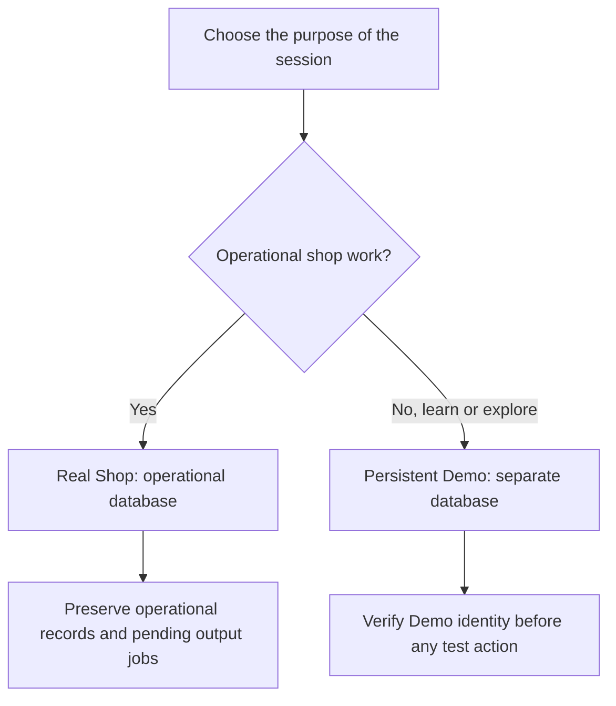
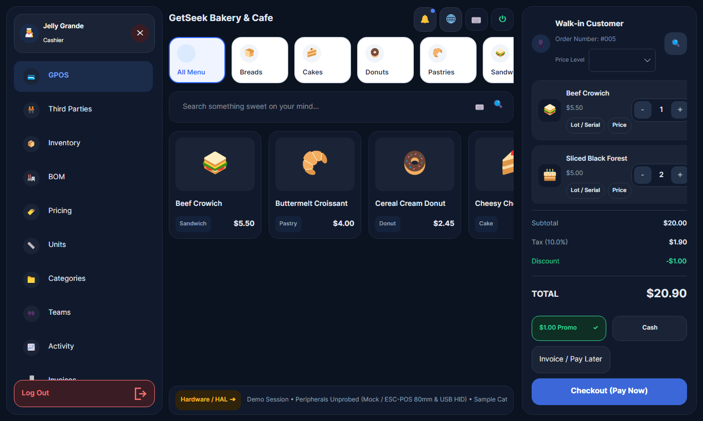

# Real Shop and Demo

DRAFT · source review 18 October 2026 · documentation foundation D02

Real Shop and persistent Demo use separate files under the current Windows user's LocalAppData. Choose the workspace deliberately; a copied source folder does not contain the default operational databases.

| Workspace | Default desktop data | Selection |
| --- | --- | --- |
| Real Shop | `%LOCALAPPDATA%\GetSeek\getseek_pos.db` | `--real-workspace` |
| Persistent Demo | `%LOCALAPPDATA%\GetSeek\Demo\getseek_demo.db` | `--demo-workspace` |
| Legacy in-memory preview | Sample UI state rather than the persistent Demo database | `--demo` or `GETSEEK_POS_DEMO=1`, subject to explicit workspace selection |

## Choose and verify

1. Confirm the Windows user and whether existing shop data should be present.
2. Use an explicit workspace selection when checking a move or investigating unexpected data.
3. Verify the workspace shown by the application before entering transactions or changing settings.
4. Use synthetic Demo data for documentation images and demonstrations.

Supply one explicit workspace selector. If both `--real-workspace` and `--demo-workspace` are provided, the current App code selects persistent Demo; this ambiguity is tracked in [PP-REV-001](../review/decisions.md#pp-rev-001).

Persistent Demo is intended to remain independent of Real Shop. The current bootstrap explicitly checks that its path does not resolve to the Real database. Source-level separation is not a newly performed reset/migration acceptance test.

## DataService has different paths

The separate DataService composition uses `%ProgramData%\GetSeek\Private\getseek_real.db` and `getseek_demo.db`. Installing that service does not prove that the desktop has switched to service-owned storage. See [application architecture](../development/index.md#storage-boundaries).

## Historical Demo view

<figure markdown>

<figcaption>Historical legacy Demo capture; original capture date is not recorded. Reviewed 18 October 2026. The Demo Session footer and sample products match source defaults. Screen labels and amounts are illustrative and may differ from the current application.</figcaption>
</figure>

For moving existing data, use a stopped-writer transfer procedure and verify Real and Demo independently. A live database file copy and a source-folder copy must not be described as a newly verified backup or installer.
