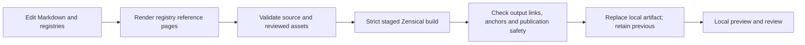

# Documentation operations

<div class="meta">DRAFT · source review 18 October 2026 · documentation foundation D02</div>

The documentation repository is independent of the application and the Restaurant documentation system. Builds use only this repository's Markdown, reviewed assets, registries, pinned dependencies and scripts.

## Local environment

The current dependency lock targets **Windows x64, CPython 3.13**, and **Zensical 0.0.71**. It contains exact transitive versions and wheel hashes. To initialize a new checkout, supply the actual interpreter path:

```powershell
.\scripts\Initialize-Environment.ps1 -PythonPath 'C:\Path\To\Python313\python.exe'
.\scripts\Check-Environment.ps1
```

The initialization command refuses to overwrite an existing environment. Other operating systems/Python versions need a reviewed lock; do not remove hash verification as a workaround.

## Build, validate and preview

```powershell
.\scripts\Build-Docs.ps1
.\scripts\Validate-Docs.ps1
.\scripts\Test-Docs.ps1
.\scripts\Preview-Docs.ps1
```

The preview runs in the foreground at `http://127.0.0.1:18181/`; Ctrl+C stops that invocation. `Start-Preview.ps1` can start the same preview hidden with an ownership record and logs; `Stop-Preview.ps1` checks process identity before stopping the recorded process tree.



Build output lives in `.build/site`; preview output is separate in `.build/preview`. Failed validation does not replace the previous local artifact. The build manifest records input/output digests, runtime versions and build time. Validation rejects a stale or modified artifact.

## Reserved infrastructure

| Component | Loopback port | D02 state |
| --- | ---: | --- |
| Caddy origin | 18180 | Reserved; not started. |
| Zensical preview | 18181 | Local preview only. |
| Caddy admin | 18182 | Reserved; not started. |
| Tunnel metrics | 18183 | Reserved; no new tunnel. |

Public deployment remains disabled. The user selected GitHub Pages at `getseek/pos` for a later deployment, superseding the planned Premium Caddy/Tunnel runtime, then instructed that local documentation be completed first. The GitHub workflow is prepared locally and inactive; no push, Pages setup or DNS change has occurred. The reserved ports above are retained as historical isolation settings. Existing Restaurant hosting remains separate.

## Troubleshooting this project

| Symptom | Action |
| --- | --- |
| Missing `.venv` | Initialize with an explicit CPython 3.13 interpreter and the committed lock. |
| Preview port occupied | Inspect the owner. Do not stop an unknown process or select a Restaurant port. |
| Asset digest mismatch | Review the actual changed asset and update its review record deliberately. |
| Stale generated reference | Run `scripts/render_registry.py`; review source-of-truth JSON changes. |
| Missing link/anchor | Repair the referenced path or heading, then rebuild. |
| Stale build | Rebuild after source/configuration/registry changes. |
| Failed build | Read the error; the previous `.build/site` is retained. |

All registered pages are checked for search-index coverage. Diagram rendering uses a locally vendored, integrity-checked Mermaid 11.17.2 asset and license. The [review methodology](../review/method.md) describes its independent source snapshot and diagram limits.

Relevant upstream references: [Zensical build](https://zensical.org/docs/usage/build/), [navigation](https://zensical.org/docs/setup/navigation/), [Caddy static files](https://caddyserver.com/docs/quick-starts/static-files), and [Cloudflare Tunnel configuration](https://developers.cloudflare.com/tunnel/features/locally-managed-tunnels/configuration-file/).
