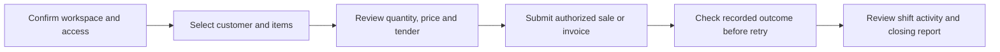
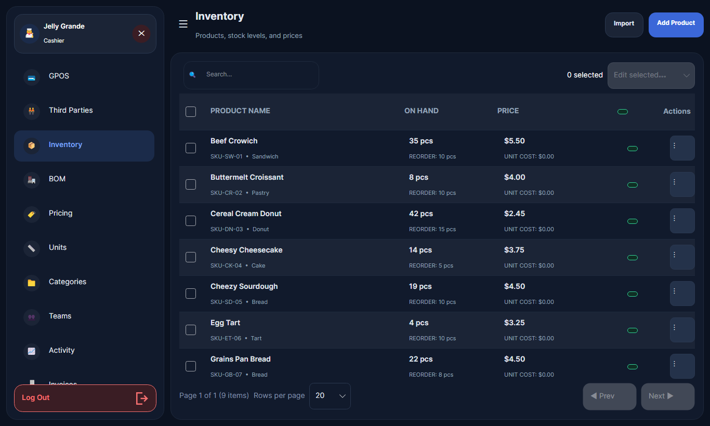

# Daily workflows

DRAFT · source review 18 October 2026 · documentation foundation D02

Use the business task to choose a starting point. The source contains entry points for the areas below; the detailed step-by-step manuals and journey checks remain D03 work. Review the [feature evidence](../reference/feature-status.md) before treating a capability as accepted.

The [complete source review atlas](../review/index.md) now expands these workflow groups with command routing, exact source locations, direct table effects, failure codes and proposed change choices. These review maps do not replace the still-pending operator task manuals.

## Cashier: sale to closing

| Task | Source coverage ID | What the guide must distinguish |
| --- | --- | --- |
| Pay-now checkout | PP-F004 | Cart review, authoritative totals and cash/manual QR/bank evidence. |
| Invoice or pay later | PP-F005 | Issuing an invoice versus recording payment and remaining due. |
| Return/refund | PP-F006 | Original sale linkage, eligibility, stock effect and money effect. |
| Drawer/shift close | PP-F007 | Active shift, blind count, discrepancy authority and frozen Z-report. |
| Orders and tables | PP-F020 | Current Cafe is pay-now Counter Service; backend/legacy order handlers and unconsumed kitchen jobs are mapped separately. |

Before retrying a payment or output action, inspect the recorded outcome and its identifiers. A timeout, queued job or displayed receipt does not establish an external bank transfer or physical print result.

## Stock controller and production

Catalog/UOM setup (PP-F008), intake and adjustment (PP-F009), waste/loss (PP-F010), pricing (PP-F011), manufacturing (PP-F012) and workbook imports (PP-F014) have separate source entry points. Virtual sales kits and manufacturing BOM output must be described as different workflows.

<figure markdown>

<figcaption>Historical Demo inventory capture, reviewed 18 October 2026; sample products match the legacy Demo source. It illustrates the workspace, not the latest stock controls or a verified stock transaction.</figcaption>
</figure>

## People and money

Third parties (PP-F013), Teams (PP-F015), salary (PP-F016) and operating expenses (PP-F017) need distinct permissions and confidentiality treatment. Creating a record and paying it are separate actions. Historical payroll/expense test evidence is summarized in [verification and limits](../reference/verification.md).

Managers and administrators can use the [role map](../administration/index.md) to locate configuration, access and hardware responsibilities.
