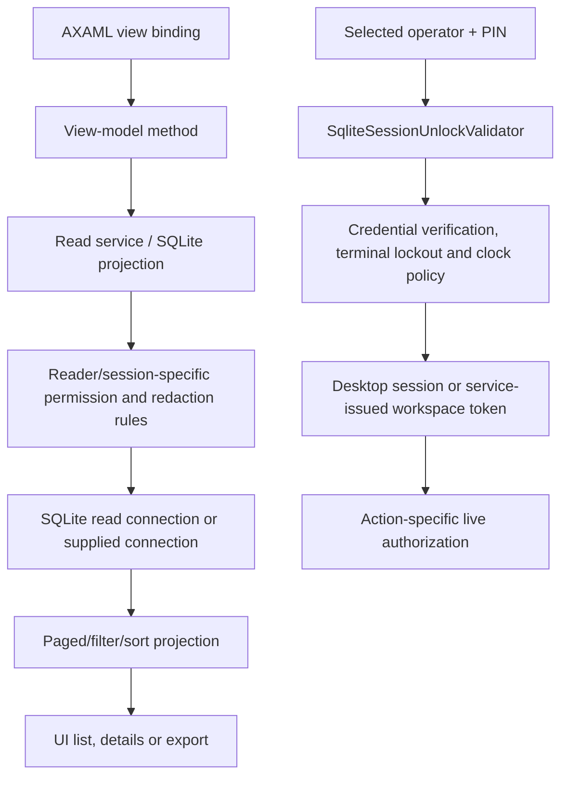

# Access, reads and first-run exceptions

DRAFT · code snapshot 18 October 2026 · source review, not runtime acceptance

## Read and authentication paths

Reads do not automatically run through CommandPipeline. Authorization must be inspected in each reader and caller. A visible or disabled UI control alone does not establish server-side permission enforcement.

## Explicit exceptions to the normal write pipeline

| Path | Observed ownership | Review requirement |
| --- | --- | --- |
| First administrator | Desktop view model and service router invoke UserCommandHandler in their own transaction and append a sanitized audit record. The handler rejects setup after users exist. | Review simultaneous first-run requests and rollback; an authenticated normal session cannot be assumed before setup. |
| Workspace reset and Demo seeding | Dedicated infrastructure service and migration/seeding paths. | Separate authorization, workspace classification, transaction and lifecycle review; no reset executed here. |
| Expense photo preparation and reads | Separate image preparation and permission-checked read service; the command handler stores versioned image bytes in SQLite. | Review image validation, authorization, attachment replacement and transactional BLOB writes. See [source-checked rules](source-check.md). |
| Search usage and output worker | Infrastructure-maintained state outside the ordinary business command caller. | Review their explicit lifecycle, permissions and diagnostic paths. |

The source catalogues expose all methods and literal table references so these paths can be inspected without inventing a universal write guarantee.

## Permission constants

| Constant | Permission value | Declaration |
| --- | --- | --- |
| <code>ReadShipping</code> | <code>pos.shipping.read</code> | [User.cs:18](code-domain.md#src-e893c6c105b0) |
| <code>CancelOrderInvoice</code> | <code>pos.invoices.cancel</code> | [User.cs:19](code-domain.md#src-e893c6c105b0) |
| <code>RequestReturnShipment</code> | <code>pos.shipping.return.request</code> | [User.cs:20](code-domain.md#src-e893c6c105b0) |
| <code>ReceiveReturnShipment</code> | <code>pos.shipping.return.receive</code> | [User.cs:21](code-domain.md#src-e893c6c105b0) |
| <code>DispatchShipping</code> | <code>pos.shipping.dispatch</code> | [User.cs:22](code-domain.md#src-e893c6c105b0) |
| <code>UpdateShipping</code> | <code>pos.shipping.update</code> | [User.cs:23](code-domain.md#src-e893c6c105b0) |
| <code>ReadPurchases</code> | <code>pos.purchases.read</code> | [User.cs:24](code-domain.md#src-e893c6c105b0) |
| <code>IssuePurchase</code> | <code>pos.purchases.issue</code> | [User.cs:25](code-domain.md#src-e893c6c105b0) |
| <code>ReceivePurchase</code> | <code>pos.purchases.receive</code> | [User.cs:26](code-domain.md#src-e893c6c105b0) |
| <code>PayPurchase</code> | <code>pos.purchases.pay</code> | [User.cs:27](code-domain.md#src-e893c6c105b0) |
| <code>ReturnPurchase</code> | <code>pos.purchases.return</code> | [User.cs:28](code-domain.md#src-e893c6c105b0) |
| <code>ReadMoney</code> | <code>pos.money.read</code> | [User.cs:29](code-domain.md#src-e893c6c105b0) |
| <code>ManageMoney</code> | <code>pos.money.manage</code> | [User.cs:30](code-domain.md#src-e893c6c105b0) |
| <code>TransferMoney</code> | <code>pos.money.transfer</code> | [User.cs:31](code-domain.md#src-e893c6c105b0) |
| <code>IssueInvoice</code> | <code>pos.invoices.issue</code> | [User.cs:32](code-domain.md#src-e893c6c105b0) |
| <code>CollectInvoice</code> | <code>pos.invoices.collect</code> | [User.cs:33](code-domain.md#src-e893c6c105b0) |
| <code>ViewInvoices</code> | <code>pos.invoices.view</code> | [User.cs:34](code-domain.md#src-e893c6c105b0) |
| <code>ResolveInspection</code> | <code>pos.returns.inspection.resolve</code> | [User.cs:35](code-domain.md#src-e893c6c105b0) |
| <code>AdjustReturnCredit</code> | <code>pos.returns.credit.adjust</code> | [User.cs:36](code-domain.md#src-e893c6c105b0) |
| <code>RecordCashLoss</code> | <code>pos.cash.loss.record</code> | [User.cs:37](code-domain.md#src-e893c6c105b0) |
| <code>CorrectCashLoss</code> | <code>pos.cash.loss.correct</code> | [User.cs:38](code-domain.md#src-e893c6c105b0) |
| <code>CheckoutSale</code> | <code>pos.sale.checkout</code> | [User.cs:39](code-domain.md#src-e893c6c105b0) |
| <code>OverrideSalePrice</code> | <code>pos.sale.price_override</code> | [User.cs:40](code-domain.md#src-e893c6c105b0) |
| <code>ApplyDiscount</code> | <code>pos.sale.discount</code> | [User.cs:41](code-domain.md#src-e893c6c105b0) |
| <code>VoidLine</code> | <code>pos.sale.void_line</code> | [User.cs:42](code-domain.md#src-e893c6c105b0) |
| <code>RefundSale</code> | <code>pos.sale.refund</code> | [User.cs:43](code-domain.md#src-e893c6c105b0) |
| <code>OpenShift</code> | <code>pos.shift.open</code> | [User.cs:44](code-domain.md#src-e893c6c105b0) |
| <code>CloseShift</code> | <code>pos.shift.close</code> | [User.cs:45](code-domain.md#src-e893c6c105b0) |
| <code>CashMovement</code> | <code>pos.shift.cash_movement</code> | [User.cs:46](code-domain.md#src-e893c6c105b0) |
| <code>AdjustStock</code> | <code>pos.inventory.adjust</code> | [User.cs:47](code-domain.md#src-e893c6c105b0) |
| <code>ReceiveStock</code> | <code>pos.inventory.receive</code> | [User.cs:48](code-domain.md#src-e893c6c105b0) |
| <code>ViewReports</code> | <code>pos.reports.view</code> | [User.cs:49](code-domain.md#src-e893c6c105b0) |
| <code>ReadReport</code> | <code>pos.report.read</code> | [User.cs:50](code-domain.md#src-e893c6c105b0) |
| <code>ViewAudit</code> | <code>pos.audit.view</code> | [User.cs:51](code-domain.md#src-e893c6c105b0) |
| <code>SupervisorElevate</code> | <code>pos.security.elevate</code> | [User.cs:52](code-domain.md#src-e893c6c105b0) |
| <code>ManageSettings</code> | <code>pos.system.settings</code> | [User.cs:53](code-domain.md#src-e893c6c105b0) |
| <code>ManageLicense</code> | <code>pos.license.manage</code> | [User.cs:54](code-domain.md#src-e893c6c105b0) |
| <code>ManageBackup</code> | <code>pos.backup.manage</code> | [User.cs:55](code-domain.md#src-e893c6c105b0) |
| <code>ManageTeams</code> | <code>pos.teams.manage</code> | [User.cs:56](code-domain.md#src-e893c6c105b0) |
| <code>ManageCatalog</code> | <code>pos.catalog.manage</code> | [User.cs:57](code-domain.md#src-e893c6c105b0) |
| <code>ConfigurePayments</code> | <code>pos.payments.configure</code> | [User.cs:58](code-domain.md#src-e893c6c105b0) |
| <code>ManageCustomers</code> | <code>pos.customers.manage</code> | [User.cs:59](code-domain.md#src-e893c6c105b0) |
| <code>ViewCustomers</code> | <code>pos.customers.view</code> | [User.cs:60](code-domain.md#src-e893c6c105b0) |
| <code>ManagePermissions</code> | <code>pos.security.permissions.manage</code> | [User.cs:61](code-domain.md#src-e893c6c105b0) |
| <code>ClassifyInventory</code> | <code>pos.inventory.classify</code> | [User.cs:62](code-domain.md#src-e893c6c105b0) |
| <code>ShiftRead</code> | <code>pos.shift.read</code> | [User.cs:63](code-domain.md#src-e893c6c105b0) |
| <code>ActivityRead</code> | <code>pos.activity.read</code> | [User.cs:64](code-domain.md#src-e893c6c105b0) |
| <code>SalaryRead</code> | <code>pos.salary.read</code> | [User.cs:66](code-domain.md#src-e893c6c105b0) |
| <code>SalaryManage</code> | <code>pos.salary.manage</code> | [User.cs:67](code-domain.md#src-e893c6c105b0) |
| <code>SalaryPay</code> | <code>pos.salary.pay</code> | [User.cs:68](code-domain.md#src-e893c6c105b0) |
| <code>SalaryAdjust</code> | <code>pos.salary.adjust</code> | [User.cs:69](code-domain.md#src-e893c6c105b0) |
| <code>ExpensesRead</code> | <code>pos.expenses.read</code> | [User.cs:71](code-domain.md#src-e893c6c105b0) |
| <code>ExpensesManage</code> | <code>pos.expenses.manage</code> | [User.cs:72](code-domain.md#src-e893c6c105b0) |
| <code>ExpensesPay</code> | <code>pos.expenses.pay</code> | [User.cs:73](code-domain.md#src-e893c6c105b0) |
| <code>ExpensesReverse</code> | <code>pos.expenses.reverse</code> | [User.cs:74](code-domain.md#src-e893c6c105b0) |

Each workflow lists the command-declared RequiredPermission/AdditionalPermissions/RequiredModule expressions. These are declarations, not a computed role matrix. Permission resolution, overrides and handler-specific checks can add conditions.
