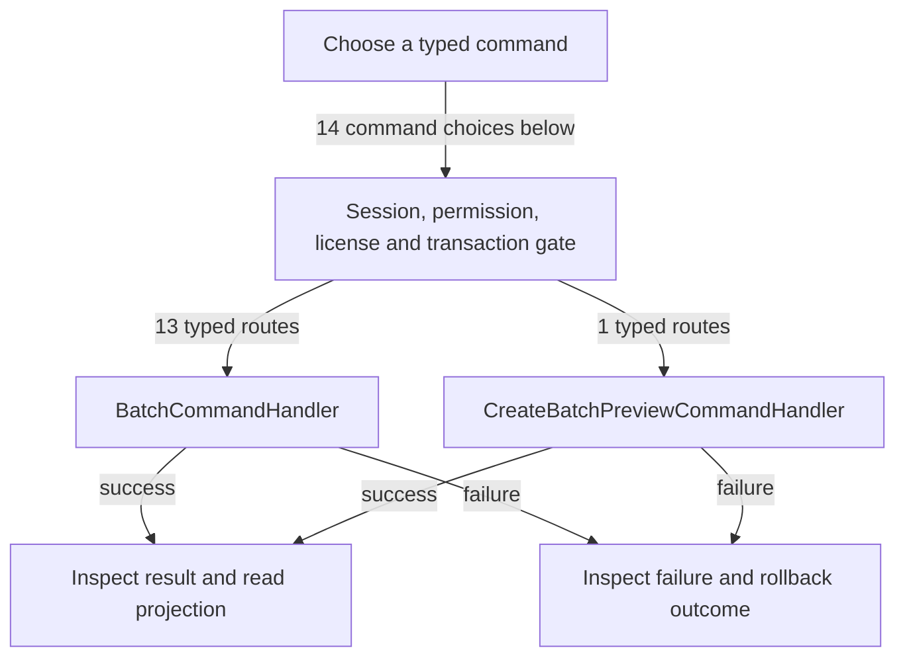

# Batch previews and master-data changes

DRAFT · code snapshot 20 October 2026 · source review and targeted automated checks

Feature coverage: PP-F025. Source: [BatchCommandHandler.cs:1](code-application.md#src-c097cf593496), [BatchPreview.cs:1](code-application.md#src-6d6431af2d8b).

## Step-by-step review route

The numbered route is a business review checklist. Branches are separate actions; it does not imply that all actions occur in one transaction.

1. Choose entity scope and requested change.
2. Create a durable preview.
3. Review selected entities and versions.
4. Submit the matching authorized batch command.
5. Validate preview and per-entity constraints.
6. Read applied and rejected batch outcomes.

## Command routing map

This overview groups routes by handler to stay readable; each named command and its connections follow below. [Shared gate details](pipeline.md) apply when this handler is invoked through the pipeline. First-run provisioning is an explicit [separate path](access.md). Source construction sites show candidates, not proof of a connected or reachable UI path.

## Commands, options and implementation connections

### BatchAssignItemCategoryCommand

Handler: [BatchCommandHandler](code-application.md#src-c097cf593496). Result type: <code>BatchResult</code>.

Declaration: [BatchCommands.cs:16](code-application.md#src-417825b8e887). <code>RequiredPermission = Permissions.ManageCatalog</code>

Construction sites: [ConfirmSelectedBatchAsync:439](code-desktop.md#src-3f4385d56088)

Handler method: [BatchCommandHandler.HandleAsync(BatchAssignItemCategoryCommand,CommandEnvelope&lt;BatchAssignItemCategoryCommand&gt;,CancellationToken)](code-application.md#m-1536789d0047).

Same-owner helper candidates: [BatchCommandHandler.ValidatePreviewAsync(BatchSelectionScope,BatchPreviewTarget,string,bool?,string?,Guid,DateTime,CancellationToken,string?,string?)](code-application.md#m-0831dacd53c6), [BatchCommandHandler.AddParam(DbCommand,string,object)](code-application.md#m-3464348508fd), [BatchCommandHandler.Chunk(List&lt;T&gt;,int)](code-application.md#m-3a89faf69339), [BatchCommandHandler.BuildInClause(DbCommand,IEnumerable&lt;string&gt;,string)](code-application.md#m-3d6d97138c8a), [BatchCommandHandler.ConsumePreviewAsync(Guid,string,DateTime,CancellationToken)](code-application.md#m-71d2543de647). These are unqualified/this-call name matches, including possible overloads; semantic binding was not performed.

| Direct method syntax | Extracted references |
| --- | --- |
| Reads | <code>product_categories</code> |
| Writes / DDL | None extracted directly; inspect helpers and dynamic paths. |
| Literal failure codes | <code>CATEGORY_INACTIVE</code> |

Helper calls, table references in helpers, and throw sites are listed in the method catalogue. This table is not a transitive effect analysis.

### BatchAssignItemPurposeCommand

Handler: [BatchCommandHandler](code-application.md#src-c097cf593496). Result type: <code>BatchResult</code>.

Declaration: [BatchCommands.cs:24](code-application.md#src-417825b8e887). <code>RequiredPermission = Permissions.ManageCatalog</code>

Construction sites: [ConfirmSelectedBatchAsync:450](code-desktop.md#src-3f4385d56088)

Handler method: [BatchCommandHandler.HandleAsync(BatchAssignItemPurposeCommand,CommandEnvelope&lt;BatchAssignItemPurposeCommand&gt;,CancellationToken)](code-application.md#m-2a12d4cac844).

Same-owner helper candidates: [BatchCommandHandler.ValidatePreviewAsync(BatchSelectionScope,BatchPreviewTarget,string,bool?,string?,Guid,DateTime,CancellationToken,string?,string?)](code-application.md#m-0831dacd53c6), [BatchCommandHandler.ContainsActiveKitParentAsync(DbConnection,DbTransaction?,List&lt;string&gt;,CancellationToken)](code-application.md#m-7a934b57d0b6), [BatchCommandHandler.Chunk(List&lt;T&gt;,int)](code-application.md#m-3a89faf69339), [BatchCommandHandler.BuildInClause(DbCommand,IEnumerable&lt;string&gt;,string)](code-application.md#m-3d6d97138c8a), [BatchCommandHandler.AddParam(DbCommand,string,object)](code-application.md#m-3464348508fd), [BatchCommandHandler.ConsumePreviewAsync(Guid,string,DateTime,CancellationToken)](code-application.md#m-71d2543de647). These are unqualified/this-call name matches, including possible overloads; semantic binding was not performed.

| Direct method syntax | Extracted references |
| --- | --- |
| Reads | None extracted directly; inspect helpers and dynamic paths. |
| Writes / DDL | None extracted directly; inspect helpers and dynamic paths. |
| Literal failure codes | <code>INVALID_PRODUCT_PURPOSE</code>, <code>KIT_PURPOSE_INVALID</code> |

Helper calls, table references in helpers, and throw sites are listed in the method catalogue. This table is not a transitive effect analysis.

### BatchAssignThirdPartyCategoryCommand

Handler: [BatchCommandHandler](code-application.md#src-c097cf593496). Result type: <code>BatchResult</code>.

Declaration: [BatchCommands.cs:40](code-application.md#src-417825b8e887). <code>RequiredPermission = Permissions.ManageCustomers</code>

Construction sites: **None found** among explicit `new Type(...)` expressions. Target-typed construction, factories and runtime dispatch are not resolved.

Handler method: [BatchCommandHandler.HandleAsync(BatchAssignThirdPartyCategoryCommand,CommandEnvelope&lt;BatchAssignThirdPartyCategoryCommand&gt;,CancellationToken)](code-application.md#m-b9355154b74c).

Same-owner helper candidates: [BatchCommandHandler.ValidatePreviewAsync(BatchSelectionScope,BatchPreviewTarget,string,bool?,string?,Guid,DateTime,CancellationToken,string?,string?)](code-application.md#m-0831dacd53c6), [BatchCommandHandler.ContainsSystemWalkInAsync(DbConnection,DbTransaction?,List&lt;string&gt;,CancellationToken)](code-application.md#m-691d131c742e), [BatchCommandHandler.Chunk(List&lt;T&gt;,int)](code-application.md#m-3a89faf69339), [BatchCommandHandler.BuildInClause(DbCommand,IEnumerable&lt;string&gt;,string)](code-application.md#m-3d6d97138c8a), [BatchCommandHandler.AddParam(DbCommand,string,object)](code-application.md#m-3464348508fd), [BatchCommandHandler.ConsumePreviewAsync(Guid,string,DateTime,CancellationToken)](code-application.md#m-71d2543de647). These are unqualified/this-call name matches, including possible overloads; semantic binding was not performed.

| Direct method syntax | Extracted references |
| --- | --- |
| Reads | None extracted directly; inspect helpers and dynamic paths. |
| Writes / DDL | None extracted directly; inspect helpers and dynamic paths. |
| Literal failure codes | <code>SYSTEM_WALK_IN_PROTECTED</code> |

Helper calls, table references in helpers, and throw sites are listed in the method catalogue. This table is not a transitive effect analysis.

### BatchAssignThirdPartyPriceLevelCommand

Handler: [BatchCommandHandler](code-application.md#src-c097cf593496). Result type: <code>BatchResult</code>.

Declaration: [BatchCommands.cs:48](code-application.md#src-417825b8e887). <code>RequiredPermission = Permissions.ManageCustomers</code>

Construction sites: [ConfirmSelectedBatchAsync:428](code-desktop.md#src-3f4385d56088)

Handler method: [BatchCommandHandler.HandleAsync(BatchAssignThirdPartyPriceLevelCommand,CommandEnvelope&lt;BatchAssignThirdPartyPriceLevelCommand&gt;,CancellationToken)](code-application.md#m-e6ad5045d4b3).

Same-owner helper candidates: [BatchCommandHandler.ValidatePreviewAsync(BatchSelectionScope,BatchPreviewTarget,string,bool?,string?,Guid,DateTime,CancellationToken,string?,string?)](code-application.md#m-0831dacd53c6), [BatchCommandHandler.ContainsSystemWalkInAsync(DbConnection,DbTransaction?,List&lt;string&gt;,CancellationToken)](code-application.md#m-691d131c742e), [BatchCommandHandler.AddParam(DbCommand,string,object)](code-application.md#m-3464348508fd), [BatchCommandHandler.Chunk(List&lt;T&gt;,int)](code-application.md#m-3a89faf69339), [BatchCommandHandler.BuildInClause(DbCommand,IEnumerable&lt;string&gt;,string)](code-application.md#m-3d6d97138c8a), [BatchCommandHandler.ConsumePreviewAsync(Guid,string,DateTime,CancellationToken)](code-application.md#m-71d2543de647). These are unqualified/this-call name matches, including possible overloads; semantic binding was not performed.

| Direct method syntax | Extracted references |
| --- | --- |
| Reads | <code>price_level_settings</code> |
| Writes / DDL | None extracted directly; inspect helpers and dynamic paths. |
| Literal failure codes | <code>INVALID_PRICE_LEVEL</code>, <code>SYSTEM_WALK_IN_PROTECTED</code> |

Helper calls, table references in helpers, and throw sites are listed in the method catalogue. This table is not a transitive effect analysis.

### BatchCancelBomDraftsCommand

Handler: [BatchCommandHandler](code-application.md#src-c097cf593496). Result type: <code>BatchResult</code>.

Declaration: [BatchCommands.cs:64](code-application.md#src-417825b8e887). <code>RequiredPermission = Permissions.ManageCatalog</code>

Construction sites: **None found** among explicit `new Type(...)` expressions. Target-typed construction, factories and runtime dispatch are not resolved.

Handler method: [BatchCommandHandler.HandleAsync(BatchCancelBomDraftsCommand,CommandEnvelope&lt;BatchCancelBomDraftsCommand&gt;,CancellationToken)](code-application.md#m-c13a520aab91).

Same-owner helper candidates: [BatchCommandHandler.ValidatePreviewAsync(BatchSelectionScope,BatchPreviewTarget,string,bool?,string?,Guid,DateTime,CancellationToken,string?,string?)](code-application.md#m-0831dacd53c6), [BatchCommandHandler.BuildInClause(DbCommand,IEnumerable&lt;string&gt;,string)](code-application.md#m-3d6d97138c8a), [BatchCommandHandler.Chunk(List&lt;T&gt;,int)](code-application.md#m-3a89faf69339), [BatchCommandHandler.ConsumePreviewAsync(Guid,string,DateTime,CancellationToken)](code-application.md#m-71d2543de647). These are unqualified/this-call name matches, including possible overloads; semantic binding was not performed.

| Direct method syntax | Extracted references |
| --- | --- |
| Reads | None extracted directly; inspect helpers and dynamic paths. |
| Writes / DDL | None extracted directly; inspect helpers and dynamic paths. |
| Literal failure codes | <code>BOM_NOT_DRAFT</code> |

Helper calls, table references in helpers, and throw sites are listed in the method catalogue. This table is not a transitive effect analysis.

### BatchDeleteCategoryDefinitionsCommand

Handler: [BatchCommandHandler](code-application.md#src-c097cf593496). Result type: <code>BatchResult</code>.

Declaration: [BatchCommands.cs:92](code-application.md#src-417825b8e887). <code>RequiredPermission = Permissions.ManageCatalog</code>

Construction sites: [ConfirmSelectedBatchAsync:373](code-desktop.md#src-3f4385d56088)

Handler method: [BatchCommandHandler.HandleAsync(BatchDeleteCategoryDefinitionsCommand,CommandEnvelope&lt;BatchDeleteCategoryDefinitionsCommand&gt;,CancellationToken)](code-application.md#m-8296ae07e6a7).

Same-owner helper candidates: [BatchCommandHandler.IsActiveAdminAsync(DbConnection,DbTransaction?,Guid,CancellationToken)](code-application.md#m-80112fe4c253), [BatchCommandHandler.ValidatePreviewAsync(BatchSelectionScope,BatchPreviewTarget,string,bool?,string?,Guid,DateTime,CancellationToken,string?,string?)](code-application.md#m-0831dacd53c6), [BatchCommandHandler.Chunk(List&lt;T&gt;,int)](code-application.md#m-3a89faf69339), [BatchCommandHandler.BuildInClause(DbCommand,IEnumerable&lt;string&gt;,string)](code-application.md#m-3d6d97138c8a), [BatchCommandHandler.ConsumePreviewAsync(Guid,string,DateTime,CancellationToken)](code-application.md#m-71d2543de647). These are unqualified/this-call name matches, including possible overloads; semantic binding was not performed.

| Direct method syntax | Extracted references |
| --- | --- |
| Reads | None extracted directly; inspect helpers and dynamic paths. |
| Writes / DDL | None extracted directly; inspect helpers and dynamic paths. |
| Literal failure codes | <code>ADMIN_REQUIRED</code>, <code>BATCH_SELECTION_STALE</code>, <code>CATEGORY_BUILTIN</code>, <code>CATEGORY_IN_USE</code> |

Helper calls, table references in helpers, and throw sites are listed in the method catalogue. This table is not a transitive effect analysis.

### BatchDeleteUnitDefinitionsCommand

Handler: [BatchCommandHandler](code-application.md#src-c097cf593496). Result type: <code>BatchResult</code>.

Declaration: [BatchCommands.cs:87](code-application.md#src-417825b8e887). <code>RequiredPermission = Permissions.ManageCatalog</code>

Construction sites: [ConfirmSelectedBatchAsync:362](code-desktop.md#src-3f4385d56088)

Handler method: [BatchCommandHandler.HandleAsync(BatchDeleteUnitDefinitionsCommand,CommandEnvelope&lt;BatchDeleteUnitDefinitionsCommand&gt;,CancellationToken)](code-application.md#m-a552049bc2a9).

Same-owner helper candidates: [BatchCommandHandler.IsActiveAdminAsync(DbConnection,DbTransaction?,Guid,CancellationToken)](code-application.md#m-80112fe4c253), [BatchCommandHandler.ValidatePreviewAsync(BatchSelectionScope,BatchPreviewTarget,string,bool?,string?,Guid,DateTime,CancellationToken,string?,string?)](code-application.md#m-0831dacd53c6), [BatchCommandHandler.Chunk(List&lt;T&gt;,int)](code-application.md#m-3a89faf69339), [BatchCommandHandler.BuildInClause(DbCommand,IEnumerable&lt;string&gt;,string)](code-application.md#m-3d6d97138c8a), [BatchCommandHandler.ConsumePreviewAsync(Guid,string,DateTime,CancellationToken)](code-application.md#m-71d2543de647). These are unqualified/this-call name matches, including possible overloads; semantic binding was not performed.

| Direct method syntax | Extracted references |
| --- | --- |
| Reads | None extracted directly; inspect helpers and dynamic paths. |
| Writes / DDL | None extracted directly; inspect helpers and dynamic paths. |
| Literal failure codes | <code>ADMIN_REQUIRED</code>, <code>BATCH_SELECTION_STALE</code>, <code>UOM_BUILTIN</code>, <code>UOM_DEFINITION_IN_USE</code> |

Helper calls, table references in helpers, and throw sites are listed in the method catalogue. This table is not a transitive effect analysis.

### BatchUpdateCategoryStatusCommand

Handler: [BatchCommandHandler](code-application.md#src-c097cf593496). Result type: <code>BatchResult</code>.

Declaration: [BatchCommands.cs:79](code-application.md#src-417825b8e887). <code>RequiredPermission = Permissions.ManageCatalog</code>

Construction sites: [ConfirmSelectedBatchAsync:395](code-desktop.md#src-3f4385d56088)

Handler method: [BatchCommandHandler.HandleAsync(BatchUpdateCategoryStatusCommand,CommandEnvelope&lt;BatchUpdateCategoryStatusCommand&gt;,CancellationToken)](code-application.md#m-4fb69efebb75).

Same-owner helper candidates: [BatchCommandHandler.IsActiveAdminAsync(DbConnection,DbTransaction?,Guid,CancellationToken)](code-application.md#m-80112fe4c253), [BatchCommandHandler.ValidatePreviewAsync(BatchSelectionScope,BatchPreviewTarget,string,bool?,string?,Guid,DateTime,CancellationToken,string?,string?)](code-application.md#m-0831dacd53c6), [BatchCommandHandler.BuildInClause(DbCommand,IEnumerable&lt;string&gt;,string)](code-application.md#m-3d6d97138c8a), [BatchCommandHandler.Chunk(List&lt;T&gt;,int)](code-application.md#m-3a89faf69339), [BatchCommandHandler.AddParam(DbCommand,string,object)](code-application.md#m-3464348508fd), [BatchCommandHandler.ConsumePreviewAsync(Guid,string,DateTime,CancellationToken)](code-application.md#m-71d2543de647). These are unqualified/this-call name matches, including possible overloads; semantic binding was not performed.

| Direct method syntax | Extracted references |
| --- | --- |
| Reads | None extracted directly; inspect helpers and dynamic paths. |
| Writes / DDL | None extracted directly; inspect helpers and dynamic paths. |
| Literal failure codes | <code>ADMIN_REQUIRED</code>, <code>CATEGORY_IN_USE</code> |

Helper calls, table references in helpers, and throw sites are listed in the method catalogue. This table is not a transitive effect analysis.

### BatchUpdateExpenseCategoryStatusCommand

Handler: [BatchCommandHandler](code-application.md#src-c097cf593496). Result type: <code>BatchResult</code>.

Declaration: [BatchCommands.cs:97](code-application.md#src-417825b8e887). <code>RequiredPermission = Permissions.ExpensesManage</code>

Construction sites: [ConfirmSelectedBatchAsync:406](code-desktop.md#src-3f4385d56088)

Handler method: [BatchCommandHandler.HandleAsync(BatchUpdateExpenseCategoryStatusCommand,CommandEnvelope&lt;BatchUpdateExpenseCategoryStatusCommand&gt;,CancellationToken)](code-application.md#m-e793003a1056).

Same-owner helper candidates: [BatchCommandHandler.ValidatePreviewAsync(BatchSelectionScope,BatchPreviewTarget,string,bool?,string?,Guid,DateTime,CancellationToken,string?,string?)](code-application.md#m-0831dacd53c6), [BatchCommandHandler.Chunk(List&lt;T&gt;,int)](code-application.md#m-3a89faf69339), [BatchCommandHandler.BuildInClause(DbCommand,IEnumerable&lt;string&gt;,string)](code-application.md#m-3d6d97138c8a), [BatchCommandHandler.AddParam(DbCommand,string,object)](code-application.md#m-3464348508fd), [BatchCommandHandler.ConsumePreviewAsync(Guid,string,DateTime,CancellationToken)](code-application.md#m-71d2543de647). These are unqualified/this-call name matches, including possible overloads; semantic binding was not performed.

| Direct method syntax | Extracted references |
| --- | --- |
| Reads | None extracted directly; inspect helpers and dynamic paths. |
| Writes / DDL | None extracted directly; inspect helpers and dynamic paths. |
| Literal failure codes | None extracted directly; inspect helpers and dynamic paths. |

Helper calls, table references in helpers, and throw sites are listed in the method catalogue. This table is not a transitive effect analysis.

### BatchUpdateItemStatusCommand

Handler: [BatchCommandHandler](code-application.md#src-c097cf593496). Result type: <code>BatchResult</code>.

Declaration: [BatchCommands.cs:8](code-application.md#src-417825b8e887). <code>RequiredPermission = Permissions.ManageCatalog</code>

Construction sites: [ConfirmSelectedBatchAsync:461](code-desktop.md#src-3f4385d56088)

Handler method: [BatchCommandHandler.HandleAsync(BatchUpdateItemStatusCommand,CommandEnvelope&lt;BatchUpdateItemStatusCommand&gt;,CancellationToken)](code-application.md#m-bf46ade28a29).

Same-owner helper candidates: [BatchCommandHandler.ValidatePreviewAsync(BatchSelectionScope,BatchPreviewTarget,string,bool?,string?,Guid,DateTime,CancellationToken,string?,string?)](code-application.md#m-0831dacd53c6), [BatchCommandHandler.Chunk(List&lt;T&gt;,int)](code-application.md#m-3a89faf69339), [BatchCommandHandler.BuildInClause(DbCommand,IEnumerable&lt;string&gt;,string)](code-application.md#m-3d6d97138c8a), [BatchCommandHandler.AddParam(DbCommand,string,object)](code-application.md#m-3464348508fd), [BatchCommandHandler.ConsumePreviewAsync(Guid,string,DateTime,CancellationToken)](code-application.md#m-71d2543de647). These are unqualified/this-call name matches, including possible overloads; semantic binding was not performed.

| Direct method syntax | Extracted references |
| --- | --- |
| Reads | None extracted directly; inspect helpers and dynamic paths. |
| Writes / DDL | None extracted directly; inspect helpers and dynamic paths. |
| Literal failure codes | None extracted directly; inspect helpers and dynamic paths. |

Helper calls, table references in helpers, and throw sites are listed in the method catalogue. This table is not a transitive effect analysis.

### BatchUpdateThirdPartyStatusCommand

Handler: [BatchCommandHandler](code-application.md#src-c097cf593496). Result type: <code>BatchResult</code>.

Declaration: [BatchCommands.cs:32](code-application.md#src-417825b8e887). <code>RequiredPermission = Permissions.ManageCustomers</code>

Construction sites: [ConfirmSelectedBatchAsync:417](code-desktop.md#src-3f4385d56088)

Handler method: [BatchCommandHandler.HandleAsync(BatchUpdateThirdPartyStatusCommand,CommandEnvelope&lt;BatchUpdateThirdPartyStatusCommand&gt;,CancellationToken)](code-application.md#m-43341c26fe29).

Same-owner helper candidates: [BatchCommandHandler.ValidatePreviewAsync(BatchSelectionScope,BatchPreviewTarget,string,bool?,string?,Guid,DateTime,CancellationToken,string?,string?)](code-application.md#m-0831dacd53c6), [BatchCommandHandler.ContainsSystemWalkInAsync(DbConnection,DbTransaction?,List&lt;string&gt;,CancellationToken)](code-application.md#m-691d131c742e), [BatchCommandHandler.Chunk(List&lt;T&gt;,int)](code-application.md#m-3a89faf69339), [BatchCommandHandler.BuildInClause(DbCommand,IEnumerable&lt;string&gt;,string)](code-application.md#m-3d6d97138c8a), [BatchCommandHandler.AddParam(DbCommand,string,object)](code-application.md#m-3464348508fd), [BatchCommandHandler.ConsumePreviewAsync(Guid,string,DateTime,CancellationToken)](code-application.md#m-71d2543de647). These are unqualified/this-call name matches, including possible overloads; semantic binding was not performed.

| Direct method syntax | Extracted references |
| --- | --- |
| Reads | None extracted directly; inspect helpers and dynamic paths. |
| Writes / DDL | None extracted directly; inspect helpers and dynamic paths. |
| Literal failure codes | <code>SYSTEM_WALK_IN_PROTECTED</code> |

Helper calls, table references in helpers, and throw sites are listed in the method catalogue. This table is not a transitive effect analysis.

### BatchUpdateUnitStatusCommand

Handler: [BatchCommandHandler](code-application.md#src-c097cf593496). Result type: <code>BatchResult</code>.

Declaration: [BatchCommands.cs:71](code-application.md#src-417825b8e887). <code>RequiredPermission = Permissions.ManageCatalog</code>

Construction sites: [ConfirmSelectedBatchAsync:384](code-desktop.md#src-3f4385d56088)

Handler method: [BatchCommandHandler.HandleAsync(BatchUpdateUnitStatusCommand,CommandEnvelope&lt;BatchUpdateUnitStatusCommand&gt;,CancellationToken)](code-application.md#m-1553251d833e).

Same-owner helper candidates: [BatchCommandHandler.IsActiveAdminAsync(DbConnection,DbTransaction?,Guid,CancellationToken)](code-application.md#m-80112fe4c253), [BatchCommandHandler.ValidatePreviewAsync(BatchSelectionScope,BatchPreviewTarget,string,bool?,string?,Guid,DateTime,CancellationToken,string?,string?)](code-application.md#m-0831dacd53c6), [BatchCommandHandler.BuildInClause(DbCommand,IEnumerable&lt;string&gt;,string)](code-application.md#m-3d6d97138c8a), [BatchCommandHandler.Chunk(List&lt;T&gt;,int)](code-application.md#m-3a89faf69339), [BatchCommandHandler.AddParam(DbCommand,string,object)](code-application.md#m-3464348508fd), [BatchCommandHandler.ConsumePreviewAsync(Guid,string,DateTime,CancellationToken)](code-application.md#m-71d2543de647). These are unqualified/this-call name matches, including possible overloads; semantic binding was not performed.

| Direct method syntax | Extracted references |
| --- | --- |
| Reads | None extracted directly; inspect helpers and dynamic paths. |
| Writes / DDL | None extracted directly; inspect helpers and dynamic paths. |
| Literal failure codes | <code>ADMIN_REQUIRED</code>, <code>UNIT_IN_USE</code> |

Helper calls, table references in helpers, and throw sites are listed in the method catalogue. This table is not a transitive effect analysis.

### BatchUpdateUserStatusCommand

Handler: [BatchCommandHandler](code-application.md#src-c097cf593496). Result type: <code>BatchResult</code>.

Declaration: [BatchCommands.cs:56](code-application.md#src-417825b8e887). <code>RequiredPermission = Permissions.ManageTeams</code>

Construction sites: **None found** among explicit `new Type(...)` expressions. Target-typed construction, factories and runtime dispatch are not resolved.

Handler method: [BatchCommandHandler.HandleAsync(BatchUpdateUserStatusCommand,CommandEnvelope&lt;BatchUpdateUserStatusCommand&gt;,CancellationToken)](code-application.md#m-15aea3888154).

Same-owner helper candidates: [BatchCommandHandler.ValidatePreviewAsync(BatchSelectionScope,BatchPreviewTarget,string,bool?,string?,Guid,DateTime,CancellationToken,string?,string?)](code-application.md#m-0831dacd53c6), [BatchCommandHandler.BuildInClause(DbCommand,IEnumerable&lt;string&gt;,string)](code-application.md#m-3d6d97138c8a), [BatchCommandHandler.Chunk(List&lt;T&gt;,int)](code-application.md#m-3a89faf69339), [BatchCommandHandler.AddParam(DbCommand,string,object)](code-application.md#m-3464348508fd), [BatchCommandHandler.ConsumePreviewAsync(Guid,string,DateTime,CancellationToken)](code-application.md#m-71d2543de647). These are unqualified/this-call name matches, including possible overloads; semantic binding was not performed.

| Direct method syntax | Extracted references |
| --- | --- |
| Reads | <code>user_roles</code>, <code>users</code> |
| Writes / DDL | None extracted directly; inspect helpers and dynamic paths. |
| Literal failure codes | <code>LAST_ADMIN_PROTECTED</code>, <code>ON_SHIFT_CASHIER_PROTECTED</code> |

Helper calls, table references in helpers, and throw sites are listed in the method catalogue. This table is not a transitive effect analysis.

### CreateBatchPreviewCommand

Handler: [CreateBatchPreviewCommandHandler](code-application.md#src-6d6431af2d8b). Result type: <code>BatchPreviewResult</code>.

Declaration: [BatchPreview.cs:51](code-application.md#src-6d6431af2d8b). <code>RequiredPermission = Target switch     {         BatchPreviewTarget.ThirdParties =&gt; Permissions.ManageCustomers,         BatchPreviewTarget.Users =&gt; Permissions.ManageTeams,         BatchPreviewTarget.ExpenseCategories =&gt; Permissions.ExpensesManage,         _ =&gt; Permissions.ManageCatalog     }</code>

Construction sites: [CreateSelectedBatchPreviewAsync:318](code-desktop.md#src-3f4385d56088), [CreateBatchPricingPreviewAsync:2421](code-desktop.md#src-974d69a1850f)

Handler method: [CreateBatchPreviewCommandHandler.HandleAsync(CreateBatchPreviewCommand,CommandEnvelope&lt;CreateBatchPreviewCommand&gt;,CancellationToken)](code-application.md#m-4de338edaddb).

| Direct method syntax | Extracted references |
| --- | --- |
| Reads | <code>price_level_settings</code>, <code>product_categories</code> |
| Writes / DDL | <code>batch_previews</code> |
| Literal failure codes | <code>BATCH_PREVIEW_REQUIRED</code>, <code>BATCH_SCOPE_MISMATCH</code>, <code>BATCH_SELECTION_STALE</code>, <code>CATEGORY_INACTIVE</code>, <code>CATEGORY_NOT_FOUND</code>, <code>INVALID_PRICE_LEVEL</code>, <code>INVALID_PRODUCT_PURPOSE</code> |

Helper calls, table references in helpers, and throw sites are listed in the method catalogue. This table is not a transitive effect analysis.

## Verification still required

No application journey was executed for this map. Use a separate synthetic test environment to verify permission denial, valid success, invalid inputs, state conflicts, cancellation, transaction rollback, retry/idempotency and the resulting projection. Add physical-device checks only where the workflow dispatches output. Preserve original financial history when reviewing corrections or reversals.
