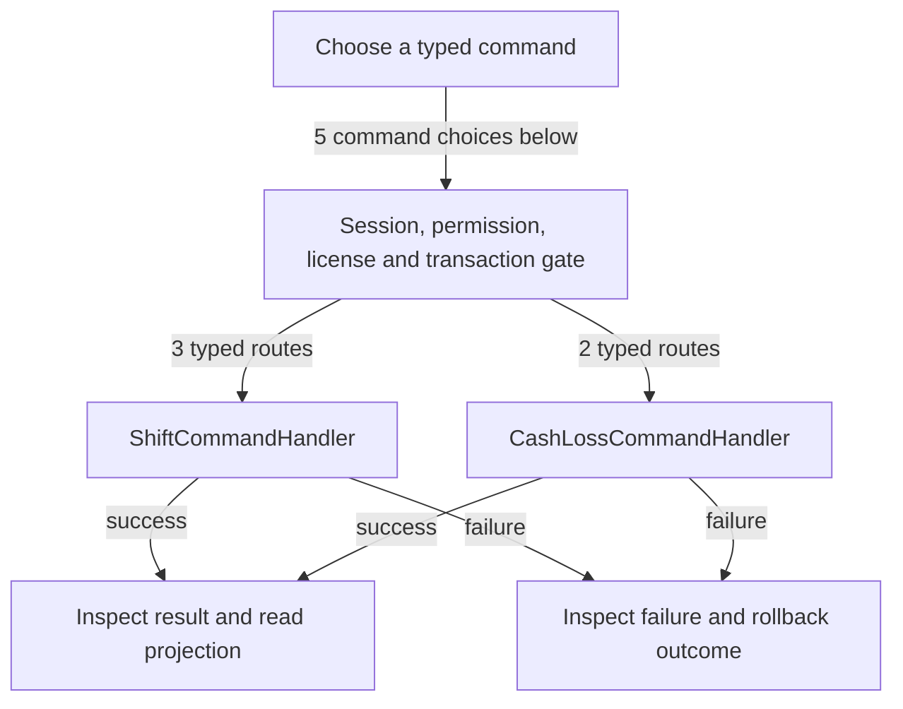

# Shifts, cash loss and reports

DRAFT · code snapshot 20 October 2026 · source review and targeted automated checks

Feature coverage: PP-F007. Source: [ShiftCommandHandler.cs:1](code-application.md#src-6edc723e3676), [CashLossCommandHandler.cs:1](code-application.md#src-77895c61e718).

## Step-by-step review route

The numbered route is a business review checklist. Branches are separate actions; it does not imply that all actions occur in one transaction.

1. Open an authorized shift.
2. Record cash movements and known losses.
3. Review activity and X-report projection.
4. Count and submit close command.
5. Validate discrepancy authority.
6. Freeze Z-report snapshot and inspect closing result.

## Command routing map

This overview groups routes by handler to stay readable; each named command and its connections follow below. [Shared gate details](pipeline.md) apply when this handler is invoked through the pipeline. First-run provisioning is an explicit [separate path](access.md). Source construction sites show candidates, not proof of a connected or reachable UI path.

## Commands, options and implementation connections

### CloseShiftCommand

Handler: [ShiftCommandHandler](code-application.md#src-6edc723e3676). Result type: <code>Shift</code>.

Declaration: [ShiftCommands.cs:29](code-application.md#src-d988e0aef61e). <code>RequiredPermission = Permissions.CloseShift</code>

Construction sites: [ConfirmCloseShiftAsync:12805](code-desktop.md#src-16497b924a99)

Handler method: [ShiftCommandHandler.HandleAsync(CloseShiftCommand,CommandEnvelope&lt;CloseShiftCommand&gt;,CancellationToken)](code-application.md#m-a6c6fe2dfdbe).

Same-owner helper candidates: [ShiftCommandHandler.AddParam(DbCommand,string,object)](code-application.md#m-5f5da613f124). These are unqualified/this-call name matches, including possible overloads; semantic binding was not performed.

| Direct method syntax | Extracted references |
| --- | --- |
| Reads | <code>cash_movements</code>, <code>invoice_collections</code>, <code>sales_invoices</code>, <code>sales_tenders</code>, <code>shifts</code> |
| Writes / DDL | <code>shift_z_reports</code>, <code>shifts</code> |
| Literal failure codes | <code>SHIFT_ALREADY_CLOSED</code>, <code>SUPERVISOR_ELEVATION_REQUIRED</code>, <code>VARIANCE_REASON_REQUIRED</code> |

Helper calls, table references in helpers, and throw sites are listed in the method catalogue. This table is not a transitive effect analysis.

### CorrectCashLossRecordCommand

Handler: [CashLossCommandHandler](code-application.md#src-77895c61e718). Result type: <code>CashLossResult</code>.

Declaration: [CashLossCommands.cs:13](code-application.md#src-7688cc0be8fa). <code>RequiredPermission = Permissions.CorrectCashLoss</code>

Construction sites: **None found** among explicit `new Type(...)` expressions. Target-typed construction, factories and runtime dispatch are not resolved.

Handler method: [CashLossCommandHandler.HandleAsync(CorrectCashLossRecordCommand,CommandEnvelope&lt;CorrectCashLossRecordCommand&gt;,CancellationToken)](code-application.md#m-0c13e8453b2f).

Same-owner helper candidates: [CashLossCommandHandler.Fail(string,string)](code-application.md#m-7b4b5cdecd02), [CashLossCommandHandler.AppendAsync(System.Data.Common.DbConnection,System.Data.Common.DbTransaction?,Guid,Guid,Guid?,CashLossKind,long,string,Guid?,Guid?,string,string,Guid,Guid,DateTime,CancellationToken)](code-application.md#m-0333da1aa4d4). These are unqualified/this-call name matches, including possible overloads; semantic binding was not performed.

| Direct method syntax | Extracted references |
| --- | --- |
| Reads | <code>cash_loss_records</code>, <code>user_roles</code>, <code>users</code> |
| Writes / DDL | None extracted directly; inspect helpers and dynamic paths. |
| Literal failure codes | None extracted directly; inspect helpers and dynamic paths. |

Helper calls, table references in helpers, and throw sites are listed in the method catalogue. This table is not a transitive effect analysis.

### OpenShiftCommand

Handler: [ShiftCommandHandler](code-application.md#src-6edc723e3676). Result type: <code>Shift</code>.

Declaration: [ShiftCommands.cs:8](code-application.md#src-d988e0aef61e). <code>RequiredPermission = Permissions.OpenShift</code>

Construction sites: [OpenShiftForStaffAsync:8722](code-desktop.md#src-16497b924a99)

Handler method: [ShiftCommandHandler.HandleAsync(OpenShiftCommand,CommandEnvelope&lt;OpenShiftCommand&gt;,CancellationToken)](code-application.md#m-a12f36e419ba).

Same-owner helper candidates: [ShiftCommandHandler.AddParam(DbCommand,string,object)](code-application.md#m-5f5da613f124). These are unqualified/this-call name matches, including possible overloads; semantic binding was not performed.

| Direct method syntax | Extracted references |
| --- | --- |
| Reads | <code>shifts</code>, <code>store_config</code>, <code>user_roles</code>, <code>users</code> |
| Writes / DDL | <code>cash_movements</code>, <code>shifts</code> |
| Literal failure codes | <code>CASHIER_INACTIVE</code>, <code>CASHIER_NOT_FOUND</code>, <code>CURRENCY_MISMATCH</code>, <code>INVALID_CASHIER_ROLE</code>, <code>INVALID_STARTING_FLOAT</code>, <code>SHIFT_ALREADY_OPEN</code> |

Helper calls, table references in helpers, and throw sites are listed in the method catalogue. This table is not a transitive effect analysis.

### RecordCashMovementCommand

Handler: [ShiftCommandHandler](code-application.md#src-6edc723e3676). Result type: <code>CashMovement</code>.

Declaration: [ShiftCommands.cs:17](code-application.md#src-d988e0aef61e). <code>RequiredPermission = Permissions.CashMovement</code>

Construction sites: **None found** among explicit `new Type(...)` expressions. Target-typed construction, factories and runtime dispatch are not resolved.

Handler method: [ShiftCommandHandler.HandleAsync(RecordCashMovementCommand,CommandEnvelope&lt;RecordCashMovementCommand&gt;,CancellationToken)](code-application.md#m-1612e5fb8c77).

Same-owner helper candidates: [ShiftCommandHandler.AddParam(DbCommand,string,object)](code-application.md#m-5f5da613f124). These are unqualified/this-call name matches, including possible overloads; semantic binding was not performed.

| Direct method syntax | Extracted references |
| --- | --- |
| Reads | <code>shifts</code> |
| Writes / DDL | <code>cash_movements</code> |
| Literal failure codes | <code>SHIFT_NOT_OPEN</code>, <code>USE_CASH_LOSS_COMMAND</code> |

Helper calls, table references in helpers, and throw sites are listed in the method catalogue. This table is not a transitive effect analysis.

### RecordKnownCashLossCommand

Handler: [CashLossCommandHandler](code-application.md#src-77895c61e718). Result type: <code>CashLossResult</code>.

Declaration: [CashLossCommands.cs:7](code-application.md#src-7688cc0be8fa). <code>RequiredPermission = Permissions.RecordCashLoss</code>

Construction sites: **None found** among explicit `new Type(...)` expressions. Target-typed construction, factories and runtime dispatch are not resolved.

Handler method: [CashLossCommandHandler.HandleAsync(RecordKnownCashLossCommand,CommandEnvelope&lt;RecordKnownCashLossCommand&gt;,CancellationToken)](code-application.md#m-372540600007).

Same-owner helper candidates: [CashLossCommandHandler.Fail(string,string)](code-application.md#m-7b4b5cdecd02), [CashLossCommandHandler.AppendAsync(System.Data.Common.DbConnection,System.Data.Common.DbTransaction?,Guid,Guid,Guid?,CashLossKind,long,string,Guid?,Guid?,string,string,Guid,Guid,DateTime,CancellationToken)](code-application.md#m-0333da1aa4d4). These are unqualified/this-call name matches, including possible overloads; semantic binding was not performed.

| Direct method syntax | Extracted references |
| --- | --- |
| Reads | <code>cash_movements</code> |
| Writes / DDL | <code>cash_movements</code> |
| Literal failure codes | None extracted directly; inspect helpers and dynamic paths. |

Helper calls, table references in helpers, and throw sites are listed in the method catalogue. This table is not a transitive effect analysis.

## Verification still required

No application journey was executed for this map. Use a separate synthetic test environment to verify permission denial, valid success, invalid inputs, state conflicts, cancellation, transaction rollback, retry/idempotency and the resulting projection. Add physical-device checks only where the workflow dispatches output. Preserve original financial history when reviewing corrections or reversals.
