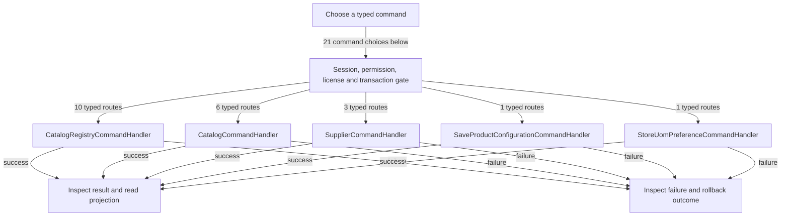

# Products, categories and units

DRAFT · code snapshot 20 October 2026 · source review and targeted automated checks

Feature coverage: PP-F008. Source: [SaveProductConfigurationCommandHandler.cs:1](code-application.md#src-c24b9e05b3b2).

## Step-by-step review route

The numbered route is a business review checklist. Branches are separate actions; it does not imply that all actions occur in one transaction.

1. Choose product, category, supplier or unit action.
2. Validate identity, lifecycle and dimensional rules.
3. Save a product configuration or registry command.
4. Reject referenced or incompatible changes.
5. Commit catalog records.
6. Reload catalog projections and affected choices.

## Command routing map

This overview groups routes by handler to stay readable; each named command and its connections follow below. [Shared gate details](pipeline.md) apply when this handler is invoked through the pipeline. First-run provisioning is an explicit [separate path](access.md). Source construction sites show candidates, not proof of a connected or reachable UI path.

## Commands, options and implementation connections

### CreateCategoryCommand

Handler: [CatalogRegistryCommandHandler](code-application.md#src-1b8d6c18449a). Result type: <code>ProductCategoryDto</code>.

Declaration: [CatalogRegistryCommands.cs:48](code-application.md#src-e1ac9f19094b). <code>RequiredPermission = Permissions.ManageCatalog</code>

Construction sites: [SaveManagedCategoryAsync:11585](code-desktop.md#src-16497b924a99)

Handler method: [CatalogRegistryCommandHandler.HandleAsync(CreateCategoryCommand,CommandEnvelope&lt;CreateCategoryCommand&gt;,CancellationToken)](code-application.md#m-d66f4c4edaeb).

Same-owner helper candidates: [CatalogRegistryCommandHandler.IsActiveAdminAsync(DbConnection,DbTransaction?,Guid,CancellationToken)](code-application.md#m-0914bdc622e8), [CatalogRegistryCommandHandler.NormalizeProfileScope(string?)](code-application.md#m-bef0dc027383), [CatalogRegistryCommandHandler.CategoryCodeExistsAsync(DbConnection,DbTransaction?,string,Guid?,CancellationToken)](code-application.md#m-f7b205f98ddf), [CatalogRegistryCommandHandler.CategoryNameExistsAsync(DbConnection,DbTransaction?,string,Guid?,CancellationToken)](code-application.md#m-d9df5a0fcb63), [CatalogRegistryCommandHandler.NormalizeTargetType(string?)](code-application.md#m-2db79d1419fd), [CatalogRegistryCommandHandler.AddParam(DbCommand,string,object)](code-application.md#m-4cb217e3a858). These are unqualified/this-call name matches, including possible overloads; semantic binding was not performed.

| Direct method syntax | Extracted references |
| --- | --- |
| Reads | None extracted directly; inspect helpers and dynamic paths. |
| Writes / DDL | <code>product_categories</code> |
| Literal failure codes | <code>ADMIN_REQUIRED</code>, <code>CATEGORY_REQUIRED</code>, <code>DUPLICATE_CATEGORY</code> |

Helper calls, table references in helpers, and throw sites are listed in the method catalogue. This table is not a transitive effect analysis.

### CreateProductCommand

Handler: [CatalogCommandHandler](code-application.md#src-c2d3294fc0a7). Result type: <code>CatalogItemDto</code>.

Declaration: [CatalogCommands.cs:34](code-application.md#src-8482e00dd58a). <code>RequiredPermission = Permissions.ManageCatalog</code>

Construction sites: [SaveAsync:141](code-application.md#src-14918ebf4662), [SaveProductConfigurationAsync:10569](code-desktop.md#src-16497b924a99)

Handler method: [CatalogCommandHandler.HandleAsync(CreateProductCommand,CommandEnvelope&lt;CreateProductCommand&gt;,CancellationToken)](code-application.md#m-502eda0717e5).

Same-owner helper candidates: [CatalogCommandHandler.NormalizeProductPurpose(string?)](code-application.md#m-aa0506eb22cc), [CatalogCommandHandler.TryNormalizeCoordinates(string?,string?,string?,string?,string?,string?)](code-application.md#m-25545048feb0), [CatalogCommandHandler.NormalizeTrackingPolicy(bool,string?,string?)](code-application.md#m-6bc9c0cc42f9), [CatalogCommandHandler.ReadUnitDefinitionAsync(DbConnection,DbTransaction?,string,CancellationToken)](code-application.md#m-0a9a531625df), [CatalogCommandHandler.ResolveDefaultUnitAsync(DbConnection,DbTransaction?,string?,string,UnitDefinition,CancellationToken)](code-application.md#m-08c7e23be75e), [CatalogCommandHandler.ResolveCategoryAsync(DbConnection,DbTransaction?,Guid?,string?,string,CancellationToken)](code-application.md#m-09e2914548db), [CatalogCommandHandler.AddParam(DbCommand,string,object)](code-application.md#m-48ee8e5f1f04), [CatalogCommandHandler.AppendItemHistoryAsync(DbConnection,DbTransaction?,Guid,string,string,string,string?,object,CommandEnvelope&lt;TCommand&gt;,CancellationToken)](code-application.md#m-392482b79b56). These are unqualified/this-call name matches, including possible overloads; semantic binding was not performed.

| Direct method syntax | Extracted references |
| --- | --- |
| Reads | <code>items</code> |
| Writes / DDL | <code>item_pricing</code>, <code>items</code> |
| Literal failure codes | <code>DUPLICATE_SKU</code>, <code>INVALID_BUYING_PRICE</code>, <code>INVALID_COST</code>, <code>INVALID_ITEM_LOCATION</code>, <code>INVALID_PRICE</code>, <code>INVALID_PRODUCT_PURPOSE</code>, <code>INVALID_THRESHOLD</code>, <code>INVALID_TRACKING_POLICY</code>, <code>NAME_REQUIRED</code>, <code>SERVICE_REGISTRATION_REQUIRED</code>, <code>SKU_REQUIRED</code>, <code>UOM_INACTIVE</code>, <code>UOM_NOT_FOUND</code>, <code>UOM_REQUIRED</code> |

Helper calls, table references in helpers, and throw sites are listed in the method catalogue. This table is not a transitive effect analysis.

### CreateServiceCommand

Handler: [CatalogCommandHandler](code-application.md#src-c2d3294fc0a7). Result type: <code>CatalogItemDto</code>.

Declaration: [CatalogCommands.cs:106](code-application.md#src-8482e00dd58a). <code>RequiredPermission = Permissions.ManageCatalog</code>

Construction sites: [SaveAsync:132](code-application.md#src-14918ebf4662), [SaveProductConfigurationAsync:10392](code-desktop.md#src-16497b924a99)

Handler method: [CatalogCommandHandler.HandleAsync(CreateServiceCommand,CommandEnvelope&lt;CreateServiceCommand&gt;,CancellationToken)](code-application.md#m-605aa4ef28c2).

Same-owner helper candidates: [CatalogCommandHandler.ReadUnitDefinitionAsync(DbConnection,DbTransaction?,string,CancellationToken)](code-application.md#m-0a9a531625df), [CatalogCommandHandler.ResolveDefaultUnitAsync(DbConnection,DbTransaction?,string?,string,UnitDefinition,CancellationToken)](code-application.md#m-08c7e23be75e), [CatalogCommandHandler.ResolveCategoryAsync(DbConnection,DbTransaction?,Guid?,string?,string,CancellationToken)](code-application.md#m-09e2914548db), [CatalogCommandHandler.AddParam(DbCommand,string,object)](code-application.md#m-48ee8e5f1f04), [CatalogCommandHandler.AppendItemHistoryAsync(DbConnection,DbTransaction?,Guid,string,string,string,string?,object,CommandEnvelope&lt;TCommand&gt;,CancellationToken)](code-application.md#m-392482b79b56). These are unqualified/this-call name matches, including possible overloads; semantic binding was not performed.

| Direct method syntax | Extracted references |
| --- | --- |
| Reads | <code>items</code> |
| Writes / DDL | <code>item_pricing</code>, <code>items</code>, <code>service_items</code> |
| Literal failure codes | <code>DUPLICATE_SKU</code>, <code>INVALID_COST</code>, <code>INVALID_PRICE</code>, <code>NAME_REQUIRED</code>, <code>SKU_REQUIRED</code>, <code>UOM_INACTIVE</code>, <code>UOM_NOT_FOUND</code>, <code>UOM_REQUIRED</code> |

Helper calls, table references in helpers, and throw sites are listed in the method catalogue. This table is not a transitive effect analysis.

### CreateSupplierCommand

Handler: [SupplierCommandHandler](code-application.md#src-2bdfe6e3c46f). Result type: <code>SupplierDto</code>.

Declaration: [SupplierCommands.cs:21](code-application.md#src-0b51c10a2834). <code>RequiredPermission = Permissions.ManageCatalog</code>

Construction sites: **None found** among explicit `new Type(...)` expressions. Target-typed construction, factories and runtime dispatch are not resolved.

Handler method: [SupplierCommandHandler.HandleAsync(CreateSupplierCommand,CommandEnvelope&lt;CreateSupplierCommand&gt;,CancellationToken)](code-application.md#m-441821b5ef52).

Same-owner helper candidates: [SupplierCommandHandler.AddParam(DbCommand,string,object)](code-application.md#m-8e0f95656592). These are unqualified/this-call name matches, including possible overloads; semantic binding was not performed.

| Direct method syntax | Extracted references |
| --- | --- |
| Reads | <code>third_parties</code> |
| Writes / DDL | <code>third_parties</code> |
| Literal failure codes | <code>CODE_REQUIRED</code>, <code>DUPLICATE_CODE</code>, <code>NAME_REQUIRED</code> |

Helper calls, table references in helpers, and throw sites are listed in the method catalogue. This table is not a transitive effect analysis.

### CreateUomCommand

Handler: [CatalogRegistryCommandHandler](code-application.md#src-1b8d6c18449a). Result type: <code>UomDefinitionDto</code>.

Declaration: [CatalogRegistryCommands.cs:91](code-application.md#src-e1ac9f19094b). <code>RequiredPermission = Permissions.ManageCatalog</code>

Construction sites: [SaveManagedUnitAsync:11927](code-desktop.md#src-16497b924a99)

Handler method: [CatalogRegistryCommandHandler.HandleAsync(CreateUomCommand,CommandEnvelope&lt;CreateUomCommand&gt;,CancellationToken)](code-application.md#m-a092ff27a933).

Same-owner helper candidates: [CatalogRegistryCommandHandler.IsActiveAdminAsync(DbConnection,DbTransaction?,Guid,CancellationToken)](code-application.md#m-0914bdc622e8), [CatalogRegistryCommandHandler.NormalizeUnitKind(string?)](code-application.md#m-e6dd80724b5c), [CatalogRegistryCommandHandler.NormalizeDimension(string?)](code-application.md#m-92ee67f8a4e9), [CatalogRegistryCommandHandler.UomCodeExistsAsync(DbConnection,DbTransaction?,string,CancellationToken)](code-application.md#m-1ffa09429318), [CatalogRegistryCommandHandler.AddParam(DbCommand,string,object)](code-application.md#m-4cb217e3a858). These are unqualified/this-call name matches, including possible overloads; semantic binding was not performed.

| Direct method syntax | Extracted references |
| --- | --- |
| Reads | None extracted directly; inspect helpers and dynamic paths. |
| Writes / DDL | <code>uoms</code> |
| Literal failure codes | <code>ADMIN_REQUIRED</code>, <code>DUPLICATE_UOM</code>, <code>UOM_DIMENSION_MISMATCH</code>, <code>UOM_FACTOR_INVALID</code>, <code>UOM_NOT_FOUND</code> |

Helper calls, table references in helpers, and throw sites are listed in the method catalogue. This table is not a transitive effect analysis.

### DeactivateCategoryCommand

Handler: [CatalogRegistryCommandHandler](code-application.md#src-1b8d6c18449a). Result type: <code>bool</code>.

Declaration: [CatalogRegistryCommands.cs:72](code-application.md#src-e1ac9f19094b). <code>RequiredPermission = Permissions.ManageCatalog</code>

Construction sites: [ToggleManagedCategoryActiveAsync:11643](code-desktop.md#src-16497b924a99)

Handler method: [CatalogRegistryCommandHandler.HandleAsync(DeactivateCategoryCommand,CommandEnvelope&lt;DeactivateCategoryCommand&gt;,CancellationToken)](code-application.md#m-92dd9d186f50).

Same-owner helper candidates: [CatalogRegistryCommandHandler.IsActiveAdminAsync(DbConnection,DbTransaction?,Guid,CancellationToken)](code-application.md#m-0914bdc622e8), [CatalogRegistryCommandHandler.ReadCategoryAsync(DbConnection,DbTransaction?,Guid,CancellationToken)](code-application.md#m-c602eb8b8f0a), [CatalogRegistryCommandHandler.AddParam(DbCommand,string,object)](code-application.md#m-4cb217e3a858). These are unqualified/this-call name matches, including possible overloads; semantic binding was not performed.

| Direct method syntax | Extracted references |
| --- | --- |
| Reads | <code>items</code> |
| Writes / DDL | <code>product_categories</code> |
| Literal failure codes | <code>ADMIN_REQUIRED</code>, <code>CATEGORY_IN_USE</code>, <code>CATEGORY_NOT_FOUND</code> |

Helper calls, table references in helpers, and throw sites are listed in the method catalogue. This table is not a transitive effect analysis.

### DeactivateProductCommand

Handler: [CatalogCommandHandler](code-application.md#src-c2d3294fc0a7). Result type: <code>bool</code>.

Declaration: [CatalogCommands.cs:92](code-application.md#src-8482e00dd58a). <code>RequiredPermission = Permissions.ManageCatalog</code>

Construction sites: [DeactivateProductAsync:10665](code-desktop.md#src-16497b924a99)

Handler method: [CatalogCommandHandler.HandleAsync(DeactivateProductCommand,CommandEnvelope&lt;DeactivateProductCommand&gt;,CancellationToken)](code-application.md#m-d570e4bebed2).

Same-owner helper candidates: [CatalogCommandHandler.HandleAsync(CreateProductCommand,CommandEnvelope&lt;CreateProductCommand&gt;,CancellationToken)](code-application.md#m-502eda0717e5), [CatalogCommandHandler.HandleAsync(UpdateProductCommand,CommandEnvelope&lt;UpdateProductCommand&gt;,CancellationToken)](code-application.md#m-7e8cfcd3ca9f), [CatalogCommandHandler.HandleAsync(SetProductStatusCommand,CommandEnvelope&lt;SetProductStatusCommand&gt;,CancellationToken)](code-application.md#m-4e282dde3789), [CatalogCommandHandler.HandleAsync(CreateServiceCommand,CommandEnvelope&lt;CreateServiceCommand&gt;,CancellationToken)](code-application.md#m-605aa4ef28c2), [CatalogCommandHandler.HandleAsync(UpdateServiceCommand,CommandEnvelope&lt;UpdateServiceCommand&gt;,CancellationToken)](code-application.md#m-34e3f7f16be6). These are unqualified/this-call name matches, including possible overloads; semantic binding was not performed.

| Direct method syntax | Extracted references |
| --- | --- |
| Reads | None extracted directly; inspect helpers and dynamic paths. |
| Writes / DDL | None extracted directly; inspect helpers and dynamic paths. |
| Literal failure codes | None extracted directly; inspect helpers and dynamic paths. |

Helper calls, table references in helpers, and throw sites are listed in the method catalogue. This table is not a transitive effect analysis.

### DeactivateSupplierCommand

Handler: [SupplierCommandHandler](code-application.md#src-2bdfe6e3c46f). Result type: <code>bool</code>.

Declaration: [SupplierCommands.cs:51](code-application.md#src-0b51c10a2834). <code>RequiredPermission = Permissions.ManageCatalog</code>

Construction sites: **None found** among explicit `new Type(...)` expressions. Target-typed construction, factories and runtime dispatch are not resolved.

Handler method: [SupplierCommandHandler.HandleAsync(DeactivateSupplierCommand,CommandEnvelope&lt;DeactivateSupplierCommand&gt;,CancellationToken)](code-application.md#m-d42558026794).

Same-owner helper candidates: [SupplierCommandHandler.AddParam(DbCommand,string,object)](code-application.md#m-8e0f95656592). These are unqualified/this-call name matches, including possible overloads; semantic binding was not performed.

| Direct method syntax | Extracted references |
| --- | --- |
| Reads | <code>third_parties</code> |
| Writes / DDL | <code>third_parties</code> |
| Literal failure codes | <code>SUPPLIER_NOT_FOUND</code> |

Helper calls, table references in helpers, and throw sites are listed in the method catalogue. This table is not a transitive effect analysis.

### DeactivateUomCommand

Handler: [CatalogRegistryCommandHandler](code-application.md#src-1b8d6c18449a). Result type: <code>bool</code>.

Declaration: [CatalogRegistryCommands.cs:117](code-application.md#src-e1ac9f19094b). <code>RequiredPermission = Permissions.ManageCatalog</code>

Construction sites: [ToggleManagedUnitActiveAsync:11977](code-desktop.md#src-16497b924a99)

Handler method: [CatalogRegistryCommandHandler.HandleAsync(DeactivateUomCommand,CommandEnvelope&lt;DeactivateUomCommand&gt;,CancellationToken)](code-application.md#m-47bb4ec92194).

Same-owner helper candidates: [CatalogRegistryCommandHandler.IsActiveAdminAsync(DbConnection,DbTransaction?,Guid,CancellationToken)](code-application.md#m-0914bdc622e8), [CatalogRegistryCommandHandler.ReadUomAsync(DbConnection,DbTransaction?,string,CancellationToken)](code-application.md#m-103895a30c02), [CatalogRegistryCommandHandler.AddParam(DbCommand,string,object)](code-application.md#m-4cb217e3a858). These are unqualified/this-call name matches, including possible overloads; semantic binding was not performed.

| Direct method syntax | Extracted references |
| --- | --- |
| Reads | <code>items</code> |
| Writes / DDL | <code>uoms</code> |
| Literal failure codes | <code>ADMIN_REQUIRED</code>, <code>UOM_DEFINITION_IN_USE</code>, <code>UOM_NOT_FOUND</code> |

Helper calls, table references in helpers, and throw sites are listed in the method catalogue. This table is not a transitive effect analysis.

### DeleteCategoryCommand

Handler: [CatalogRegistryCommandHandler](code-application.md#src-1b8d6c18449a). Result type: <code>bool</code>.

Declaration: [CatalogRegistryCommands.cs:82](code-application.md#src-e1ac9f19094b). <code>RequiredPermission = Permissions.ManageCatalog</code>

Construction sites: **None found** among explicit `new Type(...)` expressions. Target-typed construction, factories and runtime dispatch are not resolved.

Handler method: [CatalogRegistryCommandHandler.HandleAsync(DeleteCategoryCommand,CommandEnvelope&lt;DeleteCategoryCommand&gt;,CancellationToken)](code-application.md#m-24f3cd7fb461).

Same-owner helper candidates: [CatalogRegistryCommandHandler.IsActiveAdminAsync(DbConnection,DbTransaction?,Guid,CancellationToken)](code-application.md#m-0914bdc622e8), [CatalogRegistryCommandHandler.ReadCategoryAsync(DbConnection,DbTransaction?,Guid,CancellationToken)](code-application.md#m-c602eb8b8f0a), [CatalogRegistryCommandHandler.AddParam(DbCommand,string,object)](code-application.md#m-4cb217e3a858). These are unqualified/this-call name matches, including possible overloads; semantic binding was not performed.

| Direct method syntax | Extracted references |
| --- | --- |
| Reads | <code>batch_previews</code>, <code>items</code>, <code>product_category_pricing_rules</code> |
| Writes / DDL | <code>product_categories</code> |
| Literal failure codes | <code>ADMIN_REQUIRED</code>, <code>CATEGORY_BUILTIN</code>, <code>CATEGORY_DELETE_BLOCKED</code>, <code>CATEGORY_IN_USE</code>, <code>CATEGORY_NOT_FOUND</code> |

Helper calls, table references in helpers, and throw sites are listed in the method catalogue. This table is not a transitive effect analysis.

### DeleteUomCommand

Handler: [CatalogRegistryCommandHandler](code-application.md#src-1b8d6c18449a). Result type: <code>bool</code>.

Declaration: [CatalogRegistryCommands.cs:127](code-application.md#src-e1ac9f19094b). <code>RequiredPermission = Permissions.ManageCatalog</code>

Construction sites: **None found** among explicit `new Type(...)` expressions. Target-typed construction, factories and runtime dispatch are not resolved.

Handler method: [CatalogRegistryCommandHandler.HandleAsync(DeleteUomCommand,CommandEnvelope&lt;DeleteUomCommand&gt;,CancellationToken)](code-application.md#m-6b57837db1d1).

Same-owner helper candidates: [CatalogRegistryCommandHandler.IsActiveAdminAsync(DbConnection,DbTransaction?,Guid,CancellationToken)](code-application.md#m-0914bdc622e8), [CatalogRegistryCommandHandler.ReadUomAsync(DbConnection,DbTransaction?,string,CancellationToken)](code-application.md#m-103895a30c02), [CatalogRegistryCommandHandler.AddParam(DbCommand,string,object)](code-application.md#m-4cb217e3a858). These are unqualified/this-call name matches, including possible overloads; semantic binding was not performed.

| Direct method syntax | Extracted references |
| --- | --- |
| Reads | <code>barcodes</code>, <code>bom_items</code>, <code>draft_cart_lines</code>, <code>item_kit_components</code>, <code>item_price_history</code>, <code>items</code>, <code>production_run_inputs</code>, <code>production_run_outputs</code>, <code>sales_lines</code>, <code>stock_movements</code>, <code>store_uom_preferences</code>, <code>uom_dimensions</code> |
| Writes / DDL | <code>uoms</code> |
| Literal failure codes | <code>ADMIN_REQUIRED</code>, <code>UOM_BUILTIN</code>, <code>UOM_DEFINITION_IN_USE</code>, <code>UOM_DELETE_BLOCKED</code>, <code>UOM_NOT_FOUND</code> |

Helper calls, table references in helpers, and throw sites are listed in the method catalogue. This table is not a transitive effect analysis.

### ReactivateCategoryCommand

Handler: [CatalogRegistryCommandHandler](code-application.md#src-1b8d6c18449a). Result type: <code>bool</code>.

Declaration: [CatalogRegistryCommands.cs:77](code-application.md#src-e1ac9f19094b). <code>RequiredPermission = Permissions.ManageCatalog</code>

Construction sites: [ToggleManagedCategoryActiveAsync:11648](code-desktop.md#src-16497b924a99)

Handler method: [CatalogRegistryCommandHandler.HandleAsync(ReactivateCategoryCommand,CommandEnvelope&lt;ReactivateCategoryCommand&gt;,CancellationToken)](code-application.md#m-71e62b8e673c).

Same-owner helper candidates: [CatalogRegistryCommandHandler.IsActiveAdminAsync(DbConnection,DbTransaction?,Guid,CancellationToken)](code-application.md#m-0914bdc622e8), [CatalogRegistryCommandHandler.ReadCategoryAsync(DbConnection,DbTransaction?,Guid,CancellationToken)](code-application.md#m-c602eb8b8f0a), [CatalogRegistryCommandHandler.AddParam(DbCommand,string,object)](code-application.md#m-4cb217e3a858). These are unqualified/this-call name matches, including possible overloads; semantic binding was not performed.

| Direct method syntax | Extracted references |
| --- | --- |
| Reads | None extracted directly; inspect helpers and dynamic paths. |
| Writes / DDL | <code>product_categories</code> |
| Literal failure codes | <code>ADMIN_REQUIRED</code>, <code>CATEGORY_NOT_FOUND</code> |

Helper calls, table references in helpers, and throw sites are listed in the method catalogue. This table is not a transitive effect analysis.

### ReactivateUomCommand

Handler: [CatalogRegistryCommandHandler](code-application.md#src-1b8d6c18449a). Result type: <code>bool</code>.

Declaration: [CatalogRegistryCommands.cs:122](code-application.md#src-e1ac9f19094b). <code>RequiredPermission = Permissions.ManageCatalog</code>

Construction sites: [ToggleManagedUnitActiveAsync:11982](code-desktop.md#src-16497b924a99)

Handler method: [CatalogRegistryCommandHandler.HandleAsync(ReactivateUomCommand,CommandEnvelope&lt;ReactivateUomCommand&gt;,CancellationToken)](code-application.md#m-a65f0d3dc632).

Same-owner helper candidates: [CatalogRegistryCommandHandler.IsActiveAdminAsync(DbConnection,DbTransaction?,Guid,CancellationToken)](code-application.md#m-0914bdc622e8), [CatalogRegistryCommandHandler.ReadUomAsync(DbConnection,DbTransaction?,string,CancellationToken)](code-application.md#m-103895a30c02), [CatalogRegistryCommandHandler.AddParam(DbCommand,string,object)](code-application.md#m-4cb217e3a858). These are unqualified/this-call name matches, including possible overloads; semantic binding was not performed.

| Direct method syntax | Extracted references |
| --- | --- |
| Reads | None extracted directly; inspect helpers and dynamic paths. |
| Writes / DDL | <code>uoms</code> |
| Literal failure codes | <code>ADMIN_REQUIRED</code>, <code>UOM_DIMENSION_MISMATCH</code>, <code>UOM_NOT_FOUND</code> |

Helper calls, table references in helpers, and throw sites are listed in the method catalogue. This table is not a transitive effect analysis.

### SaveProductConfigurationCommand

Handler: [SaveProductConfigurationCommandHandler](code-application.md#src-c24b9e05b3b2). Result type: <code>CatalogItemDto</code>.

Declaration: [SaveProductConfigurationCommand.cs:12](code-application.md#src-5802398b5ad9). <code>RequiredPermission = Permissions.ManageCatalog</code>

Construction sites: [SaveAsync:137](code-application.md#src-14918ebf4662), [SaveAsync:146](code-application.md#src-14918ebf4662), [SaveProductConfigurationAsync:10406](code-desktop.md#src-16497b924a99), [SaveProductConfigurationAsync:10593](code-desktop.md#src-16497b924a99)

Handler method: [SaveProductConfigurationCommandHandler.HandleAsync(SaveProductConfigurationCommand,CommandEnvelope&lt;SaveProductConfigurationCommand&gt;,CancellationToken)](code-application.md#m-98f2baf362dd).

Same-owner helper candidates: [SaveProductConfigurationCommandHandler.CreateChildEnvelope(CommandEnvelope&lt;SaveProductConfigurationCommand&gt;,TChild)](code-application.md#m-b265a417a9b3), [SaveProductConfigurationCommandHandler.CopyFailure(CommandResult&lt;TIn&gt;)](code-application.md#m-b327a3a23017), [SaveProductConfigurationCommandHandler.AddParam(DbCommand,string,object)](code-application.md#m-fe15ef749c1c), [SaveProductConfigurationCommandHandler.ApplyActiveCategoryRuleAsync(CatalogItemDto,SaveItemPricingCommand,Guid?,int?,CancellationToken)](code-application.md#m-b560f7993ac1), [SaveProductConfigurationCommandHandler.SavePrimaryBarcodeAsync(Guid,string,string?,CancellationToken)](code-application.md#m-c3e2782a25a9). These are unqualified/this-call name matches, including possible overloads; semantic binding was not performed.

| Direct method syntax | Extracted references |
| --- | --- |
| Reads | <code>item_kits</code>, <code>items</code> |
| Writes / DDL | None extracted directly; inspect helpers and dynamic paths. |
| Literal failure codes | <code>AUTH_UNAUTHORIZED</code>, <code>CANNOT_ADJUST_KIT_STOCK</code>, <code>CATEGORY_PRICING_RULE_NOT_FOUND</code>, <code>CATEGORY_PRICING_RULE_STALE</code>, <code>COMPONENTS_REQUIRED</code>, <code>ITEM_KIND_IMMUTABLE</code>, <code>KIT_NOT_FOUND</code>, <code>PRODUCT_PAYLOAD_INVALID</code>, <code>REASON_REQUIRED</code>, <code>SERVICE_KIT_NOT_ALLOWED</code>, <code>SERVICE_STOCK_NOT_ALLOWED</code>, <code>SKU_IMMUTABLE</code> |

Helper calls, table references in helpers, and throw sites are listed in the method catalogue. This table is not a transitive effect analysis.

### SetProductStatusCommand

Handler: [CatalogCommandHandler](code-application.md#src-c2d3294fc0a7). Result type: <code>bool</code>.

Declaration: [CatalogCommands.cs:100](code-application.md#src-8482e00dd58a). <code>RequiredPermission = Permissions.ManageCatalog</code>

Construction sites: [HandleAsync:737](code-application.md#src-c2d3294fc0a7), [SaveAsync:153](code-application.md#src-14918ebf4662)

Handler method: [CatalogCommandHandler.HandleAsync(SetProductStatusCommand,CommandEnvelope&lt;SetProductStatusCommand&gt;,CancellationToken)](code-application.md#m-4e282dde3789).

Same-owner helper candidates: [CatalogCommandHandler.AddParam(DbCommand,string,object)](code-application.md#m-48ee8e5f1f04), [CatalogCommandHandler.AppendItemHistoryAsync(DbConnection,DbTransaction?,Guid,string,string,string,string?,object,CommandEnvelope&lt;TCommand&gt;,CancellationToken)](code-application.md#m-392482b79b56). These are unqualified/this-call name matches, including possible overloads; semantic binding was not performed.

| Direct method syntax | Extracted references |
| --- | --- |
| Reads | <code>items</code> |
| Writes / DDL | <code>items</code> |
| Literal failure codes | <code>ITEM_NOT_FOUND</code> |

Helper calls, table references in helpers, and throw sites are listed in the method catalogue. This table is not a transitive effect analysis.

### UpdateCategoryCommand

Handler: [CatalogRegistryCommandHandler](code-application.md#src-1b8d6c18449a). Result type: <code>ProductCategoryDto</code>.

Declaration: [CatalogRegistryCommands.cs:60](code-application.md#src-e1ac9f19094b). <code>RequiredPermission = Permissions.ManageCatalog</code>

Construction sites: [SaveManagedCategoryAsync:11569](code-desktop.md#src-16497b924a99)

Handler method: [CatalogRegistryCommandHandler.HandleAsync(UpdateCategoryCommand,CommandEnvelope&lt;UpdateCategoryCommand&gt;,CancellationToken)](code-application.md#m-cb797c0581eb).

Same-owner helper candidates: [CatalogRegistryCommandHandler.IsActiveAdminAsync(DbConnection,DbTransaction?,Guid,CancellationToken)](code-application.md#m-0914bdc622e8), [CatalogRegistryCommandHandler.NormalizeProfileScope(string?)](code-application.md#m-bef0dc027383), [CatalogRegistryCommandHandler.ReadCategoryAsync(DbConnection,DbTransaction?,Guid,CancellationToken)](code-application.md#m-c602eb8b8f0a), [CatalogRegistryCommandHandler.CategoryNameExistsAsync(DbConnection,DbTransaction?,string,Guid?,CancellationToken)](code-application.md#m-d9df5a0fcb63), [CatalogRegistryCommandHandler.NormalizeTargetType(string?)](code-application.md#m-2db79d1419fd), [CatalogRegistryCommandHandler.AddParam(DbCommand,string,object)](code-application.md#m-4cb217e3a858). These are unqualified/this-call name matches, including possible overloads; semantic binding was not performed.

| Direct method syntax | Extracted references |
| --- | --- |
| Reads | <code>items</code>, <code>third_parties</code>, <code>users</code> |
| Writes / DDL | <code>product_categories</code> |
| Literal failure codes | <code>ADMIN_REQUIRED</code>, <code>CATEGORY_IN_USE</code>, <code>CATEGORY_NOT_FOUND</code>, <code>CATEGORY_REQUIRED</code>, <code>DUPLICATE_CATEGORY</code> |

Helper calls, table references in helpers, and throw sites are listed in the method catalogue. This table is not a transitive effect analysis.

### UpdateProductCommand

Handler: [CatalogCommandHandler](code-application.md#src-c2d3294fc0a7). Result type: <code>CatalogItemDto</code>.

Declaration: [CatalogCommands.cs:61](code-application.md#src-8482e00dd58a). <code>RequiredPermission = Permissions.ManageCatalog</code>

Construction sites: [SaveAsync:143](code-application.md#src-14918ebf4662), [SaveProductConfigurationAsync:10540](code-desktop.md#src-16497b924a99)

Handler method: [CatalogCommandHandler.HandleAsync(UpdateProductCommand,CommandEnvelope&lt;UpdateProductCommand&gt;,CancellationToken)](code-application.md#m-7e8cfcd3ca9f).

Same-owner helper candidates: [CatalogCommandHandler.AddParam(DbCommand,string,object)](code-application.md#m-48ee8e5f1f04), [CatalogCommandHandler.NormalizeProductPurpose(string?)](code-application.md#m-aa0506eb22cc), [CatalogCommandHandler.TryNormalizeCoordinates(string?,string?,string?,string?,string?,string?)](code-application.md#m-25545048feb0), [CatalogCommandHandler.NormalizeTrackingPolicy(bool,string?,string?)](code-application.md#m-6bc9c0cc42f9), [CatalogCommandHandler.IsWeakerTrackingPolicy(string?,string)](code-application.md#m-ce2b0fcca59d), [CatalogCommandHandler.IsTrackingChangeBlockedAsync(DbConnection,DbTransaction?,Guid,CancellationToken)](code-application.md#m-131fc6989665), [CatalogCommandHandler.ResolveCategoryAsync(DbConnection,DbTransaction?,Guid?,string?,string,CancellationToken)](code-application.md#m-09e2914548db), [CatalogCommandHandler.ReadUnitDefinitionAsync(DbConnection,DbTransaction?,string,CancellationToken)](code-application.md#m-0a9a531625df), [CatalogCommandHandler.ResolveDefaultUnitAsync(DbConnection,DbTransaction?,string?,string,UnitDefinition,CancellationToken)](code-application.md#m-08c7e23be75e), [CatalogCommandHandler.AppendItemHistoryAsync(DbConnection,DbTransaction?,Guid,string,string,string,string?,object,CommandEnvelope&lt;TCommand&gt;,CancellationToken)](code-application.md#m-392482b79b56). These are unqualified/this-call name matches, including possible overloads; semantic binding was not performed.

| Direct method syntax | Extracted references |
| --- | --- |
| Reads | <code>item_kits</code>, <code>item_pricing</code>, <code>items</code>, <code>sales_lines</code>, <code>stock_movements</code> |
| Writes / DDL | <code>item_pricing</code>, <code>items</code> |
| Literal failure codes | <code>BASE_UNIT_IMMUTABLE_WITH_MOVEMENTS</code>, <code>DUPLICATE_SKU</code>, <code>INVALID_BUYING_PRICE</code>, <code>INVALID_COST</code>, <code>INVALID_ITEM_LOCATION</code>, <code>INVALID_PRICE</code>, <code>INVALID_PRODUCT_PURPOSE</code>, <code>INVALID_THRESHOLD</code>, <code>INVALID_TRACKING_POLICY</code>, <code>ITEM_KIND_IMMUTABLE</code>, <code>ITEM_NOT_FOUND</code>, <code>KIT_ITEM_CANNOT_BE_TRACKED</code>, <code>NAME_REQUIRED</code>, <code>SKU_IMMUTABLE</code>, <code>SKU_REQUIRED</code>, <code>TRACKING_CHANGE_BLOCKED</code>, <code>UOM_INACTIVE</code>, <code>UOM_NOT_FOUND</code>, <code>UOM_REQUIRED</code> |

Helper calls, table references in helpers, and throw sites are listed in the method catalogue. This table is not a transitive effect analysis.

### UpdateServiceCommand

Handler: [CatalogCommandHandler](code-application.md#src-c2d3294fc0a7). Result type: <code>CatalogItemDto</code>.

Declaration: [CatalogCommands.cs:123](code-application.md#src-8482e00dd58a). <code>RequiredPermission = Permissions.ManageCatalog</code>

Construction sites: [SaveAsync:135](code-application.md#src-14918ebf4662), [SaveProductConfigurationAsync:10373](code-desktop.md#src-16497b924a99)

Handler method: [CatalogCommandHandler.HandleAsync(UpdateServiceCommand,CommandEnvelope&lt;UpdateServiceCommand&gt;,CancellationToken)](code-application.md#m-34e3f7f16be6).

Same-owner helper candidates: [CatalogCommandHandler.AddParam(DbCommand,string,object)](code-application.md#m-48ee8e5f1f04), [CatalogCommandHandler.ResolveCategoryAsync(DbConnection,DbTransaction?,Guid?,string?,string,CancellationToken)](code-application.md#m-09e2914548db), [CatalogCommandHandler.ReadUnitDefinitionAsync(DbConnection,DbTransaction?,string,CancellationToken)](code-application.md#m-0a9a531625df), [CatalogCommandHandler.ResolveDefaultUnitAsync(DbConnection,DbTransaction?,string?,string,UnitDefinition,CancellationToken)](code-application.md#m-08c7e23be75e), [CatalogCommandHandler.AppendItemHistoryAsync(DbConnection,DbTransaction?,Guid,string,string,string,string?,object,CommandEnvelope&lt;TCommand&gt;,CancellationToken)](code-application.md#m-392482b79b56). These are unqualified/this-call name matches, including possible overloads; semantic binding was not performed.

| Direct method syntax | Extracted references |
| --- | --- |
| Reads | <code>items</code> |
| Writes / DDL | <code>item_pricing</code>, <code>items</code> |
| Literal failure codes | <code>DUPLICATE_SKU</code>, <code>INVALID_COST</code>, <code>INVALID_PRICE</code>, <code>ITEM_KIND_IMMUTABLE</code>, <code>ITEM_NOT_FOUND</code>, <code>NAME_REQUIRED</code>, <code>SKU_IMMUTABLE</code>, <code>SKU_REQUIRED</code>, <code>UOM_INACTIVE</code>, <code>UOM_NOT_FOUND</code>, <code>UOM_REQUIRED</code> |

Helper calls, table references in helpers, and throw sites are listed in the method catalogue. This table is not a transitive effect analysis.

### UpdateStoreUomPreferenceCommand

Handler: [StoreUomPreferenceCommandHandler](code-application.md#src-931326887202). Result type: <code>bool</code>.

Declaration: [StoreUomPreferenceCommands.cs:6](code-application.md#src-df6632bf7490). <code>RequiredPermission = Permissions.ManageSettings</code>

Construction sites: [SaveStoreUomPreferenceAsync:11864](code-desktop.md#src-16497b924a99)

Handler method: [StoreUomPreferenceCommandHandler.HandleAsync(UpdateStoreUomPreferenceCommand,CommandEnvelope&lt;UpdateStoreUomPreferenceCommand&gt;,CancellationToken)](code-application.md#m-43ba3062b01a).

Same-owner helper candidates: [StoreUomPreferenceCommandHandler.AddParam(DbCommand,string,object)](code-application.md#m-3da35b87c9b9). These are unqualified/this-call name matches, including possible overloads; semantic binding was not performed.

| Direct method syntax | Extracted references |
| --- | --- |
| Reads | <code>uom_dimensions</code>, <code>uoms</code> |
| Writes / DDL | <code>store_uom_preferences</code> |
| Literal failure codes | <code>DIMENSION_NOT_FOUND</code>, <code>INVALID_BASE_UOM</code>, <code>INVALID_ENTRY_UOM</code> |

Helper calls, table references in helpers, and throw sites are listed in the method catalogue. This table is not a transitive effect analysis.

### UpdateSupplierCommand

Handler: [SupplierCommandHandler](code-application.md#src-2bdfe6e3c46f). Result type: <code>SupplierDto</code>.

Declaration: [SupplierCommands.cs:35](code-application.md#src-0b51c10a2834). <code>RequiredPermission = Permissions.ManageCatalog</code>

Construction sites: **None found** among explicit `new Type(...)` expressions. Target-typed construction, factories and runtime dispatch are not resolved.

Handler method: [SupplierCommandHandler.HandleAsync(UpdateSupplierCommand,CommandEnvelope&lt;UpdateSupplierCommand&gt;,CancellationToken)](code-application.md#m-fe472277612b).

Same-owner helper candidates: [SupplierCommandHandler.AddParam(DbCommand,string,object)](code-application.md#m-8e0f95656592). These are unqualified/this-call name matches, including possible overloads; semantic binding was not performed.

| Direct method syntax | Extracted references |
| --- | --- |
| Reads | <code>third_parties</code> |
| Writes / DDL | <code>third_parties</code> |
| Literal failure codes | <code>CODE_REQUIRED</code>, <code>DUPLICATE_CODE</code>, <code>NAME_REQUIRED</code>, <code>SUPPLIER_NOT_FOUND</code> |

Helper calls, table references in helpers, and throw sites are listed in the method catalogue. This table is not a transitive effect analysis.

### UpdateUomCommand

Handler: [CatalogRegistryCommandHandler](code-application.md#src-1b8d6c18449a). Result type: <code>UomDefinitionDto</code>.

Declaration: [CatalogRegistryCommands.cs:105](code-application.md#src-e1ac9f19094b). <code>RequiredPermission = Permissions.ManageCatalog</code>

Construction sites: [SaveManagedUnitAsync:11911](code-desktop.md#src-16497b924a99)

Handler method: [CatalogRegistryCommandHandler.HandleAsync(UpdateUomCommand,CommandEnvelope&lt;UpdateUomCommand&gt;,CancellationToken)](code-application.md#m-1e03dcd53f1c).

Same-owner helper candidates: [CatalogRegistryCommandHandler.IsActiveAdminAsync(DbConnection,DbTransaction?,Guid,CancellationToken)](code-application.md#m-0914bdc622e8), [CatalogRegistryCommandHandler.ReadUomAsync(DbConnection,DbTransaction?,string,CancellationToken)](code-application.md#m-103895a30c02), [CatalogRegistryCommandHandler.UomIsReferencedAsync(DbConnection,DbTransaction?,string,CancellationToken)](code-application.md#m-c5d429817b23), [CatalogRegistryCommandHandler.AddParam(DbCommand,string,object)](code-application.md#m-4cb217e3a858). These are unqualified/this-call name matches, including possible overloads; semantic binding was not performed.

| Direct method syntax | Extracted references |
| --- | --- |
| Reads | None extracted directly; inspect helpers and dynamic paths. |
| Writes / DDL | <code>uoms</code> |
| Literal failure codes | <code>ADMIN_REQUIRED</code>, <code>UOM_DEFINITION_IN_USE</code>, <code>UOM_FACTOR_INVALID</code>, <code>UOM_NOT_FOUND</code> |

Helper calls, table references in helpers, and throw sites are listed in the method catalogue. This table is not a transitive effect analysis.

## Verification still required

No application journey was executed for this map. Use a separate synthetic test environment to verify permission denial, valid success, invalid inputs, state conflicts, cancellation, transaction rollback, retry/idempotency and the resulting projection. Add physical-device checks only where the workflow dispatches output. Preserve original financial history when reviewing corrections or reversals.
