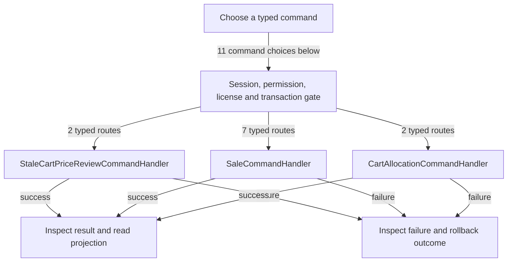

# Cart and checkout

DRAFT · code snapshot 20 October 2026 · source review and targeted automated checks

Feature coverage: PP-F004. Source: [SaleCommandHandler.cs:1](code-application.md#src-b90bee551ece).

## Step-by-step review route

The numbered route is a business review checklist. Branches are separate actions; it does not imply that all actions occur in one transaction.

1. Choose customer, item, quantity and unit.
2. Resolve price, conversion and stock allocation.
3. Review stale price or authorized override.
4. Choose immediate payment, deferred invoice or order invoice.
5. Validate and commit invoice, ledger and stock effects.
6. Refresh read model and inspect queued output.

## Command routing map

This overview groups routes by handler to stay readable; each named command and its connections follow below. [Shared gate details](pipeline.md) apply when this handler is invoked through the pipeline. First-run provisioning is an explicit [separate path](access.md). Source construction sites show candidates, not proof of a connected or reachable UI path.

## Commands, options and implementation connections

### AcceptStaleCartPriceReviewCommand

Handler: [StaleCartPriceReviewCommandHandler](code-application.md#src-f9958eaccdf4). Result type: <code>StaleCartPriceReview</code>.

Declaration: [StaleCartPriceReview.cs:26](code-application.md#src-f9958eaccdf4). <code>RequiredPermission = Permissions.CheckoutSale</code>

Construction sites: [AcceptStaleCartPriceReviewAsync:5660](code-desktop.md#src-16497b924a99)

Handler method: [StaleCartPriceReviewCommandHandler.HandleAsync(AcceptStaleCartPriceReviewCommand,CommandEnvelope&lt;AcceptStaleCartPriceReviewCommand&gt;,CancellationToken)](code-application.md#m-4ee802676bed).

Same-owner helper candidates: [StaleCartPriceReviewCommandHandler.BuildReviewAsync(Guid,int,Guid,Guid?,CancellationToken)](code-application.md#m-12f239f1bd12), [StaleCartPriceReviewCommandHandler.Add(DbCommand,string,object)](code-application.md#m-4663914ce693). These are unqualified/this-call name matches, including possible overloads; semantic binding was not performed.

| Direct method syntax | Extracted references |
| --- | --- |
| Reads | None extracted directly; inspect helpers and dynamic paths. |
| Writes / DDL | <code>draft_cart_lines</code>, <code>draft_carts</code> |
| Literal failure codes | <code>CART_LINE_STALE</code>, <code>CART_REVIEW_NO_CHANGES</code>, <code>CART_REVIEW_STALE</code>, <code>CART_REVISION_STALE</code> |

Helper calls, table references in helpers, and throw sites are listed in the method catalogue. This table is not a transitive effect analysis.

### AddSaleLineCommand

Handler: [SaleCommandHandler](code-application.md#src-b90bee551ece). Result type: <code>DraftCart</code>.

Declaration: [SaleCommands.cs:8](code-application.md#src-5208d9e05ff3). <code>RequiredPermission = UnitPriceMinor.HasValue ? Permissions.OverrideSalePrice : Permissions.CheckoutSale</code>

Construction sites: [HandleAsync:67](code-application.md#src-4772ecb3181e)

Handler method: [SaleCommandHandler.HandleAsync(AddSaleLineCommand,CommandEnvelope&lt;AddSaleLineCommand&gt;,CancellationToken)](code-application.md#m-899ec17ecc86).

Same-owner helper candidates: [SaleCommandHandler.AddParam(DbCommand,string,object?)](code-application.md#m-394b13c56723), [SaleCommandHandler.LoadCartAsync(DbConnection,DbTransaction?,Guid,CancellationToken)](code-application.md#m-93a9118a4f7b). These are unqualified/this-call name matches, including possible overloads; semantic binding was not performed.

| Direct method syntax | Extracted references |
| --- | --- |
| Reads | <code>items</code> |
| Writes / DDL | <code>draft_cart_lines</code> |
| Literal failure codes | <code>FORGED_CONVERSION_FACTOR</code>, <code>ITEM_INACTIVE</code>, <code>ITEM_NOT_FOUND</code>, <code>ITEM_NOT_SELLABLE</code>, <code>PRICE_OVERRIDE_REASON_REQUIRED</code> |

Helper calls, table references in helpers, and throw sites are listed in the method catalogue. This table is not a transitive effect analysis.

### IssueDeferredInvoiceCommand

Handler: [SaleCommandHandler](code-application.md#src-b90bee551ece). Result type: <code>SalesInvoice</code>.

Declaration: [InvoiceSettlementCommands.cs:16](code-application.md#src-a52f4feeda06). <code>RequiredPermission = Permissions.IssueInvoice</code>

Construction sites: **None found** among explicit `new Type(...)` expressions. Target-typed construction, factories and runtime dispatch are not resolved.

Handler method: [SaleCommandHandler.HandleAsync(IssueDeferredInvoiceCommand,CommandEnvelope&lt;IssueDeferredInvoiceCommand&gt;,CancellationToken)](code-application.md#m-b858907fb800).

Same-owner helper candidates: [SaleCommandHandler.IssueAsync(TakePaymentCommand,CommandEnvelope&lt;TakePaymentCommand&gt;,bool,DateOnly?,CancellationToken,FulfillmentPolicy,string?,Action&lt;OrderInvoicePreview&gt;?)](code-application.md#m-491906686e55). These are unqualified/this-call name matches, including possible overloads; semantic binding was not performed.

| Direct method syntax | Extracted references |
| --- | --- |
| Reads | None extracted directly; inspect helpers and dynamic paths. |
| Writes / DDL | None extracted directly; inspect helpers and dynamic paths. |
| Literal failure codes | None extracted directly; inspect helpers and dynamic paths. |

Helper calls, table references in helpers, and throw sites are listed in the method catalogue. This table is not a transitive effect analysis.

### IssueOrderInvoiceCommand

Handler: [SaleCommandHandler](code-application.md#src-b90bee551ece). Result type: <code>SalesInvoice</code>.

Declaration: [InvoiceSettlementCommands.cs:7](code-application.md#src-a52f4feeda06). <code>RequiredPermission = Permissions.IssueInvoice</code>

Construction sites: **None found** among explicit `new Type(...)` expressions. Target-typed construction, factories and runtime dispatch are not resolved.

Handler method: [SaleCommandHandler.HandleAsync(IssueOrderInvoiceCommand,CommandEnvelope&lt;IssueOrderInvoiceCommand&gt;,CancellationToken)](code-application.md#m-0e238eefdd64).

Same-owner helper candidates: [SaleCommandHandler.IssueAsync(TakePaymentCommand,CommandEnvelope&lt;TakePaymentCommand&gt;,bool,DateOnly?,CancellationToken,FulfillmentPolicy,string?,Action&lt;OrderInvoicePreview&gt;?)](code-application.md#m-491906686e55). These are unqualified/this-call name matches, including possible overloads; semantic binding was not performed.

| Direct method syntax | Extracted references |
| --- | --- |
| Reads | <code>draft_carts</code> |
| Writes / DDL | None extracted directly; inspect helpers and dynamic paths. |
| Literal failure codes | <code>INVOICE_DRAFT_REQUIRED</code> |

Helper calls, table references in helpers, and throw sites are listed in the method catalogue. This table is not a transitive effect analysis.

### PreviewOrderInvoiceCommand

Handler: [SaleCommandHandler](code-application.md#src-b90bee551ece). Result type: <code>OrderInvoicePreview</code>.

Declaration: [InvoiceSettlementCommands.cs:13](code-application.md#src-a52f4feeda06). <code>RequiredPermission = Permissions.IssueInvoice</code>

Construction sites: **None found** among explicit `new Type(...)` expressions. Target-typed construction, factories and runtime dispatch are not resolved.

Handler method: [SaleCommandHandler.HandleAsync(PreviewOrderInvoiceCommand,CommandEnvelope&lt;PreviewOrderInvoiceCommand&gt;,CancellationToken)](code-application.md#m-2096456a136d).

Same-owner helper candidates: [SaleCommandHandler.IssueAsync(TakePaymentCommand,CommandEnvelope&lt;TakePaymentCommand&gt;,bool,DateOnly?,CancellationToken,FulfillmentPolicy,string?,Action&lt;OrderInvoicePreview&gt;?)](code-application.md#m-491906686e55). These are unqualified/this-call name matches, including possible overloads; semantic binding was not performed.

| Direct method syntax | Extracted references |
| --- | --- |
| Reads | <code>draft_carts</code> |
| Writes / DDL | None extracted directly; inspect helpers and dynamic paths. |
| Literal failure codes | <code>INVOICE_DRAFT_REQUIRED</code> |

Helper calls, table references in helpers, and throw sites are listed in the method catalogue. This table is not a transitive effect analysis.

### RefundSaleCommand

Handler: [SaleCommandHandler](code-application.md#src-b90bee551ece). Result type: <code>SalesInvoice</code>.

Declaration: [SaleCommands.cs:50](code-application.md#src-5208d9e05ff3). <code>RequiredPermission = Permissions.RefundSale</code>

Construction sites: **None found** among explicit `new Type(...)` expressions. Target-typed construction, factories and runtime dispatch are not resolved.

Handler method: [SaleCommandHandler.HandleAsync(RefundSaleCommand,CommandEnvelope&lt;RefundSaleCommand&gt;,CancellationToken)](code-application.md#m-93e1f02fb10a).

| Direct method syntax | Extracted references |
| --- | --- |
| Reads | None extracted directly; inspect helpers and dynamic paths. |
| Writes / DDL | None extracted directly; inspect helpers and dynamic paths. |
| Literal failure codes | None extracted directly; inspect helpers and dynamic paths. |

Helper calls, table references in helpers, and throw sites are listed in the method catalogue. This table is not a transitive effect analysis.

### ReviewStaleCartPricesCommand

Handler: [StaleCartPriceReviewCommandHandler](code-application.md#src-f9958eaccdf4). Result type: <code>StaleCartPriceReview</code>.

Declaration: [StaleCartPriceReview.cs:21](code-application.md#src-f9958eaccdf4). <code>RequiredPermission = Permissions.CheckoutSale</code>

Construction sites: [OpenStaleCartPriceReviewAsync:5622](code-desktop.md#src-16497b924a99)

Handler method: [StaleCartPriceReviewCommandHandler.HandleAsync(ReviewStaleCartPricesCommand,CommandEnvelope&lt;ReviewStaleCartPricesCommand&gt;,CancellationToken)](code-application.md#m-d9c53582c750).

Same-owner helper candidates: [StaleCartPriceReviewCommandHandler.BuildReviewAsync(Guid,int,Guid,Guid?,CancellationToken)](code-application.md#m-12f239f1bd12). These are unqualified/this-call name matches, including possible overloads; semantic binding was not performed.

| Direct method syntax | Extracted references |
| --- | --- |
| Reads | None extracted directly; inspect helpers and dynamic paths. |
| Writes / DDL | None extracted directly; inspect helpers and dynamic paths. |
| Literal failure codes | None extracted directly; inspect helpers and dynamic paths. |

Helper calls, table references in helpers, and throw sites are listed in the method catalogue. This table is not a transitive effect analysis.

### SelectLotForCartLineCommand

Handler: [CartAllocationCommandHandler](code-application.md#src-46ba4855fda6). Result type: <code>bool</code>.

Declaration: [SaleCommands.cs:63](code-application.md#src-5208d9e05ff3). <code>RequiredPermission = Permissions.CheckoutSale</code>

Construction sites: [HandleAsync:80](code-application.md#src-4772ecb3181e), [HandleAsync:101](code-application.md#src-4772ecb3181e), [ConfirmLotSerialSelectionAsync:11738](code-desktop.md#src-16497b924a99)

Handler method: [CartAllocationCommandHandler.HandleAsync(SelectLotForCartLineCommand,CommandEnvelope&lt;SelectLotForCartLineCommand&gt;,CancellationToken)](code-application.md#m-ee0fab044b83).

Same-owner helper candidates: [CartAllocationCommandHandler.InsertPendingAsync(DbConnection,DbTransaction?,Guid,Guid,string?,Guid?,string?,decimal,DateTime,CancellationToken)](code-application.md#m-603bcd406d76). These are unqualified/this-call name matches, including possible overloads; semantic binding was not performed.

| Direct method syntax | Extracted references |
| --- | --- |
| Reads | None extracted directly; inspect helpers and dynamic paths. |
| Writes / DDL | None extracted directly; inspect helpers and dynamic paths. |
| Literal failure codes | <code>INSUFFICIENT_LOT_BALANCE</code>, <code>INVALID_QUANTITY</code>, <code>LOCATION_NOT_SELLABLE</code> |

Helper calls, table references in helpers, and throw sites are listed in the method catalogue. This table is not a transitive effect analysis.

### SelectSerialForCartLineCommand

Handler: [CartAllocationCommandHandler](code-application.md#src-46ba4855fda6). Result type: <code>bool</code>.

Declaration: [SaleCommands.cs:77](code-application.md#src-5208d9e05ff3). <code>RequiredPermission = Permissions.CheckoutSale</code>

Construction sites: [HandleAsync:86](code-application.md#src-4772ecb3181e), [HandleAsync:108](code-application.md#src-4772ecb3181e), [ConfirmLotSerialSelectionAsync:11757](code-desktop.md#src-16497b924a99)

Handler method: [CartAllocationCommandHandler.HandleAsync(SelectSerialForCartLineCommand,CommandEnvelope&lt;SelectSerialForCartLineCommand&gt;,CancellationToken)](code-application.md#m-a881109dcdae).

Same-owner helper candidates: [CartAllocationCommandHandler.Add(DbCommand,string,object)](code-application.md#m-e020c2b9448c), [CartAllocationCommandHandler.PendingSerialExistsAsync(DbConnection,DbTransaction?,Guid,string,CancellationToken)](code-application.md#m-2abddf84e322), [CartAllocationCommandHandler.InsertPendingAsync(DbConnection,DbTransaction?,Guid,Guid,string?,Guid?,string?,decimal,DateTime,CancellationToken)](code-application.md#m-603bcd406d76). These are unqualified/this-call name matches, including possible overloads; semantic binding was not performed.

| Direct method syntax | Extracted references |
| --- | --- |
| Reads | <code>serials</code> |
| Writes / DDL | <code>pending_allocations</code> |
| Literal failure codes | <code>INVALID_SERIAL_QUANTITY_FRACTIONAL</code>, <code>LOCATION_NOT_SELLABLE</code>, <code>SERIAL_ALREADY_COMMITTED</code>, <code>SERIAL_NOT_AVAILABLE</code>, <code>SERIAL_NOT_FOUND</code>, <code>SERIAL_RESERVED</code>, <code>SERIAL_SELECTION_REQUIRED</code>, <code>SERIAL_WRONG_LOCATION</code> |

Helper calls, table references in helpers, and throw sites are listed in the method catalogue. This table is not a transitive effect analysis.

### TakePaymentCommand

Handler: [SaleCommandHandler](code-application.md#src-b90bee551ece). Result type: <code>SalesInvoice</code>.

Declaration: [SaleCommands.cs:30](code-application.md#src-5208d9e05ff3). <code>RequiredPermission = Permissions.CheckoutSale</code>

Construction sites: [HandleAsync:223](code-application.md#src-b90bee551ece), [HandleAsync:237](code-application.md#src-b90bee551ece), [HandleAsync:248](code-application.md#src-b90bee551ece), [PlaceOrderAsync:5554](code-desktop.md#src-16497b924a99), [SettleActiveOrderAsync:6286](code-desktop.md#src-16497b924a99)

Handler method: [SaleCommandHandler.HandleAsync(TakePaymentCommand,CommandEnvelope&lt;TakePaymentCommand&gt;,CancellationToken)](code-application.md#m-bec1ebd1e944).

Same-owner helper candidates: [SaleCommandHandler.IssueAsync(TakePaymentCommand,CommandEnvelope&lt;TakePaymentCommand&gt;,bool,DateOnly?,CancellationToken,FulfillmentPolicy,string?,Action&lt;OrderInvoicePreview&gt;?)](code-application.md#m-491906686e55). These are unqualified/this-call name matches, including possible overloads; semantic binding was not performed.

| Direct method syntax | Extracted references |
| --- | --- |
| Reads | None extracted directly; inspect helpers and dynamic paths. |
| Writes / DDL | None extracted directly; inspect helpers and dynamic paths. |
| Literal failure codes | None extracted directly; inspect helpers and dynamic paths. |

Helper calls, table references in helpers, and throw sites are listed in the method catalogue. This table is not a transitive effect analysis.

### VoidSaleLineCommand

Handler: [SaleCommandHandler](code-application.md#src-b90bee551ece). Result type: <code>DraftCart</code>.

Declaration: [SaleCommands.cs:21](code-application.md#src-5208d9e05ff3). <code>RequiredPermission = Permissions.VoidLine</code>

Construction sites: **None found** among explicit `new Type(...)` expressions. Target-typed construction, factories and runtime dispatch are not resolved.

Handler method: [SaleCommandHandler.HandleAsync(VoidSaleLineCommand,CommandEnvelope&lt;VoidSaleLineCommand&gt;,CancellationToken)](code-application.md#m-dbef8767a6fa).

Same-owner helper candidates: [SaleCommandHandler.AddParam(DbCommand,string,object?)](code-application.md#m-394b13c56723), [SaleCommandHandler.LoadCartAsync(DbConnection,DbTransaction?,Guid,CancellationToken)](code-application.md#m-93a9118a4f7b). These are unqualified/this-call name matches, including possible overloads; semantic binding was not performed.

| Direct method syntax | Extracted references |
| --- | --- |
| Reads | None extracted directly; inspect helpers and dynamic paths. |
| Writes / DDL | <code>draft_cart_lines</code> |
| Literal failure codes | <code>LINE_NOT_FOUND</code> |

Helper calls, table references in helpers, and throw sites are listed in the method catalogue. This table is not a transitive effect analysis.

## Open review points

- [PP-REV-002: Pre-transaction pipeline failures use a different error path](decisions.md#pp-rev-002) — source-observed contract gap.
- [PP-REV-006: Historical passing tests omit excluded files](decisions.md#pp-rev-006) — verification gap.

## Verification still required

No application journey was executed for this map. Use a separate synthetic test environment to verify permission denial, valid success, invalid inputs, state conflicts, cancellation, transaction rollback, retry/idempotency and the resulting projection. Add physical-device checks only where the workflow dispatches output. Preserve original financial history when reviewing corrections or reversals.
