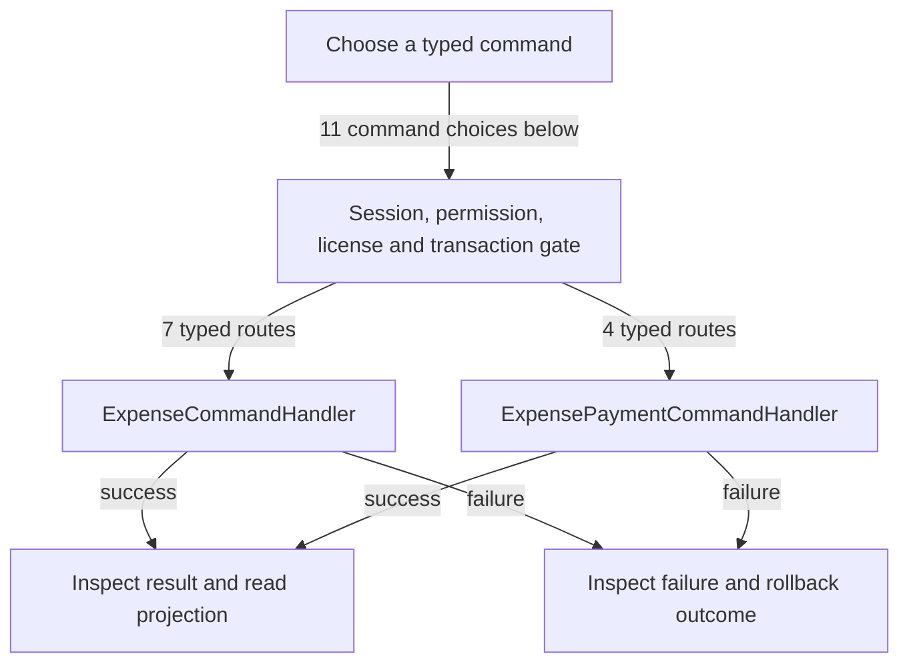

# Expenses, payments and attachments

DRAFT · code snapshot 20 October 2026 · source review and targeted automated checks

Feature coverage: PP-F017. Source: [ExpenseCommandHandler.cs:1](code-application.md#src-c02b00854044), [ExpensePaymentCommandHandler.cs:1](code-application.md#src-458534a2cf6c), [SqliteExpenseAttachmentService.cs:78](code-infrastructure.md#src-87a2fd6ad020).

Expense photos are stored in expense_attachments.image_data as versioned SQLite BLOBs. SqliteExpenseAttachmentService prepares/re-encodes input and provides permission-checked reads; ExpenseCommandHandler validates and writes the prepared attachment in the command transaction.

## Step-by-step review route

The numbered route is a business review checklist. Branches are separate actions; it does not imply that all actions occur in one transaction.

1. Choose category and expense record.
2. Validate source, amount and business date.
3. Prepare and validate the image; attach its bytes through the transactional command.
4. Choose pay, reverse, cancel or replace.
5. Commit financial records through matching command.
6. Read expense ledger and inspect attachment outcome.

## Command routing map

This overview groups routes by handler to stay readable; each named command and its connections follow below. [Shared gate details](pipeline.md) apply when this handler is invoked through the pipeline. First-run provisioning is an explicit [separate path](access.md). Source construction sites show candidates, not proof of a connected or reachable UI path.

## Commands, options and implementation connections

### AttachExpensePhotoCommand

Handler: [ExpenseCommandHandler](code-application.md#src-c02b00854044). Result type: <code>Guid</code>.

Declaration: [ExpenseCommands.cs:139](code-application.md#src-5b8093d7b8c4). <code>RequiredPermission = Permissions.ExpensesManage</code>

Construction sites: **None found** among explicit `new Type(...)` expressions. Target-typed construction, factories and runtime dispatch are not resolved.

Handler method: [ExpenseCommandHandler.HandleAsync(AttachExpensePhotoCommand,CommandEnvelope&lt;AttachExpensePhotoCommand&gt;,CancellationToken)](code-application.md#m-52ab336b04d8).

Same-owner helper candidates: [ExpenseCommandHandler.ValidatePreparedAttachment(PreparedAttachment?)](code-application.md#m-64776d08da35), [ExpenseCommandHandler.AddParam(DbCommand,string,object?)](code-application.md#m-93235f26cceb), [ExpenseCommandHandler.InsertExpenseAttachmentAsync(DbConnection,DbTransaction?,Guid,Guid,int,PreparedAttachment,Guid?,string,CancellationToken)](code-application.md#m-c70c35930186). These are unqualified/this-call name matches, including possible overloads; semantic binding was not performed.

| Direct method syntax | Extracted references |
| --- | --- |
| Reads | <code>expense_attachments</code>, <code>expense_records</code> |
| Writes / DDL | <code>expense_attachments</code>, <code>expense_records</code> |
| Literal failure codes | <code>EXPENSE_ALREADY_CANCELLED</code>, <code>EXPENSE_NOT_FOUND</code> |

Helper calls, table references in helpers, and throw sites are listed in the method catalogue. This table is not a transitive effect analysis.

### CancelExpenseRecordCommand

Handler: [ExpenseCommandHandler](code-application.md#src-c02b00854044). Result type: <code>bool</code>.

Declaration: [ExpenseCommands.cs:124](code-application.md#src-5b8093d7b8c4). <code>RequiredPermission = Permissions.ExpensesReverse</code>

Construction sites: [CancelExpenseAsync:1580](code-desktop.md#src-849697ea5909)

Handler method: [ExpenseCommandHandler.HandleAsync(CancelExpenseRecordCommand,CommandEnvelope&lt;CancelExpenseRecordCommand&gt;,CancellationToken)](code-application.md#m-61fec5661ff4).

Same-owner helper candidates: [ExpenseCommandHandler.AddParam(DbCommand,string,object?)](code-application.md#m-93235f26cceb). These are unqualified/this-call name matches, including possible overloads; semantic binding was not performed.

| Direct method syntax | Extracted references |
| --- | --- |
| Reads | <code>expense_payments</code>, <code>expense_records</code> |
| Writes / DDL | <code>expense_records</code> |
| Literal failure codes | <code>EXPENSE_ALREADY_CANCELLED</code>, <code>EXPENSE_NOT_FOUND</code>, <code>EXPENSE_REFUND_REQUIRED</code>, <code>NON_CASH_EXPENSE_CANNOT_BE_CANCELLED</code>, <code>REASON_REQUIRED</code>, <code>STALE_REVISION</code> |

Helper calls, table references in helpers, and throw sites are listed in the method catalogue. This table is not a transitive effect analysis.

### CreateExpenseCategoryCommand

Handler: [ExpenseCommandHandler](code-application.md#src-c02b00854044). Result type: <code>Guid</code>.

Declaration: [ExpenseCommands.cs:7](code-application.md#src-5b8093d7b8c4). <code>RequiredPermission = Permissions.ExpensesManage</code>

Construction sites: [CreateCategoryAsync:1167](code-desktop.md#src-849697ea5909), [SaveManagedCategoryAsync:11662](code-desktop.md#src-16497b924a99)

Handler method: [ExpenseCommandHandler.HandleAsync(CreateExpenseCategoryCommand,CommandEnvelope&lt;CreateExpenseCategoryCommand&gt;,CancellationToken)](code-application.md#m-96f0d231de4e).

Same-owner helper candidates: [ExpenseCommandHandler.GenerateUniqueCategoryCodeAsync(DbConnection,DbTransaction?,string,CancellationToken)](code-application.md#m-900e1e41614f), [ExpenseCommandHandler.AddParam(DbCommand,string,object?)](code-application.md#m-93235f26cceb). These are unqualified/this-call name matches, including possible overloads; semantic binding was not performed.

| Direct method syntax | Extracted references |
| --- | --- |
| Reads | <code>expense_categories</code> |
| Writes / DDL | <code>expense_categories</code> |
| Literal failure codes | <code>CATEGORY_CODE_EXISTS</code>, <code>CATEGORY_NAME_EXISTS</code>, <code>CATEGORY_NAME_REQUIRED</code> |

Helper calls, table references in helpers, and throw sites are listed in the method catalogue. This table is not a transitive effect analysis.

### CreateExpenseRecordCommand

Handler: [ExpenseCommandHandler](code-application.md#src-c02b00854044). Result type: <code>Guid</code>.

Declaration: [ExpenseCommands.cs:43](code-application.md#src-5b8093d7b8c4). <code>RequiredPermission = Permissions.ExpensesManage</code>

Construction sites: [SaveExpenseAsync:910](code-desktop.md#src-849697ea5909)

Handler method: [ExpenseCommandHandler.HandleAsync(CreateExpenseRecordCommand,CommandEnvelope&lt;CreateExpenseRecordCommand&gt;,CancellationToken)](code-application.md#m-ae4629505dda).

Same-owner helper candidates: [ExpenseCommandHandler.AddParam(DbCommand,string,object?)](code-application.md#m-93235f26cceb), [ExpenseCommandHandler.GenerateUniqueExpenseReferenceAsync(DbConnection,DbTransaction?,CancellationToken)](code-application.md#m-0477ed6af7ea), [ExpenseCommandHandler.GetStoreDefaultCurrencyAndScaleAsync(DbConnection,DbTransaction?,CancellationToken)](code-application.md#m-cfd75b1de925), [ExpenseCommandHandler.ValidatePreparedAttachment(PreparedAttachment?)](code-application.md#m-64776d08da35), [ExpenseCommandHandler.InsertExpenseAttachmentAsync(DbConnection,DbTransaction?,Guid,Guid,int,PreparedAttachment,Guid?,string,CancellationToken)](code-application.md#m-c70c35930186). These are unqualified/this-call name matches, including possible overloads; semantic binding was not performed.

| Direct method syntax | Extracted references |
| --- | --- |
| Reads | <code>expense_categories</code>, <code>expense_records</code>, <code>person_records</code> |
| Writes / DDL | <code>expense_records</code> |
| Literal failure codes | <code>CATEGORY_INACTIVE</code>, <code>CATEGORY_NOT_FOUND</code>, <code>CATEGORY_REQUIRED</code>, <code>DUPLICATE_EXPENSE_REFERENCE</code>, <code>INVALID_COST</code>, <code>INVALID_DECIMAL_PLACES</code>, <code>NAME_REQUIRED</code>, <code>PAYEE_NOT_FOUND</code> |

Helper calls, table references in helpers, and throw sites are listed in the method catalogue. This table is not a transitive effect analysis.

### PayExpenseCommand

Handler: [ExpensePaymentCommandHandler](code-application.md#src-458534a2cf6c). Result type: <code>Guid</code>.

Declaration: [ExpensePaymentCommands.cs:7](code-application.md#src-38ab4a4f4fb9). <code>RequiredPermission = Permissions.ExpensesPay; AdditionalPermissions = [Permissions.ReadMoney]</code>

Construction sites: [ConfirmExpensePaymentAsync:1404](code-desktop.md#src-849697ea5909)

Handler method: [ExpensePaymentCommandHandler.HandleAsync(PayExpenseCommand,CommandEnvelope&lt;PayExpenseCommand&gt;,CancellationToken)](code-application.md#m-0d05dba96a5d).

Same-owner helper candidates: [ExpensePaymentCommandHandler.AddParam(DbCommand,string,object?)](code-application.md#m-71d74bb2a4bf). These are unqualified/this-call name matches, including possible overloads; semantic binding was not performed.

| Direct method syntax | Extracted references |
| --- | --- |
| Reads | <code>expense_payments</code>, <code>expense_records</code>, <code>money_accounts</code> |
| Writes / DDL | <code>expense_payments</code>, <code>expense_records</code> |
| Literal failure codes | <code>ACCOUNT_NOT_FOUND</code>, <code>CURRENCY_MISMATCH</code>, <code>EXPENSE_CANCELLED</code>, <code>EXPENSE_NOT_FOUND</code>, <code>EXPENSE_OVERPAYMENT</code>, <code>INVALID_ACCOUNT_ID</code>, <code>INVALID_AMOUNT</code>, <code>INVALID_EXPENSE_ID</code>, <code>NON_CASH_EXPENSE_CANNOT_BE_PAID</code>, <code>PAID_AT_OVERRIDE_NOT_PERMITTED</code>, <code>REASON_REQUIRED</code>, <code>STALE_REVISION</code> |

Helper calls, table references in helpers, and throw sites are listed in the method catalogue. This table is not a transitive effect analysis.

### RecordWasteExpenseCommand

Handler: [ExpenseCommandHandler](code-application.md#src-c02b00854044). Result type: <code>Guid</code>.

Declaration: [ExpenseCommands.cs:79](code-application.md#src-5b8093d7b8c4). <code>RequiredPermission = Permissions.ExpensesManage</code>

Construction sites: [ConfirmWasteExpenseAsync:454](code-desktop.md#src-71e9030a9a8d)

Handler method: [ExpenseCommandHandler.HandleAsync(RecordWasteExpenseCommand,CommandEnvelope&lt;RecordWasteExpenseCommand&gt;,CancellationToken)](code-application.md#m-299833ace8cd).

Same-owner helper candidates: [ExpenseCommandHandler.AddParam(DbCommand,string,object?)](code-application.md#m-93235f26cceb), [ExpenseCommandHandler.GetStoreDefaultCurrencyAndScaleAsync(DbConnection,DbTransaction?,CancellationToken)](code-application.md#m-cfd75b1de925), [ExpenseCommandHandler.GenerateUniqueExpenseReferenceAsync(DbConnection,DbTransaction?,CancellationToken)](code-application.md#m-0477ed6af7ea). These are unqualified/this-call name matches, including possible overloads; semantic binding was not performed.

| Direct method syntax | Extracted references |
| --- | --- |
| Reads | <code>expense_categories</code>, <code>expense_records</code>, <code>inventory_loss_records</code>, <code>items</code> |
| Writes / DDL | <code>expense_records</code> |
| Literal failure codes | <code>CATEGORY_NOT_FOUND</code>, <code>COST_REQUIRED</code>, <code>INELIGIBLE_MOVEMENT</code>, <code>INVALID_COST</code>, <code>INVALID_TARGET</code>, <code>LOSS_RECORD_NOT_FOUND</code>, <code>WASTE_EXPENSE_ALREADY_RECORDED</code> |

Helper calls, table references in helpers, and throw sites are listed in the method catalogue. This table is not a transitive effect analysis.

### ReplaceExpenseRecordCommand

Handler: [ExpensePaymentCommandHandler](code-application.md#src-458534a2cf6c). Result type: <code>Guid</code>.

Declaration: [ExpensePaymentCommands.cs:95](code-application.md#src-38ab4a4f4fb9). <code>RequiredPermission = Permissions.ExpensesReverse; AdditionalPermissions = [Permissions.ExpensesManage]</code>

Construction sites: **None found** among explicit `new Type(...)` expressions. Target-typed construction, factories and runtime dispatch are not resolved.

Handler method: [ExpensePaymentCommandHandler.HandleAsync(ReplaceExpenseRecordCommand,CommandEnvelope&lt;ReplaceExpenseRecordCommand&gt;,CancellationToken)](code-application.md#m-1517e55bae26).

Same-owner helper candidates: [ExpensePaymentCommandHandler.AddParam(DbCommand,string,object?)](code-application.md#m-71d74bb2a4bf), [ExpensePaymentCommandHandler.GenerateUniqueExpenseReferenceAsync(DbConnection,DbTransaction?,CancellationToken)](code-application.md#m-4bde50ed2fc9). These are unqualified/this-call name matches, including possible overloads; semantic binding was not performed.

| Direct method syntax | Extracted references |
| --- | --- |
| Reads | <code>expense_categories</code>, <code>expense_payments</code>, <code>expense_records</code>, <code>person_records</code> |
| Writes / DDL | <code>expense_records</code> |
| Literal failure codes | <code>CATEGORY_NOT_FOUND</code>, <code>EXPENSE_ALREADY_CANCELLED</code>, <code>EXPENSE_NOT_FOUND</code>, <code>EXPENSE_REFUND_REQUIRED</code>, <code>INVALID_COST</code>, <code>INVALID_DECIMAL_PLACES</code>, <code>NAME_REQUIRED</code>, <code>PAYEE_NOT_FOUND</code>, <code>REASON_REQUIRED</code>, <code>STALE_REVISION</code> |

Helper calls, table references in helpers, and throw sites are listed in the method catalogue. This table is not a transitive effect analysis.

### ReverseExpensePaymentCommand

Handler: [ExpensePaymentCommandHandler](code-application.md#src-458534a2cf6c). Result type: <code>Guid</code>.

Declaration: [ExpensePaymentCommands.cs:72](code-application.md#src-38ab4a4f4fb9). <code>RequiredPermission = Permissions.ExpensesReverse; AdditionalPermissions = [Permissions.ReadMoney]</code>

Construction sites: [ReverseExpensePaymentAsync:1614](code-desktop.md#src-849697ea5909), [ConfirmPaymentReturnAsync:228](code-desktop.md#src-71e9030a9a8d)

Handler method: [ExpensePaymentCommandHandler.HandleAsync(ReverseExpensePaymentCommand,CommandEnvelope&lt;ReverseExpensePaymentCommand&gt;,CancellationToken)](code-application.md#m-ad30dabc5ae0).

Same-owner helper candidates: [ExpensePaymentCommandHandler.AddParam(DbCommand,string,object?)](code-application.md#m-71d74bb2a4bf). These are unqualified/this-call name matches, including possible overloads; semantic binding was not performed.

| Direct method syntax | Extracted references |
| --- | --- |
| Reads | <code>expense_payments</code>, <code>expense_records</code>, <code>money_accounts</code> |
| Writes / DDL | <code>expense_payments</code>, <code>expense_records</code> |
| Literal failure codes | <code>ACCOUNT_NOT_FOUND</code>, <code>BANK_CONFIRMATION_REQUIRED</code>, <code>CANNOT_REVERSE_A_REVERSAL</code>, <code>EXPENSE_MISMATCH</code>, <code>EXPENSE_NOT_FOUND</code>, <code>PAYMENT_ALREADY_REVERSED</code>, <code>PAYMENT_NOT_FOUND</code>, <code>REASON_REQUIRED</code>, <code>SHIFT_NOT_OPEN</code>, <code>STALE_REVISION</code> |

Helper calls, table references in helpers, and throw sites are listed in the method catalogue. This table is not a transitive effect analysis.

### SaveAndPayExpenseCommand

Handler: [ExpensePaymentCommandHandler](code-application.md#src-458534a2cf6c). Result type: <code>Guid</code>.

Declaration: [ExpensePaymentCommands.cs:33](code-application.md#src-38ab4a4f4fb9). <code>RequiredPermission = Permissions.ExpensesPay; AdditionalPermissions = [Permissions.ExpensesManage, Permissions.ReadMoney]</code>

Construction sites: [SaveAndPayExpenseAsync:1029](code-desktop.md#src-849697ea5909)

Handler method: [ExpensePaymentCommandHandler.HandleAsync(SaveAndPayExpenseCommand,CommandEnvelope&lt;SaveAndPayExpenseCommand&gt;,CancellationToken)](code-application.md#m-69191fb4b330).

Same-owner helper candidates: [ExpensePaymentCommandHandler.AddParam(DbCommand,string,object?)](code-application.md#m-71d74bb2a4bf), [ExpensePaymentCommandHandler.GenerateUniqueExpenseReferenceAsync(DbConnection,DbTransaction?,CancellationToken)](code-application.md#m-4bde50ed2fc9). These are unqualified/this-call name matches, including possible overloads; semantic binding was not performed.

| Direct method syntax | Extracted references |
| --- | --- |
| Reads | <code>expense_categories</code>, <code>expense_records</code>, <code>money_accounts</code>, <code>person_records</code> |
| Writes / DDL | <code>expense_payments</code>, <code>expense_records</code> |
| Literal failure codes | <code>ACCOUNT_NOT_FOUND</code>, <code>CATEGORY_INACTIVE</code>, <code>CATEGORY_NOT_FOUND</code>, <code>CATEGORY_REQUIRED</code>, <code>CURRENCY_MISMATCH</code>, <code>DUPLICATE_EXPENSE_REFERENCE</code>, <code>EXPENSE_OVERPAYMENT</code>, <code>INVALID_ACCOUNT_ID</code>, <code>INVALID_AMOUNT</code>, <code>INVALID_COST</code>, <code>INVALID_DECIMAL_PLACES</code>, <code>NAME_REQUIRED</code>, <code>PAID_AT_OVERRIDE_NOT_PERMITTED</code>, <code>PAYEE_NOT_FOUND</code> |

Helper calls, table references in helpers, and throw sites are listed in the method catalogue. This table is not a transitive effect analysis.

### UpdateExpenseCategoryCommand

Handler: [ExpenseCommandHandler](code-application.md#src-c02b00854044). Result type: <code>bool</code>.

Declaration: [ExpenseCommands.cs:23](code-application.md#src-5b8093d7b8c4). <code>RequiredPermission = Permissions.ExpensesManage</code>

Construction sites: [ToggleCategoryActiveAsync:1201](code-desktop.md#src-849697ea5909), [SaveManagedCategoryAsync:11647](code-desktop.md#src-16497b924a99), [ToggleManagedExpenseCategoryActiveAsync:11818](code-desktop.md#src-16497b924a99)

Handler method: [ExpenseCommandHandler.HandleAsync(UpdateExpenseCategoryCommand,CommandEnvelope&lt;UpdateExpenseCategoryCommand&gt;,CancellationToken)](code-application.md#m-8c7802f61231).

Same-owner helper candidates: [ExpenseCommandHandler.AddParam(DbCommand,string,object?)](code-application.md#m-93235f26cceb). These are unqualified/this-call name matches, including possible overloads; semantic binding was not performed.

| Direct method syntax | Extracted references |
| --- | --- |
| Reads | <code>expense_categories</code> |
| Writes / DDL | <code>expense_categories</code> |
| Literal failure codes | <code>CATEGORY_CODE_EXISTS</code>, <code>CATEGORY_CODE_REQUIRED</code>, <code>CATEGORY_NAME_EXISTS</code>, <code>CATEGORY_NAME_REQUIRED</code>, <code>CATEGORY_NOT_FOUND</code>, <code>STALE_REVISION</code> |

Helper calls, table references in helpers, and throw sites are listed in the method catalogue. This table is not a transitive effect analysis.

### UpdateExpenseRecordCommand

Handler: [ExpenseCommandHandler](code-application.md#src-c02b00854044). Result type: <code>bool</code>.

Declaration: [ExpenseCommands.cs:100](code-application.md#src-5b8093d7b8c4). <code>RequiredPermission = Permissions.ExpensesManage</code>

Construction sites: [SaveExpenseAsync:878](code-desktop.md#src-849697ea5909)

Handler method: [ExpenseCommandHandler.HandleAsync(UpdateExpenseRecordCommand,CommandEnvelope&lt;UpdateExpenseRecordCommand&gt;,CancellationToken)](code-application.md#m-e3f2dcc443e0).

Same-owner helper candidates: [ExpenseCommandHandler.AddParam(DbCommand,string,object?)](code-application.md#m-93235f26cceb). These are unqualified/this-call name matches, including possible overloads; semantic binding was not performed.

| Direct method syntax | Extracted references |
| --- | --- |
| Reads | <code>expense_categories</code>, <code>expense_payments</code>, <code>expense_records</code>, <code>person_records</code> |
| Writes / DDL | <code>expense_records</code> |
| Literal failure codes | <code>CATEGORY_INACTIVE</code>, <code>CATEGORY_NOT_FOUND</code>, <code>CATEGORY_REQUIRED</code>, <code>EXPENSE_CANCELLED</code>, <code>EXPENSE_NOT_FOUND</code>, <code>EXPENSE_PAID_IMMUTABLE</code>, <code>INVALID_COST</code>, <code>NAME_REQUIRED</code>, <code>PAYEE_NOT_FOUND</code>, <code>STALE_REVISION</code> |

Helper calls, table references in helpers, and throw sites are listed in the method catalogue. This table is not a transitive effect analysis.

## Verification still required

No application journey was executed for this map. Use a separate synthetic test environment to verify permission denial, valid success, invalid inputs, state conflicts, cancellation, transaction rollback, retry/idempotency and the resulting projection. Add physical-device checks only where the workflow dispatches output. Preserve original financial history when reviewing corrections or reversals.
