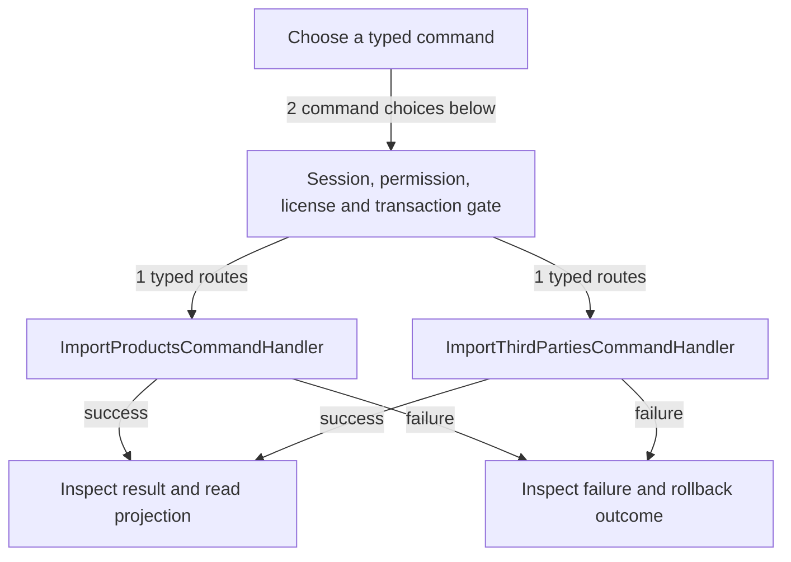

# Product and third-party imports

DRAFT · code snapshot 20 October 2026 · source review and targeted automated checks

Feature coverage: PP-F014, PP-F013. Source: [ImportProductsCommandHandler.cs:1](code-application.md#src-2c8d126a7c07), [ImportThirdPartiesCommandHandler.cs:1](code-application.md#src-7bb9c4e66dce), [MainViewModel.cs:1](code-desktop.md#src-16497b924a99), [MainViewModel.ImportReview.cs:1](code-desktop.md#src-90113acc8bd5), [MainViewModel.ThirdPartyImport.cs:1](code-desktop.md#src-63148b75a5e2), [ImportReviewLifecycleTests.cs:1](tests.md#src-320c3c9117d1), [MainViewModel.ImportResults.cs:1](code-desktop.md#src-969918d8254d), [XlsxImportWorkbook.cs:1](code-infrastructure.md#src-16a4d298fe01), [MainWindow.axaml:1](code-desktop.md#src-67243af94cf2), [MainWindow.axaml.cs:1](code-desktop.md#src-49e81864bc35), [UiPreferencesService.cs:1](code-desktop.md#src-3ede46aa073a), [ImportResultWorkbookTests.cs:1](tests.md#src-0492bf0b001b), [ImportDatabaseState.cs:1](code-application.md#src-cb21b9739067).

23 October 2026 — Patch B, E-023: 53 targeted tests passed. Both import toolbars expose Download Result when a result exists for the current unlocked operator/database. Save cancellation/failure keeps that bounded in-memory artifact. There is no Retry Import action. Correctable failed XLSX retains original identifiers, physical rows, instruction rows, create/update choices and Stock; Import Results contains diagnostics and is not business data. Unsafe/corrupt/oversized files use a diagnostic-only XLSX and require correcting the original file or a fresh template. Ambiguous outcomes first read the original durable key; unresolved outcomes omit business input and warn against stock resubmission. Lock/disposal/database changes invalidate old artifacts and stale work. Success output behavior and import handlers/parsers/templates/schema/stock/pricing rules remain unchanged. Headless layout and event tests do not verify native OS dialogs or shop acceptance.

## Step-by-step review route

The numbered route is a business review checklist. Branches are separate actions; it does not imply that all actions occur in one transaction.

1. Choose a workbook and capture its bytes and operator/database/generation.
2. Validate without committing; invalid preview produces one failure XLSX.
3. Confirm valid preview through the existing authorized atomic command.
4. Resolve an ambiguous response by reading the original durable idempotency key; never resubmit to obtain a report.
5. Capture completed or failed result separately, close the matching dialog and clear its preview.
6. Save the offered XLSX; Download Result on the Inventory or Third Parties toolbar saves the last result again without importing.
7. For correctable failures edit the returned business sheets and choose the file again; unknown outcomes require administrator review.

## Command routing map

This overview groups routes by handler to stay readable; each named command and its connections follow below. [Shared gate details](pipeline.md) apply when this handler is invoked through the pipeline. First-run provisioning is an explicit [separate path](access.md). Source construction sites show candidates, not proof of a connected or reachable UI path.

## Commands, options and implementation connections

### ImportProductsCommand

Handler: [ImportProductsCommandHandler](code-application.md#src-2c8d126a7c07). Result type: <code>ImportProductsResult</code>.

Declaration: [ImportCommands.cs:54](code-application.md#src-60301a99263c). <code>RequiredPermission = Permissions.ManageCatalog</code>

Construction sites: [ConfirmImportAsync:3928](code-desktop.md#src-16497b924a99), [ValidateInventoryAsync:65](code-infrastructure.md#src-9b8064464865)

Handler method: [ImportProductsCommandHandler.HandleAsync(ImportProductsCommand,CommandEnvelope&lt;ImportProductsCommand&gt;,CancellationToken)](code-application.md#m-c862b652239a).

Same-owner helper candidates: [ImportProductsCommandHandler.HasActivePermissionAsync(Guid,string,CancellationToken)](code-application.md#m-1f91797cf624), [ImportProductsCommandHandler.BuildOrderAsync(IReadOnlyList&lt;ImportProductRow&gt;,IReadOnlyList&lt;ImportKitComponent&gt;?)](code-application.md#m-00145b6eaa21), [ImportProductsCommandHandler.BuildOrderAsync(IReadOnlyList&lt;ImportProductRow&gt;,IReadOnlyDictionary&lt;string, List&lt;ImportKitComponent&gt;&gt;,IReadOnlyDictionary&lt;string, ImportProductRow&gt;)](code-application.md#m-6e6b998bce52), [ImportProductsCommandHandler.ResolveItemIdAsync(string,CancellationToken)](code-application.md#m-1019c290117f), [ImportProductsCommandHandler.BuildLines(ImportStockRow)](code-application.md#m-afad3de17331). These are unqualified/this-call name matches, including possible overloads; semantic binding was not performed.

| Direct method syntax | Extracted references |
| --- | --- |
| Reads | <code>item_kits</code>, <code>items</code> |
| Writes / DDL | None extracted directly; inspect helpers and dynamic paths. |
| Literal failure codes | <code>AUTH_UNAUTHORIZED</code>, <code>IMPORT_CLEAR_NOT_ALLOWED</code>, <code>IMPORT_CURRENCY_MISMATCH</code>, <code>IMPORT_DUPLICATE_ROW</code>, <code>IMPORT_EMPTY</code>, <code>IMPORT_KIT_STOCK</code>, <code>IMPORT_ORPHAN_COMPONENT</code>, <code>IMPORT_PREVIEW_STALE</code>, <code>IMPORT_SKU_NOT_FOUND</code>, <code>IMPORT_TOO_LARGE</code>, <code>IMPORT_UNKNOWN_COLUMN</code>, <code>SERVICE_KIT_NOT_ALLOWED</code>, <code>SERVICE_STOCK_NOT_ALLOWED</code>, <code>SUPPLIER_NOT_FOUND</code> |

Helper calls, table references in helpers, and throw sites are listed in the method catalogue. This table is not a transitive effect analysis.

### ImportThirdPartiesCommand

Handler: [ImportThirdPartiesCommandHandler](code-application.md#src-7bb9c4e66dce). Result type: <code>ImportThirdPartiesResult</code>.

Declaration: [ImportThirdPartiesCommands.cs:61](code-application.md#src-26c060baba90). <code>RequiredPermission = Permissions.ManageCustomers</code>

Construction sites: [ConfirmThirdPartyImportAsync:219](code-desktop.md#src-63148b75a5e2), [ValidateThirdPartiesAsync:113](code-infrastructure.md#src-9b8064464865)

Handler method: [ImportThirdPartiesCommandHandler.HandleAsync(ImportThirdPartiesCommand,CommandEnvelope&lt;ImportThirdPartiesCommand&gt;,CancellationToken)](code-application.md#m-7085a9c8a444).

Same-owner helper candidates: [ImportThirdPartiesCommandHandler.CheckPriorImportAsync(DbConnection,DbTransaction?,string,string,CancellationToken)](code-application.md#m-131de9dfb2f4), [ImportThirdPartiesCommandHandler.LoadCategoriesAsync(DbConnection,DbTransaction?,CancellationToken)](code-application.md#m-0dc126592c6c), [ImportThirdPartiesCommandHandler.LoadActivePriceTiersAsync(DbConnection,DbTransaction?,CancellationToken)](code-application.md#m-590000a1728f), [ImportThirdPartiesCommandHandler.LoadExistingPartyCodesAsync(DbConnection,DbTransaction?,CancellationToken)](code-application.md#m-59b051731bb1), [ImportThirdPartiesCommandHandler.LoadExistingExternalMappingsAsync(DbConnection,DbTransaction?,CancellationToken)](code-application.md#m-cfc661d4aa69), [ImportThirdPartiesCommandHandler.IsSystemWalkInAsync(DbConnection,DbTransaction?,string,CancellationToken)](code-application.md#m-71b31cd84032), [ImportThirdPartiesCommandHandler.AddParam(DbCommand,string,object)](code-application.md#m-560f5e970ab5), [ImportThirdPartiesCommandHandler.InsertExternalMappingAsync(DbConnection,DbTransaction?,string,string,string,string,CancellationToken)](code-application.md#m-994f0a107a4b), [ImportThirdPartiesCommandHandler.GenerateNextCodeAsync(DbConnection,DbTransaction?,CancellationToken)](code-application.md#m-49966866d1c7). These are unqualified/this-call name matches, including possible overloads; semantic binding was not performed.

| Direct method syntax | Extracted references |
| --- | --- |
| Reads | <code>third_parties</code> |
| Writes / DDL | <code>third_parties</code>, <code>third_party_imports</code> |
| Literal failure codes | <code>BARCODE_ALREADY_EXISTS</code>, <code>CATEGORY_NOT_FOUND</code>, <code>DUPLICATE_BARCODE_IN_FILE</code>, <code>DUPLICATE_CODE_IN_FILE</code>, <code>DUPLICATE_EXTERNAL_KEY_IN_FILE</code>, <code>IDENTIFIER_CONFLICT</code>, <code>IMPORT_CLEAR_NOT_ALLOWED</code>, <code>IMPORT_EMPTY</code>, <code>IMPORT_PREVIEW_STALE</code>, <code>IMPORT_TOO_LARGE</code>, <code>INVALID_IS_ACTIVE</code>, <code>INVALID_KIND</code>, <code>INVALID_PRICE_LEVEL</code>, <code>MISSING_IDENTIFIER</code>, <code>NAME_REQUIRED</code>, <code>PHONE_FORMAT_INVALID</code>, <code>STATE_REGION_INVALID</code>, <code>SYSTEM_WALK_IN_PROTECTED</code>, <code>THIRD_PARTY_NOT_FOUND</code> |

Helper calls, table references in helpers, and throw sites are listed in the method catalogue. This table is not a transitive effect analysis.

## Verification still required

No application journey was executed for this map. Use a separate synthetic test environment to verify permission denial, valid success, invalid inputs, state conflicts, cancellation, transaction rollback, retry/idempotency and the resulting projection. Add physical-device checks only where the workflow dispatches output. Preserve original financial history when reviewing corrections or reversals.
