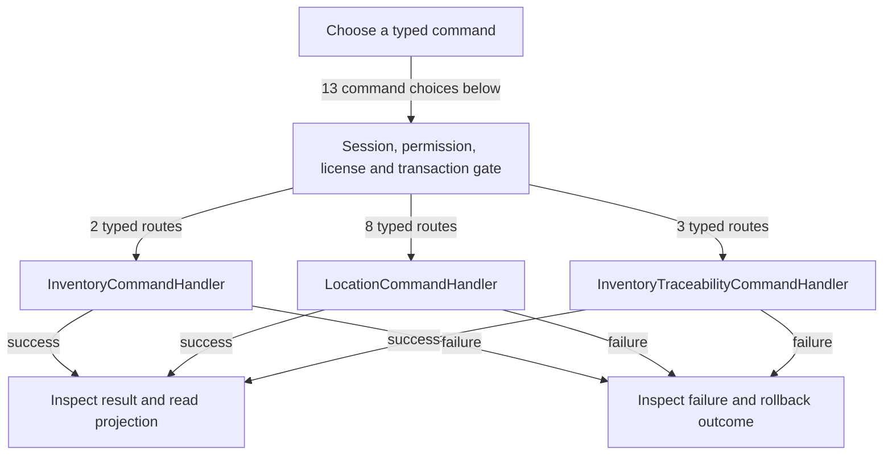

# Stock, locations, lots and serials

DRAFT · code snapshot 18 October 2026 · source review, not runtime acceptance

Feature coverage: PP-F009. Source: [InventoryCommandHandler.cs:1](code-application.md#src-43bee33cf642), [InventoryTraceabilityCommands.cs:1](code-application.md#src-1e2a68301de6).

## Step-by-step review route

The numbered route is a business review checklist. Branches are separate actions; it does not imply that all actions occur in one transaction.

1. Select item and intake or adjustment action.
2. Specify unit, location and tracking evidence.
3. Validate conversion and lot or serial policy.
4. Commit the command-specific movement or traceability change.
5. Inspect quantity and allocation projections.
6. Review exceptions before repeating.

## Command routing map

This overview groups routes by handler to stay readable; each named command and its connections follow below. [Shared gate details](pipeline.md) apply when this handler is invoked through the pipeline. First-run provisioning is an explicit [separate path](access.md). Source construction sites show candidates, not proof of a connected or reachable UI path.

## Commands, options and implementation connections

### AdjustStockCommand

Handler: [InventoryCommandHandler](code-application.md#src-43bee33cf642). Result type: <code>StockMovement</code>.

Declaration: [InventoryCommands.cs:42](code-application.md#src-85c6e1df3363). <code>RequiredPermission = Permissions.AdjustStock</code>

Construction sites: [HandleAsync:119](code-application.md#src-c24b9e05b3b2), [HandleAsync:16](code-application.md#src-ad1ac7eca868), [HandleAsync:31](code-application.md#src-1e2a68301de6), [HandleAsync:68](code-application.md#src-1e2a68301de6), [ApplyProductStockChangeAsync:68](code-desktop.md#src-97d7fd82738a), [ConfirmAdjustStockAsync:9057](code-desktop.md#src-16497b924a99)

Handler method: [InventoryCommandHandler.HandleAsync(AdjustStockCommand,CommandEnvelope&lt;AdjustStockCommand&gt;,CancellationToken)](code-application.md#m-7c8d5eebb581).

Same-owner helper candidates: [InventoryCommandHandler.AddParam(DbCommand,string,object)](code-application.md#m-de4448b9b919), [InventoryCommandHandler.LoadStoredConversionFactorAsync(DbConnection,DbTransaction?,Guid,string,string,CancellationToken)](code-application.md#m-be1a6dd30772). These are unqualified/this-call name matches, including possible overloads; semantic binding was not performed.

| Direct method syntax | Extracted references |
| --- | --- |
| Reads | <code>item_kits</code>, <code>items</code>, <code>stock_movements</code>, <code>store_config</code> |
| Writes / DDL | <code>expense_records</code>, <code>serials</code>, <code>stock_movements</code> |
| Literal failure codes | <code>CANNOT_ADJUST_KIT_STOCK</code>, <code>INSUFFICIENT_LOT_BALANCE</code>, <code>INSUFFICIENT_STOCK</code>, <code>INVALID_QUANTITY</code>, <code>INVALID_UOM_CONVERSION</code>, <code>ITEM_INACTIVE</code>, <code>ITEM_NOT_FOUND</code>, <code>ITEM_NOT_TRACKED</code>, <code>LOT_NOT_AVAILABLE</code>, <code>LOT_NOT_FOUND</code>, <code>LOT_REQUIRED</code>, <code>REASON_REQUIRED</code>, <code>SERIAL_NOT_AVAILABLE</code>, <code>SERIAL_NOT_FOUND</code>, <code>SERIAL_REQUIRED</code>, <code>SERIAL_RESERVED</code>, <code>UNEXPECTED_SERIAL</code>, <code>UNKNOWN_UOM_CONVERSION</code>, <code>USE_SERIAL_RECEIPT</code> |

Helper calls, table references in helpers, and throw sites are listed in the method catalogue. This table is not a transitive effect analysis.

### CreateFacilityCommand

Handler: [LocationCommandHandler](code-application.md#src-a5752d2091f0). Result type: <code>FacilityDto</code>.

Declaration: [LocationCommands.cs:14](code-application.md#src-7a24e4740ac8). <code>RequiredPermission = Permissions.ManageCatalog</code>

Construction sites: [ConfirmSaveFacilityAsync:11264](code-desktop.md#src-16497b924a99)

Handler method: [LocationCommandHandler.HandleAsync(CreateFacilityCommand,CommandEnvelope&lt;CreateFacilityCommand&gt;,CancellationToken)](code-application.md#m-df91c4003dce).

Same-owner helper candidates: [LocationCommandHandler.AddParam(DbCommand,string,object)](code-application.md#m-68fb56f879c0). These are unqualified/this-call name matches, including possible overloads; semantic binding was not performed.

| Direct method syntax | Extracted references |
| --- | --- |
| Reads | <code>facilities</code> |
| Writes / DDL | <code>facilities</code> |
| Literal failure codes | <code>CODE_REQUIRED</code>, <code>DUPLICATE_CODE</code>, <code>NAME_REQUIRED</code> |

Helper calls, table references in helpers, and throw sites are listed in the method catalogue. This table is not a transitive effect analysis.

### CreateLocationBinCommand

Handler: [LocationCommandHandler](code-application.md#src-a5752d2091f0). Result type: <code>BinLocationDto</code>.

Declaration: [LocationCommands.cs:52](code-application.md#src-7a24e4740ac8). <code>RequiredPermission = Permissions.ManageCatalog</code>

Construction sites: [ConfirmSaveBinAsync:11394](code-desktop.md#src-16497b924a99)

Handler method: [LocationCommandHandler.HandleAsync(CreateLocationBinCommand,CommandEnvelope&lt;CreateLocationBinCommand&gt;,CancellationToken)](code-application.md#m-d32cea7d7bd3).

Same-owner helper candidates: [LocationCommandHandler.AddParam(DbCommand,string,object)](code-application.md#m-68fb56f879c0). These are unqualified/this-call name matches, including possible overloads; semantic binding was not performed.

| Direct method syntax | Extracted references |
| --- | --- |
| Reads | <code>bins</code>, <code>facilities</code> |
| Writes / DDL | <code>bins</code> |
| Literal failure codes | <code>CODE_REQUIRED</code>, <code>DUPLICATE_CODE</code>, <code>FACILITY_INACTIVE</code>, <code>FACILITY_NOT_FOUND</code> |

Helper calls, table references in helpers, and throw sites are listed in the method catalogue. This table is not a transitive effect analysis.

### DeactivateFacilityCommand

Handler: [LocationCommandHandler](code-application.md#src-a5752d2091f0). Result type: <code>bool</code>.

Declaration: [LocationCommands.cs:34](code-application.md#src-7a24e4740ac8). <code>RequiredPermission = Permissions.ManageCatalog</code>

Construction sites: [DeactivateFacilityAsync:11298](code-desktop.md#src-16497b924a99)

Handler method: [LocationCommandHandler.HandleAsync(DeactivateFacilityCommand,CommandEnvelope&lt;DeactivateFacilityCommand&gt;,CancellationToken)](code-application.md#m-53c69375e9a6).

Same-owner helper candidates: [LocationCommandHandler.AddParam(DbCommand,string,object)](code-application.md#m-68fb56f879c0). These are unqualified/this-call name matches, including possible overloads; semantic binding was not performed.

| Direct method syntax | Extracted references |
| --- | --- |
| Reads | <code>facilities</code> |
| Writes / DDL | <code>facilities</code> |
| Literal failure codes | <code>FACILITY_NOT_FOUND</code> |

Helper calls, table references in helpers, and throw sites are listed in the method catalogue. This table is not a transitive effect analysis.

### DeactivateLocationBinCommand

Handler: [LocationCommandHandler](code-application.md#src-a5752d2091f0). Result type: <code>bool</code>.

Declaration: [LocationCommands.cs:78](code-application.md#src-7a24e4740ac8). <code>RequiredPermission = Permissions.ManageCatalog</code>

Construction sites: [DeactivateBinAsync:11435](code-desktop.md#src-16497b924a99)

Handler method: [LocationCommandHandler.HandleAsync(DeactivateLocationBinCommand,CommandEnvelope&lt;DeactivateLocationBinCommand&gt;,CancellationToken)](code-application.md#m-dc8cae9c46fa).

Same-owner helper candidates: [LocationCommandHandler.AddParam(DbCommand,string,object)](code-application.md#m-68fb56f879c0). These are unqualified/this-call name matches, including possible overloads; semantic binding was not performed.

| Direct method syntax | Extracted references |
| --- | --- |
| Reads | <code>bins</code> |
| Writes / DDL | <code>bins</code> |
| Literal failure codes | <code>BIN_NOT_FOUND</code> |

Helper calls, table references in helpers, and throw sites are listed in the method catalogue. This table is not a transitive effect analysis.

### ReceiveStockCommand

Handler: [InventoryCommandHandler](code-application.md#src-43bee33cf642). Result type: <code>StockMovement</code>.

Declaration: [InventoryCommands.cs:19](code-application.md#src-85c6e1df3363). <code>RequiredPermission = Permissions.ReceiveStock</code>

Construction sites: [HandleAsync:109](code-application.md#src-2c8d126a7c07), [HandleAsync:108](code-application.md#src-b2413dd4b01c), [ConfirmTraceabilityAsync:226](code-desktop.md#src-f3c9eb6aacd1), [ConfirmReceiveStockAsync:8733](code-desktop.md#src-16497b924a99)

Handler method: [InventoryCommandHandler.HandleAsync(ReceiveStockCommand,CommandEnvelope&lt;ReceiveStockCommand&gt;,CancellationToken)](code-application.md#m-88ca70a84a0a).

Same-owner helper candidates: [InventoryCommandHandler.AddParam(DbCommand,string,object)](code-application.md#m-de4448b9b919), [InventoryCommandHandler.LoadStoredConversionFactorAsync(DbConnection,DbTransaction?,Guid,string,string,CancellationToken)](code-application.md#m-be1a6dd30772), [InventoryCommandHandler.ResolveOrCreateLotAsync(DbConnection,DbTransaction?,Guid,string,DateTime?,DateTime,CancellationToken)](code-application.md#m-66335516a9e7), [InventoryCommandHandler.SerialExistsAsync(DbConnection,DbTransaction?,string,CancellationToken)](code-application.md#m-11a52d6239b9). These are unqualified/this-call name matches, including possible overloads; semantic binding was not performed.

| Direct method syntax | Extracted references |
| --- | --- |
| Reads | <code>items</code>, <code>third_parties</code> |
| Writes / DDL | <code>serials</code>, <code>stock_movements</code> |
| Literal failure codes | <code>COMPONENT_TRACEABILITY_REQUIRED</code>, <code>INVALID_QUANTITY</code>, <code>INVALID_UNIT_COST</code>, <code>INVALID_UOM_CONVERSION</code>, <code>ITEM_CURRENCY_MISMATCH</code>, <code>ITEM_INACTIVE</code>, <code>ITEM_NOT_FOUND</code>, <code>ITEM_NOT_TRACKED</code>, <code>LOT_CREATE_FAILED</code>, <code>LOT_NOT_AVAILABLE</code>, <code>LOT_NOT_FOUND</code>, <code>LOT_NUMBER_REQUIRED</code>, <code>LOT_REQUIRED</code>, <code>REFERENCE_REQUIRED</code>, <code>SERIAL_ALREADY_EXISTS</code>, <code>SERIAL_COUNT_MISMATCH</code>, <code>SERIAL_REQUIRED</code>, <code>SUPPLIER_INACTIVE</code>, <code>SUPPLIER_NOT_FOUND</code>, <code>UNEXPECTED_SERIAL</code>, <code>UNKNOWN_UOM_CONVERSION</code> |

Helper calls, table references in helpers, and throw sites are listed in the method catalogue. This table is not a transitive effect analysis.

### RemoveInventorySerialsCommand

Handler: [InventoryTraceabilityCommandHandler](code-application.md#src-1e2a68301de6). Result type: <code>int</code>.

Declaration: [InventoryTraceabilityCommands.cs:13](code-application.md#src-1e2a68301de6). <code>RequiredPermission = Permissions.AdjustStock</code>

Construction sites: **None found** among explicit `new Type(...)` expressions. Target-typed construction, factories and runtime dispatch are not resolved.

Handler method: [InventoryTraceabilityCommandHandler.HandleAsync(RemoveInventorySerialsCommand,CommandEnvelope&lt;RemoveInventorySerialsCommand&gt;,CancellationToken)](code-application.md#m-e067a0efc2fc).

| Direct method syntax | Extracted references |
| --- | --- |
| Reads | None extracted directly; inspect helpers and dynamic paths. |
| Writes / DDL | None extracted directly; inspect helpers and dynamic paths. |
| Literal failure codes | <code>INVALID_SERIAL_SELECTION</code>, <code>REASON_REQUIRED</code>, <code>SERIAL_NOT_AVAILABLE</code>, <code>TRACEABILITY_STALE</code> |

Helper calls, table references in helpers, and throw sites are listed in the method catalogue. This table is not a transitive effect analysis.

### RemoveItemLocationEligibilityCommand

Handler: [LocationCommandHandler](code-application.md#src-a5752d2091f0). Result type: <code>bool</code>.

Declaration: [LocationCommands.cs:109](code-application.md#src-7a24e4740ac8). <code>RequiredPermission = Permissions.ManageCatalog</code>

Construction sites: [RemoveItemLocationEligibilityAsync:11522](code-desktop.md#src-16497b924a99)

Handler method: [LocationCommandHandler.HandleAsync(RemoveItemLocationEligibilityCommand,CommandEnvelope&lt;RemoveItemLocationEligibilityCommand&gt;,CancellationToken)](code-application.md#m-6fd38c96bfec).

Same-owner helper candidates: [LocationCommandHandler.AddParam(DbCommand,string,object)](code-application.md#m-68fb56f879c0). These are unqualified/this-call name matches, including possible overloads; semantic binding was not performed.

| Direct method syntax | Extracted references |
| --- | --- |
| Reads | <code>item_locations</code> |
| Writes / DDL | <code>item_locations</code> |
| Literal failure codes | <code>LOCATION_ELIGIBILITY_NOT_FOUND</code> |

Helper calls, table references in helpers, and throw sites are listed in the method catalogue. This table is not a transitive effect analysis.

### SetItemLocationEligibilityCommand

Handler: [LocationCommandHandler](code-application.md#src-a5752d2091f0). Result type: <code>ItemLocationDto</code>.

Declaration: [LocationCommands.cs:97](code-application.md#src-7a24e4740ac8). <code>RequiredPermission = Permissions.ManageCatalog</code>

Construction sites: [SaveItemLocationEligibilityAsync:11477](code-desktop.md#src-16497b924a99)

Handler method: [LocationCommandHandler.HandleAsync(SetItemLocationEligibilityCommand,CommandEnvelope&lt;SetItemLocationEligibilityCommand&gt;,CancellationToken)](code-application.md#m-9c7ea12506b5).

Same-owner helper candidates: [LocationCommandHandler.AddParam(DbCommand,string,object)](code-application.md#m-68fb56f879c0). These are unqualified/this-call name matches, including possible overloads; semantic binding was not performed.

| Direct method syntax | Extracted references |
| --- | --- |
| Reads | <code>bins</code>, <code>items</code> |
| Writes / DDL | <code>item_locations</code> |
| Literal failure codes | <code>ITEM_INACTIVE</code>, <code>ITEM_NOT_FOUND</code>, <code>LOCATION_INACTIVE</code>, <code>LOCATION_NOT_FOUND</code>, <code>LOCATION_REQUIRED</code> |

Helper calls, table references in helpers, and throw sites are listed in the method catalogue. This table is not a transitive effect analysis.

### SetLotStockQuantityCommand

Handler: [InventoryTraceabilityCommandHandler](code-application.md#src-1e2a68301de6). Result type: <code>LotStockRow</code>.

Declaration: [InventoryTraceabilityCommands.cs:8](code-application.md#src-1e2a68301de6). <code>RequiredPermission = Permissions.AdjustStock</code>

Construction sites: **None found** among explicit `new Type(...)` expressions. Target-typed construction, factories and runtime dispatch are not resolved.

Handler method: [InventoryTraceabilityCommandHandler.HandleAsync(SetLotStockQuantityCommand,CommandEnvelope&lt;SetLotStockQuantityCommand&gt;,CancellationToken)](code-application.md#m-07cdbc10b980).

| Direct method syntax | Extracted references |
| --- | --- |
| Reads | None extracted directly; inspect helpers and dynamic paths. |
| Writes / DDL | None extracted directly; inspect helpers and dynamic paths. |
| Literal failure codes | <code>INVALID_QUANTITY</code>, <code>LOT_NOT_FOUND</code>, <code>REASON_REQUIRED</code>, <code>TRACEABILITY_STALE</code> |

Helper calls, table references in helpers, and throw sites are listed in the method catalogue. This table is not a transitive effect analysis.

### UpdateFacilityCommand

Handler: [LocationCommandHandler](code-application.md#src-a5752d2091f0). Result type: <code>FacilityDto</code>.

Declaration: [LocationCommands.cs:23](code-application.md#src-7a24e4740ac8). <code>RequiredPermission = Permissions.ManageCatalog</code>

Construction sites: [ConfirmSaveFacilityAsync:11249](code-desktop.md#src-16497b924a99)

Handler method: [LocationCommandHandler.HandleAsync(UpdateFacilityCommand,CommandEnvelope&lt;UpdateFacilityCommand&gt;,CancellationToken)](code-application.md#m-38510a8f429d).

Same-owner helper candidates: [LocationCommandHandler.AddParam(DbCommand,string,object)](code-application.md#m-68fb56f879c0). These are unqualified/this-call name matches, including possible overloads; semantic binding was not performed.

| Direct method syntax | Extracted references |
| --- | --- |
| Reads | <code>facilities</code> |
| Writes / DDL | <code>facilities</code> |
| Literal failure codes | <code>CODE_REQUIRED</code>, <code>DUPLICATE_CODE</code>, <code>FACILITY_NOT_FOUND</code>, <code>NAME_REQUIRED</code> |

Helper calls, table references in helpers, and throw sites are listed in the method catalogue. This table is not a transitive effect analysis.

### UpdateLocationBinCommand

Handler: [LocationCommandHandler](code-application.md#src-a5752d2091f0). Result type: <code>BinLocationDto</code>.

Declaration: [LocationCommands.cs:64](code-application.md#src-7a24e4740ac8). <code>RequiredPermission = Permissions.ManageCatalog</code>

Construction sites: [ConfirmSaveBinAsync:11370](code-desktop.md#src-16497b924a99)

Handler method: [LocationCommandHandler.HandleAsync(UpdateLocationBinCommand,CommandEnvelope&lt;UpdateLocationBinCommand&gt;,CancellationToken)](code-application.md#m-99e9ab387b2d).

Same-owner helper candidates: [LocationCommandHandler.AddParam(DbCommand,string,object)](code-application.md#m-68fb56f879c0). These are unqualified/this-call name matches, including possible overloads; semantic binding was not performed.

| Direct method syntax | Extracted references |
| --- | --- |
| Reads | <code>bins</code>, <code>facilities</code> |
| Writes / DDL | <code>bins</code> |
| Literal failure codes | <code>BIN_NOT_FOUND</code>, <code>CODE_REQUIRED</code>, <code>DUPLICATE_CODE</code>, <code>FACILITY_NOT_FOUND</code> |

Helper calls, table references in helpers, and throw sites are listed in the method catalogue. This table is not a transitive effect analysis.

### UpdateLotExpiryCommand

Handler: [InventoryTraceabilityCommandHandler](code-application.md#src-1e2a68301de6). Result type: <code>LotStockRow</code>.

Declaration: [InventoryTraceabilityCommands.cs:10](code-application.md#src-1e2a68301de6). <code>RequiredPermission = Permissions.ManageCatalog</code>

Construction sites: **None found** among explicit `new Type(...)` expressions. Target-typed construction, factories and runtime dispatch are not resolved.

Handler method: [InventoryTraceabilityCommandHandler.HandleAsync(UpdateLotExpiryCommand,CommandEnvelope&lt;UpdateLotExpiryCommand&gt;,CancellationToken)](code-application.md#m-cae97948113a).

| Direct method syntax | Extracted references |
| --- | --- |
| Reads | None extracted directly; inspect helpers and dynamic paths. |
| Writes / DDL | <code>lots</code> |
| Literal failure codes | <code>LOT_NOT_FOUND</code>, <code>REASON_REQUIRED</code>, <code>TRACEABILITY_STALE</code> |

Helper calls, table references in helpers, and throw sites are listed in the method catalogue. This table is not a transitive effect analysis.

## Verification still required

No application journey was executed for this map. Use a separate synthetic test environment to verify permission denial, valid success, invalid inputs, state conflicts, cancellation, transaction rollback, retry/idempotency and the resulting projection. Add physical-device checks only where the workflow dispatches output. Preserve original financial history when reviewing corrections or reversals.
