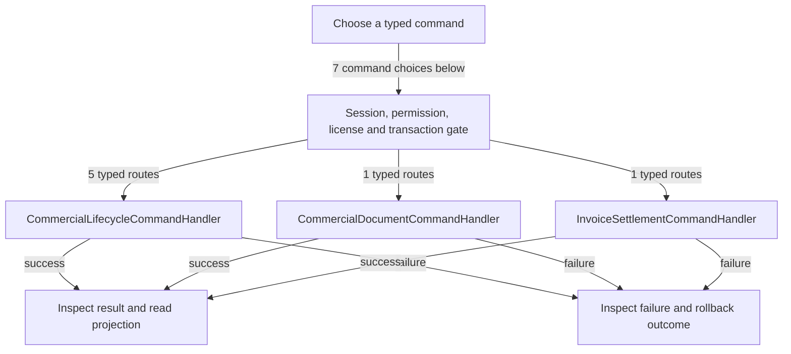

# Invoice collection and commercial lifecycle

DRAFT · code snapshot 20 October 2026 · source review and targeted automated checks

Feature coverage: PP-F005. Source: [InvoiceSettlementCommandHandler.cs:1](code-application.md#src-616fa131d5cf), [CommercialLifecycleCommands.cs:1](code-application.md#src-ad6a9468d7c1).

## Step-by-step review route

The numbered route is a business review checklist. Branches are separate actions; it does not imply that all actions occur in one transaction.

1. Select the existing commercial document.
2. Inspect remaining balance or draft state.
3. Choose collection, cancellation or return-shipment action.
4. Check permission, state and exact amount.
5. Commit the command-specific records.
6. Read the updated balance or lifecycle outcome.

## Command routing map

This overview groups routes by handler to stay readable; each named command and its connections follow below. [Shared gate details](pipeline.md) apply when this handler is invoked through the pipeline. First-run provisioning is an explicit [separate path](access.md). Source construction sites show candidates, not proof of a connected or reachable UI path.

## Commands, options and implementation connections

### CancelInvoiceRemainderCommand

Handler: [CommercialLifecycleCommandHandler](code-application.md#src-ad6a9468d7c1). Result type: <code>Guid</code>.

Declaration: [CommercialLifecycleCommands.cs:13](code-application.md#src-ad6a9468d7c1). <code>RequiredPermission = Permissions.CancelOrderInvoice</code>

Construction sites: **None found** among explicit `new Type(...)` expressions. Target-typed construction, factories and runtime dispatch are not resolved.

Handler method: [CommercialLifecycleCommandHandler.HandleAsync(CancelInvoiceRemainderCommand,CommandEnvelope&lt;CancelInvoiceRemainderCommand&gt;,CancellationToken)](code-application.md#m-48b697a42924).

Same-owner helper candidates: [CommercialLifecycleCommandHandler.Bad(string,string)](code-application.md#m-eaa449ac42c6). These are unqualified/this-call name matches, including possible overloads; semantic binding was not performed.

| Direct method syntax | Extracted references |
| --- | --- |
| Reads | <code>invoice_cancelled_lines</code>, <code>invoice_fulfillment</code>, <code>invoice_stock_reservations</code>, <code>sale_return_lines</code>, <code>sales_invoices</code>, <code>sales_lines</code> |
| Writes / DDL | <code>invoice_cancellations</code>, <code>invoice_cancelled_lines</code>, <code>invoice_fulfillment</code>, <code>invoice_stock_reservations</code>, <code>sales_invoices</code> |
| Literal failure codes | None extracted directly; inspect helpers and dynamic paths. |

Helper calls, table references in helpers, and throw sites are listed in the method catalogue. This table is not a transitive effect analysis.

### CancelReturnShipmentRequestCommand

Handler: [CommercialLifecycleCommandHandler](code-application.md#src-ad6a9468d7c1). Result type: <code>Guid</code>.

Declaration: [CommercialLifecycleCommands.cs:21](code-application.md#src-ad6a9468d7c1). <code>RequiredPermission = Permissions.RequestReturnShipment</code>

Construction sites: **None found** among explicit `new Type(...)` expressions. Target-typed construction, factories and runtime dispatch are not resolved.

Handler method: [CommercialLifecycleCommandHandler.HandleAsync(CancelReturnShipmentRequestCommand,CommandEnvelope&lt;CancelReturnShipmentRequestCommand&gt;,CancellationToken)](code-application.md#m-d630f1c0f394).

Same-owner helper candidates: [CommercialLifecycleCommandHandler.Bad(string,string)](code-application.md#m-eaa449ac42c6). These are unqualified/this-call name matches, including possible overloads; semantic binding was not performed.

| Direct method syntax | Extracted references |
| --- | --- |
| Reads | None extracted directly; inspect helpers and dynamic paths. |
| Writes / DDL | <code>return_shipment_requests</code> |
| Literal failure codes | None extracted directly; inspect helpers and dynamic paths. |

Helper calls, table references in helpers, and throw sites are listed in the method catalogue. This table is not a transitive effect analysis.

### QueueCommercialDocumentCommand

Handler: [CommercialDocumentCommandHandler](code-application.md#src-85955b820e22). Result type: <code>Guid</code>.

Declaration: [CommercialDocumentCommands.cs:9](code-application.md#src-85955b820e22). <code>RequiredPermission = Permissions.ViewAudit</code>

Construction sites: **None found** among explicit `new Type(...)` expressions. Target-typed construction, factories and runtime dispatch are not resolved.

Handler method: [CommercialDocumentCommandHandler.HandleAsync(QueueCommercialDocumentCommand,CommandEnvelope&lt;QueueCommercialDocumentCommand&gt;,CancellationToken)](code-application.md#m-942ca257bb03).

Same-owner helper candidates: [CommercialDocumentCommandHandler.PersistAsync(string,JsonElement,CancellationToken)](code-application.md#m-fa532c7baac1). These are unqualified/this-call name matches, including possible overloads; semantic binding was not performed.

| Direct method syntax | Extracted references |
| --- | --- |
| Reads | <code>hardware_jobs</code>, <code>output_device_config</code>, <code>receipt_designs</code>, <code>sales_invoices</code>, <code>sales_line_kit_allocations</code>, <code>shipment_allocations</code>, <code>shipments</code>, <code>store_config</code>, <code>store_legal_identity</code>, <code>supplier_invoice_lines</code>, <code>supplier_invoices</code>, <code>supplier_payments</code>, <code>supplier_return_lines</code>, <code>supplier_returns</code>, <code>third_parties</code>, <code>users</code> |
| Writes / DDL | None extracted directly; inspect helpers and dynamic paths. |
| Literal failure codes | <code>AUTH_UNAUTHORIZED</code>, <code>DOCUMENT_INVALID</code>, <code>DOCUMENT_NOT_FOUND</code> |

Helper calls, table references in helpers, and throw sites are listed in the method catalogue. This table is not a transitive effect analysis.

### ReceiveInvoicePaymentCommand

Handler: [InvoiceSettlementCommandHandler](code-application.md#src-616fa131d5cf). Result type: <code>InvoiceCollectionResult</code>.

Declaration: [InvoiceSettlementCommands.cs:23](code-application.md#src-a52f4feeda06). <code>RequiredPermission = Permissions.CollectInvoice</code>

Construction sites: **None found** among explicit `new Type(...)` expressions. Target-typed construction, factories and runtime dispatch are not resolved.

Handler method: [InvoiceSettlementCommandHandler.HandleAsync(ReceiveInvoicePaymentCommand,CommandEnvelope&lt;ReceiveInvoicePaymentCommand&gt;,CancellationToken)](code-application.md#m-6bf6102851f1).

Same-owner helper candidates: [InvoiceSettlementCommandHandler.Fail(string,string)](code-application.md#m-51bb8cd1fb33), [InvoiceSettlementCommandHandler.ValidateManualPaymentAsync(System.Data.Common.DbConnection,System.Data.Common.DbTransaction?,TenderType,long,string,ManualPaymentConfirmation?,Guid,Guid,DateTime,CancellationToken)](code-application.md#m-c6e5f5574643), [InvoiceSettlementCommandHandler.WriteCashMovementAsync(System.Data.Common.DbConnection,System.Data.Common.DbTransaction?,Guid,int,long,string,string,Guid,Guid,DateTime,string,CancellationToken)](code-application.md#m-985d64bca81d). These are unqualified/this-call name matches, including possible overloads; semantic binding was not performed.

| Direct method syntax | Extracted references |
| --- | --- |
| Reads | <code>shifts</code>, <code>third_parties</code> |
| Writes / DDL | <code>invoice_collection_allocations</code>, <code>invoice_collections</code>, <code>sales_invoices</code> |
| Literal failure codes | None extracted directly; inspect helpers and dynamic paths. |

Helper calls, table references in helpers, and throw sites are listed in the method catalogue. This table is not a transitive effect analysis.

### ReceiveReturnShipmentCommand

Handler: [CommercialLifecycleCommandHandler](code-application.md#src-ad6a9468d7c1). Result type: <code>Guid</code>.

Declaration: [CommercialLifecycleCommands.cs:17](code-application.md#src-ad6a9468d7c1). <code>RequiredPermission = Permissions.ReceiveReturnShipment</code>

Construction sites: **None found** among explicit `new Type(...)` expressions. Target-typed construction, factories and runtime dispatch are not resolved.

Handler method: [CommercialLifecycleCommandHandler.HandleAsync(ReceiveReturnShipmentCommand,CommandEnvelope&lt;ReceiveReturnShipmentCommand&gt;,CancellationToken)](code-application.md#m-3c371240d17c).

Same-owner helper candidates: [CommercialLifecycleCommandHandler.Bad(string,string)](code-application.md#m-eaa449ac42c6). These are unqualified/this-call name matches, including possible overloads; semantic binding was not performed.

| Direct method syntax | Extracted references |
| --- | --- |
| Reads | <code>return_shipment_requests</code> |
| Writes / DDL | <code>return_shipment_receipts</code>, <code>return_shipment_requests</code> |
| Literal failure codes | None extracted directly; inspect helpers and dynamic paths. |

Helper calls, table references in helpers, and throw sites are listed in the method catalogue. This table is not a transitive effect analysis.

### RequestReturnShipmentCommand

Handler: [CommercialLifecycleCommandHandler](code-application.md#src-ad6a9468d7c1). Result type: <code>Guid</code>.

Declaration: [CommercialLifecycleCommands.cs:15](code-application.md#src-ad6a9468d7c1). <code>RequiredPermission = Permissions.RequestReturnShipment</code>

Construction sites: **None found** among explicit `new Type(...)` expressions. Target-typed construction, factories and runtime dispatch are not resolved.

Handler method: [CommercialLifecycleCommandHandler.HandleAsync(RequestReturnShipmentCommand,CommandEnvelope&lt;RequestReturnShipmentCommand&gt;,CancellationToken)](code-application.md#m-42142a30d538).

Same-owner helper candidates: [CommercialLifecycleCommandHandler.Bad(string,string)](code-application.md#m-eaa449ac42c6). These are unqualified/this-call name matches, including possible overloads; semantic binding was not performed.

| Direct method syntax | Extracted references |
| --- | --- |
| Reads | <code>return_dispositions</code>, <code>return_shipment_requests</code>, <code>sales_line_kit_allocations</code> |
| Writes / DDL | <code>return_shipment_requests</code> |
| Literal failure codes | None extracted directly; inspect helpers and dynamic paths. |

Helper calls, table references in helpers, and throw sites are listed in the method catalogue. This table is not a transitive effect analysis.

### SavePurchaseDraftCommand

Handler: [CommercialLifecycleCommandHandler](code-application.md#src-ad6a9468d7c1). Result type: <code>Guid</code>.

Declaration: [CommercialLifecycleCommands.cs:10](code-application.md#src-ad6a9468d7c1). <code>RequiredPermission = Permissions.IssuePurchase</code>

Construction sites: **None found** among explicit `new Type(...)` expressions. Target-typed construction, factories and runtime dispatch are not resolved.

Handler method: [CommercialLifecycleCommandHandler.HandleAsync(SavePurchaseDraftCommand,CommandEnvelope&lt;SavePurchaseDraftCommand&gt;,CancellationToken)](code-application.md#m-0ea17aed1fac).

Same-owner helper candidates: [CommercialLifecycleCommandHandler.Bad(string,string)](code-application.md#m-eaa449ac42c6). These are unqualified/this-call name matches, including possible overloads; semantic binding was not performed.

| Direct method syntax | Extracted references |
| --- | --- |
| Reads | None extracted directly; inspect helpers and dynamic paths. |
| Writes / DDL | <code>purchase_invoice_drafts</code> |
| Literal failure codes | None extracted directly; inspect helpers and dynamic paths. |

Helper calls, table references in helpers, and throw sites are listed in the method catalogue. This table is not a transitive effect analysis.

## Verification still required

No application journey was executed for this map. Use a separate synthetic test environment to verify permission denial, valid success, invalid inputs, state conflicts, cancellation, transaction rollback, retry/idempotency and the resulting projection. Add physical-device checks only where the workflow dispatches output. Preserve original financial history when reviewing corrections or reversals.
