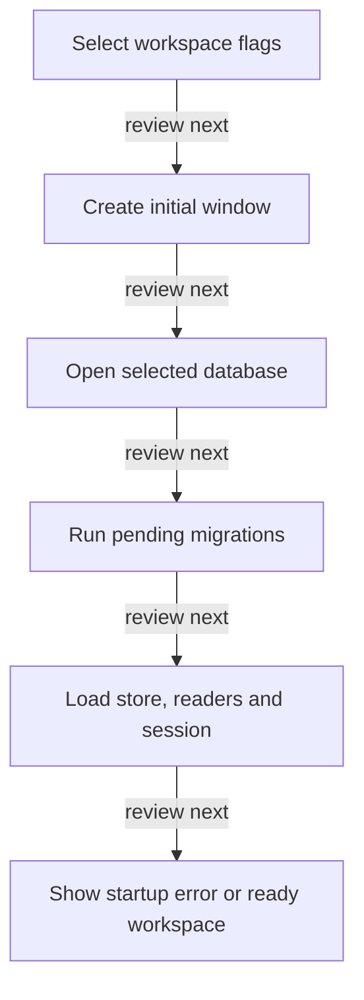

# Launch and startup

DRAFT · code snapshot 18 October 2026 · source review, not runtime acceptance

Feature coverage: PP-F001. Source: [App.axaml.cs:1](code-desktop.md#src-de5bb454765b), [PosBootstrapper.cs:1](code-desktop.md#src-d26211d90637).

## Step-by-step review route

The numbered route is a business review checklist. Branches are separate actions; it does not imply that all actions occur in one transaction.

1. Select workspace flags.
2. Create initial window.
3. Open selected database.
4. Run pending migrations.
5. Load store, readers and session.
6. Show startup error or ready workspace.

## Lifecycle review map

This is a review route across the cited implementation, not a runtime trace captured from an executing application. [Runtime ownership](runtime.md) and the [source catalogues](index.md#source-catalogues) provide the actual composition evidence.

## Verification still required

No application journey was executed for this map. Use a separate synthetic test environment to verify permission denial, valid success, invalid inputs, state conflicts, cancellation, transaction rollback, retry/idempotency and the resulting projection. Add physical-device checks only where the workflow dispatches output. Preserve original financial history when reviewing corrections or reversals.
