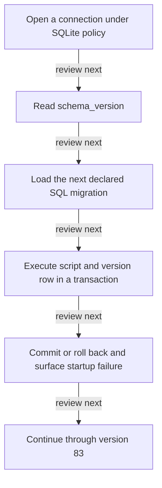

# Migration and persistence lifecycle

DRAFT · code snapshot 18 October 2026 · source review, not runtime acceptance

Feature coverage: PP-F022. Source: [DatabaseMigrator.cs:1](code-infrastructure.md#src-03c231a85247), [SqliteConnectionPolicy.cs:1](code-infrastructure.md#src-4b435878ecef).

## Step-by-step review route

The numbered route is a business review checklist. Branches are separate actions; it does not imply that all actions occur in one transaction.

1. Open a connection under SQLite policy.
2. Read schema_version.
3. Load the next declared SQL migration.
4. Execute script and version row in a transaction.
5. Commit or roll back and surface startup failure.
6. Continue through version 83.

## Lifecycle review map

This is a review route across the cited implementation, not a runtime trace captured from an executing application. [Runtime ownership](runtime.md) and the [source catalogues](index.md#source-catalogues) provide the actual composition evidence.

## Verification still required

No application journey was executed for this map. Use a separate synthetic test environment to verify permission denial, valid success, invalid inputs, state conflicts, cancellation, transaction rollback, retry/idempotency and the resulting projection. Add physical-device checks only where the workflow dispatches output. Preserve original financial history when reviewing corrections or reversals.
