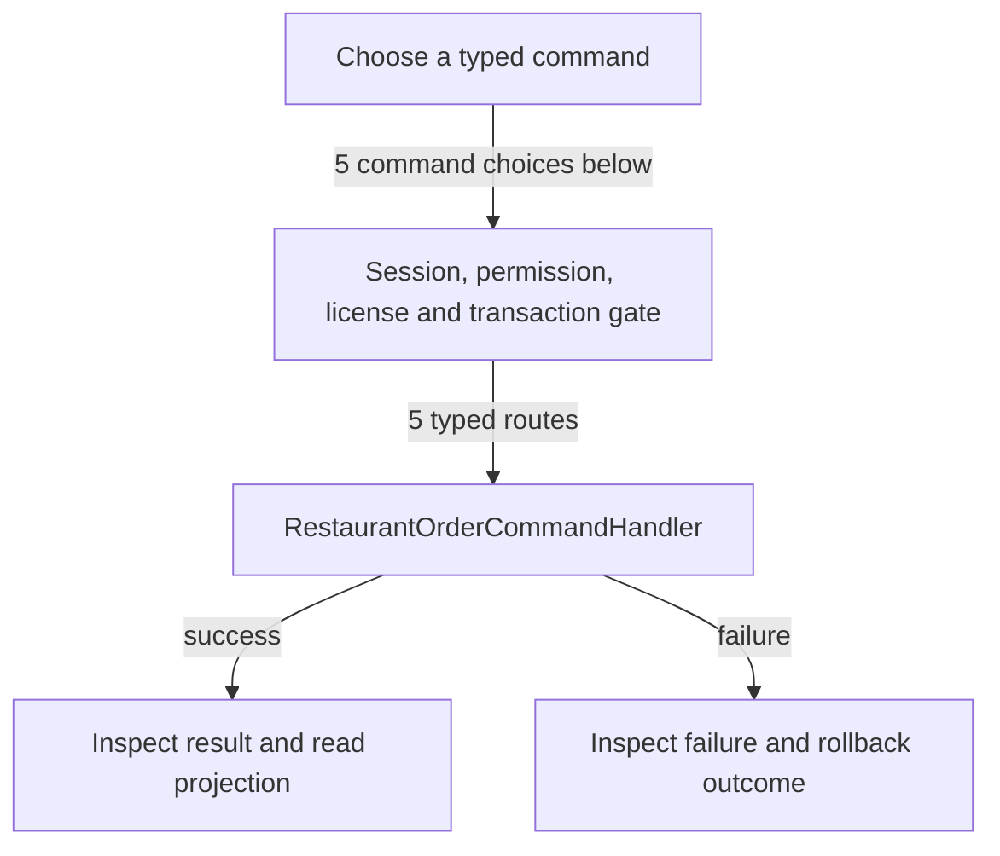

# Order backend and legacy kitchen boundary

DRAFT · code snapshot 20 October 2026 · source review and targeted automated checks

Feature coverage: PP-F020. Source: [RestaurantOrderCommandHandler.cs:1](code-application.md#src-b930bdf2056c), [SqliteProductionReaders.cs:77](code-infrastructure.md#src-212da8ad4eb4), [MainViewModel.cs:8283](code-desktop.md#src-16497b924a99), [OutputDeviceWorker.cs:223](code-infrastructure.md#src-64d2e3097e9f).

Current Cafe checkout is pay-now counter service. These backend order command declarations do not establish current table-service or physical kitchen-output support. See PP-REV-008 and the source-checked rules.

## Step-by-step review route

The numbered route is a business review checklist. Branches are separate actions; it does not imply that all actions occur in one transaction.

1. Confirm current Cafe checkout is Counter Service.
2. Inspect legacy/backend restaurant order handlers separately.
3. Trace KitchenTicket and KitchenTicketCancel production.
4. Check the bundled worker claim filter and missing kitchen route.
5. Review existing order state and authorized resolution.
6. Require a verified consumer before claiming kitchen output.

## Command routing map

This overview groups routes by handler to stay readable; each named command and its connections follow below. [Shared gate details](pipeline.md) apply when this handler is invoked through the pipeline. First-run provisioning is an explicit [separate path](access.md). Source construction sites show candidates, not proof of a connected or reachable UI path.

## Commands, options and implementation connections

### CancelRestaurantOrderCommand

Handler: [RestaurantOrderCommandHandler](code-application.md#src-b930bdf2056c). Result type: <code>RestaurantOrder</code>.

Declaration: [RestaurantOrderCommands.cs:81](code-application.md#src-6ec4352e1907). <code>RequiredPermission = &quot;pos.sale.checkout&quot;</code>

Construction sites: [CancelActiveOrderAsync:6536](code-desktop.md#src-16497b924a99)

Handler method: [RestaurantOrderCommandHandler.HandleAsync(CancelRestaurantOrderCommand,CommandEnvelope&lt;CancelRestaurantOrderCommand&gt;,CancellationToken)](code-application.md#m-38d044c06b45).

Same-owner helper candidates: [RestaurantOrderCommandHandler.LoadOrderAsync(DbConnection,DbTransaction?,Guid,CancellationToken)](code-application.md#m-14d1b799a2c6), [RestaurantOrderCommandHandler.AddParam(DbCommand,string,object?)](code-application.md#m-f60043d2c1c6). These are unqualified/this-call name matches, including possible overloads; semantic binding was not performed.

| Direct method syntax | Extracted references |
| --- | --- |
| Reads | None extracted directly; inspect helpers and dynamic paths. |
| Writes / DDL | <code>restaurant_orders</code> |
| Literal failure codes | <code>ORDER_ALREADY_SETTLED</code>, <code>ORDER_NOT_FOUND</code> |

Helper calls, table references in helpers, and throw sites are listed in the method catalogue. This table is not a transitive effect analysis.

### CreateRestaurantOrderCommand

Handler: [RestaurantOrderCommandHandler](code-application.md#src-b930bdf2056c). Result type: <code>RestaurantOrder</code>.

Declaration: [RestaurantOrderCommands.cs:18](code-application.md#src-6ec4352e1907). <code>RequiredPermission = &quot;pos.sale.checkout&quot;</code>

Construction sites: **None found** among explicit `new Type(...)` expressions. Target-typed construction, factories and runtime dispatch are not resolved.

Handler method: [RestaurantOrderCommandHandler.HandleAsync(CreateRestaurantOrderCommand,CommandEnvelope&lt;CreateRestaurantOrderCommand&gt;,CancellationToken)](code-application.md#m-66cac9aca0aa).

Same-owner helper candidates: [RestaurantOrderCommandHandler.AddParam(DbCommand,string,object?)](code-application.md#m-f60043d2c1c6). These are unqualified/this-call name matches, including possible overloads; semantic binding was not performed.

| Direct method syntax | Extracted references |
| --- | --- |
| Reads | None extracted directly; inspect helpers and dynamic paths. |
| Writes / DDL | <code>restaurant_order_lines</code>, <code>restaurant_orders</code> |
| Literal failure codes | <code>EMPTY_ORDER</code> |

Helper calls, table references in helpers, and throw sites are listed in the method catalogue. This table is not a transitive effect analysis.

### SendOrderToKitchenCommand

Handler: [RestaurantOrderCommandHandler](code-application.md#src-b930bdf2056c). Result type: <code>RestaurantOrder</code>.

Declaration: [RestaurantOrderCommands.cs:53](code-application.md#src-6ec4352e1907). <code>RequiredPermission = &quot;pos.sale.checkout&quot;</code>

Construction sites: **None found** among explicit `new Type(...)` expressions. Target-typed construction, factories and runtime dispatch are not resolved.

Handler method: [RestaurantOrderCommandHandler.HandleAsync(SendOrderToKitchenCommand,CommandEnvelope&lt;SendOrderToKitchenCommand&gt;,CancellationToken)](code-application.md#m-93af95f2f9c1).

Same-owner helper candidates: [RestaurantOrderCommandHandler.LoadOrderAsync(DbConnection,DbTransaction?,Guid,CancellationToken)](code-application.md#m-14d1b799a2c6), [RestaurantOrderCommandHandler.AddParam(DbCommand,string,object?)](code-application.md#m-f60043d2c1c6). These are unqualified/this-call name matches, including possible overloads; semantic binding was not performed.

| Direct method syntax | Extracted references |
| --- | --- |
| Reads | None extracted directly; inspect helpers and dynamic paths. |
| Writes / DDL | <code>restaurant_orders</code> |
| Literal failure codes | <code>INVALID_STATUS</code>, <code>ORDER_NOT_FOUND</code> |

Helper calls, table references in helpers, and throw sites are listed in the method catalogue. This table is not a transitive effect analysis.

### SettleRestaurantOrderCommand

Handler: [RestaurantOrderCommandHandler](code-application.md#src-b930bdf2056c). Result type: <code>RestaurantOrder</code>.

Declaration: [RestaurantOrderCommands.cs:94](code-application.md#src-6ec4352e1907). <code>RequiredPermission = &quot;pos.sale.checkout&quot;</code>

Construction sites: [SettleActiveOrderAsync:6633](code-desktop.md#src-16497b924a99)

Handler method: [RestaurantOrderCommandHandler.HandleAsync(SettleRestaurantOrderCommand,CommandEnvelope&lt;SettleRestaurantOrderCommand&gt;,CancellationToken)](code-application.md#m-1ace6b54b045).

Same-owner helper candidates: [RestaurantOrderCommandHandler.LoadOrderAsync(DbConnection,DbTransaction?,Guid,CancellationToken)](code-application.md#m-14d1b799a2c6), [RestaurantOrderCommandHandler.AddParam(DbCommand,string,object?)](code-application.md#m-f60043d2c1c6). These are unqualified/this-call name matches, including possible overloads; semantic binding was not performed.

| Direct method syntax | Extracted references |
| --- | --- |
| Reads | None extracted directly; inspect helpers and dynamic paths. |
| Writes / DDL | <code>restaurant_orders</code> |
| Literal failure codes | <code>ORDER_NOT_FOUND</code>, <code>ORDER_VOIDED</code> |

Helper calls, table references in helpers, and throw sites are listed in the method catalogue. This table is not a transitive effect analysis.

### UpdateRestaurantOrderStatusCommand

Handler: [RestaurantOrderCommandHandler](code-application.md#src-b930bdf2056c). Result type: <code>RestaurantOrder</code>.

Declaration: [RestaurantOrderCommands.cs:67](code-application.md#src-6ec4352e1907). <code>RequiredPermission = &quot;pos.sale.checkout&quot;</code>

Construction sites: [MarkPreparingAsync:6433](code-desktop.md#src-16497b924a99), [MarkReadyAsync:6468](code-desktop.md#src-16497b924a99), [MarkServedAsync:6503](code-desktop.md#src-16497b924a99)

Handler method: [RestaurantOrderCommandHandler.HandleAsync(UpdateRestaurantOrderStatusCommand,CommandEnvelope&lt;UpdateRestaurantOrderStatusCommand&gt;,CancellationToken)](code-application.md#m-cc0c2ea16a9e).

Same-owner helper candidates: [RestaurantOrderCommandHandler.LoadOrderAsync(DbConnection,DbTransaction?,Guid,CancellationToken)](code-application.md#m-14d1b799a2c6), [RestaurantOrderCommandHandler.AddParam(DbCommand,string,object?)](code-application.md#m-f60043d2c1c6). These are unqualified/this-call name matches, including possible overloads; semantic binding was not performed.

| Direct method syntax | Extracted references |
| --- | --- |
| Reads | None extracted directly; inspect helpers and dynamic paths. |
| Writes / DDL | <code>restaurant_orders</code> |
| Literal failure codes | <code>INVALID_STATUS</code>, <code>ORDER_NOT_FOUND</code> |

Helper calls, table references in helpers, and throw sites are listed in the method catalogue. This table is not a transitive effect analysis.

## Open review points

- [PP-REV-008: Kitchen ticket producers have no bundled worker claim route](decisions.md#pp-rev-008) — source-observed connection gap.

## Verification still required

No application journey was executed for this map. Use a separate synthetic test environment to verify permission denial, valid success, invalid inputs, state conflicts, cancellation, transaction rollback, retry/idempotency and the resulting projection. Add physical-device checks only where the workflow dispatches output. Preserve original financial history when reviewing corrections or reversals.
