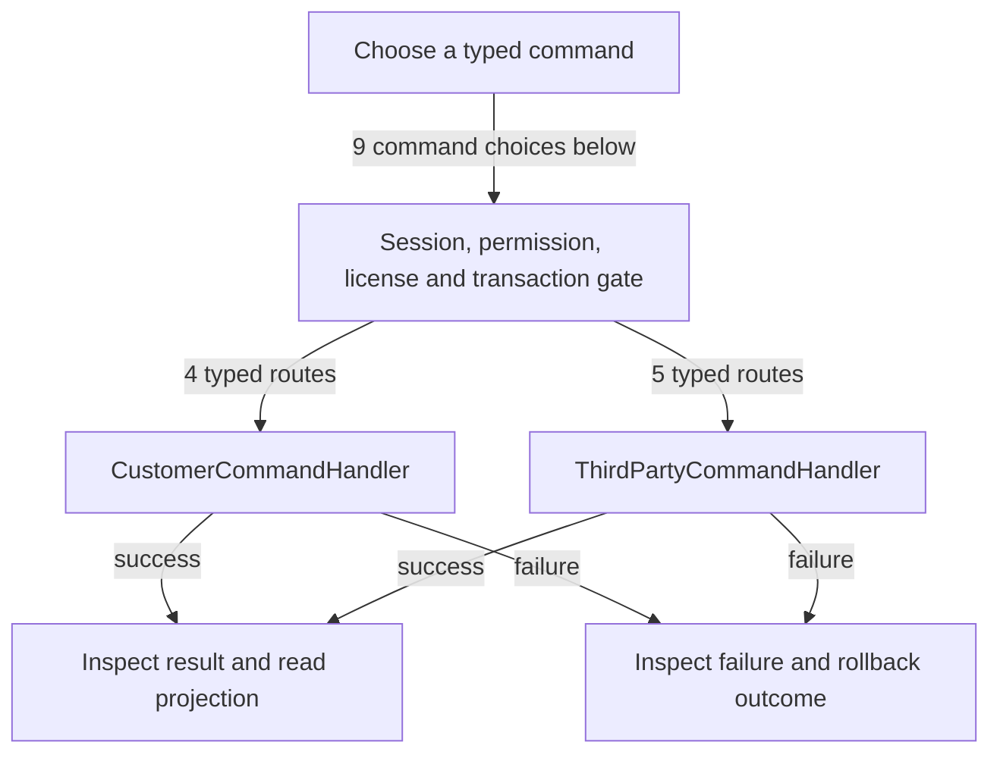

# Customers, suppliers and third parties

DRAFT · code snapshot 20 October 2026 · source review and targeted automated checks

Feature coverage: PP-F013. Source: [ThirdPartyCommandHandler.cs:1](code-application.md#src-b2b033d6711b).

## Step-by-step review route

The numbered route is a business review checklist. Branches are separate actions; it does not imply that all actions occur in one transaction.

1. Choose party and role or lifecycle action.
2. Validate identity and category.
3. Apply permitted price-level or master-data change.
4. Commit the party record.
5. Reload list and selected party.
6. Inspect dependent documents before deactivation.

## Command routing map

This overview groups routes by handler to stay readable; each named command and its connections follow below. [Shared gate details](pipeline.md) apply when this handler is invoked through the pipeline. First-run provisioning is an explicit [separate path](access.md). Source construction sites show candidates, not proof of a connected or reachable UI path.

## Commands, options and implementation connections

### CreateCustomerCommand

Handler: [CustomerCommandHandler](code-application.md#src-21df28594271). Result type: <code>CustomerDto</code>.

Declaration: [CustomerCommands.cs:20](code-application.md#src-e38bff3a5457). <code>RequiredPermission = Permissions.ManageCustomers</code>

Construction sites: **None found** among explicit `new Type(...)` expressions. Target-typed construction, factories and runtime dispatch are not resolved.

Handler method: [CustomerCommandHandler.HandleAsync(CreateCustomerCommand,CommandEnvelope&lt;CreateCustomerCommand&gt;,CancellationToken)](code-application.md#m-25775f41bdcc).

Same-owner helper candidates: [CustomerCommandHandler.AddParam(DbCommand,string,object)](code-application.md#m-2b126b330e8c). These are unqualified/this-call name matches, including possible overloads; semantic binding was not performed.

| Direct method syntax | Extracted references |
| --- | --- |
| Reads | <code>third_parties</code> |
| Writes / DDL | <code>third_parties</code> |
| Literal failure codes | <code>CODE_REQUIRED</code>, <code>DUPLICATE_CODE</code>, <code>NAME_REQUIRED</code>, <code>PHONE_FORMAT_INVALID</code> |

Helper calls, table references in helpers, and throw sites are listed in the method catalogue. This table is not a transitive effect analysis.

### CreateThirdPartyCommand

Handler: [ThirdPartyCommandHandler](code-application.md#src-b2b033d6711b). Result type: <code>ThirdPartyDto</code>.

Declaration: [ThirdPartyCommands.cs:66](code-application.md#src-29524979389b). <code>RequiredPermission = Permissions.ManageCustomers</code>

Construction sites: [ConfirmSaveThirdPartyAsync:1790](code-desktop.md#src-974d69a1850f)

Handler method: [ThirdPartyCommandHandler.HandleAsync(CreateThirdPartyCommand,CommandEnvelope&lt;CreateThirdPartyCommand&gt;,CancellationToken)](code-application.md#m-e3e4b695a83f).

Same-owner helper candidates: [ThirdPartyCommandHandler.TryNormalizePhones(string?,string?,string?,string?,string?,string?,string?,string?)](code-application.md#m-2341d95868f3), [ThirdPartyCommandHandler.NormalizeTier(string?)](code-application.md#m-f80469ebcbe6), [ThirdPartyCommandHandler.NormalizeNullable(string?)](code-application.md#m-678802e1b615), [ThirdPartyCommandHandler.ValidateActiveTierAsync(DbConnection,DbTransaction?,string,CancellationToken)](code-application.md#m-381be67db2ed), [ThirdPartyCommandHandler.GenerateNextCodeAsync(DbConnection,DbTransaction?,CancellationToken)](code-application.md#m-b3ff10e7df5d), [ThirdPartyCommandHandler.IsBarcodeAvailableAsync(DbConnection,DbTransaction?,string?,Guid?,CancellationToken)](code-application.md#m-31cbb75f3ca6), [ThirdPartyCommandHandler.AddParam(DbCommand,string,object)](code-application.md#m-efcb8358bbc5). These are unqualified/this-call name matches, including possible overloads; semantic binding was not performed.

| Direct method syntax | Extracted references |
| --- | --- |
| Reads | None extracted directly; inspect helpers and dynamic paths. |
| Writes / DDL | <code>third_parties</code> |
| Literal failure codes | <code>DUPLICATE_BARCODE</code>, <code>INVALID_PRICE_LEVEL</code>, <code>NAME_REQUIRED</code>, <code>PHONE_FORMAT_INVALID</code>, <code>STATE_REGION_INVALID</code> |

Helper calls, table references in helpers, and throw sites are listed in the method catalogue. This table is not a transitive effect analysis.

### DeactivateCustomerCommand

Handler: [CustomerCommandHandler](code-application.md#src-21df28594271). Result type: <code>bool</code>.

Declaration: [CustomerCommands.cs:48](code-application.md#src-e38bff3a5457). <code>RequiredPermission = Permissions.ManageCustomers</code>

Construction sites: [DeactivateCustomerAsync:12699](code-desktop.md#src-16497b924a99)

Handler method: [CustomerCommandHandler.HandleAsync(DeactivateCustomerCommand,CommandEnvelope&lt;DeactivateCustomerCommand&gt;,CancellationToken)](code-application.md#m-590723502c08).

Same-owner helper candidates: [CustomerCommandHandler.AddParam(DbCommand,string,object)](code-application.md#m-2b126b330e8c). These are unqualified/this-call name matches, including possible overloads; semantic binding was not performed.

| Direct method syntax | Extracted references |
| --- | --- |
| Reads | <code>third_parties</code> |
| Writes / DDL | <code>third_parties</code> |
| Literal failure codes | <code>CUSTOMER_NOT_FOUND</code>, <code>SYSTEM_WALK_IN_PROTECTED</code> |

Helper calls, table references in helpers, and throw sites are listed in the method catalogue. This table is not a transitive effect analysis.

### DeactivateThirdPartyCommand

Handler: [ThirdPartyCommandHandler](code-application.md#src-b2b033d6711b). Result type: <code>bool</code>.

Declaration: [ThirdPartyCommands.cs:116](code-application.md#src-29524979389b). <code>RequiredPermission = Permissions.ManageCustomers</code>

Construction sites: [DeactivateThirdPartyAsync:1835](code-desktop.md#src-974d69a1850f)

Handler method: [ThirdPartyCommandHandler.HandleAsync(DeactivateThirdPartyCommand,CommandEnvelope&lt;DeactivateThirdPartyCommand&gt;,CancellationToken)](code-application.md#m-599566bc0d8c).

Same-owner helper candidates: [ThirdPartyCommandHandler.AddParam(DbCommand,string,object)](code-application.md#m-efcb8358bbc5). These are unqualified/this-call name matches, including possible overloads; semantic binding was not performed.

| Direct method syntax | Extracted references |
| --- | --- |
| Reads | <code>third_parties</code> |
| Writes / DDL | <code>third_parties</code> |
| Literal failure codes | <code>SYSTEM_WALK_IN_PROTECTED</code>, <code>THIRD_PARTY_NOT_FOUND</code> |

Helper calls, table references in helpers, and throw sites are listed in the method catalogue. This table is not a transitive effect analysis.

### ReactivateCustomerCommand

Handler: [CustomerCommandHandler](code-application.md#src-21df28594271). Result type: <code>bool</code>.

Declaration: [CustomerCommands.cs:56](code-application.md#src-e38bff3a5457). <code>RequiredPermission = Permissions.ManageCustomers</code>

Construction sites: **None found** among explicit `new Type(...)` expressions. Target-typed construction, factories and runtime dispatch are not resolved.

Handler method: [CustomerCommandHandler.HandleAsync(ReactivateCustomerCommand,CommandEnvelope&lt;ReactivateCustomerCommand&gt;,CancellationToken)](code-application.md#m-afe62a7587fe).

Same-owner helper candidates: [CustomerCommandHandler.AddParam(DbCommand,string,object)](code-application.md#m-2b126b330e8c). These are unqualified/this-call name matches, including possible overloads; semantic binding was not performed.

| Direct method syntax | Extracted references |
| --- | --- |
| Reads | <code>third_parties</code> |
| Writes / DDL | <code>third_parties</code> |
| Literal failure codes | <code>CUSTOMER_NOT_FOUND</code>, <code>SYSTEM_WALK_IN_PROTECTED</code> |

Helper calls, table references in helpers, and throw sites are listed in the method catalogue. This table is not a transitive effect analysis.

### ReactivateThirdPartyCommand

Handler: [ThirdPartyCommandHandler](code-application.md#src-b2b033d6711b). Result type: <code>bool</code>.

Declaration: [ThirdPartyCommands.cs:124](code-application.md#src-29524979389b). <code>RequiredPermission = Permissions.ManageCustomers</code>

Construction sites: [ReactivateThirdPartyAsync:2797](code-desktop.md#src-974d69a1850f)

Handler method: [ThirdPartyCommandHandler.HandleAsync(ReactivateThirdPartyCommand,CommandEnvelope&lt;ReactivateThirdPartyCommand&gt;,CancellationToken)](code-application.md#m-fec6a8dfa150).

Same-owner helper candidates: [ThirdPartyCommandHandler.AddParam(DbCommand,string,object)](code-application.md#m-efcb8358bbc5). These are unqualified/this-call name matches, including possible overloads; semantic binding was not performed.

| Direct method syntax | Extracted references |
| --- | --- |
| Reads | <code>third_parties</code> |
| Writes / DDL | <code>third_parties</code> |
| Literal failure codes | None extracted directly; inspect helpers and dynamic paths. |

Helper calls, table references in helpers, and throw sites are listed in the method catalogue. This table is not a transitive effect analysis.

### SetThirdPartyPriceLevelCommand

Handler: [ThirdPartyCommandHandler](code-application.md#src-b2b033d6711b). Result type: <code>bool</code>.

Declaration: [ThirdPartyCommands.cs:130](code-application.md#src-29524979389b). <code>RequiredPermission = Permissions.ManageCustomers</code>

Construction sites: [SaveThirdPartyPriceLevelAsync:1402](code-desktop.md#src-974d69a1850f)

Handler method: [ThirdPartyCommandHandler.HandleAsync(SetThirdPartyPriceLevelCommand,CommandEnvelope&lt;SetThirdPartyPriceLevelCommand&gt;,CancellationToken)](code-application.md#m-e177b1388efc).

Same-owner helper candidates: [ThirdPartyCommandHandler.NormalizeTier(string?)](code-application.md#m-f80469ebcbe6), [ThirdPartyCommandHandler.ValidateActiveTierAsync(DbConnection,DbTransaction?,string,CancellationToken)](code-application.md#m-381be67db2ed), [ThirdPartyCommandHandler.AddParam(DbCommand,string,object)](code-application.md#m-efcb8358bbc5). These are unqualified/this-call name matches, including possible overloads; semantic binding was not performed.

| Direct method syntax | Extracted references |
| --- | --- |
| Reads | <code>third_parties</code> |
| Writes / DDL | <code>third_parties</code> |
| Literal failure codes | <code>INVALID_PRICE_LEVEL</code>, <code>SYSTEM_WALK_IN_PROTECTED</code>, <code>THIRD_PARTY_NOT_FOUND</code>, <code>THIRD_PARTY_STALE</code> |

Helper calls, table references in helpers, and throw sites are listed in the method catalogue. This table is not a transitive effect analysis.

### UpdateCustomerCommand

Handler: [CustomerCommandHandler](code-application.md#src-21df28594271). Result type: <code>CustomerDto</code>.

Declaration: [CustomerCommands.cs:33](code-application.md#src-e38bff3a5457). <code>RequiredPermission = Permissions.ManageCustomers</code>

Construction sites: **None found** among explicit `new Type(...)` expressions. Target-typed construction, factories and runtime dispatch are not resolved.

Handler method: [CustomerCommandHandler.HandleAsync(UpdateCustomerCommand,CommandEnvelope&lt;UpdateCustomerCommand&gt;,CancellationToken)](code-application.md#m-b7c4e68b2da4).

Same-owner helper candidates: [CustomerCommandHandler.AddParam(DbCommand,string,object)](code-application.md#m-2b126b330e8c). These are unqualified/this-call name matches, including possible overloads; semantic binding was not performed.

| Direct method syntax | Extracted references |
| --- | --- |
| Reads | <code>third_parties</code> |
| Writes / DDL | <code>third_parties</code> |
| Literal failure codes | <code>CODE_REQUIRED</code>, <code>CUSTOMER_NOT_FOUND</code>, <code>DUPLICATE_CODE</code>, <code>NAME_REQUIRED</code>, <code>PHONE_FORMAT_INVALID</code>, <code>SYSTEM_WALK_IN_PROTECTED</code> |

Helper calls, table references in helpers, and throw sites are listed in the method catalogue. This table is not a transitive effect analysis.

### UpdateThirdPartyCommand

Handler: [ThirdPartyCommandHandler](code-application.md#src-b2b033d6711b). Result type: <code>ThirdPartyDto</code>.

Declaration: [ThirdPartyCommands.cs:90](code-application.md#src-29524979389b). <code>RequiredPermission = Permissions.ManageCustomers</code>

Construction sites: [ConfirmSaveThirdPartyAsync:1769](code-desktop.md#src-974d69a1850f)

Handler method: [ThirdPartyCommandHandler.HandleAsync(UpdateThirdPartyCommand,CommandEnvelope&lt;UpdateThirdPartyCommand&gt;,CancellationToken)](code-application.md#m-da62f735756b).

Same-owner helper candidates: [ThirdPartyCommandHandler.TryNormalizePhones(string?,string?,string?,string?,string?,string?,string?,string?)](code-application.md#m-2341d95868f3), [ThirdPartyCommandHandler.NormalizeTier(string?)](code-application.md#m-f80469ebcbe6), [ThirdPartyCommandHandler.NormalizeNullable(string?)](code-application.md#m-678802e1b615), [ThirdPartyCommandHandler.AddParam(DbCommand,string,object)](code-application.md#m-efcb8358bbc5), [ThirdPartyCommandHandler.IsBarcodeAvailableAsync(DbConnection,DbTransaction?,string?,Guid?,CancellationToken)](code-application.md#m-31cbb75f3ca6), [ThirdPartyCommandHandler.ValidateActiveTierAsync(DbConnection,DbTransaction?,string,CancellationToken)](code-application.md#m-381be67db2ed). These are unqualified/this-call name matches, including possible overloads; semantic binding was not performed.

| Direct method syntax | Extracted references |
| --- | --- |
| Reads | <code>third_parties</code> |
| Writes / DDL | <code>third_parties</code> |
| Literal failure codes | <code>DUPLICATE_BARCODE</code>, <code>INVALID_PRICE_LEVEL</code>, <code>NAME_REQUIRED</code>, <code>PHONE_FORMAT_INVALID</code>, <code>STATE_REGION_INVALID</code>, <code>SYSTEM_WALK_IN_PROTECTED</code>, <code>THIRD_PARTY_NOT_FOUND</code> |

Helper calls, table references in helpers, and throw sites are listed in the method catalogue. This table is not a transitive effect analysis.

## Verification still required

No application journey was executed for this map. Use a separate synthetic test environment to verify permission denial, valid success, invalid inputs, state conflicts, cancellation, transaction rollback, retry/idempotency and the resulting projection. Add physical-device checks only where the workflow dispatches output. Preserve original financial history when reviewing corrections or reversals.
