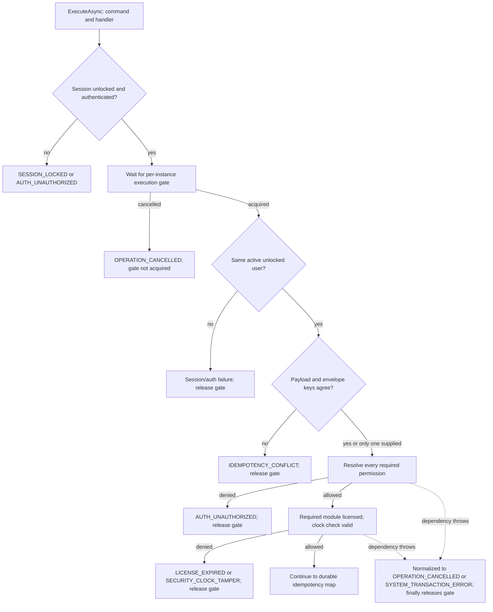
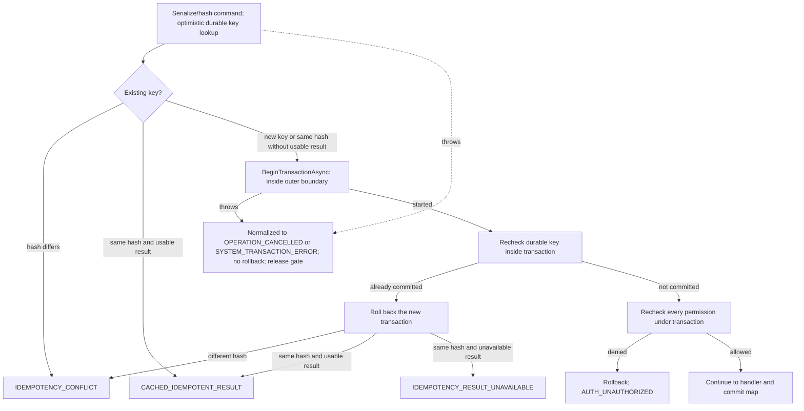
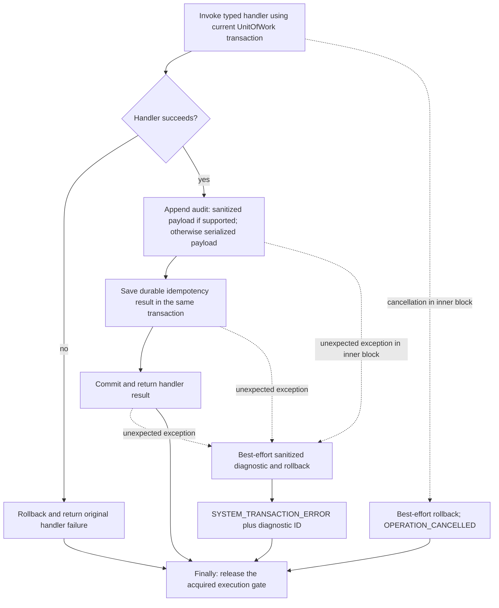

# Command and failure pipeline

DRAFT · code snapshot 20 October 2026 · source review and targeted automated checks

This map follows the inspected `ExecuteAsync` control flow. Both the post-gate preflight block and the in-transaction block share a unified cancellation/exception normalization boundary (`PP-REV-002` option `boundary`), rolling back only when an active transaction was opened.

## Session and preflight

Preflight permission resolution, licensing/clock checks, serialization, optimistic idempotency reads, and `BeginTransactionAsync` are wrapped inside the post-gate cancellation/exception boundary (`PP-REV-002`). If a preflight step fails before a transaction starts, no rollback is attempted and the gate is released in `finally`.

## Durable idempotency and transaction entry

Existing-result deserialization and the under-transaction checks share the outer boundary, with `RollbackAsync` gated on whether `tx is not null`. An unusable optimistic cache entry is not permission to repeat a committed financial action; the durable check inside the writer transaction decides the outcome.

## Handler, audit and commit

The boundary covers preflight checks, transaction creation, under-transaction rechecks, permission checks, handler execution, audit, idempotency save and commit. Rollback is executed only when a transaction has begun (`tx is not null`). Logging and rollback are best effort; a generated diagnostic ID does not prove that a log was written. A commit exception does not by itself prove that nothing was committed.

The gate is local to a pipeline instance. Durable idempotency and SQLite transaction checks add safeguards; no distributed exactly-once guarantee is made.

## Failure and retry review

| Point | Result / review action |
| --- | --- |
| Locked/changed session, permission or license denial | Correct identity/access/configuration; do not repeatedly resubmit a financial command. |
| Idempotency conflict | Inspect the recorded command key and request hash. A different action needs a different key. |
| Cached success | Display the recorded result; avoid a second physical output action. |
| Handler failure | Transaction rollback is requested; inspect the stable code and its handler context. |
| Unexpected transaction exception | Safe diagnostic reference, best-effort rollback; inspect the recorded outcome before retry. |
| Preflight dependency exception | Normalized at the pipeline boundary (`SYSTEM_TRANSACTION_ERROR` or `OPERATION_CANCELLED`) without rolling back an unstarted transaction (`PP-REV-002`). |
| Commit outcome uncertain to caller | Reconcile by durable key/result rather than assuming failure means no commit. |

## Source

[CommandPipeline.cs:27](code-application.md#src-b29270acda74)

[ICommand and permission declarations](access.md) · [Error catalogue](errors.md) · [Physical output](output.md)
