# Pricing, offers, labels and mass runs

DRAFT · code snapshot 20 October 2026 · source review and targeted automated checks

Feature coverage: PP-F011. Source: [SaveItemPricingCommandHandler.cs:1](code-application.md#src-eb108abd205b), [PricingMassRunCommandHandler.cs:1](code-application.md#src-f557bef172d1).

## Step-by-step review route

The numbered route is a business review checklist. Branches are separate actions; it does not imply that all actions occur in one transaction.

1. Choose item, category, offer or durable pricing run.
2. Preview target scope and pricing policy.
3. Check versions, rounding and cost constraints.
4. Apply authorized changes or control the run.
5. Record history, proposals, alerts or pending labels.
6. Review labels and shelf output separately.

## Command routing map

```mermaid
flowchart TD
    Entry["Choose a typed command"]
    Gate["Session, permission, license and transaction gate"]
    Good["Inspect result and read projection"]
    Bad["Inspect failure and rollback outcome"]
    h0["ApplyBatchPricingCommandHandler"]
    h1["PricingMassRunCommandHandler"]
    h2["CategoryPricingRuleCommandHandler"]
    h3["QueueShelfLabelPrintCommandHandler"]
    h4["ResolveKitPriceAlertCommandHandler"]
    h5["ResolvePriceChangeProposalCommandHandler"]
    h6["SaveItemPricingCommandHandler"]
    h7["PriceOfferCommandHandler"]
    h8["SetShelfLabelStatusCommandHandler"]
    Entry -->|"14 command choices below"| Gate
    Gate -->|"1 typed routes"| h0
    h0 -->|"success"| Good
    h0 -->|"failure"| Bad
    Gate -->|"4 typed routes"| h1
    h1 -->|"success"| Good
    h1 -->|"failure"| Bad
    Gate -->|"2 typed routes"| h2
    h2 -->|"success"| Good
    h2 -->|"failure"| Bad
    Gate -->|"1 typed routes"| h3
    h3 -->|"success"| Good
    h3 -->|"failure"| Bad
    Gate -->|"1 typed routes"| h4
    h4 -->|"success"| Good
    h4 -->|"failure"| Bad
    Gate -->|"1 typed routes"| h5
    h5 -->|"success"| Good
    h5 -->|"failure"| Bad
    Gate -->|"1 typed routes"| h6
    h6 -->|"success"| Good
    h6 -->|"failure"| Bad
    Gate -->|"2 typed routes"| h7
    h7 -->|"success"| Good
    h7 -->|"failure"| Bad
    Gate -->|"1 typed routes"| h8
    h8 -->|"success"| Good
    h8 -->|"failure"| Bad
```

This overview groups routes by handler to stay readable; each named command and its connections follow below. [Shared gate details](pipeline.md) apply when this handler is invoked through the pipeline. First-run provisioning is an explicit [separate path](access.md). Source construction sites show candidates, not proof of a connected or reachable UI path.

## Commands, options and implementation connections

### ApplyBatchPricingCommand

Handler: [ApplyBatchPricingCommandHandler](code-application.md#src-b18b22aba44c). Result type: <code>BatchPricingResult</code>.

Declaration: [PricingCommands.cs:43](code-application.md#src-110703c52a80). <code>RequiredPermission = Permissions.ManageCatalog</code>

Construction sites: [ConfirmBatchPricingAsync:2833](code-desktop.md#src-974d69a1850f)

Handler method: [ApplyBatchPricingCommandHandler.HandleAsync(ApplyBatchPricingCommand,CommandEnvelope&lt;ApplyBatchPricingCommand&gt;,CancellationToken)](code-application.md#m-1993964377ca).

Same-owner helper candidates: [ApplyBatchPricingCommandHandler.Add(DbCommand,string,object)](code-application.md#m-6e9a7663107c). These are unqualified/this-call name matches, including possible overloads; semantic binding was not performed.

| Direct method syntax | Extracted references |
| --- | --- |
| Reads | <code>store_config</code> |
| Writes / DDL | <code>item_pricing</code>, <code>items</code>, <code>pricing_batch_items</code>, <code>pricing_batch_proposals</code>, <code>pricing_batches</code> |
| Literal failure codes | <code>BATCH_SELECTION_STALE</code>, <code>INVALID_ROUNDING_INCREMENT</code>, <code>PRICING_PREVIEW_STALE</code> |

Helper calls, table references in helpers, and throw sites are listed in the method catalogue. This table is not a transitive effect analysis.

### CreatePricingMassRunCommand

Handler: [PricingMassRunCommandHandler](code-application.md#src-f557bef172d1). Result type: <code>Guid</code>.

Declaration: [PricingCommands.cs:57](code-application.md#src-110703c52a80). <code>RequiredPermission = Permissions.ManageCatalog</code>

Construction sites: **None found** among explicit `new Type(...)` expressions. Target-typed construction, factories and runtime dispatch are not resolved.

Handler method: [PricingMassRunCommandHandler.HandleAsync(CreatePricingMassRunCommand,CommandEnvelope&lt;CreatePricingMassRunCommand&gt;,CancellationToken)](code-application.md#m-493b9107613b).

Same-owner helper candidates: [PricingMassRunCommandHandler.ValidateTierOperationsAsync(DbConnection,DbTransaction?,string,IReadOnlyList&lt;PricingTierRunOperation&gt;?,CancellationToken)](code-application.md#m-812a19b640eb), [PricingMassRunCommandHandler.ComputeConfigurationFingerprint(CreatePricingMassRunCommand,string,string,string[])](code-application.md#m-afb0709bc7c8), [PricingMassRunCommandHandler.AddParam(DbCommand,string,object)](code-application.md#m-dd3cc8e69752), [PricingMassRunCommandHandler.ValidatePreviewAsync(DbConnection,DbTransaction?,CreatePricingMassRunCommand,Guid,string,Guid,DateTime,CancellationToken)](code-application.md#m-46938df44e36), [PricingMassRunCommandHandler.ReadDecimalPlacesAsync(DbConnection,DbTransaction?,CancellationToken)](code-application.md#m-d9f726827fad), [PricingMassRunCommandHandler.SnapshotCandidatesAsync(DbConnection,DbTransaction?,Guid,Guid?,string[],string?,bool,CancellationToken)](code-application.md#m-e567707599e0). These are unqualified/this-call name matches, including possible overloads; semantic binding was not performed.

| Direct method syntax | Extracted references |
| --- | --- |
| Reads | <code>pricing_mass_runs</code>, <code>product_categories</code> |
| Writes / DDL | <code>pricing_mass_run_previews</code>, <code>pricing_mass_runs</code> |
| Literal failure codes | <code>BATCH_CAP_EXCEEDED</code>, <code>BATCH_SELECTION_STALE</code>, <code>CATEGORY_INACTIVE</code>, <code>COST_BASIS_INVALID</code>, <code>IDEMPOTENCY_CONFLICT</code>, <code>IDEMPOTENCY_KEY_INVALID</code>, <code>INVALID_ROUNDING_INCREMENT</code>, <code>PRICE_NEGATIVE</code>, <code>PRICING_CONFIGURATION_INVALID</code>, <code>PRICING_CYCLE_SIZE_INVALID</code>, <code>PRICING_POLICY_INVALID</code>, <code>PRICING_PREVIEW_REQUIRED</code>, <code>PRICING_PREVIEW_STALE</code>, <code>PRICING_RUN_KIND_INVALID</code>, <code>PRICING_SCOPE_EMPTY</code>, <code>PRICING_TIER_OPERATION_INVALID</code>, <code>ROUNDING_RULE_INVALID</code> |

Helper calls, table references in helpers, and throw sites are listed in the method catalogue. This table is not a transitive effect analysis.

### DeactivateCategoryPricingRuleCommand

Handler: [CategoryPricingRuleCommandHandler](code-application.md#src-4883c67861e2). Result type: <code>bool</code>.

Declaration: [CategoryPricingRuleCommands.cs:19](code-application.md#src-2f398be5fc10). <code>RequiredPermission = Permissions.ManageCatalog</code>

Construction sites: [DeactivateCategoryPricingRuleAsync:2725](code-desktop.md#src-974d69a1850f)

Handler method: [CategoryPricingRuleCommandHandler.HandleAsync(DeactivateCategoryPricingRuleCommand,CommandEnvelope&lt;DeactivateCategoryPricingRuleCommand&gt;,CancellationToken)](code-application.md#m-a6e3a0a26ffa).

Same-owner helper candidates: [CategoryPricingRuleCommandHandler.IsActiveAdminAsync(DbConnection,DbTransaction?,Guid,CancellationToken)](code-application.md#m-115dbdc2a6ff), [CategoryPricingRuleCommandHandler.IsActiveInventoryCategoryAsync(DbConnection,DbTransaction?,Guid,CancellationToken)](code-application.md#m-7b7d2b093986), [CategoryPricingRuleCommandHandler.AddParam(DbCommand,string,object)](code-application.md#m-d8c109831da3). These are unqualified/this-call name matches, including possible overloads; semantic binding was not performed.

| Direct method syntax | Extracted references |
| --- | --- |
| Reads | <code>product_category_pricing_rules</code> |
| Writes / DDL | <code>price_change_proposals</code>, <code>product_category_pricing_rules</code> |
| Literal failure codes | <code>ADMIN_REQUIRED</code>, <code>CATEGORY_NOT_ELIGIBLE</code>, <code>CATEGORY_PRICING_RULE_NOT_FOUND</code> |

Helper calls, table references in helpers, and throw sites are listed in the method catalogue. This table is not a transitive effect analysis.

### PreviewPricingMassRunCommand

Handler: [PricingMassRunCommandHandler](code-application.md#src-f557bef172d1). Result type: <code>PricingMassRunPreviewDto</code>.

Declaration: [PricingCommands.cs:117](code-application.md#src-110703c52a80). <code>RequiredPermission = Permissions.ManageCatalog</code>

Construction sites: **None found** among explicit `new Type(...)` expressions. Target-typed construction, factories and runtime dispatch are not resolved.

Handler method: [PricingMassRunCommandHandler.HandleAsync(PreviewPricingMassRunCommand,CommandEnvelope&lt;PreviewPricingMassRunCommand&gt;,CancellationToken)](code-application.md#m-9bbb7433b331).

Same-owner helper candidates: [PricingMassRunCommandHandler.ValidateTierOperationsAsync(DbConnection,DbTransaction?,string,IReadOnlyList&lt;PricingTierRunOperation&gt;?,CancellationToken)](code-application.md#m-812a19b640eb), [PricingMassRunCommandHandler.ComputeConfigurationFingerprint(CreatePricingMassRunCommand,string,string,string[])](code-application.md#m-afb0709bc7c8), [PricingMassRunCommandHandler.AddParam(DbCommand,string,object)](code-application.md#m-dd3cc8e69752), [PricingMassRunCommandHandler.ReadPreviewCandidatesAsync(DbConnection,DbTransaction?,Guid?,string[],string?,bool,CancellationToken)](code-application.md#m-6f3b73c4a746), [PricingMassRunCommandHandler.ReadDecimalPlacesAsync(DbConnection,DbTransaction?,CancellationToken)](code-application.md#m-d9f726827fad), [PricingMassRunCommandHandler.TryParseAutomaticStrategy(string,AutomaticStrategy)](code-application.md#m-1a2974493dbb), [PricingMassRunCommandHandler.ResolveCost(PreviewCandidate,string)](code-application.md#m-a45d71ab2155), [PricingMassRunCommandHandler.PreviewTierOperationsAsync(DbConnection,DbTransaction?,string,long,IReadOnlyList&lt;PricingTierRunOperation&gt;?,int,CancellationToken)](code-application.md#m-d762faabd555), [PricingMassRunCommandHandler.ResolveCostSource(PreviewCandidate,string)](code-application.md#m-f05f452719a8), [PricingMassRunCommandHandler.HashCandidateRecords(IEnumerable&lt;PreviewCandidate&gt;)](code-application.md#m-07ca75c9a433). These are unqualified/this-call name matches, including possible overloads; semantic binding was not performed.

| Direct method syntax | Extracted references |
| --- | --- |
| Reads | <code>product_categories</code> |
| Writes / DDL | <code>pricing_mass_run_previews</code> |
| Literal failure codes | <code>BATCH_SELECTION_STALE</code>, <code>CATEGORY_INACTIVE</code>, <code>INVALID_ROUNDING_INCREMENT</code>, <code>PRICING_CONFIGURATION_INVALID</code>, <code>PRICING_RUN_KIND_INVALID</code>, <code>PRICING_SCOPE_EMPTY</code>, <code>PRICING_TIER_OPERATION_INVALID</code>, <code>ZERO_PRICE_CONFIRMATION_REQUIRED</code> |

Helper calls, table references in helpers, and throw sites are listed in the method catalogue. This table is not a transitive effect analysis.

### ProcessPricingMassRunCycleCommand

Handler: [PricingMassRunCommandHandler](code-application.md#src-f557bef172d1). Result type: <code>PricingMassRunCycleResult</code>.

Declaration: [PricingCommands.cs:122](code-application.md#src-110703c52a80). <code>RequiredPermission = Permissions.ManageCatalog</code>

Construction sites: **None found** among explicit `new Type(...)` expressions. Target-typed construction, factories and runtime dispatch are not resolved.

Handler method: [PricingMassRunCommandHandler.HandleAsync(ProcessPricingMassRunCycleCommand,CommandEnvelope&lt;ProcessPricingMassRunCycleCommand&gt;,CancellationToken)](code-application.md#m-e74d5cadfea2).

Same-owner helper candidates: [PricingMassRunCommandHandler.AddParam(DbCommand,string,object)](code-application.md#m-dd3cc8e69752), [PricingMassRunCommandHandler.ReadDecimalPlacesAsync(DbConnection,DbTransaction?,CancellationToken)](code-application.md#m-d9f726827fad), [PricingMassRunCommandHandler.MarkCandidateAsync(DbConnection,DbTransaction?,Guid,string,string,long?,long?,long?,string?,string?,string,CancellationToken)](code-application.md#m-1c80ce5ab12e), [PricingMassRunCommandHandler.InsertRunItemAsync(DbConnection,DbTransaction?,Guid,RunCandidate,long,long,string,long,string,string,string,string,CancellationToken)](code-application.md#m-8644d794ab78), [PricingMassRunCommandHandler.TryParseAutomaticStrategy(string,AutomaticStrategy)](code-application.md#m-1a2974493dbb), [PricingMassRunCommandHandler.BuildInputFingerprint((string Id, long BasePriceMinor, long Lbp, long Mac, long ManualCost, string TrackingPolicy),string,string,decimal,long,string,long)](code-application.md#m-79739250b4f7), [PricingMassRunCommandHandler.ToFingerprintTuple(RunCandidate)](code-application.md#m-0f1e12d147e1), [PricingMassRunCommandHandler.ApplyTierOperationsAsync(DbConnection,DbTransaction?,Guid,long,IReadOnlyList&lt;PricingTierRunOperation&gt;,int,string,Guid,Guid,Guid,DateTime,string,CancellationToken)](code-application.md#m-9aa2aaf21788). These are unqualified/this-call name matches, including possible overloads; semantic binding was not performed.

| Direct method syntax | Extracted references |
| --- | --- |
| Reads | <code>pricing_mass_run_candidates</code>, <code>pricing_mass_runs</code> |
| Writes / DDL | <code>item_pricing</code>, <code>items</code>, <code>pending_shelf_labels</code>, <code>pricing_mass_run_items</code>, <code>pricing_mass_runs</code> |
| Literal failure codes | <code>PRICING_CYCLE_SIZE_INVALID</code>, <code>PRICING_RUN_CONFIGURATION_INVALID</code>, <code>RUN_NOT_FOUND</code> |

Helper calls, table references in helpers, and throw sites are listed in the method catalogue. This table is not a transitive effect analysis.

### QueueShelfLabelPrintCommand

Handler: [QueueShelfLabelPrintCommandHandler](code-application.md#src-590c68d05298). Result type: <code>string</code>.

Declaration: [ShelfLabelCommands.cs:12](code-application.md#src-590c68d05298). <code>RequiredPermission = Permissions.ManageCatalog</code>

Construction sites: [QueueSelectedShelfLabelsAsync:4676](code-desktop.md#src-974d69a1850f)

Handler method: [QueueShelfLabelPrintCommandHandler.HandleAsync(QueueShelfLabelPrintCommand,CommandEnvelope&lt;QueueShelfLabelPrintCommand&gt;,CancellationToken)](code-application.md#m-cbc484ac38a3).

Same-owner helper candidates: [QueueShelfLabelPrintCommandHandler.IsActiveAdminAsync(Guid,CancellationToken)](code-application.md#m-1d52f2e5a8a4), [QueueShelfLabelPrintCommandHandler.Add(DbCommand,string,object)](code-application.md#m-537836a05bf5). These are unqualified/this-call name matches, including possible overloads; semantic binding was not performed.

| Direct method syntax | Extracted references |
| --- | --- |
| Reads | <code>barcodes</code>, <code>items</code>, <code>output_device_config</code>, <code>pending_shelf_labels</code>, <code>store_config</code> |
| Writes / DDL | <code>hardware_jobs</code>, <code>pending_shelf_labels</code> |
| Literal failure codes | <code>ADMIN_REQUIRED</code>, <code>SHELF_LABEL_OUTPUT_DISABLED</code>, <code>SHELF_LABEL_PRINTER_UNVERIFIED</code>, <code>SHELF_LABEL_PROFILE_MISSING</code>, <code>SHELF_LABEL_SELECTION_INVALID</code>, <code>SHELF_LABEL_SELECTION_STALE</code> |

Helper calls, table references in helpers, and throw sites are listed in the method catalogue. This table is not a transitive effect analysis.

### ResolveKitPriceAlertCommand

Handler: [ResolveKitPriceAlertCommandHandler](code-application.md#src-4faee8fa1e75). Result type: <code>bool</code>.

Declaration: [KitPriceAlertCommands.cs:7](code-application.md#src-4faee8fa1e75). <code>RequiredPermission = Permissions.ManageCatalog</code>

Construction sites: [SetKitPriceAlertStatusAsync:4658](code-desktop.md#src-974d69a1850f)

Handler method: [ResolveKitPriceAlertCommandHandler.HandleAsync(ResolveKitPriceAlertCommand,CommandEnvelope&lt;ResolveKitPriceAlertCommand&gt;,CancellationToken)](code-application.md#m-e7c7d8c5187a).

Same-owner helper candidates: [ResolveKitPriceAlertCommandHandler.Create(System.Data.Common.DbCommand,string,object)](code-application.md#m-30ff630645c9). These are unqualified/this-call name matches, including possible overloads; semantic binding was not performed.

| Direct method syntax | Extracted references |
| --- | --- |
| Reads | None extracted directly; inspect helpers and dynamic paths. |
| Writes / DDL | <code>kit_price_review_alerts</code> |
| Literal failure codes | <code>KIT_ALERT_RESOLUTION_INVALID</code>, <code>KIT_ALERT_STALE</code> |

Helper calls, table references in helpers, and throw sites are listed in the method catalogue. This table is not a transitive effect analysis.

### ResolvePriceChangeProposalCommand

Handler: [ResolvePriceChangeProposalCommandHandler](code-application.md#src-16f124637658). Result type: <code>bool</code>.

Declaration: [PriceChangeProposalCommands.cs:24](code-application.md#src-e9a59f73b4f4). <code>RequiredPermission = &quot;pos.system.settings&quot;</code>

Construction sites: [ResolveProposalAsync:2122](code-desktop.md#src-974d69a1850f)

Handler method: [ResolvePriceChangeProposalCommandHandler.HandleAsync(ResolvePriceChangeProposalCommand,CommandEnvelope&lt;ResolvePriceChangeProposalCommand&gt;,CancellationToken)](code-application.md#m-b35a2eef1f26).

Same-owner helper candidates: [ResolvePriceChangeProposalCommandHandler.AddParam(DbCommand,string,object)](code-application.md#m-65fb41993c92), [ResolvePriceChangeProposalCommandHandler.IsMatchingFingerprint(string,string?)](code-application.md#m-c6a9fd38f7e0), [ResolvePriceChangeProposalCommandHandler.ReadCategoryRuleAsync(DbConnection,DbTransaction?,Guid,long,CancellationToken)](code-application.md#m-43a1af55f6ce), [ResolvePriceChangeProposalCommandHandler.ReadDecimalPlacesAsync(DbConnection,DbTransaction?,CancellationToken)](code-application.md#m-6e65f1ff089e). These are unqualified/this-call name matches, including possible overloads; semantic binding was not performed.

| Direct method syntax | Extracted references |
| --- | --- |
| Reads | <code>price_change_proposals</code> |
| Writes / DDL | <code>item_pricing</code>, <code>items</code>, <code>pending_shelf_labels</code>, <code>price_change_proposals</code> |
| Literal failure codes | <code>INVALID_ROUNDING_INCREMENT</code>, <code>ITEM_NOT_FOUND</code>, <code>PRICING_STRATEGY_CHANGED</code>, <code>PROPOSAL_ALREADY_RESOLVED</code>, <code>PROPOSAL_NOT_FOUND</code>, <code>PROPOSAL_RULE_MISSING</code>, <code>ROUNDING_PRECISION_UNSUPPORTED</code> |

Helper calls, table references in helpers, and throw sites are listed in the method catalogue. This table is not a transitive effect analysis.

### SaveCategoryPricingRuleCommand

Handler: [CategoryPricingRuleCommandHandler](code-application.md#src-4883c67861e2). Result type: <code>CategoryPricingRuleSaveResult</code>.

Declaration: [CategoryPricingRuleCommands.cs:6](code-application.md#src-2f398be5fc10). <code>RequiredPermission = Permissions.ManageCatalog</code>

Construction sites: [SaveCategoryPricingRuleAsync:2692](code-desktop.md#src-974d69a1850f)

Handler method: [CategoryPricingRuleCommandHandler.HandleAsync(SaveCategoryPricingRuleCommand,CommandEnvelope&lt;SaveCategoryPricingRuleCommand&gt;,CancellationToken)](code-application.md#m-3d5f70979b42).

Same-owner helper candidates: [CategoryPricingRuleCommandHandler.IsActiveAdminAsync(DbConnection,DbTransaction?,Guid,CancellationToken)](code-application.md#m-115dbdc2a6ff), [CategoryPricingRuleCommandHandler.ReadDecimalPlacesAsync(DbConnection,DbTransaction?,CancellationToken)](code-application.md#m-55d2f609188e), [CategoryPricingRuleCommandHandler.IsActiveInventoryCategoryAsync(DbConnection,DbTransaction?,Guid,CancellationToken)](code-application.md#m-7b7d2b093986), [CategoryPricingRuleCommandHandler.NextRuleVersionAsync(DbConnection,DbTransaction?,Guid,CancellationToken)](code-application.md#m-1ce8062013f9), [CategoryPricingRuleCommandHandler.AddParam(DbCommand,string,object)](code-application.md#m-d8c109831da3), [CategoryPricingRuleCommandHandler.ReadAffectedItemsAsync(DbConnection,DbTransaction?,Guid,CancellationToken)](code-application.md#m-185eaa758002), [CategoryPricingRuleCommandHandler.ReadItemCostAsync(DbConnection,DbTransaction?,Guid,string,CancellationToken)](code-application.md#m-f035bbb12640). These are unqualified/this-call name matches, including possible overloads; semantic binding was not performed.

| Direct method syntax | Extracted references |
| --- | --- |
| Reads | <code>items</code> |
| Writes / DDL | <code>price_change_proposals</code>, <code>product_category_pricing_rules</code> |
| Literal failure codes | <code>ADMIN_REQUIRED</code>, <code>CATEGORY_NOT_ELIGIBLE</code>, <code>INVALID_COST_BASIS_SOURCE</code>, <code>INVALID_MARGIN_CEILING</code>, <code>INVALID_PRICING_METHOD</code>, <code>INVALID_PRICING_PARAMETER</code>, <code>INVALID_ROUNDING_INCREMENT</code>, <code>INVALID_ROUNDING_RULE</code>, <code>PRICING_CALCULATION_OVERFLOW</code>, <code>ROUNDING_PRECISION_UNSUPPORTED</code> |

Helper calls, table references in helpers, and throw sites are listed in the method catalogue. This table is not a transitive effect analysis.

### SaveItemPricingCommand

Handler: [SaveItemPricingCommandHandler](code-application.md#src-eb108abd205b). Result type: <code>bool</code>.

Declaration: [PricingCommands.cs:14](code-application.md#src-110703c52a80). <code>RequiredPermission = Permissions.ManageCatalog</code>

Construction sites: [PriceAsync:250](code-application.md#src-14918ebf4662), [SaveQuickItemPriceAsync:1459](code-desktop.md#src-974d69a1850f), [SaveQuickItemPricingMethodAsync:1570](code-desktop.md#src-974d69a1850f)

Handler method: [SaveItemPricingCommandHandler.HandleAsync(SaveItemPricingCommand,CommandEnvelope&lt;SaveItemPricingCommand&gt;,CancellationToken)](code-application.md#m-24d43c4f5793).

Same-owner helper candidates: [SaveItemPricingCommandHandler.MatchesActiveCategoryRuleAsync(DbConnection,DbTransaction?,SaveItemPricingCommand,CancellationToken)](code-application.md#m-8f7a7d90c6ce), [SaveItemPricingCommandHandler.AddParam(DbCommand,string,object)](code-application.md#m-3c1e4dc5361a), [SaveItemPricingCommandHandler.EnqueueAffectedKitAlertsAsync(DbConnection,DbTransaction?,Guid,string,CancellationToken,string)](code-application.md#m-4adf484b0536). These are unqualified/this-call name matches, including possible overloads; semantic binding was not performed.

| Direct method syntax | Extracted references |
| --- | --- |
| Reads | <code>item_price_levels</code>, <code>items</code>, <code>store_config</code> |
| Writes / DDL | <code>item_price_levels</code>, <code>item_pricing</code>, <code>items</code>, <code>pending_shelf_labels</code> |
| Literal failure codes | <code>CATEGORY_PRICING_RULE_STALE</code>, <code>INVALID_COST_BASIS_SOURCE</code>, <code>INVALID_COST_FLOOR_SOURCE</code>, <code>INVALID_MARGIN_CEILING</code>, <code>INVALID_PRICE_SOURCE</code>, <code>INVALID_PRICING_METHOD</code>, <code>INVALID_PRICING_PERCENTAGE</code>, <code>INVALID_ROUNDING_INCREMENT</code>, <code>INVALID_ROUNDING_RULE</code>, <code>INVALID_TIER_PRICE</code>, <code>INVALID_TIER_PRICING</code>, <code>INVALID_TIER_WEIGHT</code>, <code>ITEM_NOT_FOUND</code>, <code>ROUNDING_PRECISION_UNSUPPORTED</code> |

Helper calls, table references in helpers, and throw sites are listed in the method catalogue. This table is not a transitive effect analysis.

### SavePriceOfferCommand

Handler: [PriceOfferCommandHandler](code-application.md#src-96b68fcbfd04). Result type: <code>Guid</code>.

Declaration: [PriceOfferCommands.cs:9](code-application.md#src-96b68fcbfd04). <code>RequiredPermission = Permissions.ManageCatalog</code>

Construction sites: [SavePriceOfferAsync:4507](code-desktop.md#src-974d69a1850f)

Handler method: [PriceOfferCommandHandler.HandleAsync(SavePriceOfferCommand,CommandEnvelope&lt;SavePriceOfferCommand&gt;,CancellationToken)](code-application.md#m-4ef83743558d).

Same-owner helper candidates: [PriceOfferCommandHandler.Add(DbCommand,string,object?)](code-application.md#m-baac0d96f012). These are unqualified/this-call name matches, including possible overloads; semantic binding was not performed.

| Direct method syntax | Extracted references |
| --- | --- |
| Reads | <code>items</code>, <code>price_level_settings</code>, <code>price_offers</code>, <code>product_categories</code>, <code>uoms</code> |
| Writes / DDL | <code>price_offers</code> |
| Literal failure codes | <code>OFFER_CATEGORY_INVALID</code>, <code>OFFER_CONFIGURATION_INVALID</code>, <code>OFFER_DATES_INVALID</code>, <code>OFFER_ITEM_NOT_FOUND</code>, <code>OFFER_NOT_FOUND</code>, <code>OFFER_RULE_INVALID</code>, <code>OFFER_SCOPE_INVALID</code>, <code>OFFER_TIER_INVALID</code>, <code>OFFER_UNIT_INVALID</code>, <code>OFFER_VERSION_STALE</code> |

Helper calls, table references in helpers, and throw sites are listed in the method catalogue. This table is not a transitive effect analysis.

### SetPriceOfferStatusCommand

Handler: [PriceOfferCommandHandler](code-application.md#src-96b68fcbfd04). Result type: <code>bool</code>.

Declaration: [PriceOfferCommands.cs:30](code-application.md#src-96b68fcbfd04). <code>RequiredPermission = Permissions.ManageCatalog</code>

Construction sites: [TogglePriceOfferAsync:4526](code-desktop.md#src-974d69a1850f)

Handler method: [PriceOfferCommandHandler.HandleAsync(SetPriceOfferStatusCommand,CommandEnvelope&lt;SetPriceOfferStatusCommand&gt;,CancellationToken)](code-application.md#m-71f01a823c9f).

Same-owner helper candidates: [PriceOfferCommandHandler.Add(DbCommand,string,object?)](code-application.md#m-baac0d96f012). These are unqualified/this-call name matches, including possible overloads; semantic binding was not performed.

| Direct method syntax | Extracted references |
| --- | --- |
| Reads | None extracted directly; inspect helpers and dynamic paths. |
| Writes / DDL | <code>price_offers</code> |
| Literal failure codes | <code>OFFER_STATUS_INVALID</code>, <code>OFFER_VERSION_STALE</code> |

Helper calls, table references in helpers, and throw sites are listed in the method catalogue. This table is not a transitive effect analysis.

### SetPricingMassRunControlCommand

Handler: [PricingMassRunCommandHandler](code-application.md#src-f557bef172d1). Result type: <code>bool</code>.

Declaration: [PricingCommands.cs:130](code-application.md#src-110703c52a80). <code>RequiredPermission = Permissions.ManageCatalog</code>

Construction sites: **None found** among explicit `new Type(...)` expressions. Target-typed construction, factories and runtime dispatch are not resolved.

Handler method: [PricingMassRunCommandHandler.HandleAsync(SetPricingMassRunControlCommand,CommandEnvelope&lt;SetPricingMassRunControlCommand&gt;,CancellationToken)](code-application.md#m-6f1c4e9a205c).

Same-owner helper candidates: [PricingMassRunCommandHandler.AddParam(DbCommand,string,object)](code-application.md#m-dd3cc8e69752). These are unqualified/this-call name matches, including possible overloads; semantic binding was not performed.

| Direct method syntax | Extracted references |
| --- | --- |
| Reads | <code>pricing_mass_runs</code> |
| Writes / DDL | <code>pricing_mass_run_candidates</code>, <code>pricing_mass_runs</code> |
| Literal failure codes | <code>PRICING_RUN_ACTION_INVALID</code>, <code>PRICING_RUN_CLOSED</code>, <code>PRICING_RUN_STATE_INVALID</code>, <code>RUN_NOT_FOUND</code> |

Helper calls, table references in helpers, and throw sites are listed in the method catalogue. This table is not a transitive effect analysis.

### SetShelfLabelStatusCommand

Handler: [SetShelfLabelStatusCommandHandler](code-application.md#src-590c68d05298). Result type: <code>int</code>.

Declaration: [ShelfLabelCommands.cs:104](code-application.md#src-590c68d05298). <code>RequiredPermission = Permissions.ManageCatalog</code>

Construction sites: [SetSelectedShelfLabelStatusAsync:4690](code-desktop.md#src-974d69a1850f)

Handler method: [SetShelfLabelStatusCommandHandler.HandleAsync(SetShelfLabelStatusCommand,CommandEnvelope&lt;SetShelfLabelStatusCommand&gt;,CancellationToken)](code-application.md#m-4a4c4f3271bc).

Same-owner helper candidates: [SetShelfLabelStatusCommandHandler.Add(DbCommand,string,object)](code-application.md#m-b48a2289b359). These are unqualified/this-call name matches, including possible overloads; semantic binding was not performed.

| Direct method syntax | Extracted references |
| --- | --- |
| Reads | None extracted directly; inspect helpers and dynamic paths. |
| Writes / DDL | <code>pending_shelf_labels</code> |
| Literal failure codes | <code>SHELF_LABEL_CONFIRMATION_REQUIRED</code>, <code>SHELF_LABEL_SELECTION_INVALID</code>, <code>SHELF_LABEL_SELECTION_STALE</code>, <code>SHELF_LABEL_STATUS_INVALID</code> |

Helper calls, table references in helpers, and throw sites are listed in the method catalogue. This table is not a transitive effect analysis.

## Verification still required

No application journey was executed for this map. Use a separate synthetic test environment to verify permission denial, valid success, invalid inputs, state conflicts, cancellation, transaction rollback, retry/idempotency and the resulting projection. Add physical-device checks only where the workflow dispatches output. Preserve original financial history when reviewing corrections or reversals.
