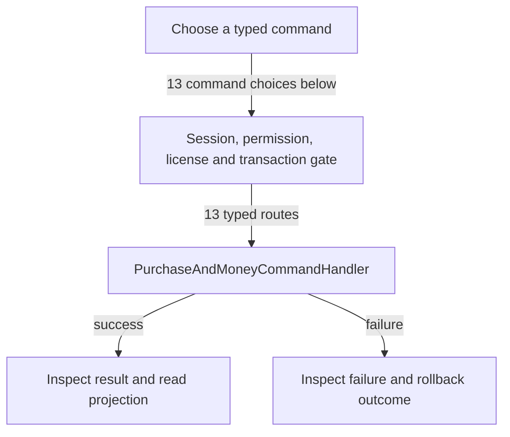

# Purchases, supplier returns and money accounts

DRAFT · code snapshot 18 October 2026 · source review, not runtime acceptance

Feature coverage: PP-F023. Source: [PurchaseAndMoneyCommands.cs:1](code-application.md#src-b2413dd4b01c), [SupplierReturnCommands.cs:1](code-application.md#src-0bb0722d3c5e).

## Step-by-step review route

The numbered route is a business review checklist. Branches are separate actions; it does not imply that all actions occur in one transaction.

1. Record supplier invoice and goods receipt separately.
2. Choose supplier payment, return or refund action.
3. Select money account and transfer where needed.
4. Validate balance, prior state and command permission.
5. Commit money and goods effects for that action.
6. Read remaining obligations and account movement.

## Command routing map

This overview groups routes by handler to stay readable; each named command and its connections follow below. [Shared gate details](pipeline.md) apply when this handler is invoked through the pipeline. First-run provisioning is an explicit [separate path](access.md). Source construction sites show candidates, not proof of a connected or reachable UI path.

## Commands, options and implementation connections

### CancelSupplierInvoiceLinesCommand

Handler: [PurchaseAndMoneyCommandHandler](code-application.md#src-0bb0722d3c5e). Result type: <code>Guid</code>.

Declaration: [SupplierReturnCommands.cs:19](code-application.md#src-0bb0722d3c5e). <code>RequiredPermission = Permissions.IssuePurchase</code>

Construction sites: **None found** among explicit `new Type(...)` expressions. Target-typed construction, factories and runtime dispatch are not resolved.

Handler method: [PurchaseAndMoneyCommandHandler.HandleAsync(CancelSupplierInvoiceLinesCommand,CommandEnvelope&lt;CancelSupplierInvoiceLinesCommand&gt;,CancellationToken)](code-application.md#m-6a20b216316a).

Same-owner helper candidates: [PurchaseAndMoneyCommandHandler.Bad(string,string)](code-application.md#m-a47f44ed23a7), [PurchaseAndMoneyCommandHandler.Quantity(Dictionary&lt;string,object?&gt;,string)](code-application.md#m-96a310a3dffd). These are unqualified/this-call name matches, including possible overloads; semantic binding was not performed.

| Direct method syntax | Extracted references |
| --- | --- |
| Reads | <code>purchase_receipt_lines</code>, <code>supplier_invoice_credit_lines</code>, <code>supplier_invoice_lines</code>, <code>supplier_invoices</code>, <code>supplier_return_lines</code> |
| Writes / DDL | <code>supplier_invoice_credit_lines</code>, <code>supplier_invoice_credits</code>, <code>supplier_invoices</code> |
| Literal failure codes | None extracted directly; inspect helpers and dynamic paths. |

Helper calls, table references in helpers, and throw sites are listed in the method catalogue. This table is not a transitive effect analysis.

### CollectBankInvoiceCommand

Handler: [PurchaseAndMoneyCommandHandler](code-application.md#src-b2413dd4b01c). Result type: <code>Guid</code>.

Declaration: [PurchaseAndMoneyCommands.cs:23](code-application.md#src-b2413dd4b01c). <code>RequiredPermission = Permissions.CollectInvoice</code>

Construction sites: **None found** among explicit `new Type(...)` expressions. Target-typed construction, factories and runtime dispatch are not resolved.

Handler method: [PurchaseAndMoneyCommandHandler.HandleAsync(CollectBankInvoiceCommand,CommandEnvelope&lt;CollectBankInvoiceCommand&gt;,CancellationToken)](code-application.md#m-d58f24dfc315).

Same-owner helper candidates: [PurchaseAndMoneyCommandHandler.Bad(string,string)](code-application.md#m-a47f44ed23a7), [PurchaseAndMoneyCommandHandler.AccountAsync(Guid,CancellationToken)](code-application.md#m-48e4165e94c4), [PurchaseAndMoneyCommandHandler.PostAsync(Dictionary&lt;string, object?&gt;,long,string,Guid,string,string,Guid?,Guid,string,DateTime,CancellationToken)](code-application.md#m-e0c7cfd8d329), [PurchaseAndMoneyCommandHandler.PostAsync(Dictionary&lt;string, object?&gt;,long,string,Guid,string,string,Guid?,Guid,string,DateTime,Guid?,Guid?,CancellationToken)](code-application.md#m-c708a2271b31). These are unqualified/this-call name matches, including possible overloads; semantic binding was not performed.

| Direct method syntax | Extracted references |
| --- | --- |
| Reads | None extracted directly; inspect helpers and dynamic paths. |
| Writes / DDL | <code>bank_invoice_collections</code>, <code>sales_invoices</code> |
| Literal failure codes | None extracted directly; inspect helpers and dynamic paths. |

Helper calls, table references in helpers, and throw sites are listed in the method catalogue. This table is not a transitive effect analysis.

### ConfirmSupplierReturnDeliveryCommand

Handler: [PurchaseAndMoneyCommandHandler](code-application.md#src-0bb0722d3c5e). Result type: <code>bool</code>.

Declaration: [SupplierReturnCommands.cs:14](code-application.md#src-0bb0722d3c5e). <code>RequiredPermission = Permissions.UpdateShipping</code>

Construction sites: **None found** among explicit `new Type(...)` expressions. Target-typed construction, factories and runtime dispatch are not resolved.

Handler method: [PurchaseAndMoneyCommandHandler.HandleAsync(ConfirmSupplierReturnDeliveryCommand,CommandEnvelope&lt;ConfirmSupplierReturnDeliveryCommand&gt;,CancellationToken)](code-application.md#m-56e88b5a3a34).

| Direct method syntax | Extracted references |
| --- | --- |
| Reads | None extracted directly; inspect helpers and dynamic paths. |
| Writes / DDL | <code>commercial_shipping_events</code>, <code>supplier_returns</code> |
| Literal failure codes | <code>REASON_REQUIRED</code>, <code>RETURN_STALE</code> |

Helper calls, table references in helpers, and throw sites are listed in the method catalogue. This table is not a transitive effect analysis.

### CreateMoneyAccountCommand

Handler: [PurchaseAndMoneyCommandHandler](code-application.md#src-b2413dd4b01c). Result type: <code>Guid</code>.

Declaration: [PurchaseAndMoneyCommands.cs:26](code-application.md#src-b2413dd4b01c). <code>RequiredPermission = Permissions.ManageMoney</code>

Construction sites: **None found** among explicit `new Type(...)` expressions. Target-typed construction, factories and runtime dispatch are not resolved.

Handler method: [PurchaseAndMoneyCommandHandler.HandleAsync(CreateMoneyAccountCommand,CommandEnvelope&lt;CreateMoneyAccountCommand&gt;,CancellationToken)](code-application.md#m-fe0e796766cc).

Same-owner helper candidates: [PurchaseAndMoneyCommandHandler.Bad(string,string)](code-application.md#m-a47f44ed23a7). These are unqualified/this-call name matches, including possible overloads; semantic binding was not performed.

| Direct method syntax | Extracted references |
| --- | --- |
| Reads | <code>money_accounts</code>, <code>store_config</code> |
| Writes / DDL | <code>money_accounts</code> |
| Literal failure codes | None extracted directly; inspect helpers and dynamic paths. |

Helper calls, table references in helpers, and throw sites are listed in the method catalogue. This table is not a transitive effect analysis.

### PaySupplierInvoiceCommand

Handler: [PurchaseAndMoneyCommandHandler](code-application.md#src-b2413dd4b01c). Result type: <code>Guid</code>.

Declaration: [PurchaseAndMoneyCommands.cs:20](code-application.md#src-b2413dd4b01c). <code>RequiredPermission = Permissions.PayPurchase</code>

Construction sites: **None found** among explicit `new Type(...)` expressions. Target-typed construction, factories and runtime dispatch are not resolved.

Handler method: [PurchaseAndMoneyCommandHandler.HandleAsync(PaySupplierInvoiceCommand,CommandEnvelope&lt;PaySupplierInvoiceCommand&gt;,CancellationToken)](code-application.md#m-7fc2e4cba9a2).

Same-owner helper candidates: [PurchaseAndMoneyCommandHandler.Bad(string,string)](code-application.md#m-a47f44ed23a7), [PurchaseAndMoneyCommandHandler.AccountAsync(Guid,CancellationToken)](code-application.md#m-48e4165e94c4), [PurchaseAndMoneyCommandHandler.PostAsync(Dictionary&lt;string, object?&gt;,long,string,Guid,string,string,Guid?,Guid,string,DateTime,CancellationToken)](code-application.md#m-e0c7cfd8d329), [PurchaseAndMoneyCommandHandler.PostAsync(Dictionary&lt;string, object?&gt;,long,string,Guid,string,string,Guid?,Guid,string,DateTime,Guid?,Guid?,CancellationToken)](code-application.md#m-c708a2271b31). These are unqualified/this-call name matches, including possible overloads; semantic binding was not performed.

| Direct method syntax | Extracted references |
| --- | --- |
| Reads | <code>supplier_invoice_credits</code>, <code>supplier_invoices</code>, <code>supplier_payments</code>, <code>supplier_refunds</code>, <code>supplier_returns</code> |
| Writes / DDL | <code>supplier_invoices</code>, <code>supplier_payments</code> |
| Literal failure codes | None extracted directly; inspect helpers and dynamic paths. |

Helper calls, table references in helpers, and throw sites are listed in the method catalogue. This table is not a transitive effect analysis.

### ReceivePurchaseGoodsCommand

Handler: [PurchaseAndMoneyCommandHandler](code-application.md#src-b2413dd4b01c). Result type: <code>Guid</code>.

Declaration: [PurchaseAndMoneyCommands.cs:17](code-application.md#src-b2413dd4b01c). <code>RequiredPermission = Permissions.ReceivePurchase</code>

Construction sites: **None found** among explicit `new Type(...)` expressions. Target-typed construction, factories and runtime dispatch are not resolved.

Handler method: [PurchaseAndMoneyCommandHandler.HandleAsync(ReceivePurchaseGoodsCommand,CommandEnvelope&lt;ReceivePurchaseGoodsCommand&gt;,CancellationToken)](code-application.md#m-6fbf10e0e8d2).

Same-owner helper candidates: [PurchaseAndMoneyCommandHandler.Bad(string,string)](code-application.md#m-a47f44ed23a7). These are unqualified/this-call name matches, including possible overloads; semantic binding was not performed.

| Direct method syntax | Extracted references |
| --- | --- |
| Reads | <code>items</code>, <code>purchase_receipt_lines</code>, <code>supplier_invoice_credit_lines</code>, <code>supplier_invoice_lines</code>, <code>supplier_invoices</code> |
| Writes / DDL | <code>purchase_receipt_lines</code>, <code>purchase_receipts</code>, <code>supplier_invoices</code> |
| Literal failure codes | None extracted directly; inspect helpers and dynamic paths. |

Helper calls, table references in helpers, and throw sites are listed in the method catalogue. This table is not a transitive effect analysis.

### ReceiveSupplierRefundCommand

Handler: [PurchaseAndMoneyCommandHandler](code-application.md#src-0bb0722d3c5e). Result type: <code>Guid</code>.

Declaration: [SupplierReturnCommands.cs:12](code-application.md#src-0bb0722d3c5e). <code>RequiredPermission = Permissions.PayPurchase</code>

Construction sites: **None found** among explicit `new Type(...)` expressions. Target-typed construction, factories and runtime dispatch are not resolved.

Handler method: [PurchaseAndMoneyCommandHandler.HandleAsync(ReceiveSupplierRefundCommand,CommandEnvelope&lt;ReceiveSupplierRefundCommand&gt;,CancellationToken)](code-application.md#m-c6a36def9602).

Same-owner helper candidates: [PurchaseAndMoneyCommandHandler.Bad(string,string)](code-application.md#m-a47f44ed23a7), [PurchaseAndMoneyCommandHandler.AccountAsync(Guid,CancellationToken)](code-application.md#m-48e4165e94c4), [PurchaseAndMoneyCommandHandler.PostAsync(Dictionary&lt;string, object?&gt;,long,string,Guid,string,string,Guid?,Guid,string,DateTime,CancellationToken)](code-application.md#m-e0c7cfd8d329), [PurchaseAndMoneyCommandHandler.PostAsync(Dictionary&lt;string, object?&gt;,long,string,Guid,string,string,Guid?,Guid,string,DateTime,Guid?,Guid?,CancellationToken)](code-application.md#m-c708a2271b31). These are unqualified/this-call name matches, including possible overloads; semantic binding was not performed.

| Direct method syntax | Extracted references |
| --- | --- |
| Reads | <code>supplier_invoice_credits</code>, <code>supplier_invoices</code>, <code>supplier_payments</code>, <code>supplier_refunds</code>, <code>supplier_returns</code> |
| Writes / DDL | <code>supplier_invoices</code>, <code>supplier_refunds</code> |
| Literal failure codes | None extracted directly; inspect helpers and dynamic paths. |

Helper calls, table references in helpers, and throw sites are listed in the method catalogue. This table is not a transitive effect analysis.

### RecordAccountOpeningCommand

Handler: [PurchaseAndMoneyCommandHandler](code-application.md#src-b2413dd4b01c). Result type: <code>Guid</code>.

Declaration: [PurchaseAndMoneyCommands.cs:28](code-application.md#src-b2413dd4b01c). <code>RequiredPermission = Permissions.ManageMoney</code>

Construction sites: **None found** among explicit `new Type(...)` expressions. Target-typed construction, factories and runtime dispatch are not resolved.

Handler method: [PurchaseAndMoneyCommandHandler.HandleAsync(RecordAccountOpeningCommand,CommandEnvelope&lt;RecordAccountOpeningCommand&gt;,CancellationToken)](code-application.md#m-0c550ea7e283).

Same-owner helper candidates: [PurchaseAndMoneyCommandHandler.AccountAsync(Guid,CancellationToken)](code-application.md#m-48e4165e94c4), [PurchaseAndMoneyCommandHandler.Bad(string,string)](code-application.md#m-a47f44ed23a7), [PurchaseAndMoneyCommandHandler.PostAsync(Dictionary&lt;string, object?&gt;,long,string,Guid,string,string,Guid?,Guid,string,DateTime,CancellationToken)](code-application.md#m-e0c7cfd8d329), [PurchaseAndMoneyCommandHandler.PostAsync(Dictionary&lt;string, object?&gt;,long,string,Guid,string,string,Guid?,Guid,string,DateTime,Guid?,Guid?,CancellationToken)](code-application.md#m-c708a2271b31). These are unqualified/this-call name matches, including possible overloads; semantic binding was not performed.

| Direct method syntax | Extracted references |
| --- | --- |
| Reads | <code>money_events</code> |
| Writes / DDL | None extracted directly; inspect helpers and dynamic paths. |
| Literal failure codes | None extracted directly; inspect helpers and dynamic paths. |

Helper calls, table references in helpers, and throw sites are listed in the method catalogue. This table is not a transitive effect analysis.

### RecordSupplierInvoiceCommand

Handler: [PurchaseAndMoneyCommandHandler](code-application.md#src-b2413dd4b01c). Result type: <code>Guid</code>.

Declaration: [PurchaseAndMoneyCommands.cs:13](code-application.md#src-b2413dd4b01c). <code>RequiredPermission = Permissions.IssuePurchase</code>

Construction sites: [SaveCommercialAsync:492](code-desktop.md#src-e4058a856f7c)

Handler method: [PurchaseAndMoneyCommandHandler.HandleAsync(RecordSupplierInvoiceCommand,CommandEnvelope&lt;RecordSupplierInvoiceCommand&gt;,CancellationToken)](code-application.md#m-f1ba27b7b958).

Same-owner helper candidates: [PurchaseAndMoneyCommandHandler.Bad(string,string)](code-application.md#m-a47f44ed23a7). These are unqualified/this-call name matches, including possible overloads; semantic binding was not performed.

| Direct method syntax | Extracted references |
| --- | --- |
| Reads | <code>item_kits</code>, <code>items</code>, <code>purchase_invoice_drafts</code>, <code>store_config</code>, <code>supplier_invoices</code>, <code>third_parties</code> |
| Writes / DDL | <code>purchase_invoice_drafts</code>, <code>supplier_invoice_lines</code>, <code>supplier_invoices</code> |
| Literal failure codes | None extracted directly; inspect helpers and dynamic paths. |

Helper calls, table references in helpers, and throw sites are listed in the method catalogue. This table is not a transitive effect analysis.

### RefundCancelledInvoiceCommand

Handler: [PurchaseAndMoneyCommandHandler](code-application.md#src-b2413dd4b01c). Result type: <code>Guid</code>.

Declaration: [PurchaseAndMoneyCommands.cs:30](code-application.md#src-b2413dd4b01c). <code>RequiredPermission = Permissions.RefundSale</code>

Construction sites: **None found** among explicit `new Type(...)` expressions. Target-typed construction, factories and runtime dispatch are not resolved.

Handler method: [PurchaseAndMoneyCommandHandler.HandleAsync(RefundCancelledInvoiceCommand,CommandEnvelope&lt;RefundCancelledInvoiceCommand&gt;,CancellationToken)](code-application.md#m-426228bae305).

Same-owner helper candidates: [PurchaseAndMoneyCommandHandler.Bad(string,string)](code-application.md#m-a47f44ed23a7), [PurchaseAndMoneyCommandHandler.AccountAsync(Guid,CancellationToken)](code-application.md#m-48e4165e94c4), [PurchaseAndMoneyCommandHandler.PostAsync(Dictionary&lt;string, object?&gt;,long,string,Guid,string,string,Guid?,Guid,string,DateTime,CancellationToken)](code-application.md#m-e0c7cfd8d329), [PurchaseAndMoneyCommandHandler.PostAsync(Dictionary&lt;string, object?&gt;,long,string,Guid,string,string,Guid?,Guid,string,DateTime,Guid?,Guid?,CancellationToken)](code-application.md#m-c708a2271b31). These are unqualified/this-call name matches, including possible overloads; semantic binding was not performed.

| Direct method syntax | Extracted references |
| --- | --- |
| Reads | None extracted directly; inspect helpers and dynamic paths. |
| Writes / DDL | <code>cancellation_refunds</code>, <code>sales_invoices</code> |
| Literal failure codes | None extracted directly; inspect helpers and dynamic paths. |

Helper calls, table references in helpers, and throw sites are listed in the method catalogue. This table is not a transitive effect analysis.

### ReturnSupplierGoodsCommand

Handler: [PurchaseAndMoneyCommandHandler](code-application.md#src-0bb0722d3c5e). Result type: <code>Guid</code>.

Declaration: [SupplierReturnCommands.cs:10](code-application.md#src-0bb0722d3c5e). <code>RequiredPermission = Permissions.ReturnPurchase</code>

Construction sites: **None found** among explicit `new Type(...)` expressions. Target-typed construction, factories and runtime dispatch are not resolved.

Handler method: [PurchaseAndMoneyCommandHandler.HandleAsync(ReturnSupplierGoodsCommand,CommandEnvelope&lt;ReturnSupplierGoodsCommand&gt;,CancellationToken)](code-application.md#m-bc4d2643eb60).

Same-owner helper candidates: [PurchaseAndMoneyCommandHandler.Bad(string,string)](code-application.md#m-a47f44ed23a7), [PurchaseAndMoneyCommandHandler.Quantity(Dictionary&lt;string,object?&gt;,string)](code-application.md#m-96a310a3dffd). These are unqualified/this-call name matches, including possible overloads; semantic binding was not performed.

| Direct method syntax | Extracted references |
| --- | --- |
| Reads | <code>items</code>, <code>lots</code>, <code>purchase_receipt_lines</code>, <code>serials</code>, <code>stock_movements</code>, <code>supplier_invoice_credit_lines</code>, <code>supplier_invoice_lines</code>, <code>supplier_invoices</code>, <code>supplier_return_allocations</code>, <code>supplier_return_lines</code> |
| Writes / DDL | <code>serials</code>, <code>supplier_invoices</code>, <code>supplier_return_allocations</code>, <code>supplier_return_lines</code>, <code>supplier_returns</code> |
| Literal failure codes | None extracted directly; inspect helpers and dynamic paths. |

Helper calls, table references in helpers, and throw sites are listed in the method catalogue. This table is not a transitive effect analysis.

### ReverseMoneyTransferCommand

Handler: [PurchaseAndMoneyCommandHandler](code-application.md#src-0bb0722d3c5e). Result type: <code>Guid</code>.

Declaration: [SupplierReturnCommands.cs:16](code-application.md#src-0bb0722d3c5e). <code>RequiredPermission = Permissions.TransferMoney</code>

Construction sites: **None found** among explicit `new Type(...)` expressions. Target-typed construction, factories and runtime dispatch are not resolved.

Handler method: [PurchaseAndMoneyCommandHandler.HandleAsync(ReverseMoneyTransferCommand,CommandEnvelope&lt;ReverseMoneyTransferCommand&gt;,CancellationToken)](code-application.md#m-66868fbc9384).

Same-owner helper candidates: [PurchaseAndMoneyCommandHandler.Bad(string,string)](code-application.md#m-a47f44ed23a7), [PurchaseAndMoneyCommandHandler.AccountAsync(Guid,CancellationToken)](code-application.md#m-48e4165e94c4), [PurchaseAndMoneyCommandHandler.PostAsync(Dictionary&lt;string, object?&gt;,long,string,Guid,string,string,Guid?,Guid,string,DateTime,CancellationToken)](code-application.md#m-e0c7cfd8d329), [PurchaseAndMoneyCommandHandler.PostAsync(Dictionary&lt;string, object?&gt;,long,string,Guid,string,string,Guid?,Guid,string,DateTime,Guid?,Guid?,CancellationToken)](code-application.md#m-c708a2271b31). These are unqualified/this-call name matches, including possible overloads; semantic binding was not performed.

| Direct method syntax | Extracted references |
| --- | --- |
| Reads | <code>money_events</code> |
| Writes / DDL | None extracted directly; inspect helpers and dynamic paths. |
| Literal failure codes | None extracted directly; inspect helpers and dynamic paths. |

Helper calls, table references in helpers, and throw sites are listed in the method catalogue. This table is not a transitive effect analysis.

### TransferMoneyCommand

Handler: [PurchaseAndMoneyCommandHandler](code-application.md#src-b2413dd4b01c). Result type: <code>Guid</code>.

Declaration: [PurchaseAndMoneyCommands.cs:33](code-application.md#src-b2413dd4b01c). <code>RequiredPermission = Permissions.TransferMoney</code>

Construction sites: **None found** among explicit `new Type(...)` expressions. Target-typed construction, factories and runtime dispatch are not resolved.

Handler method: [PurchaseAndMoneyCommandHandler.HandleAsync(TransferMoneyCommand,CommandEnvelope&lt;TransferMoneyCommand&gt;,CancellationToken)](code-application.md#m-614a96e577d8).

Same-owner helper candidates: [PurchaseAndMoneyCommandHandler.AccountAsync(Guid,CancellationToken)](code-application.md#m-48e4165e94c4), [PurchaseAndMoneyCommandHandler.Bad(string,string)](code-application.md#m-a47f44ed23a7), [PurchaseAndMoneyCommandHandler.PostAsync(Dictionary&lt;string, object?&gt;,long,string,Guid,string,string,Guid?,Guid,string,DateTime,CancellationToken)](code-application.md#m-e0c7cfd8d329), [PurchaseAndMoneyCommandHandler.PostAsync(Dictionary&lt;string, object?&gt;,long,string,Guid,string,string,Guid?,Guid,string,DateTime,Guid?,Guid?,CancellationToken)](code-application.md#m-c708a2271b31). These are unqualified/this-call name matches, including possible overloads; semantic binding was not performed.

| Direct method syntax | Extracted references |
| --- | --- |
| Reads | None extracted directly; inspect helpers and dynamic paths. |
| Writes / DDL | None extracted directly; inspect helpers and dynamic paths. |
| Literal failure codes | None extracted directly; inspect helpers and dynamic paths. |

Helper calls, table references in helpers, and throw sites are listed in the method catalogue. This table is not a transitive effect analysis.

## Verification still required

No application journey was executed for this map. Use a separate synthetic test environment to verify permission denial, valid success, invalid inputs, state conflicts, cancellation, transaction rollback, retry/idempotency and the resulting projection. Add physical-device checks only where the workflow dispatches output. Preserve original financial history when reviewing corrections or reversals.
