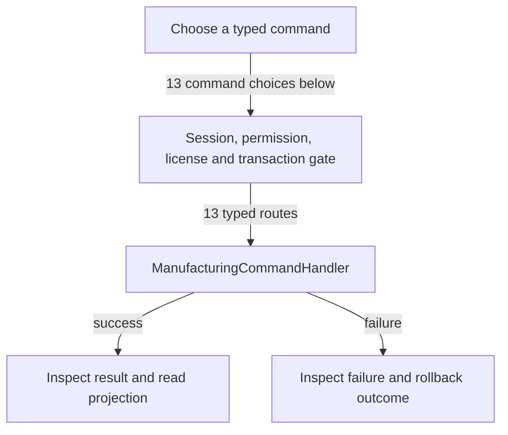

# Kits, BOM and production

DRAFT · code snapshot 20 October 2026 · source review and targeted automated checks

Feature coverage: PP-F012. Source: [ManufacturingCommandHandler.cs:1](code-application.md#src-e469f680f9bb).

## Step-by-step review route

The numbered route is a business review checklist. Branches are separate actions; it does not imply that all actions occur in one transaction.

1. Choose virtual kit or physical manufacturing workflow.
2. Create or update composition and units.
3. Draft and stage a production run when applicable.
4. Validate component allocation, lot and exact cost rules.
5. Complete or cancel through its command.
6. Review component consumption and finished output.

## Command routing map

This overview groups routes by handler to stay readable; each named command and its connections follow below. [Shared gate details](pipeline.md) apply when this handler is invoked through the pipeline. First-run provisioning is an explicit [separate path](access.md). Source construction sites show candidates, not proof of a connected or reachable UI path.

## Commands, options and implementation connections

### CancelProductionRunCommand

Handler: [ManufacturingCommandHandler](code-application.md#src-e469f680f9bb). Result type: <code>bool</code>.

Declaration: [ManufacturingCommands.cs:321](code-application.md#src-98743155dc28). <code>RequiredPermission = &quot;pos.manufacturing.manage&quot;</code>

Construction sites: **None found** among explicit `new Type(...)` expressions. Target-typed construction, factories and runtime dispatch are not resolved.

Handler method: [ManufacturingCommandHandler.HandleAsync(CancelProductionRunCommand,CommandEnvelope&lt;CancelProductionRunCommand&gt;,CancellationToken)](code-application.md#m-916f3010cfa0).

Same-owner helper candidates: [ManufacturingCommandHandler.AddParam(DbCommand,string,object)](code-application.md#m-57ea5632a5ea). These are unqualified/this-call name matches, including possible overloads; semantic binding was not performed.

| Direct method syntax | Extracted references |
| --- | --- |
| Reads | <code>production_runs</code> |
| Writes / DDL | <code>production_runs</code> |
| Literal failure codes | <code>CANNOT_CANCEL_COMPLETED_RUN</code>, <code>CANNOT_CANCEL_STARTED_RUN</code>, <code>RUN_NOT_FOUND</code> |

Helper calls, table references in helpers, and throw sites are listed in the method catalogue. This table is not a transitive effect analysis.

### CompleteProductionRunCommand

Handler: [ManufacturingCommandHandler](code-application.md#src-e469f680f9bb). Result type: <code>ProductionRunDto</code>.

Declaration: [ManufacturingCommands.cs:307](code-application.md#src-98743155dc28). <code>RequiredPermission = &quot;pos.manufacturing.execute&quot;</code>

Construction sites: **None found** among explicit `new Type(...)` expressions. Target-typed construction, factories and runtime dispatch are not resolved.

Handler method: [ManufacturingCommandHandler.HandleAsync(CompleteProductionRunCommand,CommandEnvelope&lt;CompleteProductionRunCommand&gt;,CancellationToken)](code-application.md#m-138ff74ced45).

Same-owner helper candidates: [ManufacturingCommandHandler.LoadProductionRunByIdAsync(DbConnection,DbTransaction?,Guid,CancellationToken)](code-application.md#m-e0660719ed92), [ManufacturingCommandHandler.ExecuteProductionCoreAsync(ExecuteProductionRunCommand,CommandEnvelope&lt;ExecuteProductionRunCommand&gt;,CancellationToken,ProductionRunDto?,bool)](code-application.md#m-62cdd0de17ec). These are unqualified/this-call name matches, including possible overloads; semantic binding was not performed.

| Direct method syntax | Extracted references |
| --- | --- |
| Reads | None extracted directly; inspect helpers and dynamic paths. |
| Writes / DDL | None extracted directly; inspect helpers and dynamic paths. |
| Literal failure codes | <code>RUN_ALREADY_CANCELLED</code>, <code>RUN_ALREADY_COMPLETED</code>, <code>RUN_NOT_FOUND</code> |

Helper calls, table references in helpers, and throw sites are listed in the method catalogue. This table is not a transitive effect analysis.

### CreateBomCommand

Handler: [ManufacturingCommandHandler](code-application.md#src-e469f680f9bb). Result type: <code>BomDto</code>.

Declaration: [ManufacturingCommands.cs:239](code-application.md#src-98743155dc28). <code>RequiredPermission = &quot;pos.manufacturing.manage&quot;</code>

Construction sites: **None found** among explicit `new Type(...)` expressions. Target-typed construction, factories and runtime dispatch are not resolved.

Handler method: [ManufacturingCommandHandler.HandleAsync(CreateBomCommand,CommandEnvelope&lt;CreateBomCommand&gt;,CancellationToken)](code-application.md#m-63049f36f6ae).

Same-owner helper candidates: [ManufacturingCommandHandler.CreateOrUpdateBomInternalAsync(Guid,string,decimal,bool,IReadOnlyList&lt;BomItemInput&gt;,DateTime,string?,CancellationToken)](code-application.md#m-398530bb5b12). These are unqualified/this-call name matches, including possible overloads; semantic binding was not performed.

| Direct method syntax | Extracted references |
| --- | --- |
| Reads | None extracted directly; inspect helpers and dynamic paths. |
| Writes / DDL | None extracted directly; inspect helpers and dynamic paths. |
| Literal failure codes | None extracted directly; inspect helpers and dynamic paths. |

Helper calls, table references in helpers, and throw sites are listed in the method catalogue. This table is not a transitive effect analysis.

### CreateItemVariantCommand

Handler: [ManufacturingCommandHandler](code-application.md#src-e469f680f9bb). Result type: <code>ItemVariantDto</code>.

Declaration: [ManufacturingCommands.cs:195](code-application.md#src-98743155dc28). <code>RequiredPermission = &quot;pos.inventory.manage&quot;</code>

Construction sites: **None found** among explicit `new Type(...)` expressions. Target-typed construction, factories and runtime dispatch are not resolved.

Handler method: [ManufacturingCommandHandler.HandleAsync(CreateItemVariantCommand,CommandEnvelope&lt;CreateItemVariantCommand&gt;,CancellationToken)](code-application.md#m-5227a4c7e32f).

Same-owner helper candidates: [ManufacturingCommandHandler.AddParam(DbCommand,string,object)](code-application.md#m-57ea5632a5ea). These are unqualified/this-call name matches, including possible overloads; semantic binding was not performed.

| Direct method syntax | Extracted references |
| --- | --- |
| Reads | <code>items</code> |
| Writes / DDL | <code>item_variants</code> |
| Literal failure codes | <code>OPTION_REQUIRED</code>, <code>PARENT_CANNOT_BE_VARIANT</code>, <code>PARENT_ITEM_NOT_FOUND</code>, <code>VARIANT_ITEM_NOT_FOUND</code> |

Helper calls, table references in helpers, and throw sites are listed in the method catalogue. This table is not a transitive effect analysis.

### CreateKitCommand

Handler: [ManufacturingCommandHandler](code-application.md#src-e469f680f9bb). Result type: <code>ItemKitDto</code>.

Declaration: [ManufacturingCommands.cs:213](code-application.md#src-98743155dc28). <code>RequiredPermission = Permissions.ManageCatalog</code>

Construction sites: **None found** among explicit `new Type(...)` expressions. Target-typed construction, factories and runtime dispatch are not resolved.

Handler method: [ManufacturingCommandHandler.HandleAsync(CreateKitCommand,CommandEnvelope&lt;CreateKitCommand&gt;,CancellationToken)](code-application.md#m-f6c0f76b3ec8).

Same-owner helper candidates: [ManufacturingCommandHandler.CreateOrUpdateKitInternalAsync(Guid,string,bool,IReadOnlyList&lt;KitComponentInput&gt;,DateTime,CancellationToken)](code-application.md#m-2780604bb9d3). These are unqualified/this-call name matches, including possible overloads; semantic binding was not performed.

| Direct method syntax | Extracted references |
| --- | --- |
| Reads | None extracted directly; inspect helpers and dynamic paths. |
| Writes / DDL | None extracted directly; inspect helpers and dynamic paths. |
| Literal failure codes | None extracted directly; inspect helpers and dynamic paths. |

Helper calls, table references in helpers, and throw sites are listed in the method catalogue. This table is not a transitive effect analysis.

### CreateProductionDraftCommand

Handler: [ManufacturingCommandHandler](code-application.md#src-e469f680f9bb). Result type: <code>ProductionRunDto</code>.

Declaration: [ManufacturingCommands.cs:285](code-application.md#src-98743155dc28). <code>RequiredPermission = &quot;pos.manufacturing.manage&quot;</code>

Construction sites: **None found** among explicit `new Type(...)` expressions. Target-typed construction, factories and runtime dispatch are not resolved.

Handler method: [ManufacturingCommandHandler.HandleAsync(CreateProductionDraftCommand,CommandEnvelope&lt;CreateProductionDraftCommand&gt;,CancellationToken)](code-application.md#m-0f69108612ea).

Same-owner helper candidates: [ManufacturingCommandHandler.AddParam(DbCommand,string,object)](code-application.md#m-57ea5632a5ea). These are unqualified/this-call name matches, including possible overloads; semantic binding was not performed.

| Direct method syntax | Extracted references |
| --- | --- |
| Reads | <code>boms</code>, <code>items</code> |
| Writes / DDL | <code>production_runs</code> |
| Literal failure codes | <code>BOM_INACTIVE</code>, <code>BOM_NOT_FOUND</code>, <code>INVALID_LOT_FORMULA</code>, <code>INVALID_QUANTITY</code> |

Helper calls, table references in helpers, and throw sites are listed in the method catalogue. This table is not a transitive effect analysis.

### DeactivateBomCommand

Handler: [ManufacturingCommandHandler](code-application.md#src-e469f680f9bb). Result type: <code>bool</code>.

Declaration: [ManufacturingCommands.cs:262](code-application.md#src-98743155dc28). <code>RequiredPermission = &quot;pos.manufacturing.manage&quot;</code>

Construction sites: **None found** among explicit `new Type(...)` expressions. Target-typed construction, factories and runtime dispatch are not resolved.

Handler method: [ManufacturingCommandHandler.HandleAsync(DeactivateBomCommand,CommandEnvelope&lt;DeactivateBomCommand&gt;,CancellationToken)](code-application.md#m-851734501c25).

Same-owner helper candidates: [ManufacturingCommandHandler.AddParam(DbCommand,string,object)](code-application.md#m-57ea5632a5ea). These are unqualified/this-call name matches, including possible overloads; semantic binding was not performed.

| Direct method syntax | Extracted references |
| --- | --- |
| Reads | None extracted directly; inspect helpers and dynamic paths. |
| Writes / DDL | <code>boms</code> |
| Literal failure codes | None extracted directly; inspect helpers and dynamic paths. |

Helper calls, table references in helpers, and throw sites are listed in the method catalogue. This table is not a transitive effect analysis.

### DeactivateKitCommand

Handler: [ManufacturingCommandHandler](code-application.md#src-e469f680f9bb). Result type: <code>bool</code>.

Declaration: [ManufacturingCommands.cs:232](code-application.md#src-98743155dc28). <code>RequiredPermission = Permissions.ManageCatalog</code>

Construction sites: [HandleAsync:58](code-application.md#src-c24b9e05b3b2), [HandleAsync:59](code-application.md#src-c24b9e05b3b2)

Handler method: [ManufacturingCommandHandler.HandleAsync(DeactivateKitCommand,CommandEnvelope&lt;DeactivateKitCommand&gt;,CancellationToken)](code-application.md#m-b8fa04917f75).

Same-owner helper candidates: [ManufacturingCommandHandler.AddParam(DbCommand,string,object)](code-application.md#m-57ea5632a5ea). These are unqualified/this-call name matches, including possible overloads; semantic binding was not performed.

| Direct method syntax | Extracted references |
| --- | --- |
| Reads | None extracted directly; inspect helpers and dynamic paths. |
| Writes / DDL | <code>item_kits</code> |
| Literal failure codes | None extracted directly; inspect helpers and dynamic paths. |

Helper calls, table references in helpers, and throw sites are listed in the method catalogue. This table is not a transitive effect analysis.

### ExecuteProductionRunCommand

Handler: [ManufacturingCommandHandler](code-application.md#src-e469f680f9bb). Result type: <code>ProductionRunDto</code>.

Declaration: [ManufacturingCommands.cs:269](code-application.md#src-98743155dc28). <code>RequiredPermission = &quot;pos.manufacturing.execute&quot;</code>

Construction sites: [HandleAsync:995](code-application.md#src-e469f680f9bb), [HandleAsync:1030](code-application.md#src-e469f680f9bb), [ExecuteProductionRunFromUiAsync:12138](code-desktop.md#src-16497b924a99)

Handler method: [ManufacturingCommandHandler.HandleAsync(ExecuteProductionRunCommand,CommandEnvelope&lt;ExecuteProductionRunCommand&gt;,CancellationToken)](code-application.md#m-9c5de1eeeb47).

Same-owner helper candidates: [ManufacturingCommandHandler.ExecuteProductionCoreAsync(ExecuteProductionRunCommand,CommandEnvelope&lt;ExecuteProductionRunCommand&gt;,CancellationToken,ProductionRunDto?,bool)](code-application.md#m-62cdd0de17ec). These are unqualified/this-call name matches, including possible overloads; semantic binding was not performed.

| Direct method syntax | Extracted references |
| --- | --- |
| Reads | None extracted directly; inspect helpers and dynamic paths. |
| Writes / DDL | None extracted directly; inspect helpers and dynamic paths. |
| Literal failure codes | None extracted directly; inspect helpers and dynamic paths. |

Helper calls, table references in helpers, and throw sites are listed in the method catalogue. This table is not a transitive effect analysis.

### RemoveItemVariantCommand

Handler: [ManufacturingCommandHandler](code-application.md#src-e469f680f9bb). Result type: <code>bool</code>.

Declaration: [ManufacturingCommands.cs:205](code-application.md#src-98743155dc28). <code>RequiredPermission = &quot;pos.inventory.manage&quot;</code>

Construction sites: **None found** among explicit `new Type(...)` expressions. Target-typed construction, factories and runtime dispatch are not resolved.

Handler method: [ManufacturingCommandHandler.HandleAsync(RemoveItemVariantCommand,CommandEnvelope&lt;RemoveItemVariantCommand&gt;,CancellationToken)](code-application.md#m-004d2b130c9f).

Same-owner helper candidates: [ManufacturingCommandHandler.AddParam(DbCommand,string,object)](code-application.md#m-57ea5632a5ea). These are unqualified/this-call name matches, including possible overloads; semantic binding was not performed.

| Direct method syntax | Extracted references |
| --- | --- |
| Reads | None extracted directly; inspect helpers and dynamic paths. |
| Writes / DDL | <code>item_variants</code> |
| Literal failure codes | None extracted directly; inspect helpers and dynamic paths. |

Helper calls, table references in helpers, and throw sites are listed in the method catalogue. This table is not a transitive effect analysis.

### StageProductionRunCommand

Handler: [ManufacturingCommandHandler](code-application.md#src-e469f680f9bb). Result type: <code>ProductionRunDto</code>.

Declaration: [ManufacturingCommands.cs:297](code-application.md#src-98743155dc28). <code>RequiredPermission = &quot;pos.manufacturing.manage&quot;</code>

Construction sites: **None found** among explicit `new Type(...)` expressions. Target-typed construction, factories and runtime dispatch are not resolved.

Handler method: [ManufacturingCommandHandler.HandleAsync(StageProductionRunCommand,CommandEnvelope&lt;StageProductionRunCommand&gt;,CancellationToken)](code-application.md#m-fdfcd29fb217).

Same-owner helper candidates: [ManufacturingCommandHandler.LoadProductionRunByIdAsync(DbConnection,DbTransaction?,Guid,CancellationToken)](code-application.md#m-e0660719ed92), [ManufacturingCommandHandler.ExecuteProductionCoreAsync(ExecuteProductionRunCommand,CommandEnvelope&lt;ExecuteProductionRunCommand&gt;,CancellationToken,ProductionRunDto?,bool)](code-application.md#m-62cdd0de17ec). These are unqualified/this-call name matches, including possible overloads; semantic binding was not performed.

| Direct method syntax | Extracted references |
| --- | --- |
| Reads | None extracted directly; inspect helpers and dynamic paths. |
| Writes / DDL | None extracted directly; inspect helpers and dynamic paths. |
| Literal failure codes | <code>RUN_NOT_FOUND</code>, <code>RUN_NOT_PLANNED</code>, <code>UNSUPPORTED_INPUT_ALLOCATION</code>, <code>UNSUPPORTED_OUTPUT_ALLOCATION</code> |

Helper calls, table references in helpers, and throw sites are listed in the method catalogue. This table is not a transitive effect analysis.

### UpdateBomCommand

Handler: [ManufacturingCommandHandler](code-application.md#src-e469f680f9bb). Result type: <code>BomDto</code>.

Declaration: [ManufacturingCommands.cs:250](code-application.md#src-98743155dc28). <code>RequiredPermission = &quot;pos.manufacturing.manage&quot;</code>

Construction sites: **None found** among explicit `new Type(...)` expressions. Target-typed construction, factories and runtime dispatch are not resolved.

Handler method: [ManufacturingCommandHandler.HandleAsync(UpdateBomCommand,CommandEnvelope&lt;UpdateBomCommand&gt;,CancellationToken)](code-application.md#m-9f106ee245b2).

Same-owner helper candidates: [ManufacturingCommandHandler.CreateOrUpdateBomInternalAsync(Guid,string,decimal,bool,IReadOnlyList&lt;BomItemInput&gt;,DateTime,string?,CancellationToken)](code-application.md#m-398530bb5b12). These are unqualified/this-call name matches, including possible overloads; semantic binding was not performed.

| Direct method syntax | Extracted references |
| --- | --- |
| Reads | None extracted directly; inspect helpers and dynamic paths. |
| Writes / DDL | None extracted directly; inspect helpers and dynamic paths. |
| Literal failure codes | None extracted directly; inspect helpers and dynamic paths. |

Helper calls, table references in helpers, and throw sites are listed in the method catalogue. This table is not a transitive effect analysis.

### UpdateKitCommand

Handler: [ManufacturingCommandHandler](code-application.md#src-e469f680f9bb). Result type: <code>ItemKitDto</code>.

Declaration: [ManufacturingCommands.cs:222](code-application.md#src-98743155dc28). <code>RequiredPermission = Permissions.ManageCatalog</code>

Construction sites: [HandleAsync:83](code-application.md#src-c24b9e05b3b2)

Handler method: [ManufacturingCommandHandler.HandleAsync(UpdateKitCommand,CommandEnvelope&lt;UpdateKitCommand&gt;,CancellationToken)](code-application.md#m-de55ac15d61c).

Same-owner helper candidates: [ManufacturingCommandHandler.CreateOrUpdateKitInternalAsync(Guid,string,bool,IReadOnlyList&lt;KitComponentInput&gt;,DateTime,CancellationToken)](code-application.md#m-2780604bb9d3). These are unqualified/this-call name matches, including possible overloads; semantic binding was not performed.

| Direct method syntax | Extracted references |
| --- | --- |
| Reads | None extracted directly; inspect helpers and dynamic paths. |
| Writes / DDL | None extracted directly; inspect helpers and dynamic paths. |
| Literal failure codes | None extracted directly; inspect helpers and dynamic paths. |

Helper calls, table references in helpers, and throw sites are listed in the method catalogue. This table is not a transitive effect analysis.

## Verification still required

No application journey was executed for this map. Use a separate synthetic test environment to verify permission denial, valid success, invalid inputs, state conflicts, cancellation, transaction rollback, retry/idempotency and the resulting projection. Add physical-device checks only where the workflow dispatches output. Preserve original financial history when reviewing corrections or reversals.
