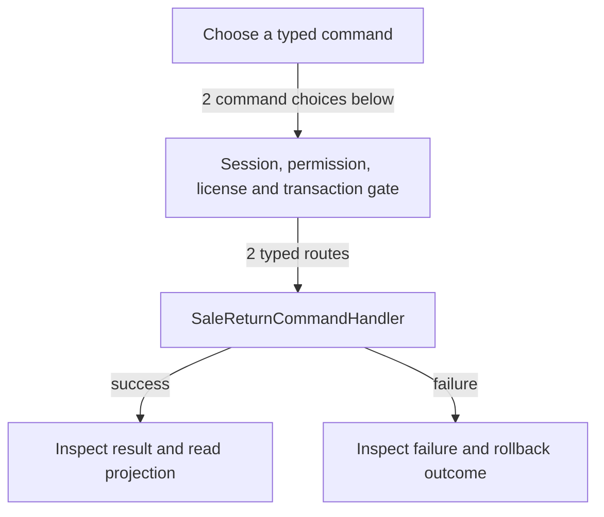

# Customer returns and inspection

DRAFT · code snapshot 18 October 2026 · source review, not runtime acceptance

Feature coverage: PP-F006. Source: [SaleReturnCommandHandler.cs:1](code-application.md#src-47b58b729be1).

## Step-by-step review route

The numbered route is a business review checklist. Branches are separate actions; it does not imply that all actions occur in one transaction.

1. Locate original sale and eligible lines.
2. Select quantity, reason and settlement choice.
3. Check prior returns and original financial snapshots.
4. Commit return and command-specific stock or refund effects.
5. Resolve inspection where required.
6. Read the return and remaining eligibility.

## Command routing map

This overview groups routes by handler to stay readable; each named command and its connections follow below. [Shared gate details](pipeline.md) apply when this handler is invoked through the pipeline. First-run provisioning is an explicit [separate path](access.md). Source construction sites show candidates, not proof of a connected or reachable UI path.

## Commands, options and implementation connections

### ProcessReturnCommand

Handler: [SaleReturnCommandHandler](code-application.md#src-47b58b729be1). Result type: <code>SaleReturnResult</code>.

Declaration: [SaleReturnCommands.cs:7](code-application.md#src-69127d19034a). <code>RequiredPermission = FinancialMode == ReturnFinancialMode.FullCredit         ? Permissions.RefundSale : Permissions.AdjustReturnCredit</code>

Construction sites: [ExecuteAsync:45](code-application.md#src-a364c6f04785)

Handler method: [SaleReturnCommandHandler.HandleAsync(ProcessReturnCommand,CommandEnvelope&lt;ProcessReturnCommand&gt;,CancellationToken)](code-application.md#m-9ee05f638173).

Same-owner helper candidates: [SaleReturnCommandHandler.PrepareAsync(ProcessReturnCommand,CancellationToken)](code-application.md#m-266a85bbc3b2), [SaleReturnCommandHandler.WriteCreditInvoiceAsync(ProcessReturnCommand,CommandEnvelope&lt;ProcessReturnCommand&gt;,PreparedReturn,Dictionary&lt;Guid,ReturnMoneyParts&gt;,Guid,CancellationToken)](code-application.md#m-fcc6c49c63bf), [SaleReturnCommandHandler.WriteDispositionAsync(ReturnStockAllocation,PreparedLine,Guid,Guid,string,CommandEnvelope&lt;ProcessReturnCommand&gt;,CancellationToken)](code-application.md#m-4b80ed816bcc). These are unqualified/this-call name matches, including possible overloads; semantic binding was not performed.

| Direct method syntax | Extracted references |
| --- | --- |
| Reads | <code>cash_movements</code>, <code>refund_lines</code>, <code>sale_return_lines</code>, <code>sales_lines</code>, <code>shifts</code> |
| Writes / DDL | <code>sale_return_lines</code>, <code>sale_returns</code>, <code>sales_invoices</code> |
| Literal failure codes | <code>AUTH_UNAUTHORIZED</code>, <code>INSUFFICIENT_DRAWER_CASH</code>, <code>INVOICE_BALANCE_STALE</code>, <code>MONETARY_SCALE_UNRESOLVED</code>, <code>SHIFT_NOT_OPEN</code> |

Helper calls, table references in helpers, and throw sites are listed in the method catalogue. This table is not a transitive effect analysis.

### ResolveInspectionCommand

Handler: [SaleReturnCommandHandler](code-application.md#src-47b58b729be1). Result type: <code>InspectionResolutionResult</code>.

Declaration: [SaleReturnCommands.cs:17](code-application.md#src-69127d19034a). <code>RequiredPermission = Permissions.ResolveInspection</code>

Construction sites: **None found** among explicit `new Type(...)` expressions. Target-typed construction, factories and runtime dispatch are not resolved.

Handler method: [SaleReturnCommandHandler.HandleAsync(ResolveInspectionCommand,CommandEnvelope&lt;ResolveInspectionCommand&gt;,CancellationToken)](code-application.md#m-b85f7f3b55ff).

Same-owner helper candidates: [SaleReturnCommandHandler.Stale()](code-application.md#m-080e71d531f1), [SaleReturnCommandHandler.CanRestockAsync(Guid,Guid?,CancellationToken)](code-application.md#m-1730ee0bb709). These are unqualified/this-call name matches, including possible overloads; semantic binding was not performed.

| Direct method syntax | Extracted references |
| --- | --- |
| Reads | <code>return_dispositions</code>, <code>sale_return_lines</code>, <code>sale_returns</code>, <code>serials</code> |
| Writes / DDL | <code>return_disposition_resolutions</code>, <code>return_dispositions</code>, <code>serials</code> |
| Literal failure codes | <code>INVALID_RESOLUTION</code>, <code>RETURN_STOCK_QUARANTINED</code> |

Helper calls, table references in helpers, and throw sites are listed in the method catalogue. This table is not a transitive effect analysis.

## Verification still required

No application journey was executed for this map. Use a separate synthetic test environment to verify permission denial, valid success, invalid inputs, state conflicts, cancellation, transaction rollback, retry/idempotency and the resulting projection. Add physical-device checks only where the workflow dispatches output. Preserve original financial history when reviewing corrections or reversals.
