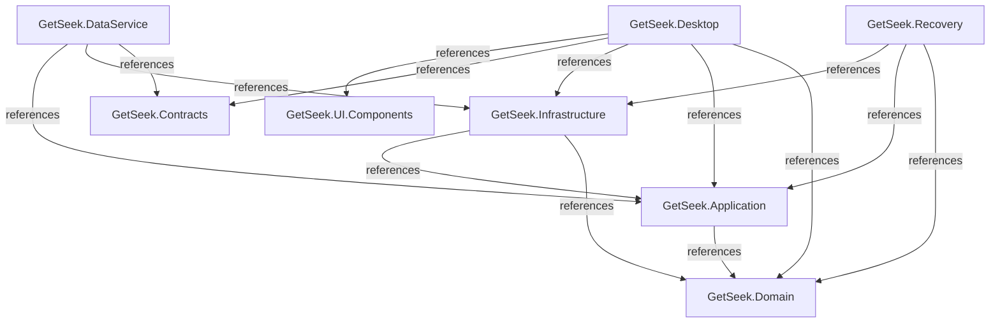
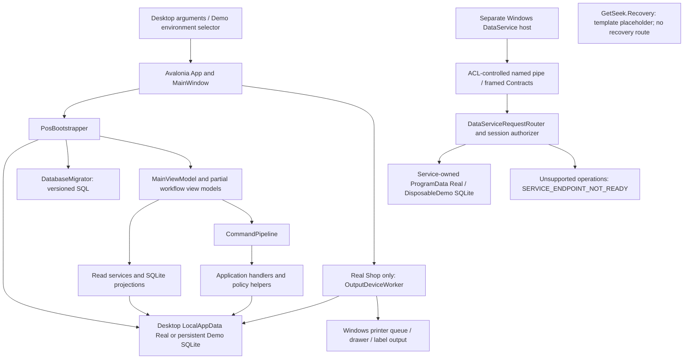

# Runtime and integration map

DRAFT · code snapshot 18 October 2026 · source review, not runtime acceptance

## Executable and library dependencies

These arrows come from `ProjectReference` entries. They show compile-time project dependencies, not a runtime request sequence.

## Runtime ownership and connection points

Desktop and DataService are distinct source compositions. The diagram does not assert a completed Desktop-to-service cutover. The Recovery project is a template placeholder, with no implemented restore route; see [PP-REV-007](decisions.md#pp-rev-007).

## Boundary review

| Connection | Evidence and limit |
| --- | --- |
| Desktop storage/bootstrap | [PosBootstrapper.cs:1](code-desktop.md#src-d26211d90637) — local composition inspected; no workspace opened |
| Separate service storage | [DataServiceComposition.cs:1](code-dataservice.md#src-a71687a05d71) — fixed service paths inspected; no service started |
| Supported/blocked service routes | [DataServiceRequestRouter.cs:1](code-dataservice.md#src-46b520696446) — router switch includes explicit not-ready fallback |
| Physical queue processing | [OutputDeviceWorker.cs:1](code-infrastructure.md#src-64d2e3097e9f) — spool acceptance is distinct from physical confirmation |
| Recovery executable | [Program.cs:1](code-recovery.md#src-84079254141c) — template output only; no recovery workflow implemented |

The [workspace map](workspaces.md), [service map](service.md), [migration map](migrations.md) and [output map](output.md) expand these boundaries.
