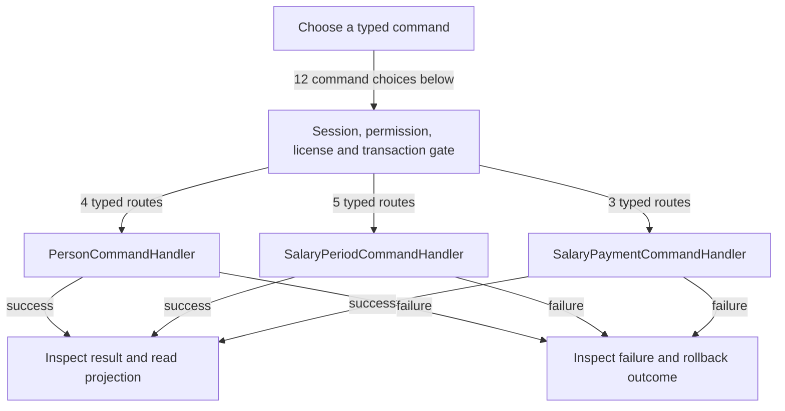

# People, agreements and salary

DRAFT · code snapshot 18 October 2026 · source review, not runtime acceptance

Feature coverage: PP-F016. Source: [SalaryPeriodCommandHandler.cs:1](code-application.md#src-4b1c23ddb697), [SalaryPaymentCommandHandler.cs:1](code-application.md#src-c26df3332168).

## Step-by-step review route

The numbered route is a business review checklist. Branches are separate actions; it does not imply that all actions occur in one transaction.

1. Maintain person and salary agreement.
2. Record adjustment, absence or opening balance.
3. Review and finalize a period.
4. Choose advance, salary payment or reversal.
5. Validate permission, balance and cash context.
6. Read ledger, frozen statement and payment outcome.

## Command routing map

This overview groups routes by handler to stay readable; each named command and its connections follow below. [Shared gate details](pipeline.md) apply when this handler is invoked through the pipeline. First-run provisioning is an explicit [separate path](access.md). Source construction sites show candidates, not proof of a connected or reachable UI path.

## Commands, options and implementation connections

### CreatePersonCommand

Handler: [PersonCommandHandler](code-application.md#src-8317fb4c0e84). Result type: <code>Guid</code>.

Declaration: [PersonCommands.cs:7](code-application.md#src-4520c918be9b). <code>RequiredPermission = Permissions.SalaryManage</code>

Construction sites: **None found** among explicit `new Type(...)` expressions. Target-typed construction, factories and runtime dispatch are not resolved.

Handler method: [PersonCommandHandler.HandleAsync(CreatePersonCommand,CommandEnvelope&lt;CreatePersonCommand&gt;,CancellationToken)](code-application.md#m-25b195fac183).

Same-owner helper candidates: [PersonCommandHandler.AddParam(DbCommand,string,object?)](code-application.md#m-deb43e4c3c67), [PersonCommandHandler.GenerateUniquePersonCodeAsync(DbConnection,DbTransaction?,CancellationToken)](code-application.md#m-68005f399ef0), [PersonCommandHandler.GetStoreDefaultCurrencyAndScaleAsync(DbConnection,DbTransaction?,CancellationToken)](code-application.md#m-9cba60261b04). These are unqualified/this-call name matches, including possible overloads; semantic binding was not performed.

| Direct method syntax | Extracted references |
| --- | --- |
| Reads | <code>person_records</code>, <code>users</code> |
| Writes / DDL | <code>person_records</code>, <code>salary_agreements</code> |
| Literal failure codes | <code>INVALID_DECIMAL_PLACES</code>, <code>INVALID_DISPLAY_NAME</code>, <code>INVALID_EMPLOYMENT_DATES</code>, <code>INVALID_PAYROLL_MONTH</code>, <code>INVALID_PERSON_KIND</code>, <code>INVALID_SALARY_AMOUNT</code>, <code>PERSON_CODE_ALREADY_EXISTS</code>, <code>USER_ALREADY_LINKED</code>, <code>USER_NOT_FOUND</code> |

Helper calls, table references in helpers, and throw sites are listed in the method catalogue. This table is not a transitive effect analysis.

### FinalizeSalaryPeriodCommand

Handler: [SalaryPeriodCommandHandler](code-application.md#src-4b1c23ddb697). Result type: <code>Guid</code>.

Declaration: [SalaryPeriodCommands.cs:48](code-application.md#src-8ce44973b846). <code>RequiredPermission = Permissions.SalaryManage</code>

Construction sites: [ConfirmFinalizeMonthAsync:1705](code-desktop.md#src-2f2298be3577)

Handler method: [SalaryPeriodCommandHandler.HandleAsync(FinalizeSalaryPeriodCommand,CommandEnvelope&lt;FinalizeSalaryPeriodCommand&gt;,CancellationToken)](code-application.md#m-c2090465ef7c).

Same-owner helper candidates: [SalaryPeriodCommandHandler.AddParam(DbCommand,string,object?)](code-application.md#m-4800dc539ff5). These are unqualified/this-call name matches, including possible overloads; semantic binding was not performed.

| Direct method syntax | Extracted references |
| --- | --- |
| Reads | <code>person_records</code>, <code>salary_adjustments</code>, <code>salary_agreements</code>, <code>salary_ledger_entries</code>, <code>salary_payments</code>, <code>salary_periods</code> |
| Writes / DDL | <code>person_records</code>, <code>salary_ledger_entries</code>, <code>salary_periods</code> |
| Literal failure codes | <code>INVALID_PAYROLL_MONTH</code>, <code>NO_SALARY_AGREEMENT</code>, <code>PERSON_NOT_FOUND</code>, <code>SALARY_PERIOD_BEFORE_TRACKING</code>, <code>SALARY_PERIOD_NOT_ENDED</code>, <code>SALARY_PREVIOUS_PERIOD_OPEN</code>, <code>STALE_REVISION</code> |

Helper calls, table references in helpers, and throw sites are listed in the method catalogue. This table is not a transitive effect analysis.

### PayAdvanceCommand

Handler: [SalaryPaymentCommandHandler](code-application.md#src-c26df3332168). Result type: <code>Guid</code>.

Declaration: [SalaryPaymentCommands.cs:7](code-application.md#src-b35b5fef12bc). <code>RequiredPermission = Permissions.SalaryPay; AdditionalPermissions = [Permissions.ReadMoney]</code>

Construction sites: [ConfirmSalaryPaymentAsync:1419](code-desktop.md#src-2f2298be3577)

Handler method: [SalaryPaymentCommandHandler.HandleAsync(PayAdvanceCommand,CommandEnvelope&lt;PayAdvanceCommand&gt;,CancellationToken)](code-application.md#m-b97b339d7e38).

Same-owner helper candidates: [SalaryPaymentCommandHandler.AddParam(DbCommand,string,object?)](code-application.md#m-aa8322662c52). These are unqualified/this-call name matches, including possible overloads; semantic binding was not performed.

| Direct method syntax | Extracted references |
| --- | --- |
| Reads | <code>money_accounts</code>, <code>person_records</code>, <code>salary_agreements</code>, <code>salary_ledger_entries</code> |
| Writes / DDL | <code>person_records</code>, <code>salary_ledger_entries</code>, <code>salary_payments</code> |
| Literal failure codes | <code>ACCOUNT_NOT_FOUND</code>, <code>CURRENCY_MISMATCH</code>, <code>INVALID_ACCOUNT_ID</code>, <code>INVALID_AMOUNT</code>, <code>INVALID_PERSON_ID</code>, <code>PAID_AT_OVERRIDE_NOT_PERMITTED</code>, <code>PERSON_DISABLED</code>, <code>PERSON_NOT_FOUND</code>, <code>REASON_REQUIRED</code>, <code>STALE_REVISION</code> |

Helper calls, table references in helpers, and throw sites are listed in the method catalogue. This table is not a transitive effect analysis.

### PaySalaryCommand

Handler: [SalaryPaymentCommandHandler](code-application.md#src-c26df3332168). Result type: <code>Guid</code>.

Declaration: [SalaryPaymentCommands.cs:33](code-application.md#src-b35b5fef12bc). <code>RequiredPermission = Permissions.SalaryPay; AdditionalPermissions = [Permissions.ReadMoney]</code>

Construction sites: [ConfirmSalaryPaymentAsync:1439](code-desktop.md#src-2f2298be3577)

Handler method: [SalaryPaymentCommandHandler.HandleAsync(PaySalaryCommand,CommandEnvelope&lt;PaySalaryCommand&gt;,CancellationToken)](code-application.md#m-4969cfdaa69b).

Same-owner helper candidates: [SalaryPaymentCommandHandler.AddParam(DbCommand,string,object?)](code-application.md#m-aa8322662c52). These are unqualified/this-call name matches, including possible overloads; semantic binding was not performed.

| Direct method syntax | Extracted references |
| --- | --- |
| Reads | <code>money_accounts</code>, <code>person_records</code>, <code>salary_agreements</code>, <code>salary_ledger_entries</code> |
| Writes / DDL | <code>person_records</code>, <code>salary_ledger_entries</code>, <code>salary_payments</code> |
| Literal failure codes | <code>ACCOUNT_NOT_FOUND</code>, <code>CURRENCY_MISMATCH</code>, <code>INVALID_ACCOUNT_ID</code>, <code>INVALID_AMOUNT</code>, <code>INVALID_PERSON_ID</code>, <code>NO_SALARY_AGREEMENT</code>, <code>PAID_AT_OVERRIDE_NOT_PERMITTED</code>, <code>PERSON_NOT_FOUND</code>, <code>REASON_REQUIRED</code>, <code>SALARY_FINALIZED_BALANCE_INSUFFICIENT</code>, <code>STALE_REVISION</code> |

Helper calls, table references in helpers, and throw sites are listed in the method catalogue. This table is not a transitive effect analysis.

### RecordSalaryAdjustmentCommand

Handler: [SalaryPeriodCommandHandler](code-application.md#src-4b1c23ddb697). Result type: <code>Guid</code>.

Declaration: [SalaryPeriodCommands.cs:7](code-application.md#src-8ce44973b846). <code>RequiredPermission = Permissions.SalaryManage</code>

Construction sites: [ConfirmSalaryAdjustmentAsync:1628](code-desktop.md#src-2f2298be3577)

Handler method: [SalaryPeriodCommandHandler.HandleAsync(RecordSalaryAdjustmentCommand,CommandEnvelope&lt;RecordSalaryAdjustmentCommand&gt;,CancellationToken)](code-application.md#m-e95dba3f35b5).

Same-owner helper candidates: [SalaryPeriodCommandHandler.AddParam(DbCommand,string,object?)](code-application.md#m-4800dc539ff5). These are unqualified/this-call name matches, including possible overloads; semantic binding was not performed.

| Direct method syntax | Extracted references |
| --- | --- |
| Reads | <code>person_records</code>, <code>salary_periods</code> |
| Writes / DDL | <code>person_records</code>, <code>salary_adjustments</code> |
| Literal failure codes | <code>INVALID_ADJUSTMENT_AMOUNT</code>, <code>INVALID_ADJUSTMENT_KIND</code>, <code>INVALID_PAYROLL_MONTH</code>, <code>INVALID_SALARY_DRAFT</code>, <code>PERIOD_ALREADY_FINALIZED</code>, <code>PERSON_NOT_FOUND</code>, <code>REASON_REQUIRED</code>, <code>STALE_REVISION</code> |

Helper calls, table references in helpers, and throw sites are listed in the method catalogue. This table is not a transitive effect analysis.

### RecordSalaryCorrectionCommand

Handler: [SalaryPeriodCommandHandler](code-application.md#src-4b1c23ddb697). Result type: <code>Guid</code>.

Declaration: [SalaryPeriodCommands.cs:86](code-application.md#src-8ce44973b846). <code>RequiredPermission = Permissions.SalaryAdjust</code>

Construction sites: **None found** among explicit `new Type(...)` expressions. Target-typed construction, factories and runtime dispatch are not resolved.

Handler method: [SalaryPeriodCommandHandler.HandleAsync(RecordSalaryCorrectionCommand,CommandEnvelope&lt;RecordSalaryCorrectionCommand&gt;,CancellationToken)](code-application.md#m-7e448db67b04).

Same-owner helper candidates: [SalaryPeriodCommandHandler.AddParam(DbCommand,string,object?)](code-application.md#m-4800dc539ff5), [SalaryPeriodCommandHandler.GetStoreDefaultCurrencyAndScaleAsync(DbConnection,DbTransaction?,CancellationToken)](code-application.md#m-b1e2c70a7d51). These are unqualified/this-call name matches, including possible overloads; semantic binding was not performed.

| Direct method syntax | Extracted references |
| --- | --- |
| Reads | <code>person_records</code>, <code>salary_agreements</code>, <code>salary_ledger_entries</code> |
| Writes / DDL | <code>person_records</code>, <code>salary_ledger_entries</code> |
| Literal failure codes | <code>INVALID_AMOUNT</code>, <code>INVALID_CORRECTION_TYPE</code>, <code>INVALID_PAYROLL_MONTH</code>, <code>PERSON_NOT_FOUND</code>, <code>REASON_REQUIRED</code>, <code>STALE_REVISION</code> |

Helper calls, table references in helpers, and throw sites are listed in the method catalogue. This table is not a transitive effect analysis.

### RecordSalaryOpeningBalanceCommand

Handler: [SalaryPeriodCommandHandler](code-application.md#src-4b1c23ddb697). Result type: <code>Guid</code>.

Declaration: [SalaryPeriodCommands.cs:64](code-application.md#src-8ce44973b846). <code>RequiredPermission = Permissions.SalaryAdjust</code>

Construction sites: **None found** among explicit `new Type(...)` expressions. Target-typed construction, factories and runtime dispatch are not resolved.

Handler method: [SalaryPeriodCommandHandler.HandleAsync(RecordSalaryOpeningBalanceCommand,CommandEnvelope&lt;RecordSalaryOpeningBalanceCommand&gt;,CancellationToken)](code-application.md#m-b2b08a84d6b9).

Same-owner helper candidates: [SalaryPeriodCommandHandler.GetStoreDefaultCurrencyAndScaleAsync(DbConnection,DbTransaction?,CancellationToken)](code-application.md#m-b1e2c70a7d51), [SalaryPeriodCommandHandler.AddParam(DbCommand,string,object?)](code-application.md#m-4800dc539ff5). These are unqualified/this-call name matches, including possible overloads; semantic binding was not performed.

| Direct method syntax | Extracted references |
| --- | --- |
| Reads | <code>person_records</code>, <code>salary_ledger_entries</code> |
| Writes / DDL | <code>person_records</code>, <code>salary_ledger_entries</code> |
| Literal failure codes | <code>INVALID_AMOUNT</code>, <code>INVALID_DECIMAL_PLACES</code>, <code>INVALID_PAYROLL_MONTH</code>, <code>OPENING_BALANCE_ALREADY_EXISTS</code>, <code>PERSON_NOT_FOUND</code>, <code>REASON_REQUIRED</code>, <code>STALE_REVISION</code> |

Helper calls, table references in helpers, and throw sites are listed in the method catalogue. This table is not a transitive effect analysis.

### RecordUnpaidDaysCommand

Handler: [SalaryPeriodCommandHandler](code-application.md#src-4b1c23ddb697). Result type: <code>bool</code>.

Declaration: [SalaryPeriodCommands.cs:29](code-application.md#src-8ce44973b846). <code>RequiredPermission = Permissions.SalaryManage</code>

Construction sites: [ConfirmSalaryAdjustmentAsync:1608](code-desktop.md#src-2f2298be3577)

Handler method: [SalaryPeriodCommandHandler.HandleAsync(RecordUnpaidDaysCommand,CommandEnvelope&lt;RecordUnpaidDaysCommand&gt;,CancellationToken)](code-application.md#m-19db365247cb).

Same-owner helper candidates: [SalaryPeriodCommandHandler.AddParam(DbCommand,string,object?)](code-application.md#m-4800dc539ff5). These are unqualified/this-call name matches, including possible overloads; semantic binding was not performed.

| Direct method syntax | Extracted references |
| --- | --- |
| Reads | <code>person_records</code>, <code>salary_periods</code> |
| Writes / DDL | <code>person_records</code>, <code>salary_periods</code> |
| Literal failure codes | <code>INVALID_PAYROLL_MONTH</code>, <code>INVALID_SALARY_DRAFT</code>, <code>INVALID_UNPAID_DAYS</code>, <code>PERIOD_ALREADY_FINALIZED</code>, <code>PERSON_NOT_FOUND</code>, <code>STALE_REVISION</code> |

Helper calls, table references in helpers, and throw sites are listed in the method catalogue. This table is not a transitive effect analysis.

### ReverseSalaryPaymentCommand

Handler: [SalaryPaymentCommandHandler](code-application.md#src-c26df3332168). Result type: <code>Guid</code>.

Declaration: [SalaryPaymentCommands.cs:59](code-application.md#src-b35b5fef12bc). <code>RequiredPermission = Permissions.SalaryAdjust; AdditionalPermissions = [Permissions.ReadMoney]</code>

Construction sites: [ConfirmPaymentReturnAsync:255](code-desktop.md#src-71e9030a9a8d)

Handler method: [SalaryPaymentCommandHandler.HandleAsync(ReverseSalaryPaymentCommand,CommandEnvelope&lt;ReverseSalaryPaymentCommand&gt;,CancellationToken)](code-application.md#m-8b736e7638f4).

Same-owner helper candidates: [SalaryPaymentCommandHandler.AddParam(DbCommand,string,object?)](code-application.md#m-aa8322662c52), [SalaryPaymentCommandHandler.GetStoreDefaultCurrencyAndScaleAsync(DbConnection,DbTransaction?,CancellationToken)](code-application.md#m-54686ddbdee6). These are unqualified/this-call name matches, including possible overloads; semantic binding was not performed.

| Direct method syntax | Extracted references |
| --- | --- |
| Reads | <code>money_accounts</code>, <code>person_records</code>, <code>salary_ledger_entries</code>, <code>salary_payments</code> |
| Writes / DDL | <code>person_records</code>, <code>salary_ledger_entries</code>, <code>salary_payments</code> |
| Literal failure codes | <code>ACCOUNT_NOT_FOUND</code>, <code>BANK_CONFIRMATION_REQUIRED</code>, <code>CANNOT_REVERSE_A_REVERSAL</code>, <code>PAYMENT_ALREADY_REVERSED</code>, <code>PAYMENT_NOT_FOUND</code>, <code>PERSON_MISMATCH</code>, <code>PERSON_NOT_FOUND</code>, <code>REASON_REQUIRED</code>, <code>SHIFT_NOT_OPEN</code>, <code>STALE_REVISION</code> |

Helper calls, table references in helpers, and throw sites are listed in the method catalogue. This table is not a transitive effect analysis.

### SaveSalaryAgreementCommand

Handler: [PersonCommandHandler](code-application.md#src-8317fb4c0e84). Result type: <code>Guid</code>.

Declaration: [PersonCommands.cs:67](code-application.md#src-4520c918be9b). <code>RequiredPermission = Permissions.SalaryManage</code>

Construction sites: **None found** among explicit `new Type(...)` expressions. Target-typed construction, factories and runtime dispatch are not resolved.

Handler method: [PersonCommandHandler.HandleAsync(SaveSalaryAgreementCommand,CommandEnvelope&lt;SaveSalaryAgreementCommand&gt;,CancellationToken)](code-application.md#m-575cc713e4b8).

Same-owner helper candidates: [PersonCommandHandler.GetStoreDefaultCurrencyAndScaleAsync(DbConnection,DbTransaction?,CancellationToken)](code-application.md#m-9cba60261b04), [PersonCommandHandler.AddParam(DbCommand,string,object?)](code-application.md#m-deb43e4c3c67), [PersonCommandHandler.CheckCurrencyChangeAllowedAsync(DbConnection,DbTransaction?,Guid,string,int,string,CancellationToken)](code-application.md#m-203137eda8d4). These are unqualified/this-call name matches, including possible overloads; semantic binding was not performed.

| Direct method syntax | Extracted references |
| --- | --- |
| Reads | <code>person_records</code>, <code>salary_agreements</code> |
| Writes / DDL | <code>person_records</code>, <code>salary_agreements</code> |
| Literal failure codes | <code>CURRENCY_CHANGE_NOT_PERMITTED</code>, <code>INVALID_DECIMAL_PLACES</code>, <code>INVALID_PAYROLL_MONTH</code>, <code>INVALID_SALARY_AMOUNT</code>, <code>INVALID_SALARY_DRAFT</code>, <code>PERSON_DISABLED</code>, <code>PERSON_NOT_FOUND</code>, <code>STALE_REVISION</code> |

Helper calls, table references in helpers, and throw sites are listed in the method catalogue. This table is not a transitive effect analysis.

### UpdatePersonCommand

Handler: [PersonCommandHandler](code-application.md#src-8317fb4c0e84). Result type: <code>bool</code>.

Declaration: [PersonCommands.cs:39](code-application.md#src-4520c918be9b). <code>RequiredPermission = Permissions.SalaryManage</code>

Construction sites: **None found** among explicit `new Type(...)` expressions. Target-typed construction, factories and runtime dispatch are not resolved.

Handler method: [PersonCommandHandler.HandleAsync(UpdatePersonCommand,CommandEnvelope&lt;UpdatePersonCommand&gt;,CancellationToken)](code-application.md#m-5e1f3b91faaa).

Same-owner helper candidates: [PersonCommandHandler.AddParam(DbCommand,string,object?)](code-application.md#m-deb43e4c3c67), [PersonCommandHandler.CheckTrackingStartAllowedAsync(DbConnection,DbTransaction?,Guid,string?,CancellationToken)](code-application.md#m-93dc82476f51). These are unqualified/this-call name matches, including possible overloads; semantic binding was not performed.

| Direct method syntax | Extracted references |
| --- | --- |
| Reads | <code>person_records</code>, <code>users</code> |
| Writes / DDL | <code>person_records</code> |
| Literal failure codes | <code>INVALID_DISPLAY_NAME</code>, <code>INVALID_EMPLOYMENT_DATES</code>, <code>INVALID_PAYROLL_MONTH</code>, <code>INVALID_PERSON_KIND</code>, <code>INVALID_SALARY_DRAFT</code>, <code>PERSON_NOT_FOUND</code>, <code>STALE_REVISION</code>, <code>TRACKING_START_EXCLUDES_EXISTING_PAYROLL</code>, <code>USER_ALREADY_LINKED</code>, <code>USER_NOT_FOUND</code> |

Helper calls, table references in helpers, and throw sites are listed in the method catalogue. This table is not a transitive effect analysis.

### UpdatePersonWithAgreementCommand

Handler: [PersonCommandHandler](code-application.md#src-8317fb4c0e84). Result type: <code>bool</code>.

Declaration: [PersonCommands.cs:90](code-application.md#src-4520c918be9b). <code>RequiredPermission = Permissions.SalaryManage</code>

Construction sites: **None found** among explicit `new Type(...)` expressions. Target-typed construction, factories and runtime dispatch are not resolved.

Handler method: [PersonCommandHandler.HandleAsync(UpdatePersonWithAgreementCommand,CommandEnvelope&lt;UpdatePersonWithAgreementCommand&gt;,CancellationToken)](code-application.md#m-9394fefd3660).

Same-owner helper candidates: [PersonCommandHandler.AddParam(DbCommand,string,object?)](code-application.md#m-deb43e4c3c67), [PersonCommandHandler.CheckTrackingStartAllowedAsync(DbConnection,DbTransaction?,Guid,string?,CancellationToken)](code-application.md#m-93dc82476f51), [PersonCommandHandler.GetStoreDefaultCurrencyAndScaleAsync(DbConnection,DbTransaction?,CancellationToken)](code-application.md#m-9cba60261b04), [PersonCommandHandler.CheckCurrencyChangeAllowedAsync(DbConnection,DbTransaction?,Guid,string,int,string,CancellationToken)](code-application.md#m-203137eda8d4). These are unqualified/this-call name matches, including possible overloads; semantic binding was not performed.

| Direct method syntax | Extracted references |
| --- | --- |
| Reads | <code>person_records</code>, <code>salary_agreements</code>, <code>users</code> |
| Writes / DDL | <code>person_records</code>, <code>salary_agreements</code> |
| Literal failure codes | <code>CURRENCY_CHANGE_NOT_PERMITTED</code>, <code>INVALID_DECIMAL_PLACES</code>, <code>INVALID_DISPLAY_NAME</code>, <code>INVALID_EMPLOYMENT_DATES</code>, <code>INVALID_PAYROLL_MONTH</code>, <code>INVALID_PERSON_KIND</code>, <code>INVALID_SALARY_AMOUNT</code>, <code>INVALID_SALARY_DRAFT</code>, <code>PERSON_DISABLED</code>, <code>PERSON_NOT_FOUND</code>, <code>STALE_REVISION</code>, <code>TRACKING_START_EXCLUDES_EXISTING_PAYROLL</code>, <code>USER_ALREADY_LINKED</code>, <code>USER_NOT_FOUND</code> |

Helper calls, table references in helpers, and throw sites are listed in the method catalogue. This table is not a transitive effect analysis.

## Verification still required

No application journey was executed for this map. Use a separate synthetic test environment to verify permission denial, valid success, invalid inputs, state conflicts, cancellation, transaction rollback, retry/idempotency and the resulting projection. Add physical-device checks only where the workflow dispatches output. Preserve original financial history when reviewing corrections or reversals.
