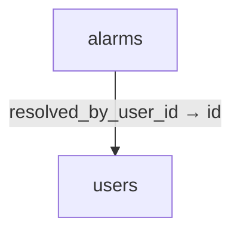
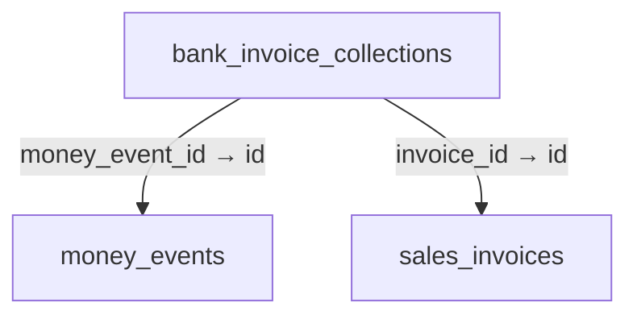
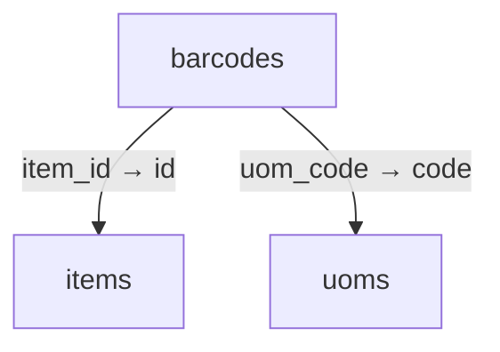
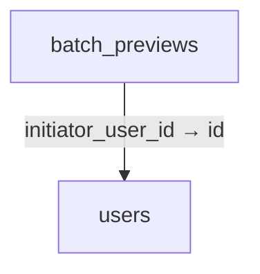
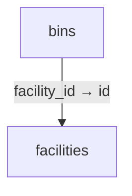
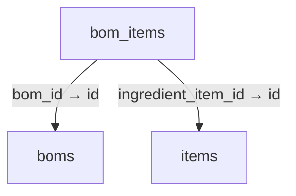
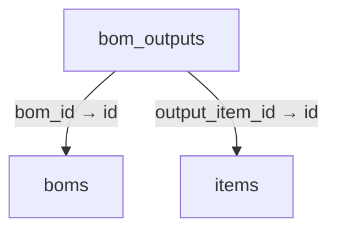
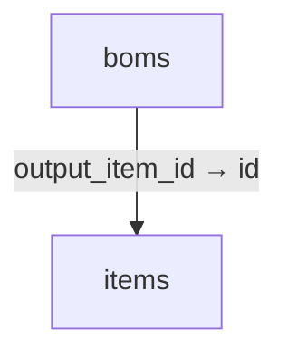
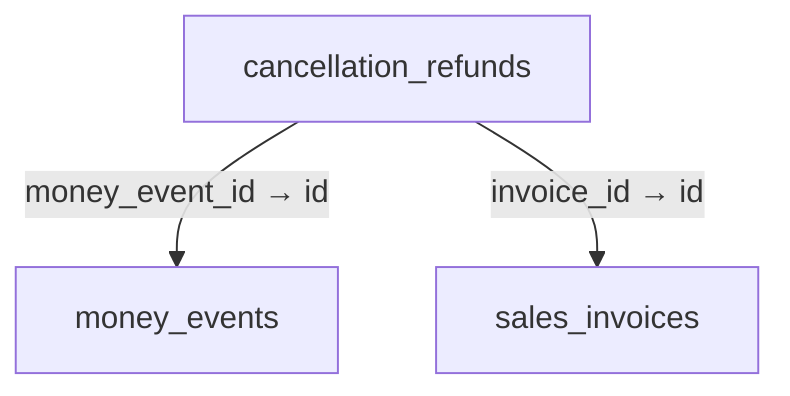
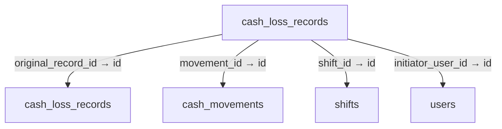

# Schema 01: alarms to cash_loss_records

DRAFT · code snapshot 20 October 2026 · source review and targeted automated checks

[Complete table index and reconstruction limits](schema.md). Arrows below are declared foreign keys, not inferred cardinalities.

## alarms {#alarms}

Relationship diagram

Columns and foreign-key policies

| Column | SQLite type | NOT NULL | Primary-key position |
| --- | --- | --- | --- |
| <code>id</code> | <code>TEXT</code> | False | 1 |
| <code>code</code> | <code>TEXT</code> | True | — |
| <code>severity</code> | <code>TEXT</code> | True | — |
| <code>message</code> | <code>TEXT</code> | True | — |
| <code>triggered_at_utc</code> | <code>TEXT</code> | True | — |
| <code>resolved_at_utc</code> | <code>TEXT</code> | False | — |
| <code>resolved_by_user_id</code> | <code>TEXT</code> | False | — |

| FK / sequence | Child column | Parent table / column | On update / delete |
| --- | --- | --- | --- |
| 0 / 0 | <code>resolved_by_user_id</code> | [users](schema-12.md#users) / <code>id</code> | NO ACTION / NO ACTION |

## backup_metadata {#backup-metadata}

No outgoing foreign key declared in the reconstructed schema.

Columns and foreign-key policies

| Column | SQLite type | NOT NULL | Primary-key position |
| --- | --- | --- | --- |
| <code>id</code> | <code>TEXT</code> | False | 1 |
| <code>backup_path</code> | <code>TEXT</code> | True | — |
| <code>checksum_sha256</code> | <code>TEXT</code> | True | — |
| <code>created_at_utc</code> | <code>TEXT</code> | True | — |
| <code>transaction_cutoff</code> | <code>TEXT</code> | True | — |
| <code>is_verified</code> | <code>INTEGER</code> | True | — |

## bank_invoice_collections {#bank-invoice-collections}

Relationship diagram

Columns and foreign-key policies

| Column | SQLite type | NOT NULL | Primary-key position |
| --- | --- | --- | --- |
| <code>id</code> | <code>TEXT</code> | False | 1 |
| <code>invoice_id</code> | <code>TEXT</code> | True | — |
| <code>money_event_id</code> | <code>TEXT</code> | True | — |
| <code>amount_minor</code> | <code>INTEGER</code> | True | — |
| <code>command_key</code> | <code>TEXT</code> | True | — |
| <code>created_at_utc</code> | <code>TEXT</code> | True | — |

| FK / sequence | Child column | Parent table / column | On update / delete |
| --- | --- | --- | --- |
| 0 / 0 | <code>money_event_id</code> | [money_events](schema-05.md#money-events) / <code>id</code> | NO ACTION / NO ACTION |
| 1 / 0 | <code>invoice_id</code> | [sales_invoices](schema-09.md#sales-invoices) / <code>id</code> | NO ACTION / NO ACTION |

## barcodes {#barcodes}

Relationship diagram

Columns and foreign-key policies

| Column | SQLite type | NOT NULL | Primary-key position |
| --- | --- | --- | --- |
| <code>barcode</code> | <code>TEXT</code> | False | 1 |
| <code>item_id</code> | <code>TEXT</code> | True | — |
| <code>uom_code</code> | <code>TEXT</code> | True | — |
| <code>conversion_factor</code> | <code>REAL</code> | True | — |
| <code>is_primary</code> | <code>INTEGER</code> | True | — |

| FK / sequence | Child column | Parent table / column | On update / delete |
| --- | --- | --- | --- |
| 0 / 0 | <code>uom_code</code> | [uoms](schema-12.md#uoms) / <code>code</code> | NO ACTION / NO ACTION |
| 1 / 0 | <code>item_id</code> | [items](schema-04.md#items) / <code>id</code> | NO ACTION / CASCADE |

## batch_previews {#batch-previews}

Relationship diagram

Columns and foreign-key policies

| Column | SQLite type | NOT NULL | Primary-key position |
| --- | --- | --- | --- |
| <code>id</code> | <code>TEXT</code> | False | 1 |
| <code>created_at_utc</code> | <code>TEXT</code> | True | — |
| <code>expires_at_utc</code> | <code>TEXT</code> | True | — |
| <code>initiator_user_id</code> | <code>TEXT</code> | True | — |
| <code>target_kind</code> | <code>TEXT</code> | True | — |
| <code>operation_kind</code> | <code>TEXT</code> | True | — |
| <code>selection_mode</code> | <code>TEXT</code> | True | — |
| <code>canonical_filter_json</code> | <code>TEXT</code> | True | — |
| <code>selected_ids_json</code> | <code>TEXT</code> | True | — |
| <code>operation_parameters_sha256</code> | <code>TEXT</code> | True | — |
| <code>selection_count</code> | <code>INTEGER</code> | True | — |
| <code>selection_sha256</code> | <code>TEXT</code> | True | — |
| <code>pricing_inputs_sha256</code> | <code>TEXT</code> | False | — |
| <code>preview_payload_json</code> | <code>TEXT</code> | True | — |
| <code>consumed_at_utc</code> | <code>TEXT</code> | False | — |
| <code>result_reference</code> | <code>TEXT</code> | False | — |

| FK / sequence | Child column | Parent table / column | On update / delete |
| --- | --- | --- | --- |
| 0 / 0 | <code>initiator_user_id</code> | [users](schema-12.md#users) / <code>id</code> | NO ACTION / NO ACTION |

## bins {#bins}

Relationship diagram

Columns and foreign-key policies

| Column | SQLite type | NOT NULL | Primary-key position |
| --- | --- | --- | --- |
| <code>id</code> | <code>TEXT</code> | False | 1 |
| <code>facility_id</code> | <code>TEXT</code> | True | — |
| <code>code</code> | <code>TEXT</code> | True | — |
| <code>zone</code> | <code>TEXT</code> | False | — |
| <code>aisle</code> | <code>TEXT</code> | False | — |
| <code>rack</code> | <code>TEXT</code> | False | — |
| <code>shelf</code> | <code>TEXT</code> | False | — |
| <code>is_active</code> | <code>INTEGER</code> | True | — |

| FK / sequence | Child column | Parent table / column | On update / delete |
| --- | --- | --- | --- |
| 0 / 0 | <code>facility_id</code> | [facilities](schema-02.md#facilities) / <code>id</code> | NO ACTION / CASCADE |

## bom_items {#bom-items}

Relationship diagram

Columns and foreign-key policies

| Column | SQLite type | NOT NULL | Primary-key position |
| --- | --- | --- | --- |
| <code>id</code> | <code>TEXT</code> | False | 1 |
| <code>bom_id</code> | <code>TEXT</code> | True | — |
| <code>ingredient_item_id</code> | <code>TEXT</code> | True | — |
| <code>quantity</code> | <code>REAL</code> | True | — |
| <code>scrap_factor</code> | <code>REAL</code> | True | — |
| <code>unit_code</code> | <code>TEXT</code> | True | — |
| <code>conversion_factor</code> | <code>REAL</code> | True | — |
| <code>quantity_decimal</code> | <code>TEXT</code> | False | — |
| <code>conversion_factor_decimal</code> | <code>TEXT</code> | False | — |

| FK / sequence | Child column | Parent table / column | On update / delete |
| --- | --- | --- | --- |
| 0 / 0 | <code>ingredient_item_id</code> | [items](schema-04.md#items) / <code>id</code> | NO ACTION / NO ACTION |
| 1 / 0 | <code>bom_id</code> | [boms](schema-01.md#boms) / <code>id</code> | NO ACTION / CASCADE |

## bom_outputs {#bom-outputs}

Relationship diagram

Columns and foreign-key policies

| Column | SQLite type | NOT NULL | Primary-key position |
| --- | --- | --- | --- |
| <code>id</code> | <code>TEXT</code> | False | 1 |
| <code>bom_id</code> | <code>TEXT</code> | True | — |
| <code>output_item_id</code> | <code>TEXT</code> | True | — |
| <code>role</code> | <code>TEXT</code> | True | — |
| <code>expected_yield</code> | <code>REAL</code> | True | — |
| <code>expected_yield_decimal</code> | <code>TEXT</code> | True | — |
| <code>cost_allocation_share_decimal</code> | <code>TEXT</code> | True | — |
| <code>shelf_life_days</code> | <code>INTEGER</code> | False | — |
| <code>batch_code_template</code> | <code>TEXT</code> | False | — |
| <code>created_at_utc</code> | <code>TEXT</code> | True | — |

| FK / sequence | Child column | Parent table / column | On update / delete |
| --- | --- | --- | --- |
| 0 / 0 | <code>output_item_id</code> | [items](schema-04.md#items) / <code>id</code> | NO ACTION / NO ACTION |
| 1 / 0 | <code>bom_id</code> | [boms](schema-01.md#boms) / <code>id</code> | NO ACTION / CASCADE |

## boms {#boms}

Relationship diagram

Columns and foreign-key policies

| Column | SQLite type | NOT NULL | Primary-key position |
| --- | --- | --- | --- |
| <code>id</code> | <code>TEXT</code> | False | 1 |
| <code>output_item_id</code> | <code>TEXT</code> | True | — |
| <code>version</code> | <code>INTEGER</code> | True | — |
| <code>name</code> | <code>TEXT</code> | True | — |
| <code>expected_yield</code> | <code>REAL</code> | True | — |
| <code>is_active</code> | <code>INTEGER</code> | True | — |

| FK / sequence | Child column | Parent table / column | On update / delete |
| --- | --- | --- | --- |
| 0 / 0 | <code>output_item_id</code> | [items](schema-04.md#items) / <code>id</code> | NO ACTION / CASCADE |

## business_profile_config {#business-profile-config}

No outgoing foreign key declared in the reconstructed schema.

Columns and foreign-key policies

| Column | SQLite type | NOT NULL | Primary-key position |
| --- | --- | --- | --- |
| <code>id</code> | <code>INTEGER</code> | False | 1 |
| <code>business_profile</code> | <code>TEXT</code> | True | — |
| <code>service_style</code> | <code>TEXT</code> | True | — |
| <code>order_types_enabled</code> | <code>TEXT</code> | True | — |
| <code>is_kitchen_routing_enabled</code> | <code>INTEGER</code> | True | — |
| <code>is_table_management_enabled</code> | <code>INTEGER</code> | True | — |
| <code>is_modifiers_enabled</code> | <code>INTEGER</code> | True | — |
| <code>updated_at_utc</code> | <code>TEXT</code> | True | — |
| <code>updated_by_user_id</code> | <code>TEXT</code> | False | — |

## cancellation_refunds {#cancellation-refunds}

Relationship diagram

Columns and foreign-key policies

| Column | SQLite type | NOT NULL | Primary-key position |
| --- | --- | --- | --- |
| <code>id</code> | <code>TEXT</code> | False | 1 |
| <code>invoice_id</code> | <code>TEXT</code> | True | — |
| <code>money_event_id</code> | <code>TEXT</code> | True | — |
| <code>amount_minor</code> | <code>INTEGER</code> | True | — |
| <code>command_key</code> | <code>TEXT</code> | True | — |
| <code>created_at_utc</code> | <code>TEXT</code> | True | — |

| FK / sequence | Child column | Parent table / column | On update / delete |
| --- | --- | --- | --- |
| 0 / 0 | <code>money_event_id</code> | [money_events](schema-05.md#money-events) / <code>id</code> | NO ACTION / NO ACTION |
| 1 / 0 | <code>invoice_id</code> | [sales_invoices](schema-09.md#sales-invoices) / <code>id</code> | NO ACTION / NO ACTION |

## cash_loss_records {#cash-loss-records}

Relationship diagram

Columns and foreign-key policies

| Column | SQLite type | NOT NULL | Primary-key position |
| --- | --- | --- | --- |
| <code>id</code> | <code>TEXT</code> | False | 1 |
| <code>shift_id</code> | <code>TEXT</code> | True | — |
| <code>movement_id</code> | <code>TEXT</code> | False | — |
| <code>kind</code> | <code>INTEGER</code> | True | — |
| <code>amount_minor</code> | <code>INTEGER</code> | True | — |
| <code>currency</code> | <code>TEXT</code> | True | — |
| <code>original_record_id</code> | <code>TEXT</code> | False | — |
| <code>correction_group_id</code> | <code>TEXT</code> | False | — |
| <code>source_key</code> | <code>TEXT</code> | True | — |
| <code>reason</code> | <code>TEXT</code> | True | — |
| <code>initiator_user_id</code> | <code>TEXT</code> | True | — |
| <code>correlation_id</code> | <code>TEXT</code> | True | — |
| <code>business_date</code> | <code>TEXT</code> | True | — |
| <code>created_at_utc</code> | <code>TEXT</code> | True | — |
| <code>currency_decimal_places_snapshot</code> | <code>INTEGER</code> | False | — |

| FK / sequence | Child column | Parent table / column | On update / delete |
| --- | --- | --- | --- |
| 0 / 0 | <code>initiator_user_id</code> | [users](schema-12.md#users) / <code>id</code> | NO ACTION / NO ACTION |
| 1 / 0 | <code>original_record_id</code> | [cash_loss_records](schema-01.md#cash-loss-records) / <code>id</code> | NO ACTION / NO ACTION |
| 2 / 0 | <code>movement_id</code> | [cash_movements](schema-02.md#cash-movements) / <code>id</code> | NO ACTION / NO ACTION |
| 3 / 0 | <code>shift_id</code> | [shifts](schema-10.md#shifts) / <code>id</code> | NO ACTION / NO ACTION |

