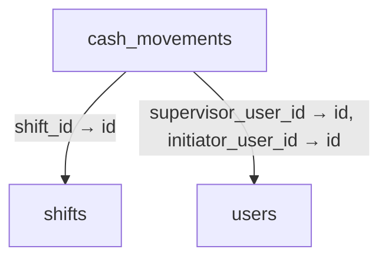
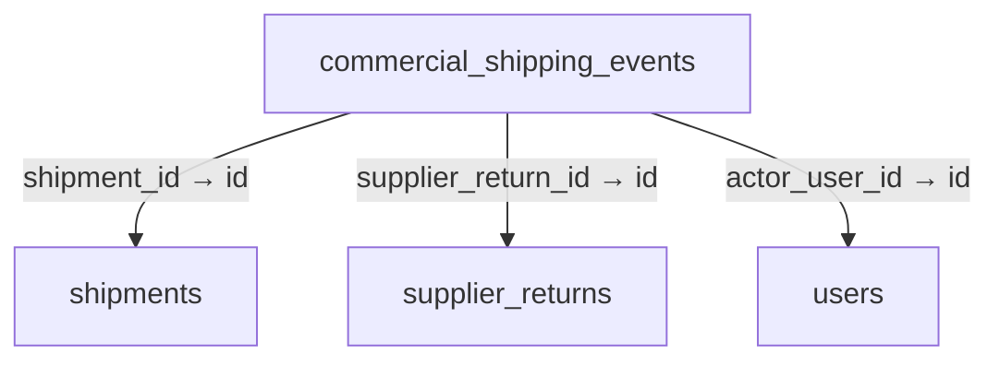
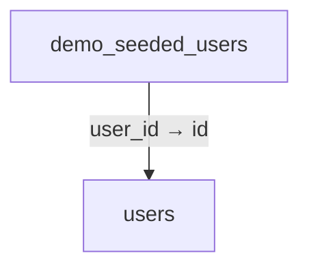
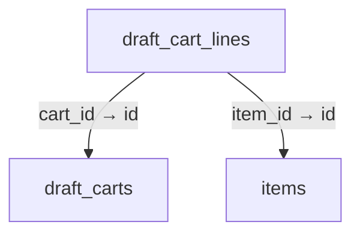
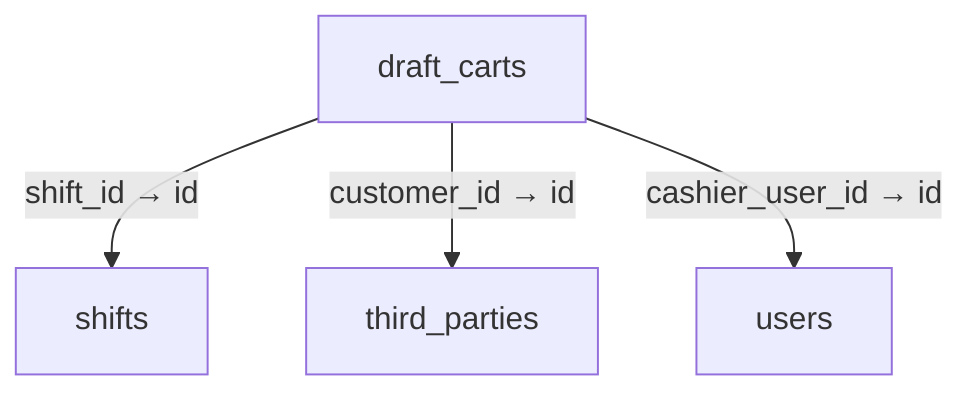
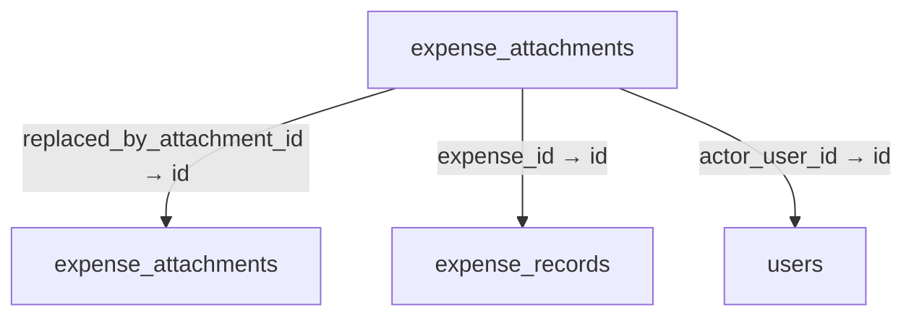
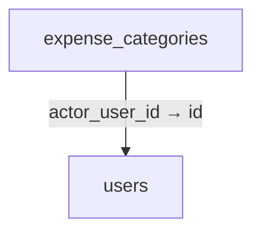
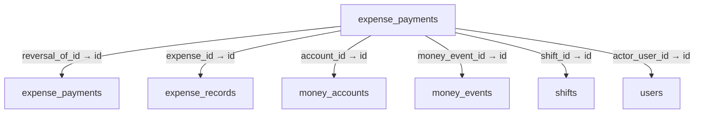
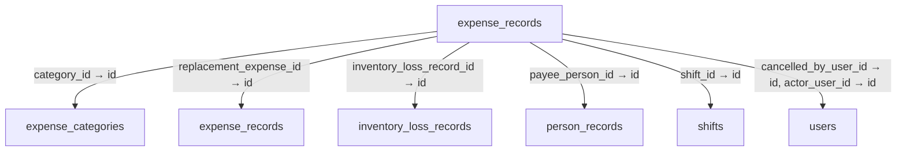

# Schema 02: cash_movements to facilities

DRAFT · code snapshot 20 October 2026 · source review and targeted automated checks

[Complete table index and reconstruction limits](schema.md). Arrows below are declared foreign keys, not inferred cardinalities.

## cash_movements {#cash-movements}

Relationship diagram

Columns and foreign-key policies

| Column | SQLite type | NOT NULL | Primary-key position |
| --- | --- | --- | --- |
| <code>id</code> | <code>TEXT</code> | False | 1 |
| <code>shift_id</code> | <code>TEXT</code> | True | — |
| <code>movement_type</code> | <code>INTEGER</code> | True | — |
| <code>amount_minor</code> | <code>INTEGER</code> | True | — |
| <code>currency</code> | <code>TEXT</code> | True | — |
| <code>reference_type</code> | <code>TEXT</code> | True | — |
| <code>reference_id</code> | <code>TEXT</code> | True | — |
| <code>initiator_user_id</code> | <code>TEXT</code> | True | — |
| <code>supervisor_user_id</code> | <code>TEXT</code> | False | — |
| <code>reason</code> | <code>TEXT</code> | False | — |
| <code>created_at_utc</code> | <code>TEXT</code> | True | — |

| FK / sequence | Child column | Parent table / column | On update / delete |
| --- | --- | --- | --- |
| 0 / 0 | <code>supervisor_user_id</code> | [users](schema-12.md#users) / <code>id</code> | NO ACTION / NO ACTION |
| 1 / 0 | <code>initiator_user_id</code> | [users](schema-12.md#users) / <code>id</code> | NO ACTION / NO ACTION |
| 2 / 0 | <code>shift_id</code> | [shifts](schema-10.md#shifts) / <code>id</code> | NO ACTION / NO ACTION |

## command_deduplication {#command-deduplication}

No outgoing foreign key declared in the reconstructed schema.

Columns and foreign-key policies

| Column | SQLite type | NOT NULL | Primary-key position |
| --- | --- | --- | --- |
| <code>idempotency_key</code> | <code>TEXT</code> | False | 1 |
| <code>canonical_hash</code> | <code>TEXT</code> | True | — |
| <code>result_payload</code> | <code>TEXT</code> | True | — |
| <code>executed_at_utc</code> | <code>TEXT</code> | True | — |

## commercial_shipping_events {#commercial-shipping-events}

Relationship diagram

Columns and foreign-key policies

| Column | SQLite type | NOT NULL | Primary-key position |
| --- | --- | --- | --- |
| <code>id</code> | <code>TEXT</code> | False | 1 |
| <code>shipment_id</code> | <code>TEXT</code> | False | — |
| <code>supplier_return_id</code> | <code>TEXT</code> | False | — |
| <code>event_kind</code> | <code>TEXT</code> | True | — |
| <code>details</code> | <code>TEXT</code> | True | — |
| <code>actor_user_id</code> | <code>TEXT</code> | True | — |
| <code>created_at_utc</code> | <code>TEXT</code> | True | — |

| FK / sequence | Child column | Parent table / column | On update / delete |
| --- | --- | --- | --- |
| 0 / 0 | <code>actor_user_id</code> | [users](schema-12.md#users) / <code>id</code> | NO ACTION / NO ACTION |
| 1 / 0 | <code>supplier_return_id</code> | [supplier_returns](schema-11.md#supplier-returns) / <code>id</code> | NO ACTION / NO ACTION |
| 2 / 0 | <code>shipment_id</code> | [shipments](schema-10.md#shipments) / <code>id</code> | NO ACTION / NO ACTION |

## demo_dataset_state {#demo-dataset-state}

No outgoing foreign key declared in the reconstructed schema.

Columns and foreign-key policies

| Column | SQLite type | NOT NULL | Primary-key position |
| --- | --- | --- | --- |
| <code>id</code> | <code>INTEGER</code> | False | 1 |
| <code>state</code> | <code>TEXT</code> | True | — |
| <code>dataset_version</code> | <code>INTEGER</code> | True | — |
| <code>completed_at_utc</code> | <code>TEXT</code> | False | — |
| <code>failure_code</code> | <code>TEXT</code> | False | — |
| <code>updated_at_utc</code> | <code>TEXT</code> | True | — |

## demo_seeded_users {#demo-seeded-users}

Relationship diagram

Columns and foreign-key policies

| Column | SQLite type | NOT NULL | Primary-key position |
| --- | --- | --- | --- |
| <code>role_name</code> | <code>TEXT</code> | False | 1 |
| <code>user_id</code> | <code>TEXT</code> | True | — |
| <code>username_snapshot</code> | <code>TEXT</code> | True | — |
| <code>created_at_utc</code> | <code>TEXT</code> | True | — |

| FK / sequence | Child column | Parent table / column | On update / delete |
| --- | --- | --- | --- |
| 0 / 0 | <code>user_id</code> | [users](schema-12.md#users) / <code>id</code> | NO ACTION / RESTRICT |

## draft_cart_lines {#draft-cart-lines}

Relationship diagram

Columns and foreign-key policies

| Column | SQLite type | NOT NULL | Primary-key position |
| --- | --- | --- | --- |
| <code>id</code> | <code>TEXT</code> | False | 1 |
| <code>cart_id</code> | <code>TEXT</code> | True | — |
| <code>item_id</code> | <code>TEXT</code> | True | — |
| <code>item_sku</code> | <code>TEXT</code> | True | — |
| <code>item_name</code> | <code>TEXT</code> | True | — |
| <code>quantity</code> | <code>REAL</code> | True | — |
| <code>unit_code</code> | <code>TEXT</code> | True | — |
| <code>conversion_factor</code> | <code>REAL</code> | True | — |
| <code>unit_price_minor</code> | <code>INTEGER</code> | True | — |
| <code>currency</code> | <code>TEXT</code> | True | — |
| <code>discount_percentage</code> | <code>REAL</code> | True | — |
| <code>discount_minor</code> | <code>INTEGER</code> | True | — |
| <code>tax_rate</code> | <code>REAL</code> | True | — |
| <code>lot_id</code> | <code>TEXT</code> | False | — |
| <code>serial_number</code> | <code>TEXT</code> | False | — |
| <code>quantity_decimal</code> | <code>TEXT</code> | False | — |
| <code>conversion_factor_decimal</code> | <code>TEXT</code> | False | — |
| <code>tax_rate_decimal</code> | <code>TEXT</code> | False | — |
| <code>is_manual_price_override</code> | <code>INTEGER</code> | True | — |
| <code>price_override_reason</code> | <code>TEXT</code> | True | — |
| <code>benchmark_price_minor</code> | <code>INTEGER</code> | False | — |

| FK / sequence | Child column | Parent table / column | On update / delete |
| --- | --- | --- | --- |
| 0 / 0 | <code>item_id</code> | [items](schema-04.md#items) / <code>id</code> | NO ACTION / NO ACTION |
| 1 / 0 | <code>cart_id</code> | [draft_carts](schema-02.md#draft-carts) / <code>id</code> | NO ACTION / CASCADE |

## draft_carts {#draft-carts}

Relationship diagram

Columns and foreign-key policies

| Column | SQLite type | NOT NULL | Primary-key position |
| --- | --- | --- | --- |
| <code>id</code> | <code>TEXT</code> | False | 1 |
| <code>cashier_user_id</code> | <code>TEXT</code> | True | — |
| <code>shift_id</code> | <code>TEXT</code> | True | — |
| <code>customer_reference</code> | <code>TEXT</code> | False | — |
| <code>status</code> | <code>INTEGER</code> | True | — |
| <code>suspension_note</code> | <code>TEXT</code> | False | — |
| <code>created_at_utc</code> | <code>TEXT</code> | True | — |
| <code>updated_at_utc</code> | <code>TEXT</code> | False | — |
| <code>customer_id</code> | <code>TEXT</code> | False | — |
| <code>customer_name_snapshot</code> | <code>TEXT</code> | False | — |
| <code>promo_type</code> | <code>TEXT</code> | False | — |
| <code>promo_value_decimal</code> | <code>TEXT</code> | False | — |
| <code>promo_reason</code> | <code>TEXT</code> | False | — |
| <code>cart_revision</code> | <code>INTEGER</code> | True | — |
| <code>origin</code> | <code>TEXT</code> | True | — |

| FK / sequence | Child column | Parent table / column | On update / delete |
| --- | --- | --- | --- |
| 0 / 0 | <code>customer_id</code> | [third_parties](schema-11.md#third-parties) / <code>id</code> | NO ACTION / NO ACTION |
| 1 / 0 | <code>shift_id</code> | [shifts](schema-10.md#shifts) / <code>id</code> | NO ACTION / NO ACTION |
| 2 / 0 | <code>cashier_user_id</code> | [users](schema-12.md#users) / <code>id</code> | NO ACTION / NO ACTION |

## expense_attachments {#expense-attachments}

Relationship diagram

Columns and foreign-key policies

| Column | SQLite type | NOT NULL | Primary-key position |
| --- | --- | --- | --- |
| <code>id</code> | <code>TEXT</code> | False | 1 |
| <code>expense_id</code> | <code>TEXT</code> | True | — |
| <code>version</code> | <code>INTEGER</code> | True | — |
| <code>is_current</code> | <code>INTEGER</code> | True | — |
| <code>replaced_by_attachment_id</code> | <code>TEXT</code> | False | — |
| <code>mime_type</code> | <code>TEXT</code> | True | — |
| <code>width</code> | <code>INTEGER</code> | True | — |
| <code>height</code> | <code>INTEGER</code> | True | — |
| <code>byte_size</code> | <code>INTEGER</code> | True | — |
| <code>sha256_hash</code> | <code>TEXT</code> | True | — |
| <code>image_data</code> | <code>BLOB</code> | True | — |
| <code>actor_user_id</code> | <code>TEXT</code> | True | — |
| <code>created_at_utc</code> | <code>TEXT</code> | True | — |

| FK / sequence | Child column | Parent table / column | On update / delete |
| --- | --- | --- | --- |
| 0 / 0 | <code>actor_user_id</code> | [users](schema-12.md#users) / <code>id</code> | NO ACTION / NO ACTION |
| 1 / 0 | <code>replaced_by_attachment_id</code> | [expense_attachments](schema-02.md#expense-attachments) / <code>id</code> | NO ACTION / NO ACTION |
| 2 / 0 | <code>expense_id</code> | [expense_records](schema-02.md#expense-records) / <code>id</code> | NO ACTION / CASCADE |

## expense_categories {#expense-categories}

Relationship diagram

Columns and foreign-key policies

| Column | SQLite type | NOT NULL | Primary-key position |
| --- | --- | --- | --- |
| <code>id</code> | <code>TEXT</code> | False | 1 |
| <code>name</code> | <code>TEXT</code> | True | — |
| <code>code</code> | <code>TEXT</code> | True | — |
| <code>is_active</code> | <code>INTEGER</code> | True | — |
| <code>is_system</code> | <code>INTEGER</code> | True | — |
| <code>revision</code> | <code>INTEGER</code> | True | — |
| <code>actor_user_id</code> | <code>TEXT</code> | False | — |
| <code>created_at_utc</code> | <code>TEXT</code> | True | — |
| <code>updated_at_utc</code> | <code>TEXT</code> | True | — |

| FK / sequence | Child column | Parent table / column | On update / delete |
| --- | --- | --- | --- |
| 0 / 0 | <code>actor_user_id</code> | [users](schema-12.md#users) / <code>id</code> | NO ACTION / NO ACTION |

## expense_payments {#expense-payments}

Relationship diagram

Columns and foreign-key policies

| Column | SQLite type | NOT NULL | Primary-key position |
| --- | --- | --- | --- |
| <code>id</code> | <code>TEXT</code> | False | 1 |
| <code>expense_id</code> | <code>TEXT</code> | True | — |
| <code>kind</code> | <code>TEXT</code> | True | — |
| <code>amount_minor</code> | <code>INTEGER</code> | True | — |
| <code>account_id</code> | <code>TEXT</code> | True | — |
| <code>shift_id</code> | <code>TEXT</code> | False | — |
| <code>paid_at_utc</code> | <code>TEXT</code> | True | — |
| <code>external_reference</code> | <code>TEXT</code> | False | — |
| <code>money_event_id</code> | <code>TEXT</code> | False | — |
| <code>reason</code> | <code>TEXT</code> | True | — |
| <code>actor_user_id</code> | <code>TEXT</code> | True | — |
| <code>reversal_of_id</code> | <code>TEXT</code> | False | — |
| <code>command_key</code> | <code>TEXT</code> | True | — |
| <code>created_at_utc</code> | <code>TEXT</code> | True | — |

| FK / sequence | Child column | Parent table / column | On update / delete |
| --- | --- | --- | --- |
| 0 / 0 | <code>reversal_of_id</code> | [expense_payments](schema-02.md#expense-payments) / <code>id</code> | NO ACTION / NO ACTION |
| 1 / 0 | <code>actor_user_id</code> | [users](schema-12.md#users) / <code>id</code> | NO ACTION / NO ACTION |
| 2 / 0 | <code>money_event_id</code> | [money_events](schema-05.md#money-events) / <code>id</code> | NO ACTION / NO ACTION |
| 3 / 0 | <code>shift_id</code> | [shifts](schema-10.md#shifts) / <code>id</code> | NO ACTION / NO ACTION |
| 4 / 0 | <code>account_id</code> | [money_accounts](schema-05.md#money-accounts) / <code>id</code> | NO ACTION / NO ACTION |
| 5 / 0 | <code>expense_id</code> | [expense_records](schema-02.md#expense-records) / <code>id</code> | NO ACTION / CASCADE |

## expense_records {#expense-records}

Relationship diagram

Columns and foreign-key policies

| Column | SQLite type | NOT NULL | Primary-key position |
| --- | --- | --- | --- |
| <code>id</code> | <code>TEXT</code> | False | 1 |
| <code>reference</code> | <code>TEXT</code> | True | — |
| <code>category_id</code> | <code>TEXT</code> | True | — |
| <code>name</code> | <code>TEXT</code> | True | — |
| <code>cost_minor</code> | <code>INTEGER</code> | True | — |
| <code>currency</code> | <code>TEXT</code> | True | — |
| <code>decimal_places</code> | <code>INTEGER</code> | True | — |
| <code>occurred_at_utc</code> | <code>TEXT</code> | True | — |
| <code>payee_person_id</code> | <code>TEXT</code> | False | — |
| <code>payee_name_snapshot</code> | <code>TEXT</code> | False | — |
| <code>notes</code> | <code>TEXT</code> | False | — |
| <code>revision</code> | <code>INTEGER</code> | True | — |
| <code>command_key</code> | <code>TEXT</code> | True | — |
| <code>actor_user_id</code> | <code>TEXT</code> | True | — |
| <code>created_at_utc</code> | <code>TEXT</code> | True | — |
| <code>updated_at_utc</code> | <code>TEXT</code> | True | — |
| <code>cancelled_at_utc</code> | <code>TEXT</code> | False | — |
| <code>cancelled_by_user_id</code> | <code>TEXT</code> | False | — |
| <code>cancellation_reason</code> | <code>TEXT</code> | False | — |
| <code>replacement_expense_id</code> | <code>TEXT</code> | False | — |
| <code>shift_id</code> | <code>TEXT</code> | False | — |
| <code>inventory_loss_record_id</code> | <code>TEXT</code> | False | — |
| <code>is_non_cash</code> | <code>INTEGER</code> | True | — |

| FK / sequence | Child column | Parent table / column | On update / delete |
| --- | --- | --- | --- |
| 0 / 0 | <code>inventory_loss_record_id</code> | [inventory_loss_records](schema-03.md#inventory-loss-records) / <code>id</code> | NO ACTION / NO ACTION |
| 1 / 0 | <code>shift_id</code> | [shifts](schema-10.md#shifts) / <code>id</code> | NO ACTION / NO ACTION |
| 2 / 0 | <code>replacement_expense_id</code> | [expense_records](schema-02.md#expense-records) / <code>id</code> | NO ACTION / NO ACTION |
| 3 / 0 | <code>cancelled_by_user_id</code> | [users](schema-12.md#users) / <code>id</code> | NO ACTION / NO ACTION |
| 4 / 0 | <code>actor_user_id</code> | [users](schema-12.md#users) / <code>id</code> | NO ACTION / NO ACTION |
| 5 / 0 | <code>payee_person_id</code> | [person_records](schema-05.md#person-records) / <code>id</code> | NO ACTION / NO ACTION |
| 6 / 0 | <code>category_id</code> | [expense_categories](schema-02.md#expense-categories) / <code>id</code> | NO ACTION / NO ACTION |

## facilities {#facilities}

No outgoing foreign key declared in the reconstructed schema.

Columns and foreign-key policies

| Column | SQLite type | NOT NULL | Primary-key position |
| --- | --- | --- | --- |
| <code>id</code> | <code>TEXT</code> | False | 1 |
| <code>code</code> | <code>TEXT</code> | True | — |
| <code>name</code> | <code>TEXT</code> | True | — |
| <code>type</code> | <code>TEXT</code> | True | — |
| <code>is_active</code> | <code>INTEGER</code> | True | — |

