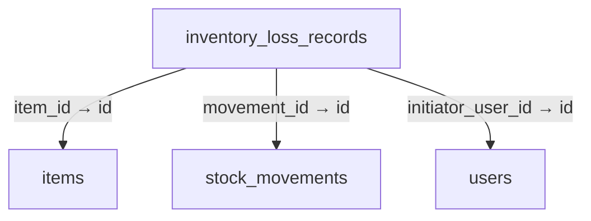
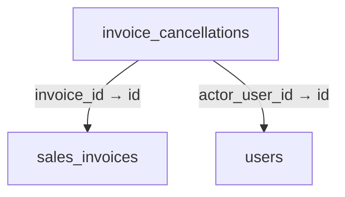
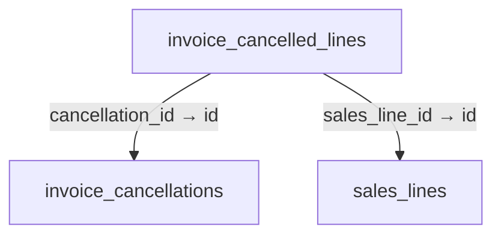
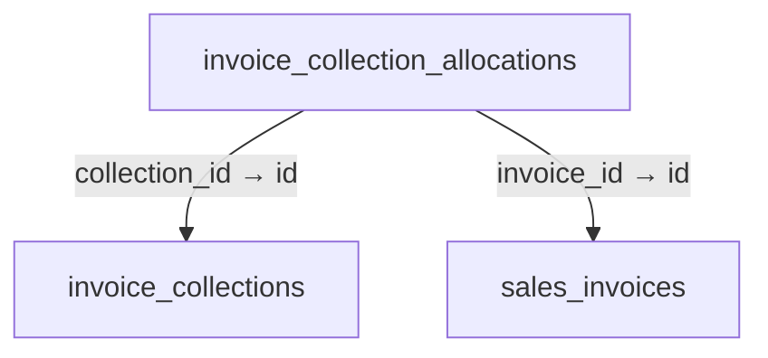
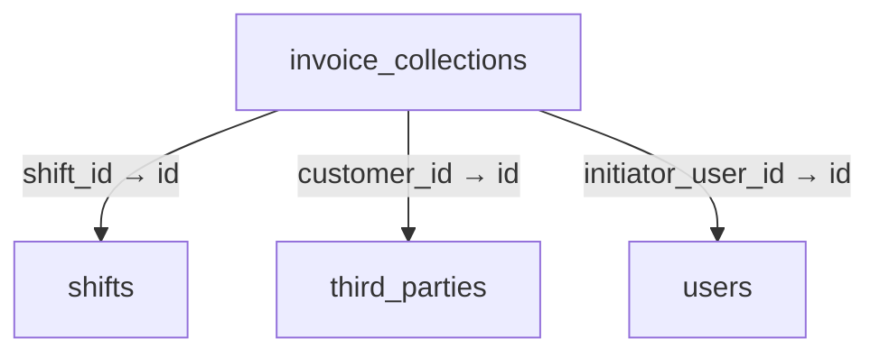
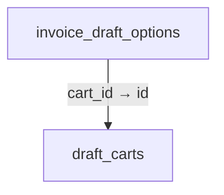
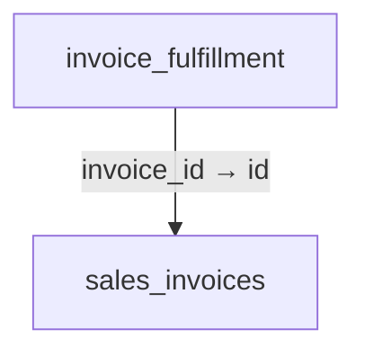
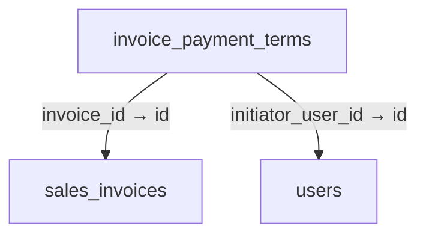
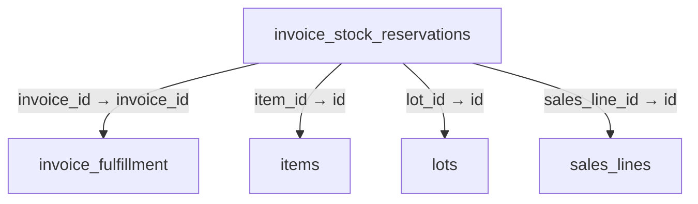

# Schema 03: hardware_jobs to invoice_stock_reservations

DRAFT · code snapshot 18 October 2026 · source review, not runtime acceptance

[Complete table index and reconstruction limits](schema.md). Arrows below are declared foreign keys, not inferred cardinalities.

## hardware_jobs {#hardware-jobs}

No outgoing foreign key declared in the reconstructed schema.

Columns and foreign-key policies

| Column | SQLite type | NOT NULL | Primary-key position |
| --- | --- | --- | --- |
| <code>id</code> | <code>TEXT</code> | False | 1 |
| <code>job_type</code> | <code>TEXT</code> | True | — |
| <code>payload</code> | <code>TEXT</code> | True | — |
| <code>status</code> | <code>TEXT</code> | True | — |
| <code>attempts</code> | <code>INTEGER</code> | True | — |
| <code>created_at_utc</code> | <code>TEXT</code> | True | — |
| <code>last_attempt_at_utc</code> | <code>TEXT</code> | False | — |
| <code>error_message</code> | <code>TEXT</code> | False | — |
| <code>receipt_media_family_snapshot</code> | <code>TEXT</code> | False | — |
| <code>receipt_design_version_id</code> | <code>TEXT</code> | False | — |
| <code>receipt_snapshot_json</code> | <code>TEXT</code> | False | — |
| <code>output_printer_name_snapshot</code> | <code>TEXT</code> | False | — |
| <code>thermal_dot_width_snapshot</code> | <code>INTEGER</code> | False | — |
| <code>thermal_capability_fingerprint_snapshot</code> | <code>TEXT</code> | False | — |

## immutable_audit_journal {#immutable-audit-journal}

No outgoing foreign key declared in the reconstructed schema.

Columns and foreign-key policies

| Column | SQLite type | NOT NULL | Primary-key position |
| --- | --- | --- | --- |
| <code>sequence_number</code> | <code>INTEGER</code> | False | 1 |
| <code>event_id</code> | <code>TEXT</code> | True | — |
| <code>who</code> | <code>TEXT</code> | True | — |
| <code>supervisor_who</code> | <code>TEXT</code> | False | — |
| <code>what</code> | <code>TEXT</code> | True | — |
| <code>when_utc</code> | <code>TEXT</code> | True | — |
| <code>where_device</code> | <code>TEXT</code> | True | — |
| <code>why_reason</code> | <code>TEXT</code> | False | — |
| <code>how_payload</code> | <code>TEXT</code> | True | — |
| <code>prior_hash</code> | <code>TEXT</code> | True | — |
| <code>entry_hash</code> | <code>TEXT</code> | True | — |

## inventory_loss_records {#inventory-loss-records}

Relationship diagram

Columns and foreign-key policies

| Column | SQLite type | NOT NULL | Primary-key position |
| --- | --- | --- | --- |
| <code>id</code> | <code>TEXT</code> | False | 1 |
| <code>item_id</code> | <code>TEXT</code> | True | — |
| <code>movement_id</code> | <code>TEXT</code> | True | — |
| <code>base_quantity_decimal</code> | <code>TEXT</code> | True | — |
| <code>entered_quantity_decimal</code> | <code>TEXT</code> | True | — |
| <code>entered_unit_code</code> | <code>TEXT</code> | True | — |
| <code>base_unit_code</code> | <code>TEXT</code> | True | — |
| <code>exact_base_cost_decimal</code> | <code>TEXT</code> | False | — |
| <code>value_minor</code> | <code>INTEGER</code> | False | — |
| <code>currency</code> | <code>TEXT</code> | True | — |
| <code>reason_kind</code> | <code>TEXT</code> | True | — |
| <code>reason</code> | <code>TEXT</code> | True | — |
| <code>source_type</code> | <code>TEXT</code> | True | — |
| <code>source_id</code> | <code>TEXT</code> | True | — |
| <code>initiator_user_id</code> | <code>TEXT</code> | True | — |
| <code>correlation_id</code> | <code>TEXT</code> | True | — |
| <code>business_date</code> | <code>TEXT</code> | True | — |
| <code>created_at_utc</code> | <code>TEXT</code> | True | — |
| <code>currency_decimal_places_snapshot</code> | <code>INTEGER</code> | False | — |

| FK / sequence | Child column | Parent table / column | On update / delete |
| --- | --- | --- | --- |
| 0 / 0 | <code>initiator_user_id</code> | [users](schema-12.md#users) / <code>id</code> | NO ACTION / NO ACTION |
| 1 / 0 | <code>movement_id</code> | [stock_movements](schema-10.md#stock-movements) / <code>id</code> | NO ACTION / NO ACTION |
| 2 / 0 | <code>item_id</code> | [items](schema-04.md#items) / <code>id</code> | NO ACTION / NO ACTION |

## invoice_cancellations {#invoice-cancellations}

Relationship diagram

Columns and foreign-key policies

| Column | SQLite type | NOT NULL | Primary-key position |
| --- | --- | --- | --- |
| <code>id</code> | <code>TEXT</code> | False | 1 |
| <code>invoice_id</code> | <code>TEXT</code> | True | — |
| <code>credit_minor</code> | <code>INTEGER</code> | True | — |
| <code>command_key</code> | <code>TEXT</code> | True | — |
| <code>actor_user_id</code> | <code>TEXT</code> | True | — |
| <code>reason</code> | <code>TEXT</code> | True | — |
| <code>created_at_utc</code> | <code>TEXT</code> | True | — |

| FK / sequence | Child column | Parent table / column | On update / delete |
| --- | --- | --- | --- |
| 0 / 0 | <code>actor_user_id</code> | [users](schema-12.md#users) / <code>id</code> | NO ACTION / NO ACTION |
| 1 / 0 | <code>invoice_id</code> | [sales_invoices](schema-09.md#sales-invoices) / <code>id</code> | NO ACTION / NO ACTION |

## invoice_cancelled_lines {#invoice-cancelled-lines}

Relationship diagram

Columns and foreign-key policies

| Column | SQLite type | NOT NULL | Primary-key position |
| --- | --- | --- | --- |
| <code>id</code> | <code>TEXT</code> | False | 1 |
| <code>cancellation_id</code> | <code>TEXT</code> | True | — |
| <code>sales_line_id</code> | <code>TEXT</code> | True | — |
| <code>quantity_decimal</code> | <code>TEXT</code> | True | — |
| <code>credit_minor</code> | <code>INTEGER</code> | True | — |

| FK / sequence | Child column | Parent table / column | On update / delete |
| --- | --- | --- | --- |
| 0 / 0 | <code>sales_line_id</code> | [sales_lines](schema-09.md#sales-lines) / <code>id</code> | NO ACTION / NO ACTION |
| 1 / 0 | <code>cancellation_id</code> | [invoice_cancellations](schema-03.md#invoice-cancellations) / <code>id</code> | NO ACTION / NO ACTION |

## invoice_collection_allocations {#invoice-collection-allocations}

Relationship diagram

Columns and foreign-key policies

| Column | SQLite type | NOT NULL | Primary-key position |
| --- | --- | --- | --- |
| <code>id</code> | <code>TEXT</code> | False | 1 |
| <code>collection_id</code> | <code>TEXT</code> | True | — |
| <code>invoice_id</code> | <code>TEXT</code> | True | — |
| <code>amount_minor</code> | <code>INTEGER</code> | True | — |

| FK / sequence | Child column | Parent table / column | On update / delete |
| --- | --- | --- | --- |
| 0 / 0 | <code>invoice_id</code> | [sales_invoices](schema-09.md#sales-invoices) / <code>id</code> | NO ACTION / NO ACTION |
| 1 / 0 | <code>collection_id</code> | [invoice_collections](schema-03.md#invoice-collections) / <code>id</code> | NO ACTION / NO ACTION |

## invoice_collections {#invoice-collections}

Relationship diagram

Columns and foreign-key policies

| Column | SQLite type | NOT NULL | Primary-key position |
| --- | --- | --- | --- |
| <code>id</code> | <code>TEXT</code> | False | 1 |
| <code>customer_id</code> | <code>TEXT</code> | True | — |
| <code>shift_id</code> | <code>TEXT</code> | True | — |
| <code>currency</code> | <code>TEXT</code> | True | — |
| <code>tender_type</code> | <code>INTEGER</code> | True | — |
| <code>amount_minor</code> | <code>INTEGER</code> | True | — |
| <code>external_reference</code> | <code>TEXT</code> | False | — |
| <code>verification_details</code> | <code>TEXT</code> | False | — |
| <code>command_key</code> | <code>TEXT</code> | True | — |
| <code>initiator_user_id</code> | <code>TEXT</code> | True | — |
| <code>correlation_id</code> | <code>TEXT</code> | True | — |
| <code>business_date</code> | <code>TEXT</code> | True | — |
| <code>created_at_utc</code> | <code>TEXT</code> | True | — |
| <code>currency_decimal_places_snapshot</code> | <code>INTEGER</code> | False | — |

| FK / sequence | Child column | Parent table / column | On update / delete |
| --- | --- | --- | --- |
| 0 / 0 | <code>initiator_user_id</code> | [users](schema-12.md#users) / <code>id</code> | NO ACTION / NO ACTION |
| 1 / 0 | <code>shift_id</code> | [shifts](schema-10.md#shifts) / <code>id</code> | NO ACTION / NO ACTION |
| 2 / 0 | <code>customer_id</code> | [third_parties](schema-11.md#third-parties) / <code>id</code> | NO ACTION / NO ACTION |

## invoice_draft_options {#invoice-draft-options}

Relationship diagram

Columns and foreign-key policies

| Column | SQLite type | NOT NULL | Primary-key position |
| --- | --- | --- | --- |
| <code>cart_id</code> | <code>TEXT</code> | False | 1 |
| <code>payload_json</code> | <code>TEXT</code> | True | — |

| FK / sequence | Child column | Parent table / column | On update / delete |
| --- | --- | --- | --- |
| 0 / 0 | <code>cart_id</code> | [draft_carts](schema-02.md#draft-carts) / <code>id</code> | NO ACTION / NO ACTION |

## invoice_fulfillment {#invoice-fulfillment}

Relationship diagram

Columns and foreign-key policies

| Column | SQLite type | NOT NULL | Primary-key position |
| --- | --- | --- | --- |
| <code>invoice_id</code> | <code>TEXT</code> | False | 1 |
| <code>policy</code> | <code>TEXT</code> | True | — |
| <code>revision</code> | <code>INTEGER</code> | True | — |
| <code>created_at_utc</code> | <code>TEXT</code> | True | — |

| FK / sequence | Child column | Parent table / column | On update / delete |
| --- | --- | --- | --- |
| 0 / 0 | <code>invoice_id</code> | [sales_invoices](schema-09.md#sales-invoices) / <code>id</code> | NO ACTION / NO ACTION |

## invoice_payment_terms {#invoice-payment-terms}

Relationship diagram

Columns and foreign-key policies

| Column | SQLite type | NOT NULL | Primary-key position |
| --- | --- | --- | --- |
| <code>invoice_id</code> | <code>TEXT</code> | False | 1 |
| <code>due_date</code> | <code>TEXT</code> | False | — |
| <code>created_at_utc</code> | <code>TEXT</code> | True | — |
| <code>initiator_user_id</code> | <code>TEXT</code> | True | — |

| FK / sequence | Child column | Parent table / column | On update / delete |
| --- | --- | --- | --- |
| 0 / 0 | <code>initiator_user_id</code> | [users](schema-12.md#users) / <code>id</code> | NO ACTION / NO ACTION |
| 1 / 0 | <code>invoice_id</code> | [sales_invoices](schema-09.md#sales-invoices) / <code>id</code> | NO ACTION / NO ACTION |

## invoice_sequences {#invoice-sequences}

No outgoing foreign key declared in the reconstructed schema.

Columns and foreign-key policies

| Column | SQLite type | NOT NULL | Primary-key position |
| --- | --- | --- | --- |
| <code>prefix</code> | <code>TEXT</code> | False | 1 |
| <code>current_value</code> | <code>INTEGER</code> | True | — |
| <code>updated_at_utc</code> | <code>TEXT</code> | True | — |

## invoice_stock_reservations {#invoice-stock-reservations}

Relationship diagram

Columns and foreign-key policies

| Column | SQLite type | NOT NULL | Primary-key position |
| --- | --- | --- | --- |
| <code>id</code> | <code>TEXT</code> | False | 1 |
| <code>invoice_id</code> | <code>TEXT</code> | True | — |
| <code>sales_line_id</code> | <code>TEXT</code> | True | — |
| <code>item_id</code> | <code>TEXT</code> | True | — |
| <code>kit_id</code> | <code>TEXT</code> | False | — |
| <code>unit_code</code> | <code>TEXT</code> | True | — |
| <code>quantity_decimal</code> | <code>TEXT</code> | True | — |
| <code>remaining_decimal</code> | <code>TEXT</code> | True | — |
| <code>lot_id</code> | <code>TEXT</code> | False | — |
| <code>serial_number</code> | <code>TEXT</code> | False | — |
| <code>cost_basis_decimal</code> | <code>TEXT</code> | False | — |
| <code>state</code> | <code>TEXT</code> | True | — |
| <code>created_at_utc</code> | <code>TEXT</code> | True | — |
| <code>cancelled_decimal</code> | <code>TEXT</code> | True | — |

| FK / sequence | Child column | Parent table / column | On update / delete |
| --- | --- | --- | --- |
| 0 / 0 | <code>lot_id</code> | [lots](schema-04.md#lots) / <code>id</code> | NO ACTION / NO ACTION |
| 1 / 0 | <code>item_id</code> | [items](schema-04.md#items) / <code>id</code> | NO ACTION / NO ACTION |
| 2 / 0 | <code>sales_line_id</code> | [sales_lines](schema-09.md#sales-lines) / <code>id</code> | NO ACTION / NO ACTION |
| 3 / 0 | <code>invoice_id</code> | [invoice_fulfillment](schema-03.md#invoice-fulfillment) / <code>invoice_id</code> | NO ACTION / NO ACTION |

