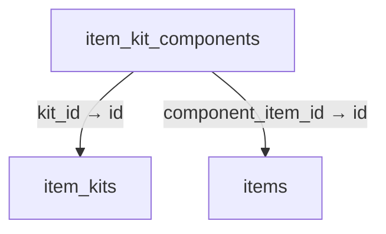
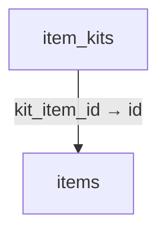
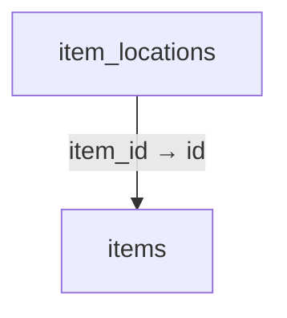
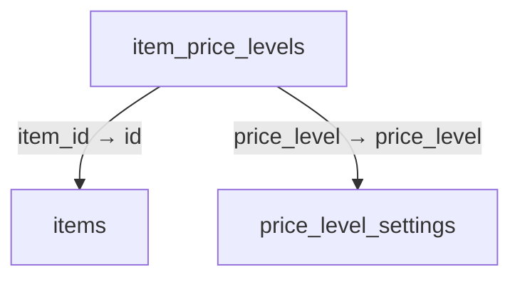
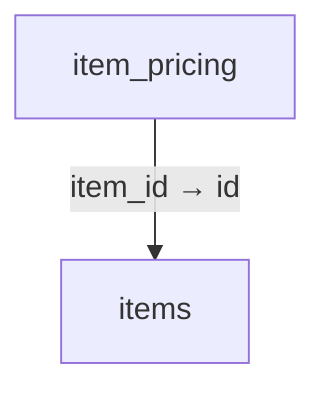
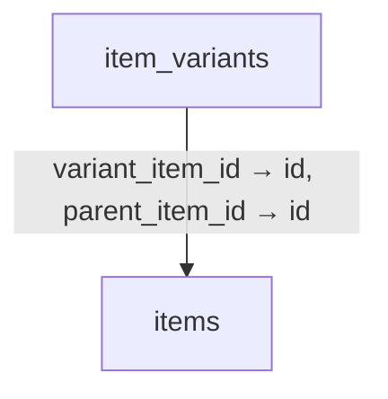
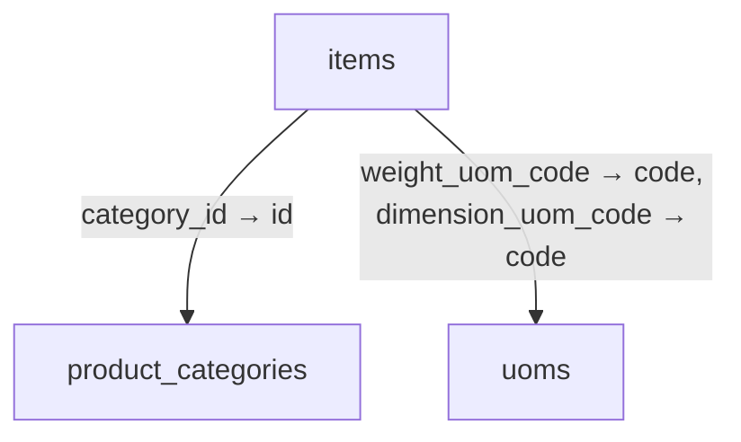
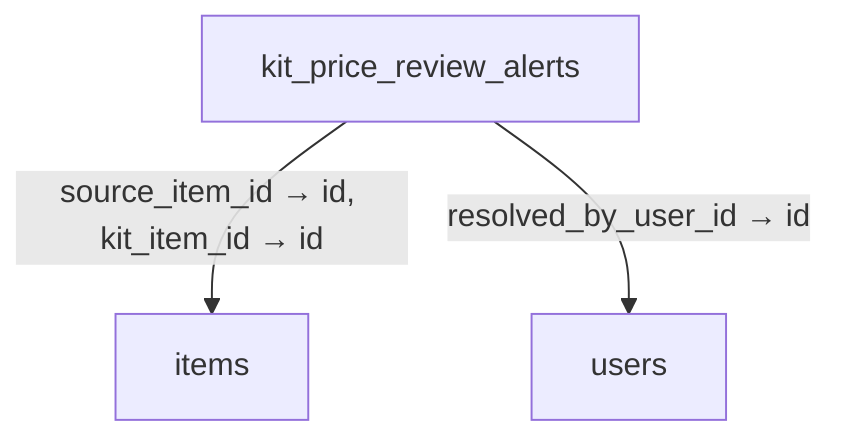
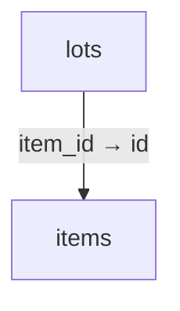

# Schema 04: item_change_history to lots

DRAFT · code snapshot 18 October 2026 · source review, not runtime acceptance

[Complete table index and reconstruction limits](schema.md). Arrows below are declared foreign keys, not inferred cardinalities.

## item_change_history {#item-change-history}

No outgoing foreign key declared in the reconstructed schema.

Columns and foreign-key policies

| Column | SQLite type | NOT NULL | Primary-key position |
| --- | --- | --- | --- |
| <code>id</code> | <code>TEXT</code> | False | 1 |
| <code>item_id_snapshot</code> | <code>TEXT</code> | True | — |
| <code>sku_snapshot</code> | <code>TEXT</code> | True | — |
| <code>name_snapshot</code> | <code>TEXT</code> | True | — |
| <code>action</code> | <code>TEXT</code> | True | — |
| <code>before_snapshot_json</code> | <code>TEXT</code> | False | — |
| <code>after_snapshot_json</code> | <code>TEXT</code> | True | — |
| <code>changed_by_user_id</code> | <code>TEXT</code> | True | — |
| <code>changed_at_utc</code> | <code>TEXT</code> | True | — |
| <code>correlation_id</code> | <code>TEXT</code> | False | — |

## item_kit_components {#item-kit-components}

Relationship diagram

Columns and foreign-key policies

| Column | SQLite type | NOT NULL | Primary-key position |
| --- | --- | --- | --- |
| <code>id</code> | <code>TEXT</code> | False | 1 |
| <code>kit_id</code> | <code>TEXT</code> | True | — |
| <code>component_item_id</code> | <code>TEXT</code> | True | — |
| <code>quantity</code> | <code>REAL</code> | True | — |
| <code>unit_code</code> | <code>TEXT</code> | True | — |
| <code>conversion_factor</code> | <code>REAL</code> | True | — |
| <code>created_at_utc</code> | <code>TEXT</code> | True | — |
| <code>quantity_decimal</code> | <code>TEXT</code> | False | — |
| <code>conversion_factor_decimal</code> | <code>TEXT</code> | False | — |

| FK / sequence | Child column | Parent table / column | On update / delete |
| --- | --- | --- | --- |
| 0 / 0 | <code>component_item_id</code> | [items](schema-04.md#items) / <code>id</code> | NO ACTION / NO ACTION |
| 1 / 0 | <code>kit_id</code> | [item_kits](schema-04.md#item-kits) / <code>id</code> | NO ACTION / CASCADE |

## item_kits {#item-kits}

Relationship diagram

Columns and foreign-key policies

| Column | SQLite type | NOT NULL | Primary-key position |
| --- | --- | --- | --- |
| <code>id</code> | <code>TEXT</code> | False | 1 |
| <code>kit_item_id</code> | <code>TEXT</code> | True | — |
| <code>version</code> | <code>INTEGER</code> | True | — |
| <code>name</code> | <code>TEXT</code> | True | — |
| <code>is_active</code> | <code>INTEGER</code> | True | — |
| <code>created_at_utc</code> | <code>TEXT</code> | True | — |

| FK / sequence | Child column | Parent table / column | On update / delete |
| --- | --- | --- | --- |
| 0 / 0 | <code>kit_item_id</code> | [items](schema-04.md#items) / <code>id</code> | NO ACTION / CASCADE |

## item_locations {#item-locations}

Relationship diagram

Columns and foreign-key policies

| Column | SQLite type | NOT NULL | Primary-key position |
| --- | --- | --- | --- |
| <code>id</code> | <code>TEXT</code> | False | 1 |
| <code>item_id</code> | <code>TEXT</code> | True | — |
| <code>location_code</code> | <code>TEXT</code> | True | — |
| <code>is_primary_selling</code> | <code>INTEGER</code> | True | — |
| <code>is_primary_receiving</code> | <code>INTEGER</code> | True | — |
| <code>min_reorder_point</code> | <code>REAL</code> | False | — |
| <code>max_stock_level</code> | <code>REAL</code> | False | — |
| <code>is_active</code> | <code>INTEGER</code> | True | — |
| <code>created_at_utc</code> | <code>TEXT</code> | True | — |

| FK / sequence | Child column | Parent table / column | On update / delete |
| --- | --- | --- | --- |
| 0 / 0 | <code>item_id</code> | [items](schema-04.md#items) / <code>id</code> | NO ACTION / CASCADE |

## item_price_history {#item-price-history}

No outgoing foreign key declared in the reconstructed schema.

Columns and foreign-key policies

| Column | SQLite type | NOT NULL | Primary-key position |
| --- | --- | --- | --- |
| <code>id</code> | <code>TEXT</code> | False | 1 |
| <code>item_id_snapshot</code> | <code>TEXT</code> | True | — |
| <code>sku_snapshot</code> | <code>TEXT</code> | True | — |
| <code>price_kind</code> | <code>TEXT</code> | True | — |
| <code>tier_code</code> | <code>TEXT</code> | False | — |
| <code>old_price_minor</code> | <code>INTEGER</code> | False | — |
| <code>new_price_minor</code> | <code>INTEGER</code> | False | — |
| <code>currency</code> | <code>TEXT</code> | True | — |
| <code>unit_code</code> | <code>TEXT</code> | False | — |
| <code>entered_unit_cost_minor</code> | <code>INTEGER</code> | False | — |
| <code>entered_unit_code</code> | <code>TEXT</code> | False | — |
| <code>normalized_base_unit_cost_minor_decimal</code> | <code>TEXT</code> | False | — |
| <code>base_unit_code</code> | <code>TEXT</code> | False | — |
| <code>conversion_factor_decimal</code> | <code>TEXT</code> | False | — |
| <code>old_mode</code> | <code>TEXT</code> | False | — |
| <code>new_mode</code> | <code>TEXT</code> | False | — |
| <code>source_kind</code> | <code>TEXT</code> | True | — |
| <code>source_reference_id</code> | <code>TEXT</code> | False | — |
| <code>source_movement_id</code> | <code>TEXT</code> | False | — |
| <code>source_run_id</code> | <code>TEXT</code> | False | — |
| <code>actor_user_id</code> | <code>TEXT</code> | False | — |
| <code>changed_at_utc</code> | <code>TEXT</code> | True | — |
| <code>correlation_id</code> | <code>TEXT</code> | False | — |

## item_price_levels {#item-price-levels}

Relationship diagram

Columns and foreign-key policies

| Column | SQLite type | NOT NULL | Primary-key position |
| --- | --- | --- | --- |
| <code>item_id</code> | <code>TEXT</code> | True | 1 |
| <code>price_level</code> | <code>TEXT</code> | True | 2 |
| <code>weight_mode</code> | <code>TEXT</code> | True | — |
| <code>custom_weight_decimal</code> | <code>TEXT</code> | False | — |
| <code>fixed_price_minor</code> | <code>INTEGER</code> | False | — |
| <code>updated_at_utc</code> | <code>TEXT</code> | True | — |
| <code>percentage_contract_version</code> | <code>INTEGER</code> | True | — |

| FK / sequence | Child column | Parent table / column | On update / delete |
| --- | --- | --- | --- |
| 0 / 0 | <code>price_level</code> | [price_level_settings](schema-05.md#price-level-settings) / <code>price_level</code> | NO ACTION / NO ACTION |
| 1 / 0 | <code>item_id</code> | [items](schema-04.md#items) / <code>id</code> | NO ACTION / CASCADE |

## item_pricing {#item-pricing}

Relationship diagram

Columns and foreign-key policies

| Column | SQLite type | NOT NULL | Primary-key position |
| --- | --- | --- | --- |
| <code>item_id</code> | <code>TEXT</code> | False | 1 |
| <code>pricing_method</code> | <code>TEXT</code> | True | — |
| <code>target_percentage_decimal</code> | <code>TEXT</code> | True | — |
| <code>percentage_contract_version</code> | <code>INTEGER</code> | True | — |
| <code>rounding_rule</code> | <code>TEXT</code> | True | — |
| <code>rounding_increment_minor</code> | <code>INTEGER</code> | True | — |
| <code>enforce_cost_floor</code> | <code>INTEGER</code> | True | — |
| <code>cost_floor_source</code> | <code>TEXT</code> | True | — |
| <code>min_margin_percentage_decimal</code> | <code>TEXT</code> | True | — |
| <code>manual_base_price_minor</code> | <code>INTEGER</code> | True | — |
| <code>cost_plus_amount_minor</code> | <code>INTEGER</code> | True | — |
| <code>calculated_base_price_minor</code> | <code>INTEGER</code> | True | — |
| <code>effective_base_price_minor</code> | <code>INTEGER</code> | True | — |
| <code>updated_at_utc</code> | <code>TEXT</code> | True | — |
| <code>price_source</code> | <code>TEXT</code> | True | — |
| <code>source_category_rule_id</code> | <code>TEXT</code> | False | — |
| <code>source_category_rule_version</code> | <code>INTEGER</code> | False | — |
| <code>cost_basis_source</code> | <code>TEXT</code> | False | — |

| FK / sequence | Child column | Parent table / column | On update / delete |
| --- | --- | --- | --- |
| 0 / 0 | <code>item_id</code> | [items](schema-04.md#items) / <code>id</code> | NO ACTION / CASCADE |

## item_variants {#item-variants}

Relationship diagram

Columns and foreign-key policies

| Column | SQLite type | NOT NULL | Primary-key position |
| --- | --- | --- | --- |
| <code>id</code> | <code>TEXT</code> | False | 1 |
| <code>parent_item_id</code> | <code>TEXT</code> | True | — |
| <code>variant_item_id</code> | <code>TEXT</code> | True | — |
| <code>option_name</code> | <code>TEXT</code> | True | — |
| <code>option_value</code> | <code>TEXT</code> | True | — |
| <code>created_at_utc</code> | <code>TEXT</code> | True | — |

| FK / sequence | Child column | Parent table / column | On update / delete |
| --- | --- | --- | --- |
| 0 / 0 | <code>variant_item_id</code> | [items](schema-04.md#items) / <code>id</code> | NO ACTION / CASCADE |
| 1 / 0 | <code>parent_item_id</code> | [items](schema-04.md#items) / <code>id</code> | NO ACTION / CASCADE |

## items {#items}

Relationship diagram

Columns and foreign-key policies

| Column | SQLite type | NOT NULL | Primary-key position |
| --- | --- | --- | --- |
| <code>id</code> | <code>TEXT</code> | False | 1 |
| <code>sku</code> | <code>TEXT</code> | True | — |
| <code>name</code> | <code>TEXT</code> | True | — |
| <code>description</code> | <code>TEXT</code> | False | — |
| <code>base_unit_code</code> | <code>TEXT</code> | True | — |
| <code>base_price_minor</code> | <code>INTEGER</code> | True | — |
| <code>currency</code> | <code>TEXT</code> | True | — |
| <code>cost_basis_minor</code> | <code>INTEGER</code> | True | — |
| <code>tax_rate</code> | <code>REAL</code> | True | — |
| <code>is_tracked</code> | <code>INTEGER</code> | True | — |
| <code>is_active</code> | <code>INTEGER</code> | True | — |
| <code>created_at_utc</code> | <code>TEXT</code> | True | — |
| <code>updated_at_utc</code> | <code>TEXT</code> | False | — |
| <code>reorder_threshold</code> | <code>REAL</code> | False | — |
| <code>tracking_policy</code> | <code>TEXT</code> | True | — |
| <code>moving_average_cost_minor</code> | <code>INTEGER</code> | True | — |
| <code>last_bought_price_minor</code> | <code>INTEGER</code> | True | — |
| <code>last_received_at_utc</code> | <code>TEXT</code> | False | — |
| <code>category_id</code> | <code>TEXT</code> | False | — |
| <code>tax_rate_decimal</code> | <code>TEXT</code> | False | — |
| <code>length_decimal</code> | <code>TEXT</code> | False | — |
| <code>width_decimal</code> | <code>TEXT</code> | False | — |
| <code>height_decimal</code> | <code>TEXT</code> | False | — |
| <code>dimension_uom_code</code> | <code>TEXT</code> | False | — |
| <code>weight_decimal</code> | <code>TEXT</code> | False | — |
| <code>weight_uom_code</code> | <code>TEXT</code> | False | — |
| <code>product_purpose</code> | <code>TEXT</code> | False | — |
| <code>manual_buying_price_minor</code> | <code>INTEGER</code> | False | — |
| <code>image_path</code> | <code>TEXT</code> | False | — |
| <code>default_purchase_unit_code</code> | <code>TEXT</code> | False | — |
| <code>default_sale_unit_code</code> | <code>TEXT</code> | False | — |
| <code>loc_table</code> | <code>TEXT</code> | False | — |
| <code>loc_row</code> | <code>TEXT</code> | False | — |
| <code>loc_column</code> | <code>TEXT</code> | False | — |
| <code>last_bought_unit_cost_minor_decimal</code> | <code>TEXT</code> | False | — |
| <code>moving_average_unit_cost_minor_decimal</code> | <code>TEXT</code> | False | — |

| FK / sequence | Child column | Parent table / column | On update / delete |
| --- | --- | --- | --- |
| 0 / 0 | <code>weight_uom_code</code> | [uoms](schema-11.md#uoms) / <code>code</code> | NO ACTION / NO ACTION |
| 1 / 0 | <code>dimension_uom_code</code> | [uoms](schema-11.md#uoms) / <code>code</code> | NO ACTION / NO ACTION |
| 2 / 0 | <code>category_id</code> | [product_categories](schema-06.md#product-categories) / <code>id</code> | NO ACTION / NO ACTION |

## kit_price_review_alerts {#kit-price-review-alerts}

Relationship diagram

Columns and foreign-key policies

| Column | SQLite type | NOT NULL | Primary-key position |
| --- | --- | --- | --- |
| <code>id</code> | <code>TEXT</code> | False | 1 |
| <code>kit_item_id</code> | <code>TEXT</code> | True | — |
| <code>parent_price_minor</code> | <code>INTEGER</code> | True | — |
| <code>sum_children_cost_minor</code> | <code>INTEGER</code> | True | — |
| <code>sum_children_price_minor</code> | <code>INTEGER</code> | True | — |
| <code>alert_reason</code> | <code>TEXT</code> | True | — |
| <code>status</code> | <code>TEXT</code> | True | — |
| <code>created_at_utc</code> | <code>TEXT</code> | True | — |
| <code>resolved_at_utc</code> | <code>TEXT</code> | False | — |
| <code>version</code> | <code>INTEGER</code> | True | — |
| <code>resolved_by_user_id</code> | <code>TEXT</code> | False | — |
| <code>resolution_note</code> | <code>TEXT</code> | True | — |
| <code>source_item_id</code> | <code>TEXT</code> | False | — |
| <code>source_event_type</code> | <code>TEXT</code> | True | — |

| FK / sequence | Child column | Parent table / column | On update / delete |
| --- | --- | --- | --- |
| 0 / 0 | <code>source_item_id</code> | [items](schema-04.md#items) / <code>id</code> | NO ACTION / NO ACTION |
| 1 / 0 | <code>resolved_by_user_id</code> | [users](schema-12.md#users) / <code>id</code> | NO ACTION / NO ACTION |
| 2 / 0 | <code>kit_item_id</code> | [items](schema-04.md#items) / <code>id</code> | NO ACTION / CASCADE |

## license_claims {#license-claims}

No outgoing foreign key declared in the reconstructed schema.

Columns and foreign-key policies

| Column | SQLite type | NOT NULL | Primary-key position |
| --- | --- | --- | --- |
| <code>id</code> | <code>INTEGER</code> | False | 1 |
| <code>schema_version</code> | <code>INTEGER</code> | True | — |
| <code>license_id</code> | <code>TEXT</code> | True | — |
| <code>shop_id</code> | <code>TEXT</code> | True | — |
| <code>device_binding_hash</code> | <code>TEXT</code> | True | — |
| <code>valid_from_utc</code> | <code>TEXT</code> | True | — |
| <code>valid_until_utc</code> | <code>TEXT</code> | False | — |
| <code>enabled_modules</code> | <code>TEXT</code> | True | — |
| <code>issued_at_utc</code> | <code>TEXT</code> | True | — |
| <code>signature</code> | <code>TEXT</code> | True | — |

## lots {#lots}

Relationship diagram

Columns and foreign-key policies

| Column | SQLite type | NOT NULL | Primary-key position |
| --- | --- | --- | --- |
| <code>id</code> | <code>TEXT</code> | False | 1 |
| <code>item_id</code> | <code>TEXT</code> | True | — |
| <code>lot_number</code> | <code>TEXT</code> | True | — |
| <code>supplier_lot_ref</code> | <code>TEXT</code> | False | — |
| <code>manufacture_date_utc</code> | <code>TEXT</code> | False | — |
| <code>expiry_date_utc</code> | <code>TEXT</code> | True | — |
| <code>state</code> | <code>TEXT</code> | True | — |
| <code>qc_notes</code> | <code>TEXT</code> | False | — |

| FK / sequence | Child column | Parent table / column | On update / delete |
| --- | --- | --- | --- |
| 0 / 0 | <code>item_id</code> | [items](schema-04.md#items) / <code>id</code> | NO ACTION / CASCADE |

