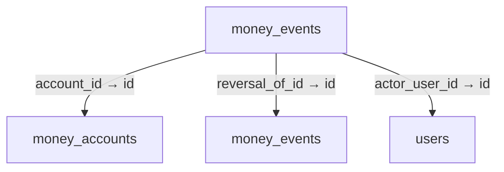
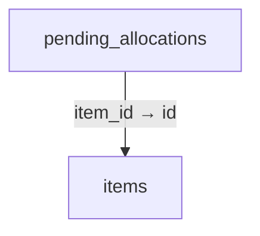
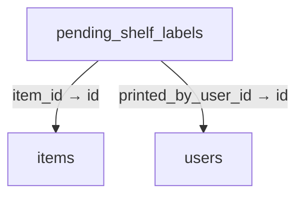
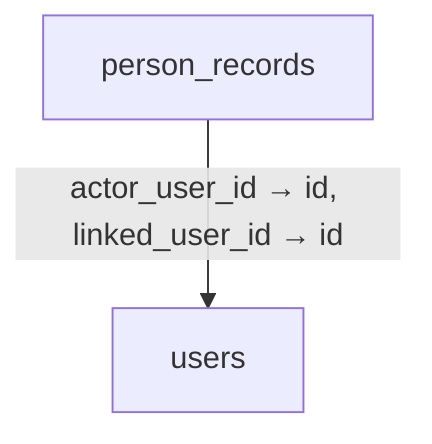
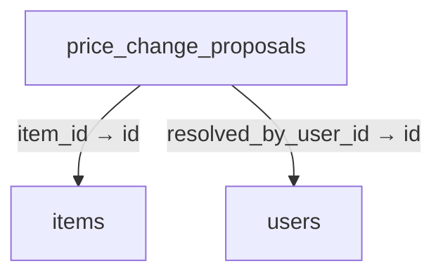
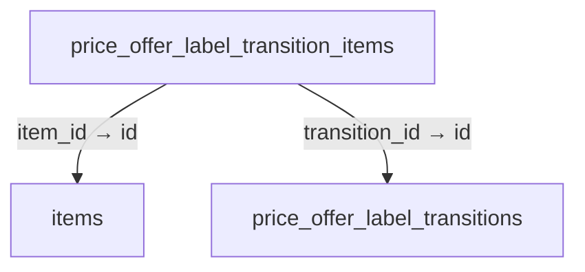
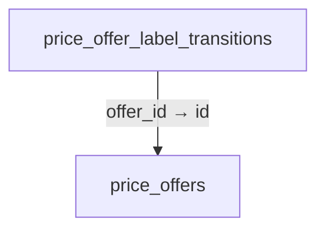

# Schema 05: manual_payment_display to price_offer_label_transitions

DRAFT · code snapshot 18 October 2026 · source review, not runtime acceptance

[Complete table index and reconstruction limits](schema.md). Arrows below are declared foreign keys, not inferred cardinalities.

## manual_payment_display {#manual-payment-display}

No outgoing foreign key declared in the reconstructed schema.

Columns and foreign-key policies

| Column | SQLite type | NOT NULL | Primary-key position |
| --- | --- | --- | --- |
| <code>id</code> | <code>INTEGER</code> | False | 1 |
| <code>qr_identifier</code> | <code>TEXT</code> | True | — |
| <code>qr_image</code> | <code>BLOB</code> | False | — |
| <code>qr_image_mime</code> | <code>TEXT</code> | False | — |
| <code>bank_name</code> | <code>TEXT</code> | True | — |
| <code>bank_account_number</code> | <code>TEXT</code> | True | — |
| <code>bank_account_holder</code> | <code>TEXT</code> | True | — |
| <code>bank_image</code> | <code>BLOB</code> | False | — |
| <code>bank_image_mime</code> | <code>TEXT</code> | False | — |
| <code>updated_at_utc</code> | <code>TEXT</code> | False | — |
| <code>updated_by_user_id</code> | <code>TEXT</code> | False | — |

## money_accounts {#money-accounts}

No outgoing foreign key declared in the reconstructed schema.

Columns and foreign-key policies

| Column | SQLite type | NOT NULL | Primary-key position |
| --- | --- | --- | --- |
| <code>id</code> | <code>TEXT</code> | False | 1 |
| <code>name</code> | <code>TEXT</code> | True | — |
| <code>kind</code> | <code>TEXT</code> | True | — |
| <code>currency</code> | <code>TEXT</code> | True | — |
| <code>decimal_places</code> | <code>INTEGER</code> | True | — |
| <code>is_active</code> | <code>INTEGER</code> | True | — |

## money_events {#money-events}

Relationship diagram

Columns and foreign-key policies

| Column | SQLite type | NOT NULL | Primary-key position |
| --- | --- | --- | --- |
| <code>id</code> | <code>TEXT</code> | False | 1 |
| <code>account_id</code> | <code>TEXT</code> | True | — |
| <code>amount_minor</code> | <code>INTEGER</code> | True | — |
| <code>source_kind</code> | <code>TEXT</code> | True | — |
| <code>source_id</code> | <code>TEXT</code> | True | — |
| <code>external_reference</code> | <code>TEXT</code> | False | — |
| <code>reversal_of_id</code> | <code>TEXT</code> | False | — |
| <code>transfer_id</code> | <code>TEXT</code> | False | — |
| <code>command_key</code> | <code>TEXT</code> | True | — |
| <code>actor_user_id</code> | <code>TEXT</code> | True | — |
| <code>reason</code> | <code>TEXT</code> | True | — |
| <code>created_at_utc</code> | <code>TEXT</code> | True | — |

| FK / sequence | Child column | Parent table / column | On update / delete |
| --- | --- | --- | --- |
| 0 / 0 | <code>actor_user_id</code> | [users](schema-12.md#users) / <code>id</code> | NO ACTION / NO ACTION |
| 1 / 0 | <code>reversal_of_id</code> | [money_events](schema-05.md#money-events) / <code>id</code> | NO ACTION / NO ACTION |
| 2 / 0 | <code>account_id</code> | [money_accounts](schema-05.md#money-accounts) / <code>id</code> | NO ACTION / NO ACTION |

## output_device_config {#output-device-config}

No outgoing foreign key declared in the reconstructed schema.

Columns and foreign-key policies

| Column | SQLite type | NOT NULL | Primary-key position |
| --- | --- | --- | --- |
| <code>id</code> | <code>INTEGER</code> | False | 1 |
| <code>printer_name</code> | <code>TEXT</code> | True | — |
| <code>drawer_enabled</code> | <code>INTEGER</code> | True | — |
| <code>updated_at_utc</code> | <code>TEXT</code> | True | — |
| <code>updated_by_user_id</code> | <code>TEXT</code> | False | — |
| <code>receipt_media_family</code> | <code>TEXT</code> | True | — |
| <code>thermal_dot_width</code> | <code>INTEGER</code> | False | — |
| <code>thermal_capability_status</code> | <code>TEXT</code> | True | — |
| <code>thermal_capability_verified_at_utc</code> | <code>TEXT</code> | False | — |
| <code>thermal_capability_fingerprint</code> | <code>TEXT</code> | False | — |
| <code>drawer_pin</code> | <code>INTEGER</code> | True | — |
| <code>drawer_on_time_units</code> | <code>INTEGER</code> | True | — |
| <code>drawer_off_time_units</code> | <code>INTEGER</code> | True | — |
| <code>thermal_cut_mode</code> | <code>TEXT</code> | True | — |
| <code>thermal_test_spool_accepted_at_utc</code> | <code>TEXT</code> | False | — |
| <code>thermal_test_spool_fingerprint</code> | <code>TEXT</code> | False | — |
| <code>shelf_label_output_enabled</code> | <code>INTEGER</code> | True | — |
| <code>shelf_label_height_dots</code> | <code>INTEGER</code> | True | — |

## pending_allocations {#pending-allocations}

Relationship diagram

Columns and foreign-key policies

| Column | SQLite type | NOT NULL | Primary-key position |
| --- | --- | --- | --- |
| <code>id</code> | <code>TEXT</code> | False | 1 |
| <code>cart_id</code> | <code>TEXT</code> | True | — |
| <code>item_id</code> | <code>TEXT</code> | True | — |
| <code>location_code</code> | <code>TEXT</code> | False | — |
| <code>lot_id</code> | <code>TEXT</code> | False | — |
| <code>serial_number</code> | <code>TEXT</code> | False | — |
| <code>quantity_decimal</code> | <code>TEXT</code> | False | — |
| <code>hold_expires_at_utc</code> | <code>TEXT</code> | False | — |
| <code>created_at_utc</code> | <code>TEXT</code> | True | — |

| FK / sequence | Child column | Parent table / column | On update / delete |
| --- | --- | --- | --- |
| 0 / 0 | <code>item_id</code> | [items](schema-04.md#items) / <code>id</code> | NO ACTION / NO ACTION |

## pending_shelf_labels {#pending-shelf-labels}

Relationship diagram

Columns and foreign-key policies

| Column | SQLite type | NOT NULL | Primary-key position |
| --- | --- | --- | --- |
| <code>id</code> | <code>TEXT</code> | False | 1 |
| <code>item_id</code> | <code>TEXT</code> | True | — |
| <code>previous_price_minor</code> | <code>INTEGER</code> | True | — |
| <code>new_price_minor</code> | <code>INTEGER</code> | True | — |
| <code>reason</code> | <code>TEXT</code> | True | — |
| <code>status</code> | <code>TEXT</code> | True | — |
| <code>created_at_utc</code> | <code>TEXT</code> | True | — |
| <code>printed_at_utc</code> | <code>TEXT</code> | False | — |
| <code>price_tier</code> | <code>TEXT</code> | True | — |
| <code>event_key</code> | <code>TEXT</code> | False | — |
| <code>source_reference_id</code> | <code>TEXT</code> | False | — |
| <code>source_version</code> | <code>INTEGER</code> | True | — |
| <code>currency</code> | <code>TEXT</code> | True | — |
| <code>unit_code</code> | <code>TEXT</code> | True | — |
| <code>output_job_id</code> | <code>TEXT</code> | False | — |
| <code>version</code> | <code>INTEGER</code> | True | — |
| <code>printed_by_user_id</code> | <code>TEXT</code> | False | — |

| FK / sequence | Child column | Parent table / column | On update / delete |
| --- | --- | --- | --- |
| 0 / 0 | <code>printed_by_user_id</code> | [users](schema-12.md#users) / <code>id</code> | NO ACTION / NO ACTION |
| 1 / 0 | <code>item_id</code> | [items](schema-04.md#items) / <code>id</code> | NO ACTION / CASCADE |

## permissions {#permissions}

No outgoing foreign key declared in the reconstructed schema.

Columns and foreign-key policies

| Column | SQLite type | NOT NULL | Primary-key position |
| --- | --- | --- | --- |
| <code>name</code> | <code>TEXT</code> | False | 1 |
| <code>description</code> | <code>TEXT</code> | False | — |

## person_records {#person-records}

Relationship diagram

Columns and foreign-key policies

| Column | SQLite type | NOT NULL | Primary-key position |
| --- | --- | --- | --- |
| <code>id</code> | <code>TEXT</code> | False | 1 |
| <code>code</code> | <code>TEXT</code> | True | — |
| <code>display_name</code> | <code>TEXT</code> | True | — |
| <code>kind</code> | <code>TEXT</code> | True | — |
| <code>employment_start_date</code> | <code>TEXT</code> | True | — |
| <code>employment_end_date</code> | <code>TEXT</code> | False | — |
| <code>payroll_tracking_start_month</code> | <code>TEXT</code> | False | — |
| <code>is_enabled</code> | <code>INTEGER</code> | True | — |
| <code>linked_user_id</code> | <code>TEXT</code> | False | — |
| <code>revision</code> | <code>INTEGER</code> | True | — |
| <code>actor_user_id</code> | <code>TEXT</code> | True | — |
| <code>created_at_utc</code> | <code>TEXT</code> | True | — |
| <code>updated_at_utc</code> | <code>TEXT</code> | True | — |

| FK / sequence | Child column | Parent table / column | On update / delete |
| --- | --- | --- | --- |
| 0 / 0 | <code>actor_user_id</code> | [users](schema-12.md#users) / <code>id</code> | NO ACTION / NO ACTION |
| 1 / 0 | <code>linked_user_id</code> | [users](schema-12.md#users) / <code>id</code> | NO ACTION / SET NULL |

## price_change_proposals {#price-change-proposals}

Relationship diagram

Columns and foreign-key policies

| Column | SQLite type | NOT NULL | Primary-key position |
| --- | --- | --- | --- |
| <code>id</code> | <code>TEXT</code> | False | 1 |
| <code>item_id</code> | <code>TEXT</code> | True | — |
| <code>old_mac_minor</code> | <code>INTEGER</code> | True | — |
| <code>new_mac_minor</code> | <code>INTEGER</code> | True | — |
| <code>old_lbp_minor</code> | <code>INTEGER</code> | True | — |
| <code>new_lbp_minor</code> | <code>INTEGER</code> | True | — |
| <code>current_price_minor</code> | <code>INTEGER</code> | True | — |
| <code>suggested_price_minor</code> | <code>INTEGER</code> | True | — |
| <code>margin_impact_decimal</code> | <code>TEXT</code> | True | — |
| <code>status</code> | <code>TEXT</code> | True | — |
| <code>created_at_utc</code> | <code>TEXT</code> | True | — |
| <code>resolved_at_utc</code> | <code>TEXT</code> | False | — |
| <code>resolved_by_user_id</code> | <code>TEXT</code> | False | — |
| <code>proposal_source</code> | <code>TEXT</code> | True | — |
| <code>source_category_rule_id</code> | <code>TEXT</code> | False | — |
| <code>source_category_rule_version</code> | <code>INTEGER</code> | False | — |
| <code>rounding_rule</code> | <code>TEXT</code> | True | — |
| <code>rounding_increment_minor</code> | <code>INTEGER</code> | False | — |
| <code>source_state_fingerprint</code> | <code>TEXT</code> | True | — |
| <code>cost_basis_source</code> | <code>TEXT</code> | True | — |
| <code>cost_basis_minor</code> | <code>INTEGER</code> | True | — |
| <code>resolution_note</code> | <code>TEXT</code> | False | — |
| <code>cost_basis_minor_decimal</code> | <code>TEXT</code> | False | — |

| FK / sequence | Child column | Parent table / column | On update / delete |
| --- | --- | --- | --- |
| 0 / 0 | <code>resolved_by_user_id</code> | [users](schema-12.md#users) / <code>id</code> | NO ACTION / NO ACTION |
| 1 / 0 | <code>item_id</code> | [items](schema-04.md#items) / <code>id</code> | NO ACTION / CASCADE |

## price_level_settings {#price-level-settings}

No outgoing foreign key declared in the reconstructed schema.

Columns and foreign-key policies

| Column | SQLite type | NOT NULL | Primary-key position |
| --- | --- | --- | --- |
| <code>tier_number</code> | <code>INTEGER</code> | False | 1 |
| <code>price_level</code> | <code>TEXT</code> | True | — |
| <code>display_label</code> | <code>TEXT</code> | True | — |
| <code>default_weight_decimal</code> | <code>TEXT</code> | True | — |
| <code>is_active</code> | <code>INTEGER</code> | True | — |
| <code>sort_order</code> | <code>INTEGER</code> | True | — |
| <code>updated_at_utc</code> | <code>TEXT</code> | True | — |
| <code>percentage_contract_version</code> | <code>INTEGER</code> | True | — |

## price_offer_label_transition_items {#price-offer-label-transition-items}

Relationship diagram

Columns and foreign-key policies

| Column | SQLite type | NOT NULL | Primary-key position |
| --- | --- | --- | --- |
| <code>transition_id</code> | <code>TEXT</code> | True | 1 |
| <code>item_id</code> | <code>TEXT</code> | True | 2 |
| <code>status</code> | <code>TEXT</code> | True | — |

| FK / sequence | Child column | Parent table / column | On update / delete |
| --- | --- | --- | --- |
| 0 / 0 | <code>item_id</code> | [items](schema-04.md#items) / <code>id</code> | NO ACTION / CASCADE |
| 1 / 0 | <code>transition_id</code> | [price_offer_label_transitions](schema-05.md#price-offer-label-transitions) / <code>id</code> | NO ACTION / CASCADE |

## price_offer_label_transitions {#price-offer-label-transitions}

Relationship diagram

Columns and foreign-key policies

| Column | SQLite type | NOT NULL | Primary-key position |
| --- | --- | --- | --- |
| <code>id</code> | <code>TEXT</code> | False | 1 |
| <code>offer_id</code> | <code>TEXT</code> | True | — |
| <code>offer_version</code> | <code>INTEGER</code> | True | — |
| <code>transition_kind</code> | <code>TEXT</code> | True | — |
| <code>transition_at_utc</code> | <code>TEXT</code> | True | — |
| <code>status</code> | <code>TEXT</code> | True | — |
| <code>created_at_utc</code> | <code>TEXT</code> | True | — |
| <code>completed_at_utc</code> | <code>TEXT</code> | False | — |

| FK / sequence | Child column | Parent table / column | On update / delete |
| --- | --- | --- | --- |
| 0 / 0 | <code>offer_id</code> | [price_offers](schema-06.md#price-offers) / <code>id</code> | NO ACTION / CASCADE |

