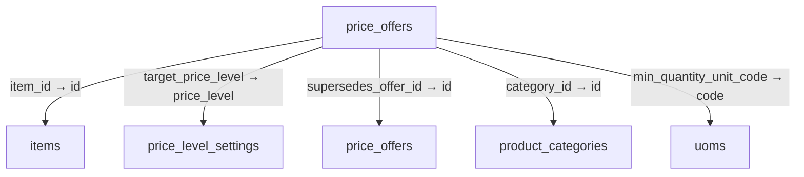
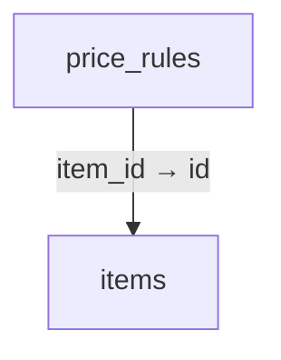
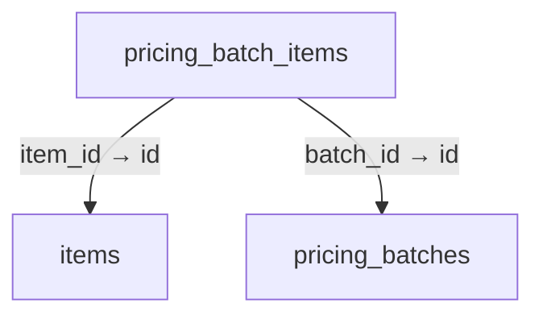
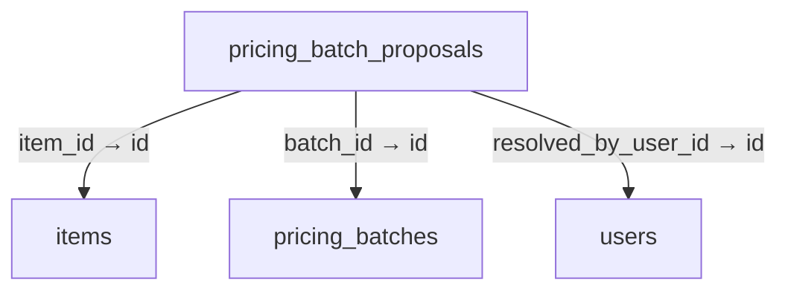
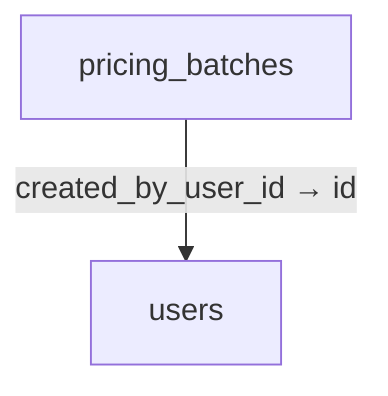
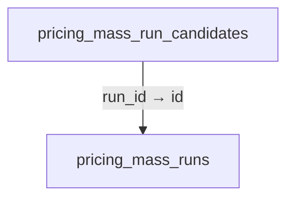
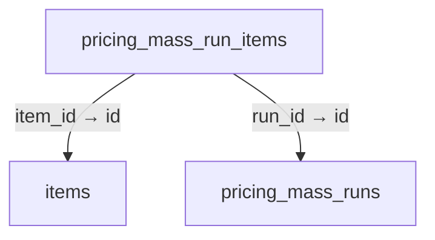
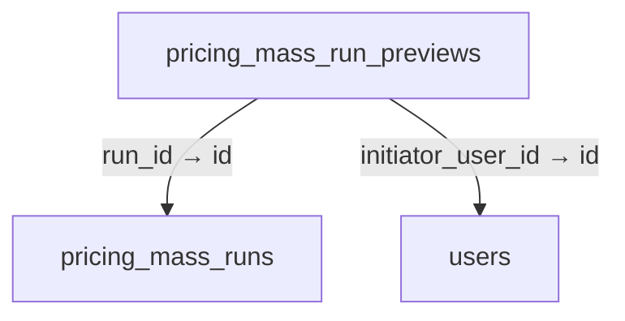
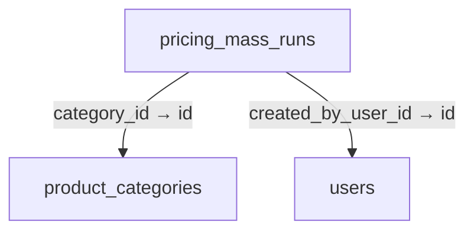
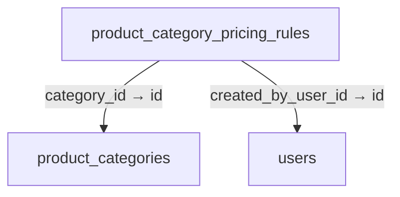

# Schema 06: price_offers to production_lot_sequences

DRAFT · code snapshot 18 October 2026 · source review, not runtime acceptance

[Complete table index and reconstruction limits](schema.md). Arrows below are declared foreign keys, not inferred cardinalities.

## price_offers {#price-offers}

Relationship diagram

Columns and foreign-key policies

| Column | SQLite type | NOT NULL | Primary-key position |
| --- | --- | --- | --- |
| <code>id</code> | <code>TEXT</code> | False | 1 |
| <code>name</code> | <code>TEXT</code> | True | — |
| <code>offer_type</code> | <code>TEXT</code> | True | — |
| <code>status</code> | <code>TEXT</code> | True | — |
| <code>starts_at_utc</code> | <code>TEXT</code> | False | — |
| <code>ends_at_utc</code> | <code>TEXT</code> | False | — |
| <code>item_id</code> | <code>TEXT</code> | False | — |
| <code>category_id</code> | <code>TEXT</code> | False | — |
| <code>min_quantity</code> | <code>REAL</code> | True | — |
| <code>discount_type</code> | <code>TEXT</code> | True | — |
| <code>discount_value_decimal</code> | <code>TEXT</code> | True | — |
| <code>bundle_price_minor</code> | <code>INTEGER</code> | True | — |
| <code>priority</code> | <code>INTEGER</code> | True | — |
| <code>created_at_utc</code> | <code>TEXT</code> | True | — |
| <code>updated_at_utc</code> | <code>TEXT</code> | True | — |
| <code>fixed_discount_minor</code> | <code>INTEGER</code> | True | — |
| <code>version</code> | <code>INTEGER</code> | True | — |
| <code>supersedes_offer_id</code> | <code>TEXT</code> | False | — |
| <code>min_quantity_decimal</code> | <code>TEXT</code> | True | — |
| <code>min_quantity_unit_code</code> | <code>TEXT</code> | False | — |
| <code>target_price_level</code> | <code>TEXT</code> | False | — |

| FK / sequence | Child column | Parent table / column | On update / delete |
| --- | --- | --- | --- |
| 0 / 0 | <code>target_price_level</code> | [price_level_settings](schema-05.md#price-level-settings) / <code>price_level</code> | NO ACTION / NO ACTION |
| 1 / 0 | <code>min_quantity_unit_code</code> | [uoms](schema-11.md#uoms) / <code>code</code> | NO ACTION / NO ACTION |
| 2 / 0 | <code>supersedes_offer_id</code> | [price_offers](schema-06.md#price-offers) / <code>id</code> | NO ACTION / NO ACTION |
| 3 / 0 | <code>category_id</code> | [product_categories](schema-06.md#product-categories) / <code>id</code> | NO ACTION / CASCADE |
| 4 / 0 | <code>item_id</code> | [items](schema-04.md#items) / <code>id</code> | NO ACTION / CASCADE |

## price_rules {#price-rules}

Relationship diagram

Columns and foreign-key policies

| Column | SQLite type | NOT NULL | Primary-key position |
| --- | --- | --- | --- |
| <code>id</code> | <code>TEXT</code> | False | 1 |
| <code>item_id</code> | <code>TEXT</code> | True | — |
| <code>min_quantity</code> | <code>REAL</code> | True | — |
| <code>price_minor</code> | <code>INTEGER</code> | True | — |
| <code>currency</code> | <code>TEXT</code> | True | — |
| <code>priority</code> | <code>INTEGER</code> | True | — |

| FK / sequence | Child column | Parent table / column | On update / delete |
| --- | --- | --- | --- |
| 0 / 0 | <code>item_id</code> | [items](schema-04.md#items) / <code>id</code> | NO ACTION / CASCADE |

## pricing_batch_items {#pricing-batch-items}

Relationship diagram

Columns and foreign-key policies

| Column | SQLite type | NOT NULL | Primary-key position |
| --- | --- | --- | --- |
| <code>id</code> | <code>TEXT</code> | False | 1 |
| <code>batch_id</code> | <code>TEXT</code> | True | — |
| <code>item_id</code> | <code>TEXT</code> | True | — |
| <code>cost_basis_minor</code> | <code>INTEGER</code> | True | — |
| <code>cost_basis_source</code> | <code>TEXT</code> | True | — |
| <code>old_price_minor</code> | <code>INTEGER</code> | True | — |
| <code>new_price_minor</code> | <code>INTEGER</code> | True | — |
| <code>outcome</code> | <code>TEXT</code> | True | — |
| <code>skip_reason</code> | <code>TEXT</code> | False | — |
| <code>created_at_utc</code> | <code>TEXT</code> | True | — |

| FK / sequence | Child column | Parent table / column | On update / delete |
| --- | --- | --- | --- |
| 0 / 0 | <code>item_id</code> | [items](schema-04.md#items) / <code>id</code> | NO ACTION / CASCADE |
| 1 / 0 | <code>batch_id</code> | [pricing_batches](schema-06.md#pricing-batches) / <code>id</code> | NO ACTION / CASCADE |

## pricing_batch_proposals {#pricing-batch-proposals}

Relationship diagram

Columns and foreign-key policies

| Column | SQLite type | NOT NULL | Primary-key position |
| --- | --- | --- | --- |
| <code>id</code> | <code>TEXT</code> | False | 1 |
| <code>batch_id</code> | <code>TEXT</code> | True | — |
| <code>item_id</code> | <code>TEXT</code> | True | — |
| <code>current_price_minor</code> | <code>INTEGER</code> | True | — |
| <code>proposed_price_minor</code> | <code>INTEGER</code> | True | — |
| <code>cost_minor</code> | <code>INTEGER</code> | True | — |
| <code>cost_source</code> | <code>TEXT</code> | True | — |
| <code>status</code> | <code>TEXT</code> | True | — |
| <code>created_at_utc</code> | <code>TEXT</code> | True | — |
| <code>resolved_at_utc</code> | <code>TEXT</code> | False | — |
| <code>resolved_by_user_id</code> | <code>TEXT</code> | False | — |

| FK / sequence | Child column | Parent table / column | On update / delete |
| --- | --- | --- | --- |
| 0 / 0 | <code>resolved_by_user_id</code> | [users](schema-12.md#users) / <code>id</code> | NO ACTION / NO ACTION |
| 1 / 0 | <code>item_id</code> | [items](schema-04.md#items) / <code>id</code> | NO ACTION / CASCADE |
| 2 / 0 | <code>batch_id</code> | [pricing_batches](schema-06.md#pricing-batches) / <code>id</code> | NO ACTION / CASCADE |

## pricing_batches {#pricing-batches}

Relationship diagram

Columns and foreign-key policies

| Column | SQLite type | NOT NULL | Primary-key position |
| --- | --- | --- | --- |
| <code>id</code> | <code>TEXT</code> | False | 1 |
| <code>mode</code> | <code>TEXT</code> | True | — |
| <code>cost_basis</code> | <code>TEXT</code> | True | — |
| <code>pricing_method</code> | <code>TEXT</code> | True | — |
| <code>target_percentage_decimal</code> | <code>TEXT</code> | True | — |
| <code>percentage_contract_version</code> | <code>INTEGER</code> | True | — |
| <code>cost_plus_amount_minor</code> | <code>INTEGER</code> | True | — |
| <code>rounding_rule</code> | <code>TEXT</code> | True | — |
| <code>rounding_increment_minor</code> | <code>INTEGER</code> | True | — |
| <code>filter_fingerprint</code> | <code>TEXT</code> | True | — |
| <code>total_items</code> | <code>INTEGER</code> | True | — |
| <code>applied_items</code> | <code>INTEGER</code> | True | — |
| <code>skipped_items</code> | <code>INTEGER</code> | True | — |
| <code>status</code> | <code>TEXT</code> | True | — |
| <code>created_by_user_id</code> | <code>TEXT</code> | True | — |
| <code>created_at_utc</code> | <code>TEXT</code> | True | — |
| <code>preview_id</code> | <code>TEXT</code> | False | — |

| FK / sequence | Child column | Parent table / column | On update / delete |
| --- | --- | --- | --- |
| 0 / 0 | <code>created_by_user_id</code> | [users](schema-12.md#users) / <code>id</code> | NO ACTION / NO ACTION |

## pricing_mass_run_candidates {#pricing-mass-run-candidates}

Relationship diagram

Columns and foreign-key policies

| Column | SQLite type | NOT NULL | Primary-key position |
| --- | --- | --- | --- |
| <code>run_id</code> | <code>TEXT</code> | True | 1 |
| <code>item_id</code> | <code>TEXT</code> | True | 2 |
| <code>snapshot_base_price_minor</code> | <code>INTEGER</code> | True | — |
| <code>snapshot_lbp_minor</code> | <code>INTEGER</code> | True | — |
| <code>snapshot_mac_minor</code> | <code>INTEGER</code> | True | — |
| <code>snapshot_manual_cost_minor</code> | <code>INTEGER</code> | True | — |
| <code>snapshot_category_id</code> | <code>TEXT</code> | False | — |
| <code>snapshot_is_active</code> | <code>INTEGER</code> | True | — |
| <code>snapshot_pricing_method</code> | <code>TEXT</code> | False | — |
| <code>snapshot_price_source</code> | <code>TEXT</code> | False | — |
| <code>candidate_state</code> | <code>TEXT</code> | True | — |
| <code>old_price_minor</code> | <code>INTEGER</code> | False | — |
| <code>proposed_price_minor</code> | <code>INTEGER</code> | False | — |
| <code>cost_basis_minor</code> | <code>INTEGER</code> | False | — |
| <code>cost_basis_source</code> | <code>TEXT</code> | False | — |
| <code>outcome_reason</code> | <code>TEXT</code> | False | — |
| <code>processed_at_utc</code> | <code>TEXT</code> | False | — |
| <code>snapshot_tier_fingerprint</code> | <code>TEXT</code> | True | — |
| <code>snapshot_auto_strategy</code> | <code>TEXT</code> | True | — |

| FK / sequence | Child column | Parent table / column | On update / delete |
| --- | --- | --- | --- |
| 0 / 0 | <code>run_id</code> | [pricing_mass_runs](schema-06.md#pricing-mass-runs) / <code>id</code> | NO ACTION / CASCADE |

## pricing_mass_run_items {#pricing-mass-run-items}

Relationship diagram

Columns and foreign-key policies

| Column | SQLite type | NOT NULL | Primary-key position |
| --- | --- | --- | --- |
| <code>id</code> | <code>TEXT</code> | False | 1 |
| <code>run_id</code> | <code>TEXT</code> | True | — |
| <code>item_id</code> | <code>TEXT</code> | True | — |
| <code>old_base_price_minor</code> | <code>INTEGER</code> | True | — |
| <code>new_base_price_minor</code> | <code>INTEGER</code> | True | — |
| <code>cost_basis_minor</code> | <code>INTEGER</code> | True | — |
| <code>cost_basis_source</code> | <code>TEXT</code> | True | — |
| <code>outcome</code> | <code>TEXT</code> | True | — |
| <code>skip_reason</code> | <code>TEXT</code> | False | — |
| <code>processed_at_utc</code> | <code>TEXT</code> | True | — |
| <code>proposed_price_minor</code> | <code>INTEGER</code> | False | — |
| <code>pricing_method</code> | <code>TEXT</code> | False | — |
| <code>input_fingerprint</code> | <code>TEXT</code> | False | — |

| FK / sequence | Child column | Parent table / column | On update / delete |
| --- | --- | --- | --- |
| 0 / 0 | <code>item_id</code> | [items](schema-04.md#items) / <code>id</code> | NO ACTION / CASCADE |
| 1 / 0 | <code>run_id</code> | [pricing_mass_runs](schema-06.md#pricing-mass-runs) / <code>id</code> | NO ACTION / CASCADE |

## pricing_mass_run_previews {#pricing-mass-run-previews}

Relationship diagram

Columns and foreign-key policies

| Column | SQLite type | NOT NULL | Primary-key position |
| --- | --- | --- | --- |
| <code>id</code> | <code>TEXT</code> | False | 1 |
| <code>initiator_user_id</code> | <code>TEXT</code> | True | — |
| <code>created_at_utc</code> | <code>TEXT</code> | True | — |
| <code>expires_at_utc</code> | <code>TEXT</code> | True | — |
| <code>configuration_sha256</code> | <code>TEXT</code> | True | — |
| <code>scope_fingerprint_sha256</code> | <code>TEXT</code> | True | — |
| <code>configuration_json</code> | <code>TEXT</code> | True | — |
| <code>candidate_ids_json</code> | <code>TEXT</code> | True | — |
| <code>total_items</code> | <code>INTEGER</code> | True | — |
| <code>eligible_items</code> | <code>INTEGER</code> | True | — |
| <code>zero_cost_items</code> | <code>INTEGER</code> | True | — |
| <code>preview_rows_json</code> | <code>TEXT</code> | True | — |
| <code>consumed_at_utc</code> | <code>TEXT</code> | False | — |
| <code>run_id</code> | <code>TEXT</code> | False | — |

| FK / sequence | Child column | Parent table / column | On update / delete |
| --- | --- | --- | --- |
| 0 / 0 | <code>run_id</code> | [pricing_mass_runs](schema-06.md#pricing-mass-runs) / <code>id</code> | NO ACTION / NO ACTION |
| 1 / 0 | <code>initiator_user_id</code> | [users](schema-12.md#users) / <code>id</code> | NO ACTION / NO ACTION |

## pricing_mass_runs {#pricing-mass-runs}

Relationship diagram

Columns and foreign-key policies

| Column | SQLite type | NOT NULL | Primary-key position |
| --- | --- | --- | --- |
| <code>id</code> | <code>TEXT</code> | False | 1 |
| <code>name</code> | <code>TEXT</code> | True | — |
| <code>status</code> | <code>TEXT</code> | True | — |
| <code>pricing_method</code> | <code>TEXT</code> | True | — |
| <code>target_percentage_decimal</code> | <code>TEXT</code> | True | — |
| <code>cost_plus_amount_minor</code> | <code>INTEGER</code> | True | — |
| <code>cost_basis_source</code> | <code>TEXT</code> | True | — |
| <code>rounding_rule</code> | <code>TEXT</code> | True | — |
| <code>rounding_increment_minor</code> | <code>INTEGER</code> | True | — |
| <code>category_id</code> | <code>TEXT</code> | False | — |
| <code>total_items</code> | <code>INTEGER</code> | True | — |
| <code>processed_items</code> | <code>INTEGER</code> | True | — |
| <code>applied_items</code> | <code>INTEGER</code> | True | — |
| <code>skipped_items</code> | <code>INTEGER</code> | True | — |
| <code>last_processed_item_id</code> | <code>TEXT</code> | False | — |
| <code>error_message</code> | <code>TEXT</code> | False | — |
| <code>created_by_user_id</code> | <code>TEXT</code> | True | — |
| <code>created_at_utc</code> | <code>TEXT</code> | True | — |
| <code>updated_at_utc</code> | <code>TEXT</code> | True | — |
| <code>idempotency_key</code> | <code>TEXT</code> | False | — |
| <code>configuration_sha256</code> | <code>TEXT</code> | True | — |
| <code>existing_price_policy</code> | <code>TEXT</code> | True | — |
| <code>cycle_size</code> | <code>INTEGER</code> | True | — |
| <code>scope_kind</code> | <code>TEXT</code> | True | — |
| <code>proposal_items</code> | <code>INTEGER</code> | True | — |
| <code>is_cancelled</code> | <code>INTEGER</code> | True | — |
| <code>manual_base_price_minor</code> | <code>INTEGER</code> | True | — |
| <code>search_query</code> | <code>TEXT</code> | True | — |
| <code>run_kind</code> | <code>TEXT</code> | True | — |
| <code>automatic_only</code> | <code>INTEGER</code> | True | — |
| <code>tier_operations_json</code> | <code>TEXT</code> | True | — |

| FK / sequence | Child column | Parent table / column | On update / delete |
| --- | --- | --- | --- |
| 0 / 0 | <code>created_by_user_id</code> | [users](schema-12.md#users) / <code>id</code> | NO ACTION / NO ACTION |
| 1 / 0 | <code>category_id</code> | [product_categories](schema-06.md#product-categories) / <code>id</code> | NO ACTION / NO ACTION |

## product_categories {#product-categories}

No outgoing foreign key declared in the reconstructed schema.

Columns and foreign-key policies

| Column | SQLite type | NOT NULL | Primary-key position |
| --- | --- | --- | --- |
| <code>id</code> | <code>TEXT</code> | False | 1 |
| <code>code</code> | <code>TEXT</code> | True | — |
| <code>name</code> | <code>TEXT</code> | True | — |
| <code>profile_scope</code> | <code>TEXT</code> | True | — |
| <code>display_order</code> | <code>INTEGER</code> | True | — |
| <code>icon</code> | <code>TEXT</code> | False | — |
| <code>is_active</code> | <code>INTEGER</code> | True | — |
| <code>is_builtin</code> | <code>INTEGER</code> | True | — |
| <code>created_at_utc</code> | <code>TEXT</code> | True | — |
| <code>updated_at_utc</code> | <code>TEXT</code> | False | — |
| <code>target_type</code> | <code>TEXT</code> | True | — |

## product_category_pricing_rules {#product-category-pricing-rules}

Relationship diagram

Columns and foreign-key policies

| Column | SQLite type | NOT NULL | Primary-key position |
| --- | --- | --- | --- |
| <code>id</code> | <code>TEXT</code> | False | 1 |
| <code>category_id</code> | <code>TEXT</code> | True | — |
| <code>version</code> | <code>INTEGER</code> | True | — |
| <code>cost_basis</code> | <code>TEXT</code> | True | — |
| <code>pricing_method</code> | <code>TEXT</code> | True | — |
| <code>parameter_decimal</code> | <code>TEXT</code> | True | — |
| <code>cost_plus_amount_minor</code> | <code>INTEGER</code> | True | — |
| <code>rounding_rule</code> | <code>TEXT</code> | True | — |
| <code>rounding_increment_decimal</code> | <code>TEXT</code> | False | — |
| <code>is_active</code> | <code>INTEGER</code> | True | — |
| <code>effective_at_utc</code> | <code>TEXT</code> | True | — |
| <code>created_by_user_id</code> | <code>TEXT</code> | True | — |
| <code>created_at_utc</code> | <code>TEXT</code> | True | — |

| FK / sequence | Child column | Parent table / column | On update / delete |
| --- | --- | --- | --- |
| 0 / 0 | <code>created_by_user_id</code> | [users](schema-12.md#users) / <code>id</code> | NO ACTION / NO ACTION |
| 1 / 0 | <code>category_id</code> | [product_categories](schema-06.md#product-categories) / <code>id</code> | NO ACTION / NO ACTION |

## production_lot_sequences {#production-lot-sequences}

No outgoing foreign key declared in the reconstructed schema.

Columns and foreign-key policies

| Column | SQLite type | NOT NULL | Primary-key position |
| --- | --- | --- | --- |
| <code>id</code> | <code>TEXT</code> | False | 1 |
| <code>scope_key</code> | <code>TEXT</code> | True | — |
| <code>current_sequence</code> | <code>INTEGER</code> | True | — |
| <code>updated_at_utc</code> | <code>TEXT</code> | True | — |

