# Schema 07: production_run_inputs to restaurant_order_lines

DRAFT · code snapshot 20 October 2026 · source review and targeted automated checks

[Complete table index and reconstruction limits](schema.md). Arrows below are declared foreign keys, not inferred cardinalities.

## production_run_inputs {#production-run-inputs}

Relationship diagram

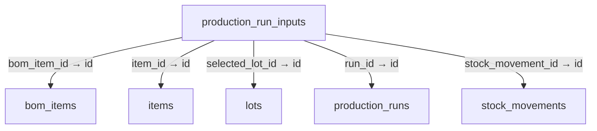

Columns and foreign-key policies

| Column | SQLite type | NOT NULL | Primary-key position |
| --- | --- | --- | --- |
| <code>id</code> | <code>TEXT</code> | False | 1 |
| <code>run_id</code> | <code>TEXT</code> | True | — |
| <code>bom_item_id</code> | <code>TEXT</code> | False | — |
| <code>item_id</code> | <code>TEXT</code> | True | — |
| <code>source_location</code> | <code>TEXT</code> | True | — |
| <code>entered_quantity</code> | <code>REAL</code> | True | — |
| <code>entered_unit_code</code> | <code>TEXT</code> | True | — |
| <code>conversion_factor</code> | <code>REAL</code> | True | — |
| <code>quantity_decimal</code> | <code>TEXT</code> | True | — |
| <code>conversion_factor_decimal</code> | <code>TEXT</code> | True | — |
| <code>base_quantity_decimal</code> | <code>TEXT</code> | True | — |
| <code>selected_lot_id</code> | <code>TEXT</code> | False | — |
| <code>selected_serial_number</code> | <code>TEXT</code> | False | — |
| <code>cost_basis_source</code> | <code>TEXT</code> | False | — |
| <code>unit_cost_minor</code> | <code>INTEGER</code> | False | — |
| <code>stock_movement_id</code> | <code>TEXT</code> | False | — |
| <code>created_at_utc</code> | <code>TEXT</code> | True | — |
| <code>unit_cost_minor_decimal</code> | <code>TEXT</code> | False | — |

| FK / sequence | Child column | Parent table / column | On update / delete |
| --- | --- | --- | --- |
| 0 / 0 | <code>stock_movement_id</code> | [stock_movements](schema-10.md#stock-movements) / <code>id</code> | NO ACTION / NO ACTION |
| 1 / 0 | <code>selected_lot_id</code> | [lots](schema-04.md#lots) / <code>id</code> | NO ACTION / NO ACTION |
| 2 / 0 | <code>item_id</code> | [items](schema-04.md#items) / <code>id</code> | NO ACTION / NO ACTION |
| 3 / 0 | <code>bom_item_id</code> | [bom_items](schema-01.md#bom-items) / <code>id</code> | NO ACTION / NO ACTION |
| 4 / 0 | <code>run_id</code> | [production_runs](schema-07.md#production-runs) / <code>id</code> | NO ACTION / CASCADE |

## production_run_outputs {#production-run-outputs}

Relationship diagram

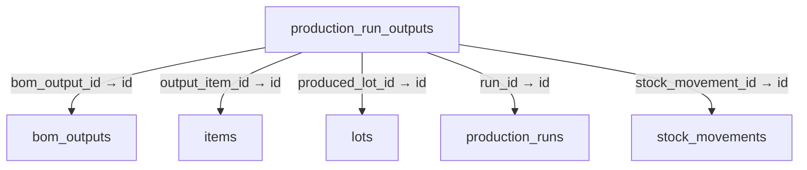

Columns and foreign-key policies

| Column | SQLite type | NOT NULL | Primary-key position |
| --- | --- | --- | --- |
| <code>id</code> | <code>TEXT</code> | False | 1 |
| <code>run_id</code> | <code>TEXT</code> | True | — |
| <code>bom_output_id</code> | <code>TEXT</code> | False | — |
| <code>output_item_id</code> | <code>TEXT</code> | True | — |
| <code>destination_location</code> | <code>TEXT</code> | True | — |
| <code>entered_quantity</code> | <code>REAL</code> | True | — |
| <code>entered_unit_code</code> | <code>TEXT</code> | True | — |
| <code>conversion_factor</code> | <code>REAL</code> | True | — |
| <code>quantity_decimal</code> | <code>TEXT</code> | True | — |
| <code>conversion_factor_decimal</code> | <code>TEXT</code> | True | — |
| <code>base_quantity_decimal</code> | <code>TEXT</code> | True | — |
| <code>produced_lot_id</code> | <code>TEXT</code> | False | — |
| <code>produced_serial_number</code> | <code>TEXT</code> | False | — |
| <code>allocated_cost_minor</code> | <code>INTEGER</code> | False | — |
| <code>stock_movement_id</code> | <code>TEXT</code> | False | — |
| <code>created_at_utc</code> | <code>TEXT</code> | True | — |

| FK / sequence | Child column | Parent table / column | On update / delete |
| --- | --- | --- | --- |
| 0 / 0 | <code>stock_movement_id</code> | [stock_movements](schema-10.md#stock-movements) / <code>id</code> | NO ACTION / NO ACTION |
| 1 / 0 | <code>produced_lot_id</code> | [lots](schema-04.md#lots) / <code>id</code> | NO ACTION / NO ACTION |
| 2 / 0 | <code>output_item_id</code> | [items](schema-04.md#items) / <code>id</code> | NO ACTION / NO ACTION |
| 3 / 0 | <code>bom_output_id</code> | [bom_outputs](schema-01.md#bom-outputs) / <code>id</code> | NO ACTION / NO ACTION |
| 4 / 0 | <code>run_id</code> | [production_runs](schema-07.md#production-runs) / <code>id</code> | NO ACTION / CASCADE |

## production_run_scrap {#production-run-scrap}

Relationship diagram

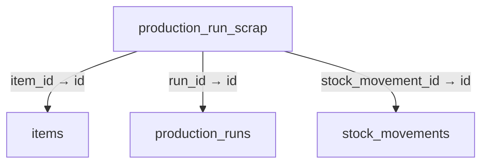

Columns and foreign-key policies

| Column | SQLite type | NOT NULL | Primary-key position |
| --- | --- | --- | --- |
| <code>id</code> | <code>TEXT</code> | False | 1 |
| <code>run_id</code> | <code>TEXT</code> | True | — |
| <code>item_id</code> | <code>TEXT</code> | True | — |
| <code>location</code> | <code>TEXT</code> | True | — |
| <code>quantity_decimal</code> | <code>TEXT</code> | True | — |
| <code>reason</code> | <code>TEXT</code> | False | — |
| <code>cost_minor</code> | <code>INTEGER</code> | False | — |
| <code>stock_movement_id</code> | <code>TEXT</code> | False | — |
| <code>created_at_utc</code> | <code>TEXT</code> | True | — |

| FK / sequence | Child column | Parent table / column | On update / delete |
| --- | --- | --- | --- |
| 0 / 0 | <code>stock_movement_id</code> | [stock_movements](schema-10.md#stock-movements) / <code>id</code> | NO ACTION / NO ACTION |
| 1 / 0 | <code>item_id</code> | [items](schema-04.md#items) / <code>id</code> | NO ACTION / NO ACTION |
| 2 / 0 | <code>run_id</code> | [production_runs](schema-07.md#production-runs) / <code>id</code> | NO ACTION / CASCADE |

## production_runs {#production-runs}

Relationship diagram

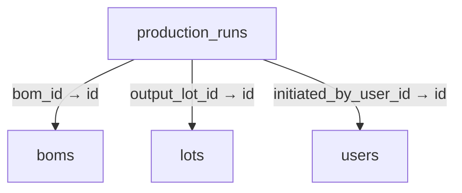

Columns and foreign-key policies

| Column | SQLite type | NOT NULL | Primary-key position |
| --- | --- | --- | --- |
| <code>id</code> | <code>TEXT</code> | False | 1 |
| <code>bom_id</code> | <code>TEXT</code> | True | — |
| <code>run_number</code> | <code>TEXT</code> | True | — |
| <code>planned_quantity</code> | <code>REAL</code> | True | — |
| <code>actual_yield</code> | <code>REAL</code> | False | — |
| <code>scrap_quantity</code> | <code>REAL</code> | True | — |
| <code>output_lot_id</code> | <code>TEXT</code> | False | — |
| <code>status</code> | <code>TEXT</code> | True | — |
| <code>initiated_by_user_id</code> | <code>TEXT</code> | True | — |
| <code>started_at_utc</code> | <code>TEXT</code> | True | — |
| <code>completed_at_utc</code> | <code>TEXT</code> | False | — |
| <code>source_location</code> | <code>TEXT</code> | True | — |
| <code>destination_location</code> | <code>TEXT</code> | True | — |
| <code>notes</code> | <code>TEXT</code> | False | — |
| <code>planned_quantity_decimal</code> | <code>TEXT</code> | False | — |
| <code>actual_yield_decimal</code> | <code>TEXT</code> | False | — |
| <code>scrap_quantity_decimal</code> | <code>TEXT</code> | False | — |
| <code>output_lot_formula</code> | <code>TEXT</code> | False | — |
| <code>created_at_utc</code> | <code>TEXT</code> | False | — |

| FK / sequence | Child column | Parent table / column | On update / delete |
| --- | --- | --- | --- |
| 0 / 0 | <code>initiated_by_user_id</code> | [users](schema-12.md#users) / <code>id</code> | NO ACTION / NO ACTION |
| 1 / 0 | <code>output_lot_id</code> | [lots](schema-04.md#lots) / <code>id</code> | NO ACTION / NO ACTION |
| 2 / 0 | <code>bom_id</code> | [boms](schema-01.md#boms) / <code>id</code> | NO ACTION / NO ACTION |

## purchase_invoice_drafts {#purchase-invoice-drafts}

Relationship diagram

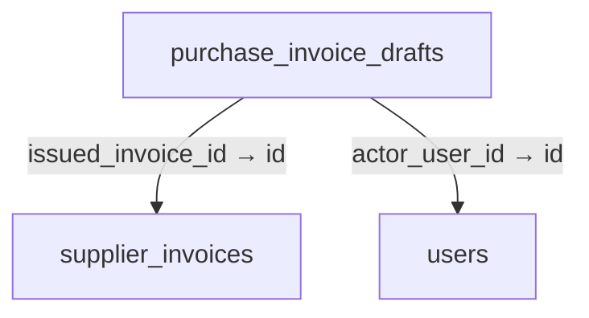

Columns and foreign-key policies

| Column | SQLite type | NOT NULL | Primary-key position |
| --- | --- | --- | --- |
| <code>id</code> | <code>TEXT</code> | False | 1 |
| <code>payload_json</code> | <code>TEXT</code> | True | — |
| <code>actor_user_id</code> | <code>TEXT</code> | True | — |
| <code>issued_invoice_id</code> | <code>TEXT</code> | False | — |
| <code>revision</code> | <code>INTEGER</code> | True | — |
| <code>created_at_utc</code> | <code>TEXT</code> | True | — |
| <code>updated_at_utc</code> | <code>TEXT</code> | True | — |

| FK / sequence | Child column | Parent table / column | On update / delete |
| --- | --- | --- | --- |
| 0 / 0 | <code>issued_invoice_id</code> | [supplier_invoices](schema-11.md#supplier-invoices) / <code>id</code> | NO ACTION / NO ACTION |
| 1 / 0 | <code>actor_user_id</code> | [users](schema-12.md#users) / <code>id</code> | NO ACTION / NO ACTION |

## purchase_receipt_lines {#purchase-receipt-lines}

Relationship diagram

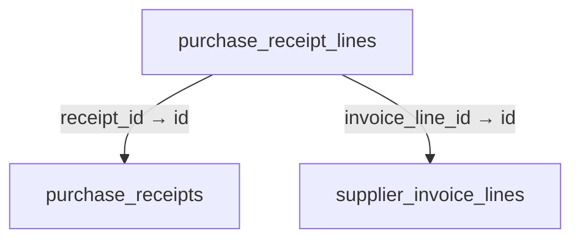

Columns and foreign-key policies

| Column | SQLite type | NOT NULL | Primary-key position |
| --- | --- | --- | --- |
| <code>id</code> | <code>TEXT</code> | False | 1 |
| <code>receipt_id</code> | <code>TEXT</code> | True | — |
| <code>invoice_line_id</code> | <code>TEXT</code> | True | — |
| <code>quantity_decimal</code> | <code>TEXT</code> | True | — |
| <code>stock_reference</code> | <code>TEXT</code> | True | — |

| FK / sequence | Child column | Parent table / column | On update / delete |
| --- | --- | --- | --- |
| 0 / 0 | <code>invoice_line_id</code> | [supplier_invoice_lines](schema-11.md#supplier-invoice-lines) / <code>id</code> | NO ACTION / NO ACTION |
| 1 / 0 | <code>receipt_id</code> | [purchase_receipts](schema-07.md#purchase-receipts) / <code>id</code> | NO ACTION / NO ACTION |

## purchase_receipts {#purchase-receipts}

Relationship diagram

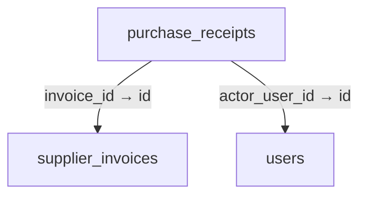

Columns and foreign-key policies

| Column | SQLite type | NOT NULL | Primary-key position |
| --- | --- | --- | --- |
| <code>id</code> | <code>TEXT</code> | False | 1 |
| <code>invoice_id</code> | <code>TEXT</code> | True | — |
| <code>command_key</code> | <code>TEXT</code> | True | — |
| <code>actor_user_id</code> | <code>TEXT</code> | True | — |
| <code>reason</code> | <code>TEXT</code> | True | — |
| <code>created_at_utc</code> | <code>TEXT</code> | True | — |

| FK / sequence | Child column | Parent table / column | On update / delete |
| --- | --- | --- | --- |
| 0 / 0 | <code>actor_user_id</code> | [users](schema-12.md#users) / <code>id</code> | NO ACTION / NO ACTION |
| 1 / 0 | <code>invoice_id</code> | [supplier_invoices](schema-11.md#supplier-invoices) / <code>id</code> | NO ACTION / NO ACTION |

## receipt_assets {#receipt-assets}

Relationship diagram

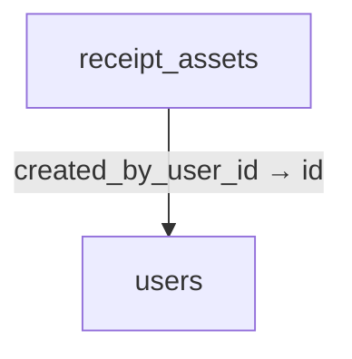

Columns and foreign-key policies

| Column | SQLite type | NOT NULL | Primary-key position |
| --- | --- | --- | --- |
| <code>id</code> | <code>TEXT</code> | False | 1 |
| <code>asset_kind</code> | <code>TEXT</code> | True | — |
| <code>mime_type</code> | <code>TEXT</code> | True | — |
| <code>content_bytes</code> | <code>BLOB</code> | True | — |
| <code>monochrome_bytes</code> | <code>BLOB</code> | False | — |
| <code>width_pixels</code> | <code>INTEGER</code> | True | — |
| <code>height_pixels</code> | <code>INTEGER</code> | True | — |
| <code>content_hash</code> | <code>TEXT</code> | True | — |
| <code>created_at_utc</code> | <code>TEXT</code> | True | — |
| <code>created_by_user_id</code> | <code>TEXT</code> | True | — |

| FK / sequence | Child column | Parent table / column | On update / delete |
| --- | --- | --- | --- |
| 0 / 0 | <code>created_by_user_id</code> | [users](schema-12.md#users) / <code>id</code> | NO ACTION / NO ACTION |

## receipt_design_versions {#receipt-design-versions}

Relationship diagram

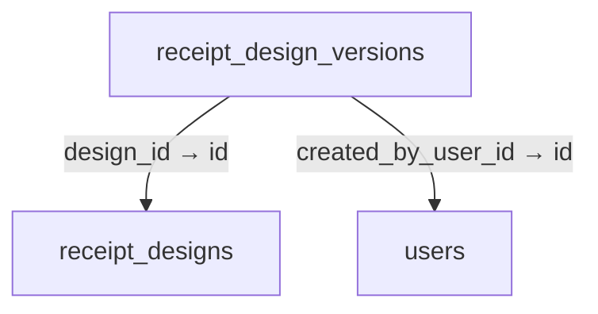

Columns and foreign-key policies

| Column | SQLite type | NOT NULL | Primary-key position |
| --- | --- | --- | --- |
| <code>id</code> | <code>TEXT</code> | False | 1 |
| <code>design_id</code> | <code>TEXT</code> | True | — |
| <code>version_number</code> | <code>INTEGER</code> | True | — |
| <code>document_json</code> | <code>TEXT</code> | True | — |
| <code>content_hash</code> | <code>TEXT</code> | True | — |
| <code>created_at_utc</code> | <code>TEXT</code> | True | — |
| <code>created_by_user_id</code> | <code>TEXT</code> | True | — |
| <code>retired_at_utc</code> | <code>TEXT</code> | False | — |

| FK / sequence | Child column | Parent table / column | On update / delete |
| --- | --- | --- | --- |
| 0 / 0 | <code>created_by_user_id</code> | [users](schema-12.md#users) / <code>id</code> | NO ACTION / NO ACTION |
| 1 / 0 | <code>design_id</code> | [receipt_designs](schema-07.md#receipt-designs) / <code>id</code> | NO ACTION / NO ACTION |

## receipt_designs {#receipt-designs}

Relationship diagram

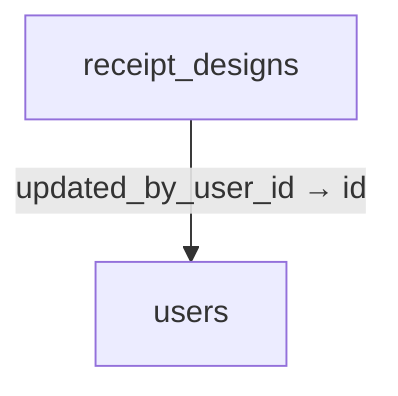

Columns and foreign-key policies

| Column | SQLite type | NOT NULL | Primary-key position |
| --- | --- | --- | --- |
| <code>id</code> | <code>TEXT</code> | False | 1 |
| <code>media_family</code> | <code>TEXT</code> | True | — |
| <code>active_version_id</code> | <code>TEXT</code> | False | — |
| <code>enabled</code> | <code>INTEGER</code> | True | — |
| <code>created_at_utc</code> | <code>TEXT</code> | True | — |
| <code>updated_at_utc</code> | <code>TEXT</code> | True | — |
| <code>updated_by_user_id</code> | <code>TEXT</code> | False | — |

| FK / sequence | Child column | Parent table / column | On update / delete |
| --- | --- | --- | --- |
| 0 / 0 | <code>updated_by_user_id</code> | [users](schema-12.md#users) / <code>id</code> | NO ACTION / NO ACTION |

## refund_lines {#refund-lines}

Relationship diagram

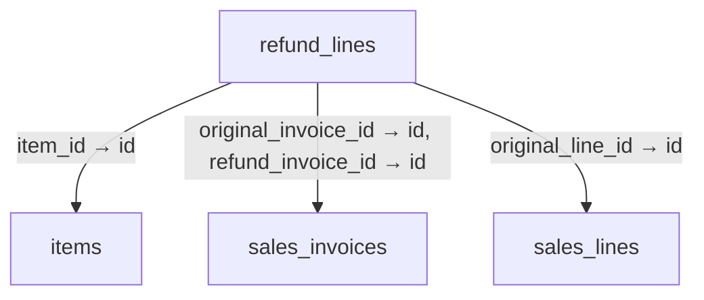

Columns and foreign-key policies

| Column | SQLite type | NOT NULL | Primary-key position |
| --- | --- | --- | --- |
| <code>id</code> | <code>TEXT</code> | False | 1 |
| <code>refund_invoice_id</code> | <code>TEXT</code> | True | — |
| <code>original_invoice_id</code> | <code>TEXT</code> | True | — |
| <code>original_line_id</code> | <code>TEXT</code> | True | — |
| <code>item_id</code> | <code>TEXT</code> | True | — |
| <code>quantity</code> | <code>REAL</code> | True | — |
| <code>unit_price_minor</code> | <code>INTEGER</code> | True | — |
| <code>discount_minor</code> | <code>INTEGER</code> | True | — |
| <code>tax_minor</code> | <code>INTEGER</code> | True | — |
| <code>line_total_minor</code> | <code>INTEGER</code> | True | — |
| <code>currency</code> | <code>TEXT</code> | True | — |
| <code>disposition</code> | <code>TEXT</code> | True | — |
| <code>created_at_utc</code> | <code>TEXT</code> | True | — |
| <code>quantity_decimal</code> | <code>TEXT</code> | False | — |

| FK / sequence | Child column | Parent table / column | On update / delete |
| --- | --- | --- | --- |
| 0 / 0 | <code>item_id</code> | [items](schema-04.md#items) / <code>id</code> | NO ACTION / NO ACTION |
| 1 / 0 | <code>original_line_id</code> | [sales_lines](schema-09.md#sales-lines) / <code>id</code> | NO ACTION / NO ACTION |
| 2 / 0 | <code>original_invoice_id</code> | [sales_invoices](schema-09.md#sales-invoices) / <code>id</code> | NO ACTION / NO ACTION |
| 3 / 0 | <code>refund_invoice_id</code> | [sales_invoices](schema-09.md#sales-invoices) / <code>id</code> | NO ACTION / CASCADE |

## restaurant_order_lines {#restaurant-order-lines}

Relationship diagram

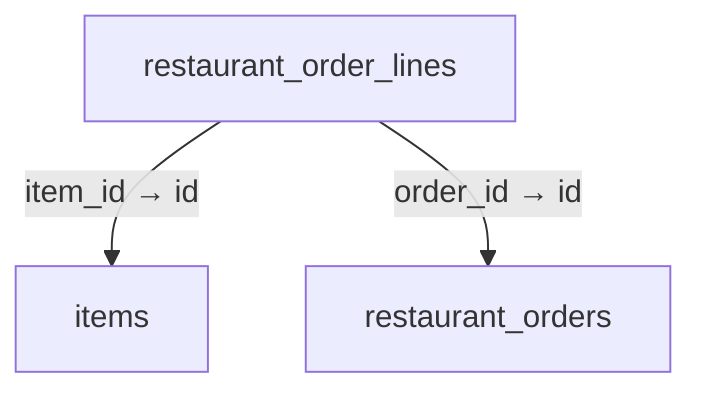

Columns and foreign-key policies

| Column | SQLite type | NOT NULL | Primary-key position |
| --- | --- | --- | --- |
| <code>id</code> | <code>TEXT</code> | False | 1 |
| <code>order_id</code> | <code>TEXT</code> | True | — |
| <code>line_number</code> | <code>INTEGER</code> | True | — |
| <code>item_id</code> | <code>TEXT</code> | True | — |
| <code>item_name</code> | <code>TEXT</code> | True | — |
| <code>quantity</code> | <code>REAL</code> | True | — |
| <code>unit_price_minor</code> | <code>INTEGER</code> | True | — |
| <code>line_total_minor</code> | <code>INTEGER</code> | True | — |
| <code>notes</code> | <code>TEXT</code> | False | — |
| <code>created_at_utc</code> | <code>TEXT</code> | True | — |

| FK / sequence | Child column | Parent table / column | On update / delete |
| --- | --- | --- | --- |
| 0 / 0 | <code>item_id</code> | [items](schema-04.md#items) / <code>id</code> | NO ACTION / NO ACTION |
| 1 / 0 | <code>order_id</code> | [restaurant_orders](schema-08.md#restaurant-orders) / <code>id</code> | NO ACTION / CASCADE |

