# Schema 08: restaurant_orders to salary_periods

DRAFT · code snapshot 18 October 2026 · source review, not runtime acceptance

[Complete table index and reconstruction limits](schema.md). Arrows below are declared foreign keys, not inferred cardinalities.

## restaurant_orders {#restaurant-orders}

Relationship diagram

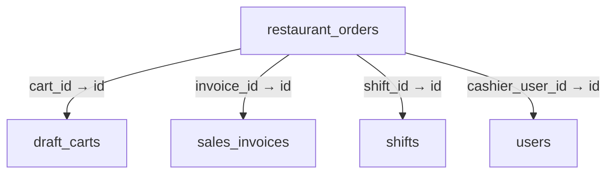

Columns and foreign-key policies

| Column | SQLite type | NOT NULL | Primary-key position |
| --- | --- | --- | --- |
| <code>id</code> | <code>TEXT</code> | False | 1 |
| <code>order_number</code> | <code>TEXT</code> | True | — |
| <code>shift_id</code> | <code>TEXT</code> | True | — |
| <code>cashier_user_id</code> | <code>TEXT</code> | True | — |
| <code>table_number</code> | <code>TEXT</code> | False | — |
| <code>customer_name</code> | <code>TEXT</code> | False | — |
| <code>dining_type</code> | <code>TEXT</code> | True | — |
| <code>service_style</code> | <code>TEXT</code> | True | — |
| <code>status</code> | <code>INTEGER</code> | True | — |
| <code>subtotal_minor</code> | <code>INTEGER</code> | True | — |
| <code>discount_minor</code> | <code>INTEGER</code> | True | — |
| <code>tax_minor</code> | <code>INTEGER</code> | True | — |
| <code>total_minor</code> | <code>INTEGER</code> | True | — |
| <code>currency</code> | <code>TEXT</code> | True | — |
| <code>cart_id</code> | <code>TEXT</code> | False | — |
| <code>invoice_id</code> | <code>TEXT</code> | False | — |
| <code>created_at_utc</code> | <code>TEXT</code> | True | — |
| <code>updated_at_utc</code> | <code>TEXT</code> | True | — |

| FK / sequence | Child column | Parent table / column | On update / delete |
| --- | --- | --- | --- |
| 0 / 0 | <code>invoice_id</code> | [sales_invoices](schema-09.md#sales-invoices) / <code>id</code> | NO ACTION / NO ACTION |
| 1 / 0 | <code>cart_id</code> | [draft_carts](schema-02.md#draft-carts) / <code>id</code> | NO ACTION / NO ACTION |
| 2 / 0 | <code>cashier_user_id</code> | [users](schema-12.md#users) / <code>id</code> | NO ACTION / NO ACTION |
| 3 / 0 | <code>shift_id</code> | [shifts](schema-10.md#shifts) / <code>id</code> | NO ACTION / NO ACTION |

## return_disposition_resolutions {#return-disposition-resolutions}

Relationship diagram

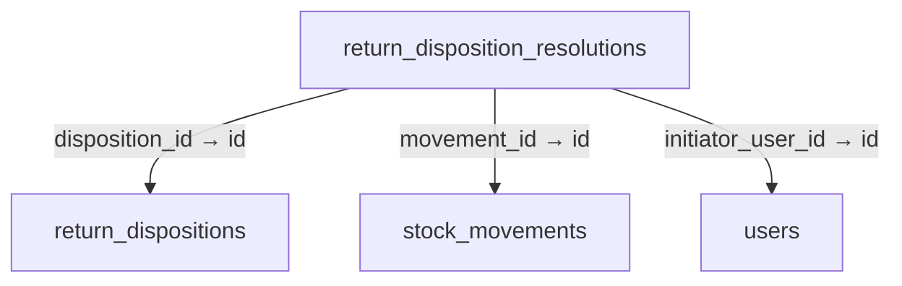

Columns and foreign-key policies

| Column | SQLite type | NOT NULL | Primary-key position |
| --- | --- | --- | --- |
| <code>id</code> | <code>TEXT</code> | False | 1 |
| <code>disposition_id</code> | <code>TEXT</code> | True | — |
| <code>base_quantity_decimal</code> | <code>TEXT</code> | True | — |
| <code>resolution</code> | <code>INTEGER</code> | True | — |
| <code>movement_id</code> | <code>TEXT</code> | True | — |
| <code>command_key</code> | <code>TEXT</code> | True | — |
| <code>reason</code> | <code>TEXT</code> | True | — |
| <code>initiator_user_id</code> | <code>TEXT</code> | True | — |
| <code>correlation_id</code> | <code>TEXT</code> | True | — |
| <code>created_at_utc</code> | <code>TEXT</code> | True | — |

| FK / sequence | Child column | Parent table / column | On update / delete |
| --- | --- | --- | --- |
| 0 / 0 | <code>initiator_user_id</code> | [users](schema-12.md#users) / <code>id</code> | NO ACTION / NO ACTION |
| 1 / 0 | <code>movement_id</code> | [stock_movements](schema-10.md#stock-movements) / <code>id</code> | NO ACTION / NO ACTION |
| 2 / 0 | <code>disposition_id</code> | [return_dispositions](schema-08.md#return-dispositions) / <code>id</code> | NO ACTION / NO ACTION |

## return_dispositions {#return-dispositions}

Relationship diagram

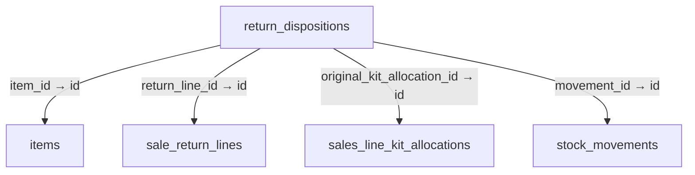

Columns and foreign-key policies

| Column | SQLite type | NOT NULL | Primary-key position |
| --- | --- | --- | --- |
| <code>id</code> | <code>TEXT</code> | False | 1 |
| <code>return_line_id</code> | <code>TEXT</code> | True | — |
| <code>original_kit_allocation_id</code> | <code>TEXT</code> | False | — |
| <code>item_id</code> | <code>TEXT</code> | True | — |
| <code>lot_id</code> | <code>TEXT</code> | False | — |
| <code>serial_number</code> | <code>TEXT</code> | False | — |
| <code>base_quantity_decimal</code> | <code>TEXT</code> | True | — |
| <code>remaining_quantity_decimal</code> | <code>TEXT</code> | True | — |
| <code>base_unit_code</code> | <code>TEXT</code> | True | — |
| <code>disposition</code> | <code>INTEGER</code> | True | — |
| <code>state</code> | <code>INTEGER</code> | True | — |
| <code>revision</code> | <code>INTEGER</code> | True | — |
| <code>cost_basis_decimal</code> | <code>TEXT</code> | False | — |
| <code>movement_id</code> | <code>TEXT</code> | True | — |
| <code>created_at_utc</code> | <code>TEXT</code> | True | — |

| FK / sequence | Child column | Parent table / column | On update / delete |
| --- | --- | --- | --- |
| 0 / 0 | <code>movement_id</code> | [stock_movements](schema-10.md#stock-movements) / <code>id</code> | NO ACTION / NO ACTION |
| 1 / 0 | <code>item_id</code> | [items](schema-04.md#items) / <code>id</code> | NO ACTION / NO ACTION |
| 2 / 0 | <code>original_kit_allocation_id</code> | [sales_line_kit_allocations](schema-09.md#sales-line-kit-allocations) / <code>id</code> | NO ACTION / NO ACTION |
| 3 / 0 | <code>return_line_id</code> | [sale_return_lines](schema-09.md#sale-return-lines) / <code>id</code> | NO ACTION / NO ACTION |

## return_shipment_receipts {#return-shipment-receipts}

Relationship diagram

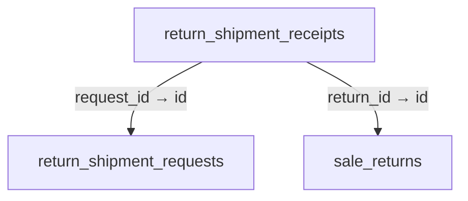

Columns and foreign-key policies

| Column | SQLite type | NOT NULL | Primary-key position |
| --- | --- | --- | --- |
| <code>id</code> | <code>TEXT</code> | False | 1 |
| <code>request_id</code> | <code>TEXT</code> | True | — |
| <code>return_id</code> | <code>TEXT</code> | True | — |
| <code>created_at_utc</code> | <code>TEXT</code> | True | — |

| FK / sequence | Child column | Parent table / column | On update / delete |
| --- | --- | --- | --- |
| 0 / 0 | <code>return_id</code> | [sale_returns](schema-09.md#sale-returns) / <code>id</code> | NO ACTION / NO ACTION |
| 1 / 0 | <code>request_id</code> | [return_shipment_requests](schema-08.md#return-shipment-requests) / <code>id</code> | NO ACTION / NO ACTION |

## return_shipment_requests {#return-shipment-requests}

Relationship diagram

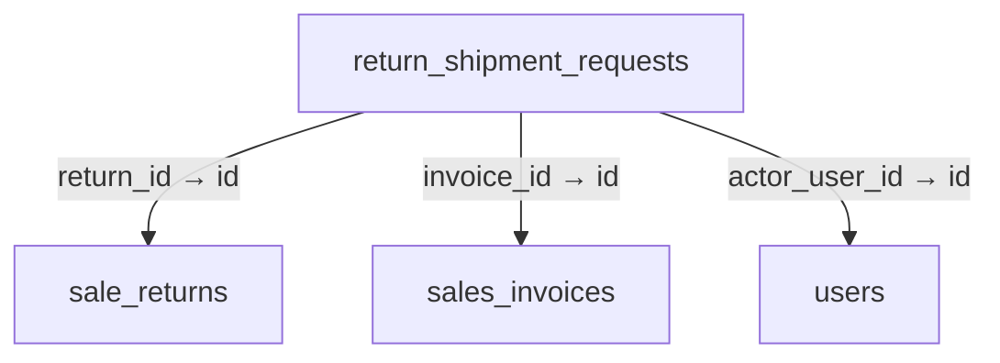

Columns and foreign-key policies

| Column | SQLite type | NOT NULL | Primary-key position |
| --- | --- | --- | --- |
| <code>id</code> | <code>TEXT</code> | False | 1 |
| <code>invoice_id</code> | <code>TEXT</code> | True | — |
| <code>payload_json</code> | <code>TEXT</code> | True | — |
| <code>state</code> | <code>TEXT</code> | True | — |
| <code>revision</code> | <code>INTEGER</code> | True | — |
| <code>return_id</code> | <code>TEXT</code> | False | — |
| <code>command_key</code> | <code>TEXT</code> | True | — |
| <code>actor_user_id</code> | <code>TEXT</code> | True | — |
| <code>created_at_utc</code> | <code>TEXT</code> | True | — |

| FK / sequence | Child column | Parent table / column | On update / delete |
| --- | --- | --- | --- |
| 0 / 0 | <code>actor_user_id</code> | [users](schema-12.md#users) / <code>id</code> | NO ACTION / NO ACTION |
| 1 / 0 | <code>return_id</code> | [sale_returns](schema-09.md#sale-returns) / <code>id</code> | NO ACTION / NO ACTION |
| 2 / 0 | <code>invoice_id</code> | [sales_invoices](schema-09.md#sales-invoices) / <code>id</code> | NO ACTION / NO ACTION |

## role_permissions {#role-permissions}

Relationship diagram

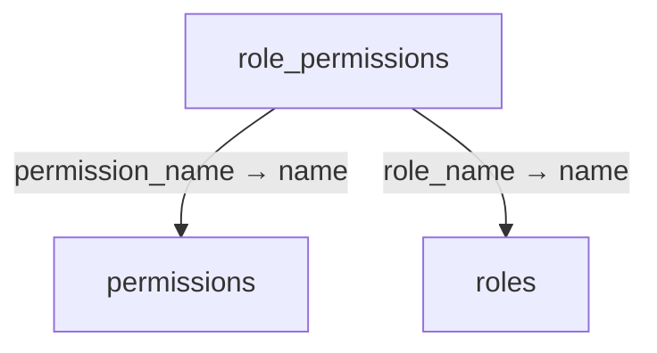

Columns and foreign-key policies

| Column | SQLite type | NOT NULL | Primary-key position |
| --- | --- | --- | --- |
| <code>role_name</code> | <code>TEXT</code> | True | 1 |
| <code>permission_name</code> | <code>TEXT</code> | True | 2 |

| FK / sequence | Child column | Parent table / column | On update / delete |
| --- | --- | --- | --- |
| 0 / 0 | <code>permission_name</code> | [permissions](schema-05.md#permissions) / <code>name</code> | NO ACTION / CASCADE |
| 1 / 0 | <code>role_name</code> | [roles](schema-08.md#roles) / <code>name</code> | NO ACTION / CASCADE |

## roles {#roles}

No outgoing foreign key declared in the reconstructed schema.

Columns and foreign-key policies

| Column | SQLite type | NOT NULL | Primary-key position |
| --- | --- | --- | --- |
| <code>name</code> | <code>TEXT</code> | False | 1 |
| <code>description</code> | <code>TEXT</code> | False | — |

## salary_adjustments {#salary-adjustments}

Relationship diagram

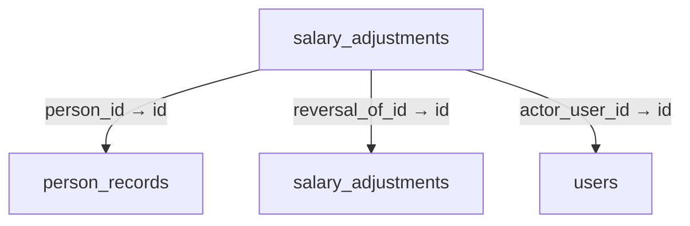

Columns and foreign-key policies

| Column | SQLite type | NOT NULL | Primary-key position |
| --- | --- | --- | --- |
| <code>id</code> | <code>TEXT</code> | False | 1 |
| <code>person_id</code> | <code>TEXT</code> | True | — |
| <code>payroll_month</code> | <code>TEXT</code> | True | — |
| <code>kind</code> | <code>TEXT</code> | True | — |
| <code>amount_minor</code> | <code>INTEGER</code> | True | — |
| <code>occurred_at_utc</code> | <code>TEXT</code> | True | — |
| <code>reason</code> | <code>TEXT</code> | True | — |
| <code>actor_user_id</code> | <code>TEXT</code> | True | — |
| <code>reversal_of_id</code> | <code>TEXT</code> | False | — |
| <code>command_key</code> | <code>TEXT</code> | True | — |
| <code>created_at_utc</code> | <code>TEXT</code> | True | — |

| FK / sequence | Child column | Parent table / column | On update / delete |
| --- | --- | --- | --- |
| 0 / 0 | <code>reversal_of_id</code> | [salary_adjustments](schema-08.md#salary-adjustments) / <code>id</code> | NO ACTION / NO ACTION |
| 1 / 0 | <code>actor_user_id</code> | [users](schema-12.md#users) / <code>id</code> | NO ACTION / NO ACTION |
| 2 / 0 | <code>person_id</code> | [person_records](schema-05.md#person-records) / <code>id</code> | NO ACTION / CASCADE |

## salary_agreements {#salary-agreements}

Relationship diagram

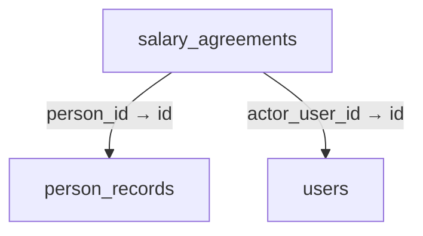

Columns and foreign-key policies

| Column | SQLite type | NOT NULL | Primary-key position |
| --- | --- | --- | --- |
| <code>id</code> | <code>TEXT</code> | False | 1 |
| <code>person_id</code> | <code>TEXT</code> | True | — |
| <code>effective_from_month</code> | <code>TEXT</code> | True | — |
| <code>monthly_amount_minor</code> | <code>INTEGER</code> | True | — |
| <code>daily_override_minor</code> | <code>INTEGER</code> | False | — |
| <code>currency</code> | <code>TEXT</code> | True | — |
| <code>decimal_places</code> | <code>INTEGER</code> | True | — |
| <code>revision</code> | <code>INTEGER</code> | True | — |
| <code>actor_user_id</code> | <code>TEXT</code> | True | — |
| <code>created_at_utc</code> | <code>TEXT</code> | True | — |
| <code>is_salary_enabled</code> | <code>INTEGER</code> | True | — |

| FK / sequence | Child column | Parent table / column | On update / delete |
| --- | --- | --- | --- |
| 0 / 0 | <code>actor_user_id</code> | [users](schema-12.md#users) / <code>id</code> | NO ACTION / NO ACTION |
| 1 / 0 | <code>person_id</code> | [person_records](schema-05.md#person-records) / <code>id</code> | NO ACTION / CASCADE |

## salary_ledger_entries {#salary-ledger-entries}

Relationship diagram

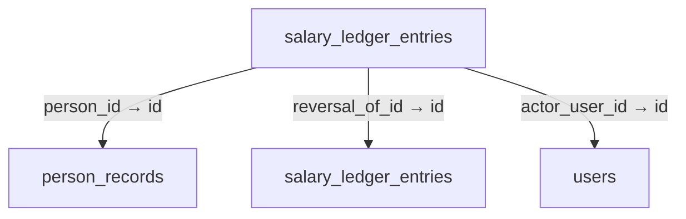

Columns and foreign-key policies

| Column | SQLite type | NOT NULL | Primary-key position |
| --- | --- | --- | --- |
| <code>id</code> | <code>TEXT</code> | False | 1 |
| <code>person_id</code> | <code>TEXT</code> | True | — |
| <code>entry_type</code> | <code>TEXT</code> | True | — |
| <code>amount_minor</code> | <code>INTEGER</code> | True | — |
| <code>accounting_month</code> | <code>TEXT</code> | True | — |
| <code>currency</code> | <code>TEXT</code> | True | — |
| <code>decimal_places</code> | <code>INTEGER</code> | True | — |
| <code>reason</code> | <code>TEXT</code> | True | — |
| <code>source_type</code> | <code>TEXT</code> | True | — |
| <code>source_id</code> | <code>TEXT</code> | True | — |
| <code>actor_user_id</code> | <code>TEXT</code> | True | — |
| <code>reversal_of_id</code> | <code>TEXT</code> | False | — |
| <code>created_at_utc</code> | <code>TEXT</code> | True | — |

| FK / sequence | Child column | Parent table / column | On update / delete |
| --- | --- | --- | --- |
| 0 / 0 | <code>reversal_of_id</code> | [salary_ledger_entries](schema-08.md#salary-ledger-entries) / <code>id</code> | NO ACTION / NO ACTION |
| 1 / 0 | <code>actor_user_id</code> | [users](schema-12.md#users) / <code>id</code> | NO ACTION / NO ACTION |
| 2 / 0 | <code>person_id</code> | [person_records](schema-05.md#person-records) / <code>id</code> | NO ACTION / CASCADE |

## salary_payments {#salary-payments}

Relationship diagram

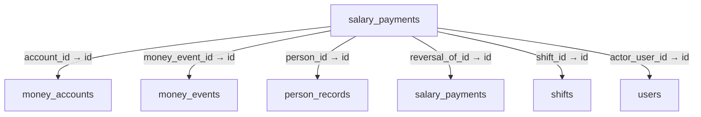

Columns and foreign-key policies

| Column | SQLite type | NOT NULL | Primary-key position |
| --- | --- | --- | --- |
| <code>id</code> | <code>TEXT</code> | False | 1 |
| <code>person_id</code> | <code>TEXT</code> | True | — |
| <code>kind</code> | <code>TEXT</code> | True | — |
| <code>amount_minor</code> | <code>INTEGER</code> | True | — |
| <code>account_id</code> | <code>TEXT</code> | False | — |
| <code>shift_id</code> | <code>TEXT</code> | False | — |
| <code>paid_at_utc</code> | <code>TEXT</code> | True | — |
| <code>external_reference</code> | <code>TEXT</code> | False | — |
| <code>reason</code> | <code>TEXT</code> | True | — |
| <code>actor_user_id</code> | <code>TEXT</code> | True | — |
| <code>money_event_id</code> | <code>TEXT</code> | False | — |
| <code>reversal_of_id</code> | <code>TEXT</code> | False | — |
| <code>command_key</code> | <code>TEXT</code> | True | — |
| <code>created_at_utc</code> | <code>TEXT</code> | True | — |

| FK / sequence | Child column | Parent table / column | On update / delete |
| --- | --- | --- | --- |
| 0 / 0 | <code>reversal_of_id</code> | [salary_payments](schema-08.md#salary-payments) / <code>id</code> | NO ACTION / NO ACTION |
| 1 / 0 | <code>money_event_id</code> | [money_events](schema-05.md#money-events) / <code>id</code> | NO ACTION / NO ACTION |
| 2 / 0 | <code>actor_user_id</code> | [users](schema-12.md#users) / <code>id</code> | NO ACTION / NO ACTION |
| 3 / 0 | <code>shift_id</code> | [shifts](schema-10.md#shifts) / <code>id</code> | NO ACTION / NO ACTION |
| 4 / 0 | <code>account_id</code> | [money_accounts](schema-05.md#money-accounts) / <code>id</code> | NO ACTION / NO ACTION |
| 5 / 0 | <code>person_id</code> | [person_records](schema-05.md#person-records) / <code>id</code> | NO ACTION / CASCADE |

## salary_periods {#salary-periods}

Relationship diagram

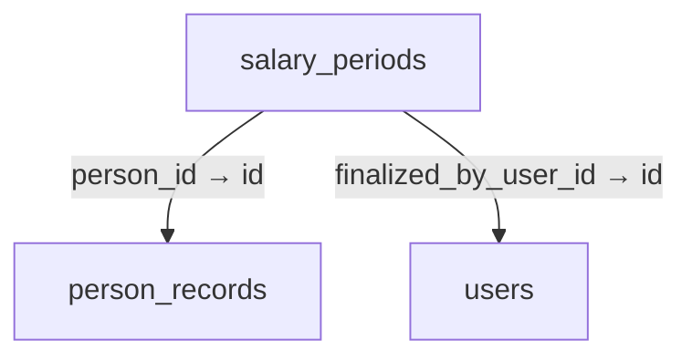

Columns and foreign-key policies

| Column | SQLite type | NOT NULL | Primary-key position |
| --- | --- | --- | --- |
| <code>id</code> | <code>TEXT</code> | False | 1 |
| <code>person_id</code> | <code>TEXT</code> | True | — |
| <code>payroll_month</code> | <code>TEXT</code> | True | — |
| <code>status</code> | <code>TEXT</code> | True | — |
| <code>unpaid_days</code> | <code>INTEGER</code> | True | — |
| <code>unpaid_days_reason</code> | <code>TEXT</code> | False | — |
| <code>finalized_calculation_json</code> | <code>TEXT</code> | False | — |
| <code>finalized_at_utc</code> | <code>TEXT</code> | False | — |
| <code>finalized_by_user_id</code> | <code>TEXT</code> | False | — |
| <code>revision</code> | <code>INTEGER</code> | True | — |
| <code>updated_at_utc</code> | <code>TEXT</code> | True | — |
| <code>statement_version</code> | <code>INTEGER</code> | True | — |
| <code>currency</code> | <code>TEXT</code> | False | — |
| <code>decimal_places</code> | <code>INTEGER</code> | False | — |
| <code>store_timezone</code> | <code>TEXT</code> | False | — |
| <code>payment_cutoff_utc</code> | <code>TEXT</code> | False | — |
| <code>opening_carry_minor</code> | <code>INTEGER</code> | False | — |
| <code>net_earned_minor</code> | <code>INTEGER</code> | False | — |
| <code>expected_remaining_minor</code> | <code>INTEGER</code> | False | — |
| <code>statement_json</code> | <code>TEXT</code> | False | — |

| FK / sequence | Child column | Parent table / column | On update / delete |
| --- | --- | --- | --- |
| 0 / 0 | <code>finalized_by_user_id</code> | [users](schema-12.md#users) / <code>id</code> | NO ACTION / NO ACTION |
| 1 / 0 | <code>person_id</code> | [person_records](schema-05.md#person-records) / <code>id</code> | NO ACTION / CASCADE |

