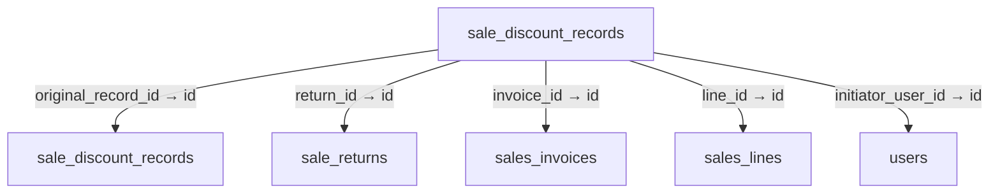
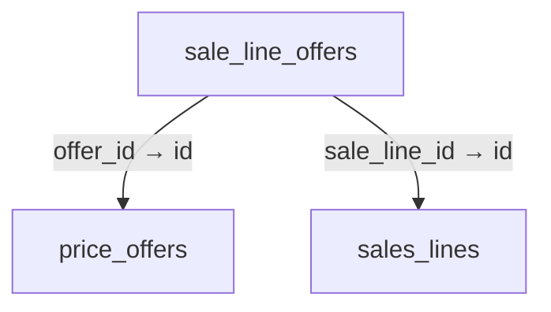
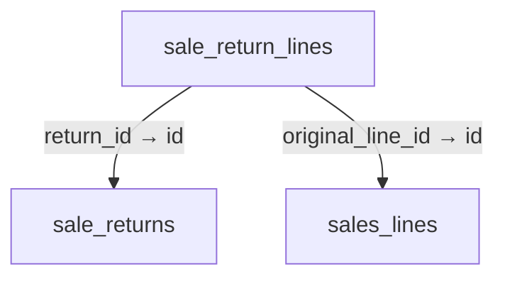
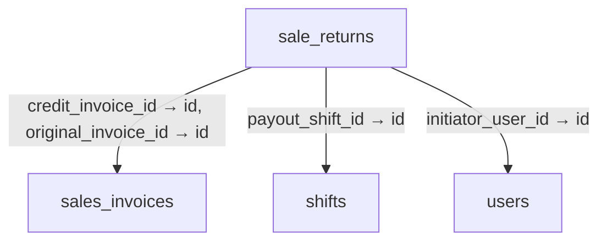
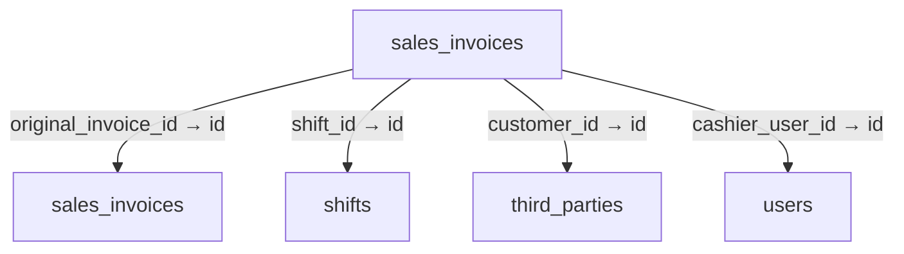
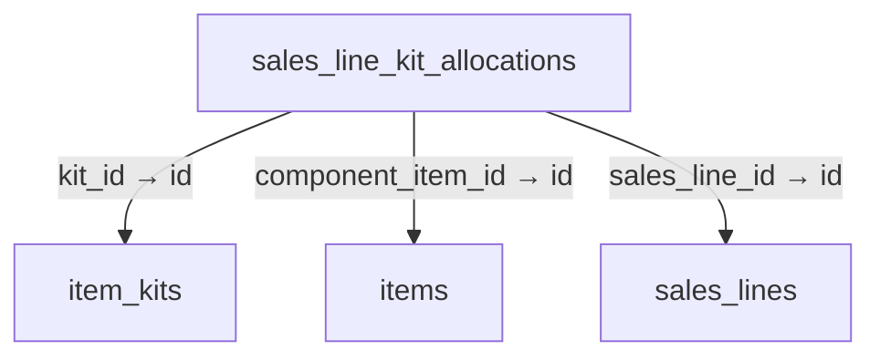
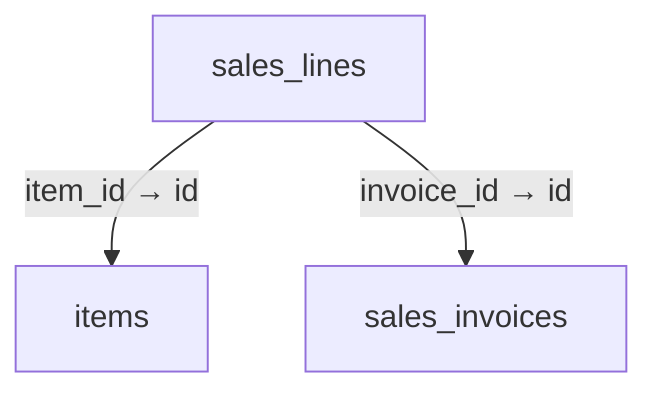
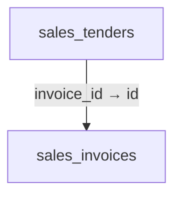
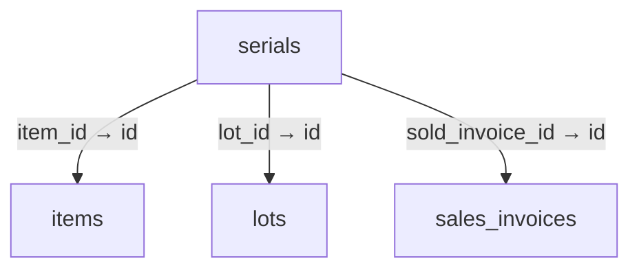

# Schema 09: sale_discount_records to serials

DRAFT · code snapshot 18 October 2026 · source review, not runtime acceptance

[Complete table index and reconstruction limits](schema.md). Arrows below are declared foreign keys, not inferred cardinalities.

## sale_discount_records {#sale-discount-records}

Relationship diagram

Columns and foreign-key policies

| Column | SQLite type | NOT NULL | Primary-key position |
| --- | --- | --- | --- |
| <code>id</code> | <code>TEXT</code> | False | 1 |
| <code>invoice_id</code> | <code>TEXT</code> | True | — |
| <code>line_id</code> | <code>TEXT</code> | False | — |
| <code>kind</code> | <code>INTEGER</code> | True | — |
| <code>amount_minor</code> | <code>INTEGER</code> | True | — |
| <code>benchmark_minor</code> | <code>INTEGER</code> | False | — |
| <code>currency</code> | <code>TEXT</code> | True | — |
| <code>original_record_id</code> | <code>TEXT</code> | False | — |
| <code>return_id</code> | <code>TEXT</code> | False | — |
| <code>source_key</code> | <code>TEXT</code> | True | — |
| <code>reason</code> | <code>TEXT</code> | True | — |
| <code>initiator_user_id</code> | <code>TEXT</code> | True | — |
| <code>business_date</code> | <code>TEXT</code> | True | — |
| <code>created_at_utc</code> | <code>TEXT</code> | True | — |
| <code>currency_decimal_places_snapshot</code> | <code>INTEGER</code> | False | — |

| FK / sequence | Child column | Parent table / column | On update / delete |
| --- | --- | --- | --- |
| 0 / 0 | <code>initiator_user_id</code> | [users](schema-12.md#users) / <code>id</code> | NO ACTION / NO ACTION |
| 1 / 0 | <code>return_id</code> | [sale_returns](schema-09.md#sale-returns) / <code>id</code> | NO ACTION / NO ACTION |
| 2 / 0 | <code>original_record_id</code> | [sale_discount_records](schema-09.md#sale-discount-records) / <code>id</code> | NO ACTION / NO ACTION |
| 3 / 0 | <code>line_id</code> | [sales_lines](schema-09.md#sales-lines) / <code>id</code> | NO ACTION / NO ACTION |
| 4 / 0 | <code>invoice_id</code> | [sales_invoices](schema-09.md#sales-invoices) / <code>id</code> | NO ACTION / NO ACTION |

## sale_line_offers {#sale-line-offers}

Relationship diagram

Columns and foreign-key policies

| Column | SQLite type | NOT NULL | Primary-key position |
| --- | --- | --- | --- |
| <code>id</code> | <code>TEXT</code> | False | 1 |
| <code>sale_line_id</code> | <code>TEXT</code> | True | — |
| <code>offer_id</code> | <code>TEXT</code> | True | — |
| <code>applied_discount_minor</code> | <code>INTEGER</code> | True | — |
| <code>created_at_utc</code> | <code>TEXT</code> | True | — |
| <code>offer_version_snapshot</code> | <code>INTEGER</code> | True | — |
| <code>offer_name_snapshot</code> | <code>TEXT</code> | True | — |
| <code>offer_rule_snapshot_json</code> | <code>TEXT</code> | True | — |
| <code>entered_quantity_decimal</code> | <code>TEXT</code> | True | — |
| <code>entered_unit_code</code> | <code>TEXT</code> | True | — |

| FK / sequence | Child column | Parent table / column | On update / delete |
| --- | --- | --- | --- |
| 0 / 0 | <code>offer_id</code> | [price_offers](schema-06.md#price-offers) / <code>id</code> | NO ACTION / NO ACTION |
| 1 / 0 | <code>sale_line_id</code> | [sales_lines](schema-09.md#sales-lines) / <code>id</code> | NO ACTION / CASCADE |

## sale_return_lines {#sale-return-lines}

Relationship diagram

Columns and foreign-key policies

| Column | SQLite type | NOT NULL | Primary-key position |
| --- | --- | --- | --- |
| <code>id</code> | <code>TEXT</code> | False | 1 |
| <code>return_id</code> | <code>TEXT</code> | True | — |
| <code>original_line_id</code> | <code>TEXT</code> | True | — |
| <code>returned_quantity_decimal</code> | <code>TEXT</code> | True | — |
| <code>unit_code</code> | <code>TEXT</code> | True | — |
| <code>conversion_factor_decimal</code> | <code>TEXT</code> | True | — |
| <code>eligible_credit_minor</code> | <code>INTEGER</code> | True | — |
| <code>approved_credit_minor</code> | <code>INTEGER</code> | True | — |
| <code>subtotal_minor</code> | <code>INTEGER</code> | True | — |
| <code>discount_minor</code> | <code>INTEGER</code> | True | — |
| <code>tax_minor</code> | <code>INTEGER</code> | True | — |
| <code>service_charge_minor</code> | <code>INTEGER</code> | True | — |
| <code>service_charge_tax_minor</code> | <code>INTEGER</code> | True | — |
| <code>rounding_minor</code> | <code>INTEGER</code> | True | — |

| FK / sequence | Child column | Parent table / column | On update / delete |
| --- | --- | --- | --- |
| 0 / 0 | <code>original_line_id</code> | [sales_lines](schema-09.md#sales-lines) / <code>id</code> | NO ACTION / NO ACTION |
| 1 / 0 | <code>return_id</code> | [sale_returns](schema-09.md#sale-returns) / <code>id</code> | NO ACTION / NO ACTION |

## sale_returns {#sale-returns}

Relationship diagram

Columns and foreign-key policies

| Column | SQLite type | NOT NULL | Primary-key position |
| --- | --- | --- | --- |
| <code>id</code> | <code>TEXT</code> | False | 1 |
| <code>original_invoice_id</code> | <code>TEXT</code> | True | — |
| <code>credit_invoice_id</code> | <code>TEXT</code> | False | — |
| <code>financial_mode</code> | <code>INTEGER</code> | True | — |
| <code>eligible_credit_minor</code> | <code>INTEGER</code> | True | — |
| <code>approved_credit_minor</code> | <code>INTEGER</code> | True | — |
| <code>debt_reduction_minor</code> | <code>INTEGER</code> | True | — |
| <code>payout_minor</code> | <code>INTEGER</code> | True | — |
| <code>currency</code> | <code>TEXT</code> | True | — |
| <code>payout_method</code> | <code>INTEGER</code> | False | — |
| <code>payout_shift_id</code> | <code>TEXT</code> | False | — |
| <code>payout_reference</code> | <code>TEXT</code> | False | — |
| <code>reason</code> | <code>TEXT</code> | True | — |
| <code>command_key</code> | <code>TEXT</code> | True | — |
| <code>initiator_user_id</code> | <code>TEXT</code> | True | — |
| <code>correlation_id</code> | <code>TEXT</code> | True | — |
| <code>business_date</code> | <code>TEXT</code> | True | — |
| <code>created_at_utc</code> | <code>TEXT</code> | True | — |
| <code>currency_decimal_places_snapshot</code> | <code>INTEGER</code> | False | — |

| FK / sequence | Child column | Parent table / column | On update / delete |
| --- | --- | --- | --- |
| 0 / 0 | <code>initiator_user_id</code> | [users](schema-12.md#users) / <code>id</code> | NO ACTION / NO ACTION |
| 1 / 0 | <code>payout_shift_id</code> | [shifts](schema-10.md#shifts) / <code>id</code> | NO ACTION / NO ACTION |
| 2 / 0 | <code>credit_invoice_id</code> | [sales_invoices](schema-09.md#sales-invoices) / <code>id</code> | NO ACTION / NO ACTION |
| 3 / 0 | <code>original_invoice_id</code> | [sales_invoices](schema-09.md#sales-invoices) / <code>id</code> | NO ACTION / NO ACTION |

## sales_invoices {#sales-invoices}

Relationship diagram

Columns and foreign-key policies

| Column | SQLite type | NOT NULL | Primary-key position |
| --- | --- | --- | --- |
| <code>id</code> | <code>TEXT</code> | False | 1 |
| <code>invoice_number</code> | <code>TEXT</code> | True | — |
| <code>shift_id</code> | <code>TEXT</code> | True | — |
| <code>cashier_user_id</code> | <code>TEXT</code> | True | — |
| <code>customer_reference</code> | <code>TEXT</code> | False | — |
| <code>subtotal_minor</code> | <code>INTEGER</code> | True | — |
| <code>discount_minor</code> | <code>INTEGER</code> | True | — |
| <code>tax_minor</code> | <code>INTEGER</code> | True | — |
| <code>total_minor</code> | <code>INTEGER</code> | True | — |
| <code>currency</code> | <code>TEXT</code> | True | — |
| <code>status</code> | <code>INTEGER</code> | True | — |
| <code>issued_at_utc</code> | <code>TEXT</code> | True | — |
| <code>customer_id</code> | <code>TEXT</code> | False | — |
| <code>customer_name_snapshot</code> | <code>TEXT</code> | False | — |
| <code>fulfillment_type</code> | <code>TEXT</code> | False | — |
| <code>promo_type</code> | <code>TEXT</code> | False | — |
| <code>promo_value_decimal</code> | <code>TEXT</code> | False | — |
| <code>promo_reason</code> | <code>TEXT</code> | False | — |
| <code>promo_discount_minor</code> | <code>INTEGER</code> | True | — |
| <code>exact_total_minor</code> | <code>INTEGER</code> | True | — |
| <code>service_charge_minor</code> | <code>INTEGER</code> | True | — |
| <code>service_charge_tax_minor</code> | <code>INTEGER</code> | True | — |
| <code>cash_rounding_adjustment_minor</code> | <code>INTEGER</code> | True | — |
| <code>cash_rounding_discount_minor</code> | <code>INTEGER</code> | True | — |
| <code>cash_rounding_charge_minor</code> | <code>INTEGER</code> | True | — |
| <code>cash_rounding_mode_snapshot</code> | <code>TEXT</code> | True | — |
| <code>cash_rounding_increment_minor_snapshot</code> | <code>INTEGER</code> | True | — |
| <code>cash_display_decimal_places_snapshot</code> | <code>INTEGER</code> | True | — |
| <code>financial_settings_version_snapshot</code> | <code>INTEGER</code> | True | — |
| <code>original_invoice_id</code> | <code>TEXT</code> | False | — |
| <code>settlement_revision</code> | <code>INTEGER</code> | True | — |
| <code>currency_decimal_places_snapshot</code> | <code>INTEGER</code> | False | — |
| <code>cash_rounding_tie_rule_snapshot</code> | <code>TEXT</code> | True | — |

| FK / sequence | Child column | Parent table / column | On update / delete |
| --- | --- | --- | --- |
| 0 / 0 | <code>original_invoice_id</code> | [sales_invoices](schema-09.md#sales-invoices) / <code>id</code> | NO ACTION / NO ACTION |
| 1 / 0 | <code>customer_id</code> | [third_parties](schema-11.md#third-parties) / <code>id</code> | NO ACTION / NO ACTION |
| 2 / 0 | <code>cashier_user_id</code> | [users](schema-12.md#users) / <code>id</code> | NO ACTION / NO ACTION |
| 3 / 0 | <code>shift_id</code> | [shifts](schema-10.md#shifts) / <code>id</code> | NO ACTION / NO ACTION |

## sales_line_kit_allocations {#sales-line-kit-allocations}

Relationship diagram

Columns and foreign-key policies

| Column | SQLite type | NOT NULL | Primary-key position |
| --- | --- | --- | --- |
| <code>id</code> | <code>TEXT</code> | False | 1 |
| <code>sales_line_id</code> | <code>TEXT</code> | True | — |
| <code>kit_id</code> | <code>TEXT</code> | False | — |
| <code>component_item_id</code> | <code>TEXT</code> | True | — |
| <code>component_sku</code> | <code>TEXT</code> | True | — |
| <code>component_name</code> | <code>TEXT</code> | True | — |
| <code>allocated_base_quantity</code> | <code>REAL</code> | True | — |
| <code>unit_code</code> | <code>TEXT</code> | True | — |
| <code>created_at_utc</code> | <code>TEXT</code> | True | — |
| <code>allocated_base_quantity_decimal</code> | <code>TEXT</code> | False | — |
| <code>conversion_factor_decimal</code> | <code>TEXT</code> | False | — |
| <code>selected_lot_id</code> | <code>TEXT</code> | False | — |
| <code>selected_serial_number</code> | <code>TEXT</code> | False | — |
| <code>cost_basis_decimal</code> | <code>TEXT</code> | False | — |

| FK / sequence | Child column | Parent table / column | On update / delete |
| --- | --- | --- | --- |
| 0 / 0 | <code>component_item_id</code> | [items](schema-04.md#items) / <code>id</code> | NO ACTION / NO ACTION |
| 1 / 0 | <code>kit_id</code> | [item_kits](schema-04.md#item-kits) / <code>id</code> | NO ACTION / NO ACTION |
| 2 / 0 | <code>sales_line_id</code> | [sales_lines](schema-09.md#sales-lines) / <code>id</code> | NO ACTION / CASCADE |

## sales_lines {#sales-lines}

Relationship diagram

Columns and foreign-key policies

| Column | SQLite type | NOT NULL | Primary-key position |
| --- | --- | --- | --- |
| <code>id</code> | <code>TEXT</code> | False | 1 |
| <code>invoice_id</code> | <code>TEXT</code> | True | — |
| <code>line_number</code> | <code>INTEGER</code> | True | — |
| <code>item_id</code> | <code>TEXT</code> | True | — |
| <code>item_sku</code> | <code>TEXT</code> | True | — |
| <code>item_name</code> | <code>TEXT</code> | True | — |
| <code>quantity</code> | <code>REAL</code> | True | — |
| <code>unit_code</code> | <code>TEXT</code> | True | — |
| <code>conversion_factor</code> | <code>REAL</code> | True | — |
| <code>unit_price_minor</code> | <code>INTEGER</code> | True | — |
| <code>discount_minor</code> | <code>INTEGER</code> | True | — |
| <code>tax_rate</code> | <code>REAL</code> | True | — |
| <code>tax_minor</code> | <code>INTEGER</code> | True | — |
| <code>line_total_minor</code> | <code>INTEGER</code> | True | — |
| <code>cost_basis_minor</code> | <code>INTEGER</code> | True | — |
| <code>currency</code> | <code>TEXT</code> | True | — |
| <code>lot_id</code> | <code>TEXT</code> | False | — |
| <code>serial_number</code> | <code>TEXT</code> | False | — |
| <code>quantity_decimal</code> | <code>TEXT</code> | False | — |
| <code>base_quantity_decimal</code> | <code>TEXT</code> | False | — |
| <code>conversion_factor_decimal</code> | <code>TEXT</code> | False | — |
| <code>tax_rate_decimal</code> | <code>TEXT</code> | False | — |
| <code>is_manual_price_override</code> | <code>INTEGER</code> | True | — |
| <code>price_override_reason_snapshot</code> | <code>TEXT</code> | True | — |
| <code>benchmark_price_minor</code> | <code>INTEGER</code> | False | — |
| <code>tracking_policy_snapshot</code> | <code>TEXT</code> | False | — |

| FK / sequence | Child column | Parent table / column | On update / delete |
| --- | --- | --- | --- |
| 0 / 0 | <code>item_id</code> | [items](schema-04.md#items) / <code>id</code> | NO ACTION / NO ACTION |
| 1 / 0 | <code>invoice_id</code> | [sales_invoices](schema-09.md#sales-invoices) / <code>id</code> | NO ACTION / CASCADE |

## sales_tenders {#sales-tenders}

Relationship diagram

Columns and foreign-key policies

| Column | SQLite type | NOT NULL | Primary-key position |
| --- | --- | --- | --- |
| <code>id</code> | <code>TEXT</code> | False | 1 |
| <code>invoice_id</code> | <code>TEXT</code> | True | — |
| <code>tender_type</code> | <code>INTEGER</code> | True | — |
| <code>amount_tendered_minor</code> | <code>INTEGER</code> | True | — |
| <code>amount_settled_minor</code> | <code>INTEGER</code> | True | — |
| <code>change_returned_minor</code> | <code>INTEGER</code> | True | — |
| <code>currency</code> | <code>TEXT</code> | True | — |
| <code>external_reference</code> | <code>TEXT</code> | False | — |
| <code>verification_details</code> | <code>TEXT</code> | False | — |
| <code>tendered_at_utc</code> | <code>TEXT</code> | True | — |

| FK / sequence | Child column | Parent table / column | On update / delete |
| --- | --- | --- | --- |
| 0 / 0 | <code>invoice_id</code> | [sales_invoices](schema-09.md#sales-invoices) / <code>id</code> | NO ACTION / CASCADE |

## schema_version {#schema-version}

No outgoing foreign key declared in the reconstructed schema.

Columns and foreign-key policies

| Column | SQLite type | NOT NULL | Primary-key position |
| --- | --- | --- | --- |
| <code>version</code> | <code>INTEGER</code> | False | 1 |
| <code>applied_at_utc</code> | <code>TEXT</code> | False | — |
| <code>description</code> | <code>TEXT</code> | False | — |

## search_usage {#search-usage}

No outgoing foreign key declared in the reconstructed schema.

Columns and foreign-key policies

| Column | SQLite type | NOT NULL | Primary-key position |
| --- | --- | --- | --- |
| <code>context</code> | <code>TEXT</code> | True | 1 |
| <code>entity_type</code> | <code>TEXT</code> | True | 2 |
| <code>entity_id</code> | <code>TEXT</code> | True | 3 |
| <code>use_count</code> | <code>INTEGER</code> | True | — |
| <code>last_used_at_utc</code> | <code>TEXT</code> | True | — |

## search_usage_events {#search-usage-events}

No outgoing foreign key declared in the reconstructed schema.

Columns and foreign-key policies

| Column | SQLite type | NOT NULL | Primary-key position |
| --- | --- | --- | --- |
| <code>event_id</code> | <code>TEXT</code> | True | 1 |
| <code>context</code> | <code>TEXT</code> | True | 2 |
| <code>entity_type</code> | <code>TEXT</code> | True | 3 |
| <code>entity_id</code> | <code>TEXT</code> | True | 4 |
| <code>recorded_at_utc</code> | <code>TEXT</code> | True | — |

## serials {#serials}

Relationship diagram

Columns and foreign-key policies

| Column | SQLite type | NOT NULL | Primary-key position |
| --- | --- | --- | --- |
| <code>serial_number</code> | <code>TEXT</code> | False | 1 |
| <code>item_id</code> | <code>TEXT</code> | True | — |
| <code>lot_id</code> | <code>TEXT</code> | False | — |
| <code>state</code> | <code>TEXT</code> | True | — |
| <code>current_location</code> | <code>TEXT</code> | True | — |
| <code>sold_invoice_id</code> | <code>TEXT</code> | False | — |
| <code>warranty_end_utc</code> | <code>TEXT</code> | False | — |

| FK / sequence | Child column | Parent table / column | On update / delete |
| --- | --- | --- | --- |
| 0 / 0 | <code>sold_invoice_id</code> | [sales_invoices](schema-09.md#sales-invoices) / <code>id</code> | NO ACTION / NO ACTION |
| 1 / 0 | <code>lot_id</code> | [lots](schema-04.md#lots) / <code>id</code> | NO ACTION / NO ACTION |
| 2 / 0 | <code>item_id</code> | [items](schema-04.md#items) / <code>id</code> | NO ACTION / CASCADE |

