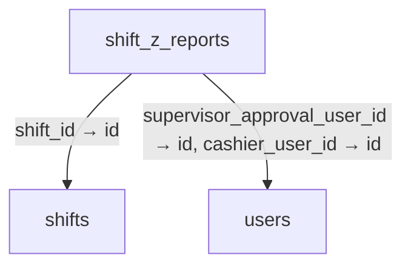
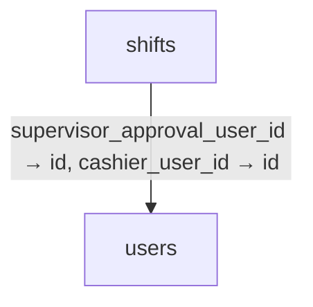
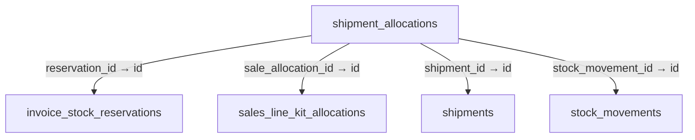
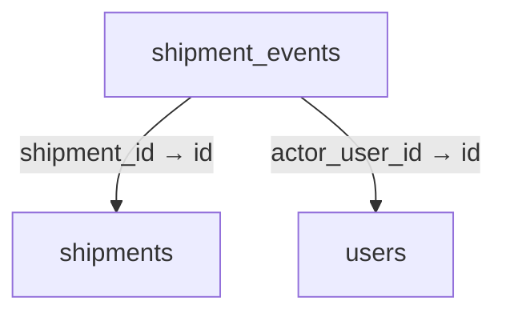
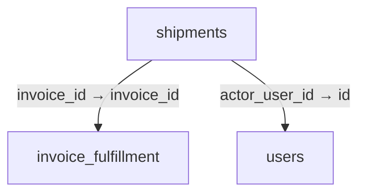
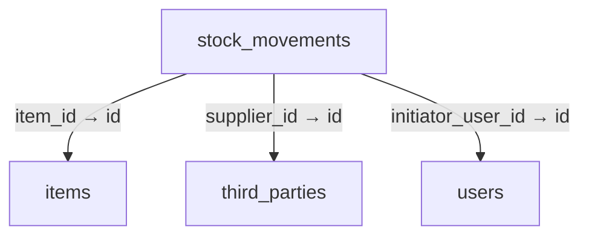
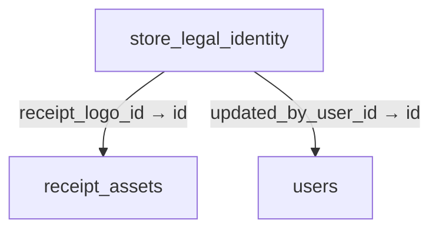
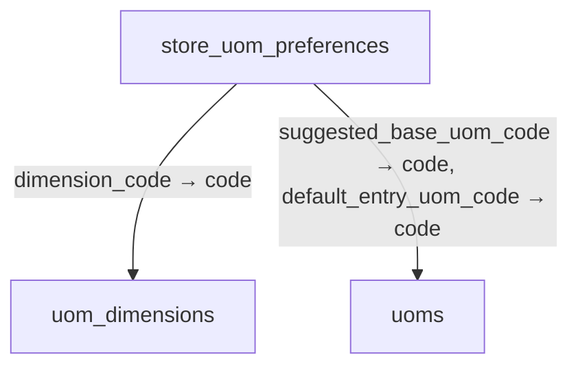
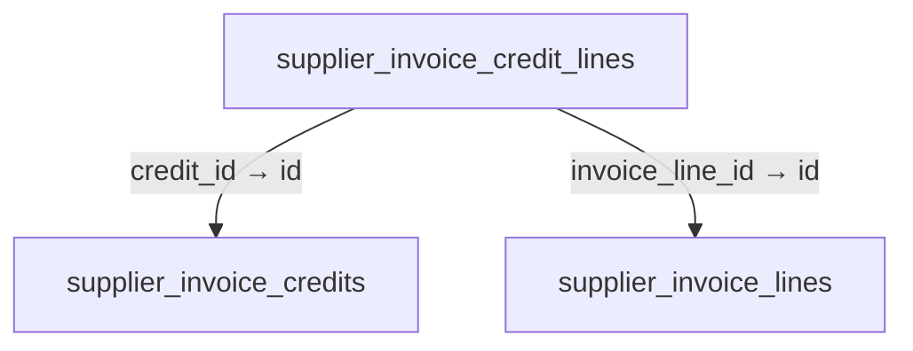
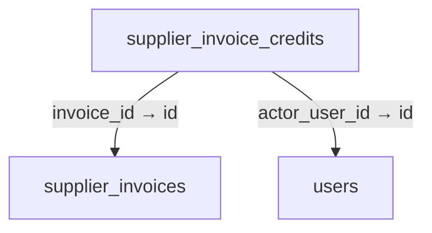

# Schema 10: shift_z_reports to supplier_invoice_credits

DRAFT · code snapshot 18 October 2026 · source review, not runtime acceptance

[Complete table index and reconstruction limits](schema.md). Arrows below are declared foreign keys, not inferred cardinalities.

## shift_z_reports {#shift-z-reports}

Relationship diagram

Columns and foreign-key policies

| Column | SQLite type | NOT NULL | Primary-key position |
| --- | --- | --- | --- |
| <code>id</code> | <code>TEXT</code> | False | 1 |
| <code>shift_id</code> | <code>TEXT</code> | True | — |
| <code>cashier_user_id</code> | <code>TEXT</code> | True | — |
| <code>started_at_utc</code> | <code>TEXT</code> | True | — |
| <code>ended_at_utc</code> | <code>TEXT</code> | True | — |
| <code>currency</code> | <code>TEXT</code> | True | — |
| <code>starting_float_minor</code> | <code>INTEGER</code> | True | — |
| <code>sales_count</code> | <code>INTEGER</code> | True | — |
| <code>gross_sales_minor</code> | <code>INTEGER</code> | True | — |
| <code>discounts_total_minor</code> | <code>INTEGER</code> | True | — |
| <code>taxes_total_minor</code> | <code>INTEGER</code> | True | — |
| <code>refunds_count</code> | <code>INTEGER</code> | True | — |
| <code>refunds_total_minor</code> | <code>INTEGER</code> | True | — |
| <code>net_sales_minor</code> | <code>INTEGER</code> | True | — |
| <code>tenders_json</code> | <code>TEXT</code> | True | — |
| <code>total_cash_inflow_minor</code> | <code>INTEGER</code> | True | — |
| <code>total_cash_outflow_minor</code> | <code>INTEGER</code> | True | — |
| <code>expected_cash_minor</code> | <code>INTEGER</code> | True | — |
| <code>actual_cash_minor</code> | <code>INTEGER</code> | True | — |
| <code>variance_minor</code> | <code>INTEGER</code> | True | — |
| <code>requires_supervisor_approval</code> | <code>INTEGER</code> | True | — |
| <code>supervisor_approval_user_id</code> | <code>TEXT</code> | False | — |
| <code>closing_notes</code> | <code>TEXT</code> | False | — |
| <code>created_at_utc</code> | <code>TEXT</code> | True | — |
| <code>service_charge_total_minor</code> | <code>INTEGER</code> | True | — |
| <code>cash_rounding_adjustment_minor</code> | <code>INTEGER</code> | True | — |
| <code>collection_tenders_json</code> | <code>TEXT</code> | True | — |
| <code>salary_expense_records_json</code> | <code>TEXT</code> | True | — |

| FK / sequence | Child column | Parent table / column | On update / delete |
| --- | --- | --- | --- |
| 0 / 0 | <code>supervisor_approval_user_id</code> | [users](schema-12.md#users) / <code>id</code> | NO ACTION / NO ACTION |
| 1 / 0 | <code>cashier_user_id</code> | [users](schema-12.md#users) / <code>id</code> | NO ACTION / NO ACTION |
| 2 / 0 | <code>shift_id</code> | [shifts](schema-10.md#shifts) / <code>id</code> | NO ACTION / NO ACTION |

## shifts {#shifts}

Relationship diagram

Columns and foreign-key policies

| Column | SQLite type | NOT NULL | Primary-key position |
| --- | --- | --- | --- |
| <code>id</code> | <code>TEXT</code> | False | 1 |
| <code>cashier_user_id</code> | <code>TEXT</code> | True | — |
| <code>starting_float_minor</code> | <code>INTEGER</code> | True | — |
| <code>currency</code> | <code>TEXT</code> | True | — |
| <code>expected_cash_minor</code> | <code>INTEGER</code> | False | — |
| <code>actual_cash_minor</code> | <code>INTEGER</code> | False | — |
| <code>variance_minor</code> | <code>INTEGER</code> | False | — |
| <code>supervisor_approval_user_id</code> | <code>TEXT</code> | False | — |
| <code>status</code> | <code>INTEGER</code> | True | — |
| <code>started_at_utc</code> | <code>TEXT</code> | True | — |
| <code>ended_at_utc</code> | <code>TEXT</code> | False | — |
| <code>closing_notes</code> | <code>TEXT</code> | False | — |
| <code>business_date</code> | <code>TEXT</code> | False | — |
| <code>currency_decimal_places_snapshot</code> | <code>INTEGER</code> | False | — |

| FK / sequence | Child column | Parent table / column | On update / delete |
| --- | --- | --- | --- |
| 0 / 0 | <code>supervisor_approval_user_id</code> | [users](schema-12.md#users) / <code>id</code> | NO ACTION / NO ACTION |
| 1 / 0 | <code>cashier_user_id</code> | [users](schema-12.md#users) / <code>id</code> | NO ACTION / NO ACTION |

## shipment_allocations {#shipment-allocations}

Relationship diagram

Columns and foreign-key policies

| Column | SQLite type | NOT NULL | Primary-key position |
| --- | --- | --- | --- |
| <code>id</code> | <code>TEXT</code> | False | 1 |
| <code>shipment_id</code> | <code>TEXT</code> | True | — |
| <code>reservation_id</code> | <code>TEXT</code> | True | — |
| <code>quantity_decimal</code> | <code>TEXT</code> | True | — |
| <code>stock_movement_id</code> | <code>TEXT</code> | True | — |
| <code>sale_allocation_id</code> | <code>TEXT</code> | True | — |

| FK / sequence | Child column | Parent table / column | On update / delete |
| --- | --- | --- | --- |
| 0 / 0 | <code>sale_allocation_id</code> | [sales_line_kit_allocations](schema-09.md#sales-line-kit-allocations) / <code>id</code> | NO ACTION / NO ACTION |
| 1 / 0 | <code>stock_movement_id</code> | [stock_movements](schema-10.md#stock-movements) / <code>id</code> | NO ACTION / NO ACTION |
| 2 / 0 | <code>reservation_id</code> | [invoice_stock_reservations](schema-03.md#invoice-stock-reservations) / <code>id</code> | NO ACTION / NO ACTION |
| 3 / 0 | <code>shipment_id</code> | [shipments](schema-10.md#shipments) / <code>id</code> | NO ACTION / NO ACTION |

## shipment_events {#shipment-events}

Relationship diagram

Columns and foreign-key policies

| Column | SQLite type | NOT NULL | Primary-key position |
| --- | --- | --- | --- |
| <code>id</code> | <code>TEXT</code> | False | 1 |
| <code>shipment_id</code> | <code>TEXT</code> | True | — |
| <code>event_kind</code> | <code>TEXT</code> | True | — |
| <code>details</code> | <code>TEXT</code> | True | — |
| <code>actor_user_id</code> | <code>TEXT</code> | True | — |
| <code>created_at_utc</code> | <code>TEXT</code> | True | — |

| FK / sequence | Child column | Parent table / column | On update / delete |
| --- | --- | --- | --- |
| 0 / 0 | <code>actor_user_id</code> | [users](schema-12.md#users) / <code>id</code> | NO ACTION / NO ACTION |
| 1 / 0 | <code>shipment_id</code> | [shipments](schema-10.md#shipments) / <code>id</code> | NO ACTION / NO ACTION |

## shipments {#shipments}

Relationship diagram

Columns and foreign-key policies

| Column | SQLite type | NOT NULL | Primary-key position |
| --- | --- | --- | --- |
| <code>id</code> | <code>TEXT</code> | False | 1 |
| <code>invoice_id</code> | <code>TEXT</code> | True | — |
| <code>carrier</code> | <code>TEXT</code> | True | — |
| <code>tracking_reference</code> | <code>TEXT</code> | True | — |
| <code>delivered_at_utc</code> | <code>TEXT</code> | False | — |
| <code>command_key</code> | <code>TEXT</code> | True | — |
| <code>actor_user_id</code> | <code>TEXT</code> | True | — |
| <code>reason</code> | <code>TEXT</code> | True | — |
| <code>created_at_utc</code> | <code>TEXT</code> | True | — |
| <code>revision</code> | <code>INTEGER</code> | True | — |

| FK / sequence | Child column | Parent table / column | On update / delete |
| --- | --- | --- | --- |
| 0 / 0 | <code>actor_user_id</code> | [users](schema-12.md#users) / <code>id</code> | NO ACTION / NO ACTION |
| 1 / 0 | <code>invoice_id</code> | [invoice_fulfillment](schema-03.md#invoice-fulfillment) / <code>invoice_id</code> | NO ACTION / NO ACTION |

## sign_in_lockout_state {#sign-in-lockout-state}

No outgoing foreign key declared in the reconstructed schema.

Columns and foreign-key policies

| Column | SQLite type | NOT NULL | Primary-key position |
| --- | --- | --- | --- |
| <code>scope_key</code> | <code>TEXT</code> | False | 1 |
| <code>failed_attempts</code> | <code>INTEGER</code> | True | — |
| <code>lockout_until_utc</code> | <code>TEXT</code> | False | — |
| <code>last_attempt_at_utc</code> | <code>TEXT</code> | True | — |
| <code>trusted_utc_high_water</code> | <code>TEXT</code> | False | — |

## stock_movements {#stock-movements}

Relationship diagram

Columns and foreign-key policies

| Column | SQLite type | NOT NULL | Primary-key position |
| --- | --- | --- | --- |
| <code>id</code> | <code>TEXT</code> | False | 1 |
| <code>item_id</code> | <code>TEXT</code> | True | — |
| <code>base_quantity</code> | <code>REAL</code> | True | — |
| <code>source_location</code> | <code>TEXT</code> | True | — |
| <code>destination_location</code> | <code>TEXT</code> | True | — |
| <code>movement_type</code> | <code>INTEGER</code> | True | — |
| <code>reference_type</code> | <code>TEXT</code> | True | — |
| <code>reference_id</code> | <code>TEXT</code> | True | — |
| <code>lot_id</code> | <code>TEXT</code> | False | — |
| <code>serial_number</code> | <code>TEXT</code> | False | — |
| <code>initiator_user_id</code> | <code>TEXT</code> | True | — |
| <code>reason</code> | <code>TEXT</code> | False | — |
| <code>created_at_utc</code> | <code>TEXT</code> | True | — |
| <code>entered_quantity</code> | <code>REAL</code> | False | — |
| <code>entered_unit_code</code> | <code>TEXT</code> | False | — |
| <code>conversion_factor</code> | <code>REAL</code> | True | — |
| <code>unit_cost_minor</code> | <code>INTEGER</code> | False | — |
| <code>supplier_id</code> | <code>TEXT</code> | False | — |
| <code>base_quantity_decimal</code> | <code>TEXT</code> | False | — |
| <code>entered_quantity_decimal</code> | <code>TEXT</code> | False | — |
| <code>conversion_factor_decimal</code> | <code>TEXT</code> | False | — |
| <code>unit_cost_minor_decimal</code> | <code>TEXT</code> | False | — |

| FK / sequence | Child column | Parent table / column | On update / delete |
| --- | --- | --- | --- |
| 0 / 0 | <code>supplier_id</code> | [third_parties](schema-11.md#third-parties) / <code>id</code> | NO ACTION / NO ACTION |
| 1 / 0 | <code>initiator_user_id</code> | [users](schema-12.md#users) / <code>id</code> | NO ACTION / NO ACTION |
| 2 / 0 | <code>item_id</code> | [items](schema-04.md#items) / <code>id</code> | NO ACTION / NO ACTION |

## store_config {#store-config}

No outgoing foreign key declared in the reconstructed schema.

Columns and foreign-key policies

| Column | SQLite type | NOT NULL | Primary-key position |
| --- | --- | --- | --- |
| <code>id</code> | <code>INTEGER</code> | False | 1 |
| <code>store_name</code> | <code>TEXT</code> | True | — |
| <code>currency_code</code> | <code>TEXT</code> | True | — |
| <code>currency_symbol</code> | <code>TEXT</code> | True | — |
| <code>decimal_places</code> | <code>INTEGER</code> | True | — |
| <code>tax_rate_percent</code> | <code>REAL</code> | True | — |
| <code>tax_mode</code> | <code>INTEGER</code> | True | — |
| <code>variance_approval_threshold_minor</code> | <code>INTEGER</code> | True | — |
| <code>daily_reset_time_utc</code> | <code>TEXT</code> | True | — |
| <code>updated_at_utc</code> | <code>TEXT</code> | True | — |
| <code>active_price_level_count</code> | <code>INTEGER</code> | True | — |
| <code>business_date</code> | <code>TEXT</code> | False | — |
| <code>timezone_iana</code> | <code>TEXT</code> | False | — |
| <code>cash_display_decimal_places</code> | <code>INTEGER</code> | True | — |
| <code>cash_rounding_mode</code> | <code>TEXT</code> | True | — |
| <code>cash_rounding_increment_minor</code> | <code>INTEGER</code> | True | — |
| <code>service_charge_enabled</code> | <code>INTEGER</code> | True | — |
| <code>service_charge_percent_decimal</code> | <code>TEXT</code> | True | — |
| <code>service_charge_profile_scope</code> | <code>TEXT</code> | True | — |
| <code>service_charge_basis</code> | <code>TEXT</code> | True | — |
| <code>service_charge_tax_mode</code> | <code>TEXT</code> | True | — |
| <code>financial_settings_version</code> | <code>INTEGER</code> | True | — |
| <code>enable_item_locations</code> | <code>INTEGER</code> | True | — |
| <code>auto_record_waste_as_expense</code> | <code>INTEGER</code> | True | — |

## store_legal_identity {#store-legal-identity}

Relationship diagram

Columns and foreign-key policies

| Column | SQLite type | NOT NULL | Primary-key position |
| --- | --- | --- | --- |
| <code>id</code> | <code>INTEGER</code> | False | 1 |
| <code>legal_name</code> | <code>TEXT</code> | True | — |
| <code>address</code> | <code>TEXT</code> | True | — |
| <code>phone</code> | <code>TEXT</code> | True | — |
| <code>tax_id</code> | <code>TEXT</code> | True | — |
| <code>receipt_logo_id</code> | <code>TEXT</code> | False | — |
| <code>updated_at_utc</code> | <code>TEXT</code> | True | — |
| <code>updated_by_user_id</code> | <code>TEXT</code> | False | — |

| FK / sequence | Child column | Parent table / column | On update / delete |
| --- | --- | --- | --- |
| 0 / 0 | <code>updated_by_user_id</code> | [users](schema-12.md#users) / <code>id</code> | NO ACTION / NO ACTION |
| 1 / 0 | <code>receipt_logo_id</code> | [receipt_assets](schema-07.md#receipt-assets) / <code>id</code> | NO ACTION / NO ACTION |

## store_uom_preferences {#store-uom-preferences}

Relationship diagram

Columns and foreign-key policies

| Column | SQLite type | NOT NULL | Primary-key position |
| --- | --- | --- | --- |
| <code>dimension_code</code> | <code>TEXT</code> | False | 1 |
| <code>default_entry_uom_code</code> | <code>TEXT</code> | True | — |
| <code>suggested_base_uom_code</code> | <code>TEXT</code> | True | — |
| <code>updated_at_utc</code> | <code>TEXT</code> | True | — |

| FK / sequence | Child column | Parent table / column | On update / delete |
| --- | --- | --- | --- |
| 0 / 0 | <code>suggested_base_uom_code</code> | [uoms](schema-11.md#uoms) / <code>code</code> | NO ACTION / NO ACTION |
| 1 / 0 | <code>default_entry_uom_code</code> | [uoms](schema-11.md#uoms) / <code>code</code> | NO ACTION / NO ACTION |
| 2 / 0 | <code>dimension_code</code> | [uom_dimensions](schema-11.md#uom-dimensions) / <code>code</code> | NO ACTION / NO ACTION |

## supplier_invoice_credit_lines {#supplier-invoice-credit-lines}

Relationship diagram

Columns and foreign-key policies

| Column | SQLite type | NOT NULL | Primary-key position |
| --- | --- | --- | --- |
| <code>id</code> | <code>TEXT</code> | False | 1 |
| <code>credit_id</code> | <code>TEXT</code> | True | — |
| <code>invoice_line_id</code> | <code>TEXT</code> | True | — |
| <code>quantity_decimal</code> | <code>TEXT</code> | True | — |
| <code>credit_minor</code> | <code>INTEGER</code> | True | — |

| FK / sequence | Child column | Parent table / column | On update / delete |
| --- | --- | --- | --- |
| 0 / 0 | <code>invoice_line_id</code> | [supplier_invoice_lines](schema-11.md#supplier-invoice-lines) / <code>id</code> | NO ACTION / NO ACTION |
| 1 / 0 | <code>credit_id</code> | [supplier_invoice_credits](schema-10.md#supplier-invoice-credits) / <code>id</code> | NO ACTION / NO ACTION |

## supplier_invoice_credits {#supplier-invoice-credits}

Relationship diagram

Columns and foreign-key policies

| Column | SQLite type | NOT NULL | Primary-key position |
| --- | --- | --- | --- |
| <code>id</code> | <code>TEXT</code> | False | 1 |
| <code>invoice_id</code> | <code>TEXT</code> | True | — |
| <code>credit_minor</code> | <code>INTEGER</code> | True | — |
| <code>command_key</code> | <code>TEXT</code> | True | — |
| <code>actor_user_id</code> | <code>TEXT</code> | True | — |
| <code>reason</code> | <code>TEXT</code> | True | — |
| <code>created_at_utc</code> | <code>TEXT</code> | True | — |

| FK / sequence | Child column | Parent table / column | On update / delete |
| --- | --- | --- | --- |
| 0 / 0 | <code>actor_user_id</code> | [users](schema-12.md#users) / <code>id</code> | NO ACTION / NO ACTION |
| 1 / 0 | <code>invoice_id</code> | [supplier_invoices](schema-11.md#supplier-invoices) / <code>id</code> | NO ACTION / NO ACTION |

