# Schema 11: supplier_invoice_lines to uoms

DRAFT · code snapshot 18 October 2026 · source review, not runtime acceptance

[Complete table index and reconstruction limits](schema.md). Arrows below are declared foreign keys, not inferred cardinalities.

## supplier_invoice_lines {#supplier-invoice-lines}

Relationship diagram

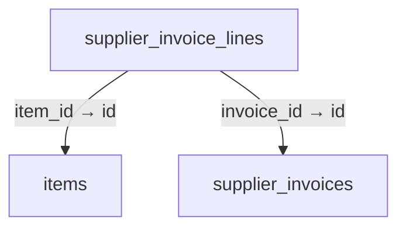

Columns and foreign-key policies

| Column | SQLite type | NOT NULL | Primary-key position |
| --- | --- | --- | --- |
| <code>id</code> | <code>TEXT</code> | False | 1 |
| <code>invoice_id</code> | <code>TEXT</code> | True | — |
| <code>item_id</code> | <code>TEXT</code> | True | — |
| <code>name_snapshot</code> | <code>TEXT</code> | True | — |
| <code>quantity_decimal</code> | <code>TEXT</code> | True | — |
| <code>unit_code</code> | <code>TEXT</code> | True | — |
| <code>conversion_factor_decimal</code> | <code>TEXT</code> | True | — |
| <code>unit_cost_minor</code> | <code>INTEGER</code> | True | — |
| <code>tax_rate_decimal</code> | <code>TEXT</code> | True | — |
| <code>tax_minor</code> | <code>INTEGER</code> | True | — |
| <code>discount_minor</code> | <code>INTEGER</code> | True | — |
| <code>total_minor</code> | <code>INTEGER</code> | True | — |

| FK / sequence | Child column | Parent table / column | On update / delete |
| --- | --- | --- | --- |
| 0 / 0 | <code>item_id</code> | [items](schema-04.md#items) / <code>id</code> | NO ACTION / NO ACTION |
| 1 / 0 | <code>invoice_id</code> | [supplier_invoices](schema-11.md#supplier-invoices) / <code>id</code> | NO ACTION / NO ACTION |

## supplier_invoices {#supplier-invoices}

Relationship diagram

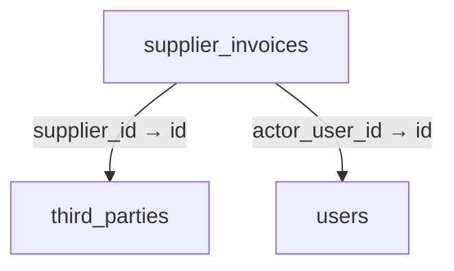

Columns and foreign-key policies

| Column | SQLite type | NOT NULL | Primary-key position |
| --- | --- | --- | --- |
| <code>id</code> | <code>TEXT</code> | False | 1 |
| <code>invoice_number</code> | <code>TEXT</code> | True | — |
| <code>supplier_id</code> | <code>TEXT</code> | True | — |
| <code>supplier_reference</code> | <code>TEXT</code> | True | — |
| <code>currency</code> | <code>TEXT</code> | True | — |
| <code>decimal_places</code> | <code>INTEGER</code> | True | — |
| <code>total_minor</code> | <code>INTEGER</code> | True | — |
| <code>due_date</code> | <code>TEXT</code> | False | — |
| <code>revision</code> | <code>INTEGER</code> | True | — |
| <code>received_complete</code> | <code>INTEGER</code> | True | — |
| <code>command_key</code> | <code>TEXT</code> | True | — |
| <code>actor_user_id</code> | <code>TEXT</code> | True | — |
| <code>created_at_utc</code> | <code>TEXT</code> | True | — |
| <code>supplier_name_snapshot</code> | <code>TEXT</code> | False | — |

| FK / sequence | Child column | Parent table / column | On update / delete |
| --- | --- | --- | --- |
| 0 / 0 | <code>actor_user_id</code> | [users](schema-12.md#users) / <code>id</code> | NO ACTION / NO ACTION |
| 1 / 0 | <code>supplier_id</code> | [third_parties](schema-11.md#third-parties) / <code>id</code> | NO ACTION / NO ACTION |

## supplier_payments {#supplier-payments}

Relationship diagram

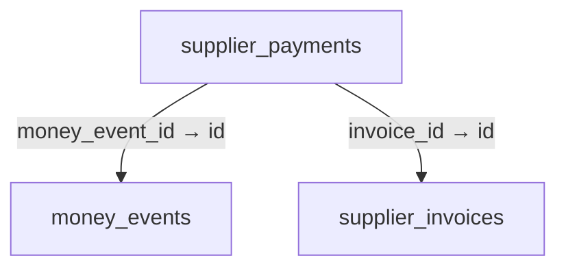

Columns and foreign-key policies

| Column | SQLite type | NOT NULL | Primary-key position |
| --- | --- | --- | --- |
| <code>id</code> | <code>TEXT</code> | False | 1 |
| <code>invoice_id</code> | <code>TEXT</code> | True | — |
| <code>money_event_id</code> | <code>TEXT</code> | True | — |
| <code>amount_minor</code> | <code>INTEGER</code> | True | — |
| <code>command_key</code> | <code>TEXT</code> | True | — |
| <code>created_at_utc</code> | <code>TEXT</code> | True | — |

| FK / sequence | Child column | Parent table / column | On update / delete |
| --- | --- | --- | --- |
| 0 / 0 | <code>money_event_id</code> | [money_events](schema-05.md#money-events) / <code>id</code> | NO ACTION / NO ACTION |
| 1 / 0 | <code>invoice_id</code> | [supplier_invoices](schema-11.md#supplier-invoices) / <code>id</code> | NO ACTION / NO ACTION |

## supplier_refunds {#supplier-refunds}

Relationship diagram

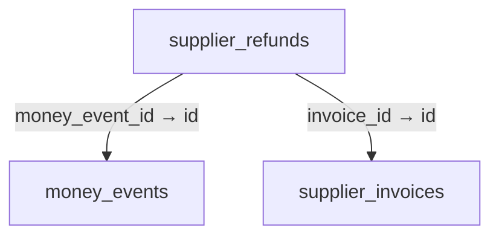

Columns and foreign-key policies

| Column | SQLite type | NOT NULL | Primary-key position |
| --- | --- | --- | --- |
| <code>id</code> | <code>TEXT</code> | False | 1 |
| <code>invoice_id</code> | <code>TEXT</code> | True | — |
| <code>money_event_id</code> | <code>TEXT</code> | True | — |
| <code>amount_minor</code> | <code>INTEGER</code> | True | — |
| <code>command_key</code> | <code>TEXT</code> | True | — |
| <code>created_at_utc</code> | <code>TEXT</code> | True | — |

| FK / sequence | Child column | Parent table / column | On update / delete |
| --- | --- | --- | --- |
| 0 / 0 | <code>money_event_id</code> | [money_events](schema-05.md#money-events) / <code>id</code> | NO ACTION / NO ACTION |
| 1 / 0 | <code>invoice_id</code> | [supplier_invoices](schema-11.md#supplier-invoices) / <code>id</code> | NO ACTION / NO ACTION |

## supplier_return_allocations {#supplier-return-allocations}

Relationship diagram

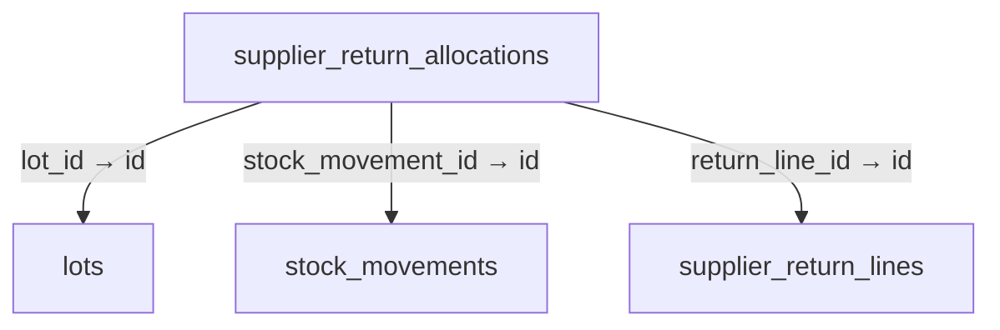

Columns and foreign-key policies

| Column | SQLite type | NOT NULL | Primary-key position |
| --- | --- | --- | --- |
| <code>id</code> | <code>TEXT</code> | False | 1 |
| <code>return_line_id</code> | <code>TEXT</code> | True | — |
| <code>lot_id</code> | <code>TEXT</code> | False | — |
| <code>serial_number</code> | <code>TEXT</code> | False | — |
| <code>base_quantity_decimal</code> | <code>TEXT</code> | True | — |
| <code>stock_movement_id</code> | <code>TEXT</code> | True | — |

| FK / sequence | Child column | Parent table / column | On update / delete |
| --- | --- | --- | --- |
| 0 / 0 | <code>stock_movement_id</code> | [stock_movements](schema-10.md#stock-movements) / <code>id</code> | NO ACTION / NO ACTION |
| 1 / 0 | <code>lot_id</code> | [lots](schema-04.md#lots) / <code>id</code> | NO ACTION / NO ACTION |
| 2 / 0 | <code>return_line_id</code> | [supplier_return_lines](schema-11.md#supplier-return-lines) / <code>id</code> | NO ACTION / NO ACTION |

## supplier_return_lines {#supplier-return-lines}

Relationship diagram

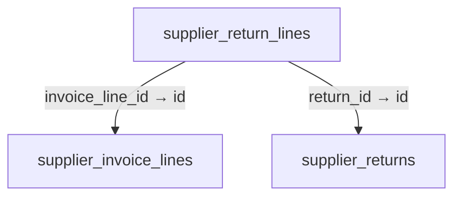

Columns and foreign-key policies

| Column | SQLite type | NOT NULL | Primary-key position |
| --- | --- | --- | --- |
| <code>id</code> | <code>TEXT</code> | False | 1 |
| <code>return_id</code> | <code>TEXT</code> | True | — |
| <code>invoice_line_id</code> | <code>TEXT</code> | True | — |
| <code>quantity_decimal</code> | <code>TEXT</code> | True | — |
| <code>credit_minor</code> | <code>INTEGER</code> | True | — |

| FK / sequence | Child column | Parent table / column | On update / delete |
| --- | --- | --- | --- |
| 0 / 0 | <code>invoice_line_id</code> | [supplier_invoice_lines](schema-11.md#supplier-invoice-lines) / <code>id</code> | NO ACTION / NO ACTION |
| 1 / 0 | <code>return_id</code> | [supplier_returns](schema-11.md#supplier-returns) / <code>id</code> | NO ACTION / NO ACTION |

## supplier_returns {#supplier-returns}

Relationship diagram

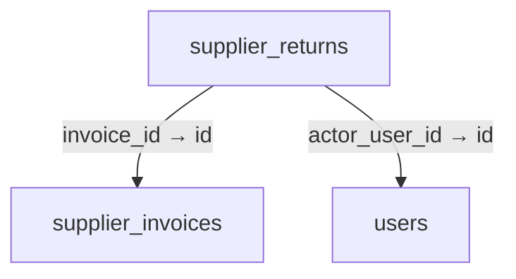

Columns and foreign-key policies

| Column | SQLite type | NOT NULL | Primary-key position |
| --- | --- | --- | --- |
| <code>id</code> | <code>TEXT</code> | False | 1 |
| <code>invoice_id</code> | <code>TEXT</code> | True | — |
| <code>credit_minor</code> | <code>INTEGER</code> | True | — |
| <code>carrier</code> | <code>TEXT</code> | True | — |
| <code>tracking_reference</code> | <code>TEXT</code> | True | — |
| <code>delivered_at_utc</code> | <code>TEXT</code> | False | — |
| <code>command_key</code> | <code>TEXT</code> | True | — |
| <code>actor_user_id</code> | <code>TEXT</code> | True | — |
| <code>reason</code> | <code>TEXT</code> | True | — |
| <code>created_at_utc</code> | <code>TEXT</code> | True | — |
| <code>revision</code> | <code>INTEGER</code> | True | — |

| FK / sequence | Child column | Parent table / column | On update / delete |
| --- | --- | --- | --- |
| 0 / 0 | <code>actor_user_id</code> | [users](schema-12.md#users) / <code>id</code> | NO ACTION / NO ACTION |
| 1 / 0 | <code>invoice_id</code> | [supplier_invoices](schema-11.md#supplier-invoices) / <code>id</code> | NO ACTION / NO ACTION |

## third_parties {#third-parties}

Relationship diagram

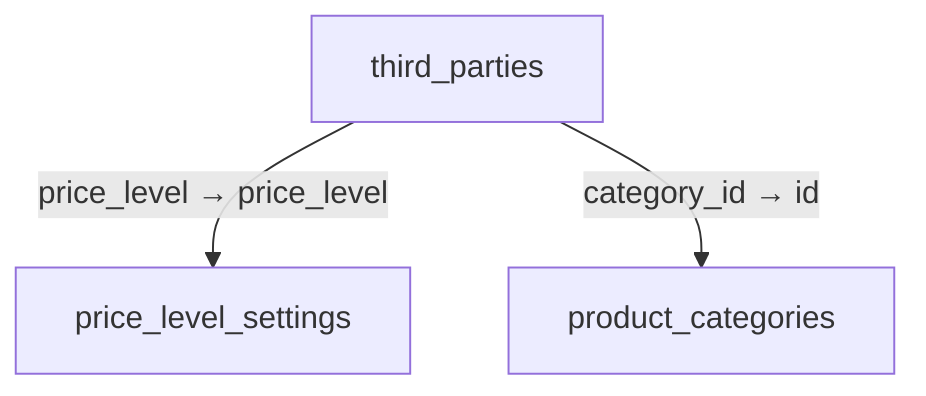

Columns and foreign-key policies

| Column | SQLite type | NOT NULL | Primary-key position |
| --- | --- | --- | --- |
| <code>id</code> | <code>TEXT</code> | False | 1 |
| <code>code</code> | <code>TEXT</code> | True | — |
| <code>name</code> | <code>TEXT</code> | True | — |
| <code>kind</code> | <code>TEXT</code> | True | — |
| <code>email</code> | <code>TEXT</code> | False | — |
| <code>tax_identifier</code> | <code>TEXT</code> | False | — |
| <code>phone_1</code> | <code>TEXT</code> | False | — |
| <code>phone_2</code> | <code>TEXT</code> | False | — |
| <code>phone_3</code> | <code>TEXT</code> | False | — |
| <code>phone_4</code> | <code>TEXT</code> | False | — |
| <code>line_id</code> | <code>TEXT</code> | False | — |
| <code>viber_id</code> | <code>TEXT</code> | False | — |
| <code>telegram_id</code> | <code>TEXT</code> | False | — |
| <code>address</code> | <code>TEXT</code> | False | — |
| <code>notes</code> | <code>TEXT</code> | False | — |
| <code>price_level</code> | <code>TEXT</code> | True | — |
| <code>alias_name</code> | <code>TEXT</code> | False | — |
| <code>state_code</code> | <code>TEXT</code> | False | — |
| <code>is_system_walk_in</code> | <code>INTEGER</code> | True | — |
| <code>is_active</code> | <code>INTEGER</code> | True | — |
| <code>created_at_utc</code> | <code>TEXT</code> | True | — |
| <code>updated_at_utc</code> | <code>TEXT</code> | True | — |
| <code>category_id</code> | <code>TEXT</code> | False | — |
| <code>barcode</code> | <code>TEXT</code> | False | — |

| FK / sequence | Child column | Parent table / column | On update / delete |
| --- | --- | --- | --- |
| 0 / 0 | <code>category_id</code> | [product_categories](schema-06.md#product-categories) / <code>id</code> | NO ACTION / NO ACTION |
| 1 / 0 | <code>price_level</code> | [price_level_settings](schema-05.md#price-level-settings) / <code>price_level</code> | NO ACTION / NO ACTION |

## third_party_external_mappings {#third-party-external-mappings}

Relationship diagram

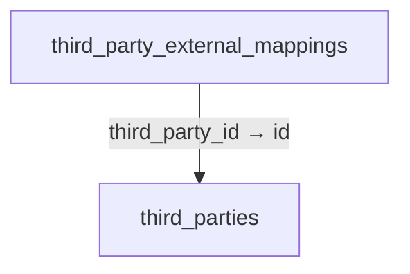

Columns and foreign-key policies

| Column | SQLite type | NOT NULL | Primary-key position |
| --- | --- | --- | --- |
| <code>source_system</code> | <code>TEXT</code> | True | 1 |
| <code>external_key</code> | <code>TEXT</code> | True | 2 |
| <code>third_party_id</code> | <code>TEXT</code> | True | — |
| <code>created_at_utc</code> | <code>TEXT</code> | True | — |
| <code>updated_at_utc</code> | <code>TEXT</code> | True | — |

| FK / sequence | Child column | Parent table / column | On update / delete |
| --- | --- | --- | --- |
| 0 / 0 | <code>third_party_id</code> | [third_parties](schema-11.md#third-parties) / <code>id</code> | NO ACTION / CASCADE |

## third_party_imports {#third-party-imports}

Relationship diagram

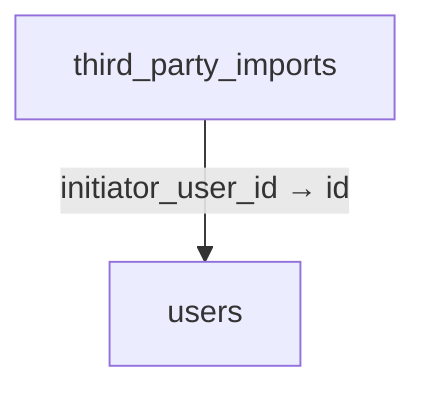

Columns and foreign-key policies

| Column | SQLite type | NOT NULL | Primary-key position |
| --- | --- | --- | --- |
| <code>id</code> | <code>TEXT</code> | False | 1 |
| <code>file_sha256</code> | <code>TEXT</code> | True | — |
| <code>file_name</code> | <code>TEXT</code> | True | — |
| <code>row_count</code> | <code>INTEGER</code> | True | — |
| <code>status</code> | <code>TEXT</code> | True | — |
| <code>created_count</code> | <code>INTEGER</code> | True | — |
| <code>updated_count</code> | <code>INTEGER</code> | True | — |
| <code>rejected_count</code> | <code>INTEGER</code> | True | — |
| <code>initiator_user_id</code> | <code>TEXT</code> | True | — |
| <code>created_at_utc</code> | <code>TEXT</code> | True | — |

| FK / sequence | Child column | Parent table / column | On update / delete |
| --- | --- | --- | --- |
| 0 / 0 | <code>initiator_user_id</code> | [users](schema-12.md#users) / <code>id</code> | NO ACTION / NO ACTION |

## uom_dimensions {#uom-dimensions}

Relationship diagram

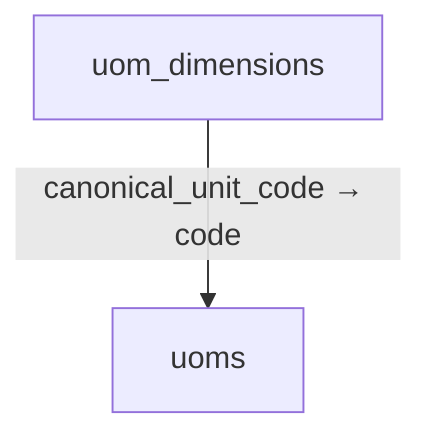

Columns and foreign-key policies

| Column | SQLite type | NOT NULL | Primary-key position |
| --- | --- | --- | --- |
| <code>code</code> | <code>TEXT</code> | False | 1 |
| <code>name</code> | <code>TEXT</code> | True | — |
| <code>canonical_unit_code</code> | <code>TEXT</code> | True | — |
| <code>is_active</code> | <code>INTEGER</code> | True | — |

| FK / sequence | Child column | Parent table / column | On update / delete |
| --- | --- | --- | --- |
| 0 / 0 | <code>canonical_unit_code</code> | [uoms](schema-11.md#uoms) / <code>code</code> | NO ACTION / NO ACTION |

## uoms {#uoms}

No outgoing foreign key declared in the reconstructed schema.

Columns and foreign-key policies

| Column | SQLite type | NOT NULL | Primary-key position |
| --- | --- | --- | --- |
| <code>code</code> | <code>TEXT</code> | False | 1 |
| <code>name</code> | <code>TEXT</code> | True | — |
| <code>conversion_factor</code> | <code>REAL</code> | True | — |
| <code>is_base_unit</code> | <code>INTEGER</code> | True | — |
| <code>dimension_code</code> | <code>TEXT</code> | False | — |
| <code>unit_kind</code> | <code>TEXT</code> | False | — |
| <code>display_group</code> | <code>TEXT</code> | False | — |
| <code>canonical_factor_decimal</code> | <code>TEXT</code> | False | — |
| <code>is_active</code> | <code>INTEGER</code> | True | — |
| <code>is_builtin</code> | <code>INTEGER</code> | True | — |
| <code>max_decimal_places</code> | <code>INTEGER</code> | True | — |
| <code>definition_note</code> | <code>TEXT</code> | False | — |

