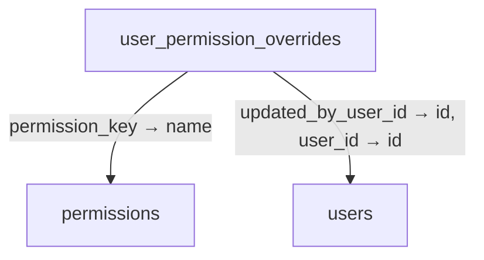
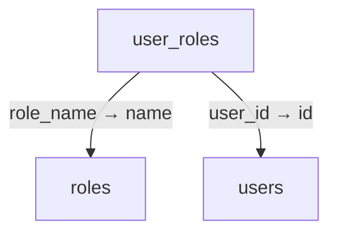
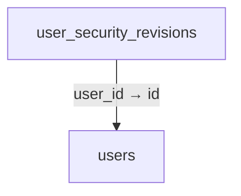
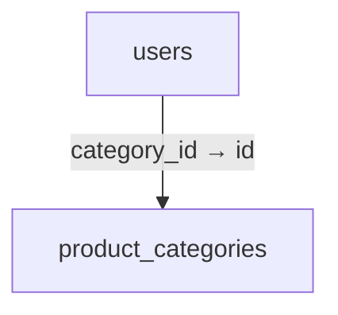

# Schema 12: user_permission_overrides to workspace_classification

DRAFT · code snapshot 20 October 2026 · source review and targeted automated checks

[Complete table index and reconstruction limits](schema.md). Arrows below are declared foreign keys, not inferred cardinalities.

## user_permission_overrides {#user-permission-overrides}

Relationship diagram

Columns and foreign-key policies

| Column | SQLite type | NOT NULL | Primary-key position |
| --- | --- | --- | --- |
| <code>user_id</code> | <code>TEXT</code> | True | 1 |
| <code>permission_key</code> | <code>TEXT</code> | True | 2 |
| <code>is_granted</code> | <code>INTEGER</code> | True | — |
| <code>updated_at_utc</code> | <code>TEXT</code> | True | — |
| <code>updated_by_user_id</code> | <code>TEXT</code> | True | — |

| FK / sequence | Child column | Parent table / column | On update / delete |
| --- | --- | --- | --- |
| 0 / 0 | <code>updated_by_user_id</code> | [users](schema-12.md#users) / <code>id</code> | NO ACTION / NO ACTION |
| 1 / 0 | <code>permission_key</code> | [permissions](schema-05.md#permissions) / <code>name</code> | NO ACTION / CASCADE |
| 2 / 0 | <code>user_id</code> | [users](schema-12.md#users) / <code>id</code> | NO ACTION / CASCADE |

## user_roles {#user-roles}

Relationship diagram

Columns and foreign-key policies

| Column | SQLite type | NOT NULL | Primary-key position |
| --- | --- | --- | --- |
| <code>user_id</code> | <code>TEXT</code> | True | 1 |
| <code>role_name</code> | <code>TEXT</code> | True | 2 |

| FK / sequence | Child column | Parent table / column | On update / delete |
| --- | --- | --- | --- |
| 0 / 0 | <code>role_name</code> | [roles](schema-08.md#roles) / <code>name</code> | NO ACTION / CASCADE |
| 1 / 0 | <code>user_id</code> | [users](schema-12.md#users) / <code>id</code> | NO ACTION / CASCADE |

## user_security_revisions {#user-security-revisions}

Relationship diagram

Columns and foreign-key policies

| Column | SQLite type | NOT NULL | Primary-key position |
| --- | --- | --- | --- |
| <code>user_id</code> | <code>TEXT</code> | False | 1 |
| <code>revision</code> | <code>INTEGER</code> | True | — |
| <code>updated_at_utc</code> | <code>TEXT</code> | True | — |

| FK / sequence | Child column | Parent table / column | On update / delete |
| --- | --- | --- | --- |
| 0 / 0 | <code>user_id</code> | [users](schema-12.md#users) / <code>id</code> | NO ACTION / CASCADE |

## users {#users}

Relationship diagram

Columns and foreign-key policies

| Column | SQLite type | NOT NULL | Primary-key position |
| --- | --- | --- | --- |
| <code>id</code> | <code>TEXT</code> | False | 1 |
| <code>username</code> | <code>TEXT</code> | True | — |
| <code>display_name</code> | <code>TEXT</code> | True | — |
| <code>quick_pin_hash</code> | <code>TEXT</code> | False | — |
| <code>is_active</code> | <code>INTEGER</code> | True | — |
| <code>created_at_utc</code> | <code>TEXT</code> | True | — |
| <code>last_login_at_utc</code> | <code>TEXT</code> | False | — |
| <code>category_id</code> | <code>TEXT</code> | False | — |

| FK / sequence | Child column | Parent table / column | On update / delete |
| --- | --- | --- | --- |
| 0 / 0 | <code>category_id</code> | [product_categories](schema-06.md#product-categories) / <code>id</code> | NO ACTION / NO ACTION |

## workspace_classification {#workspace-classification}

No outgoing foreign key declared in the reconstructed schema.

Columns and foreign-key policies

| Column | SQLite type | NOT NULL | Primary-key position |
| --- | --- | --- | --- |
| <code>id</code> | <code>INTEGER</code> | False | 1 |
| <code>environment</code> | <code>TEXT</code> | True | — |
| <code>marked_at_utc</code> | <code>TEXT</code> | True | — |

