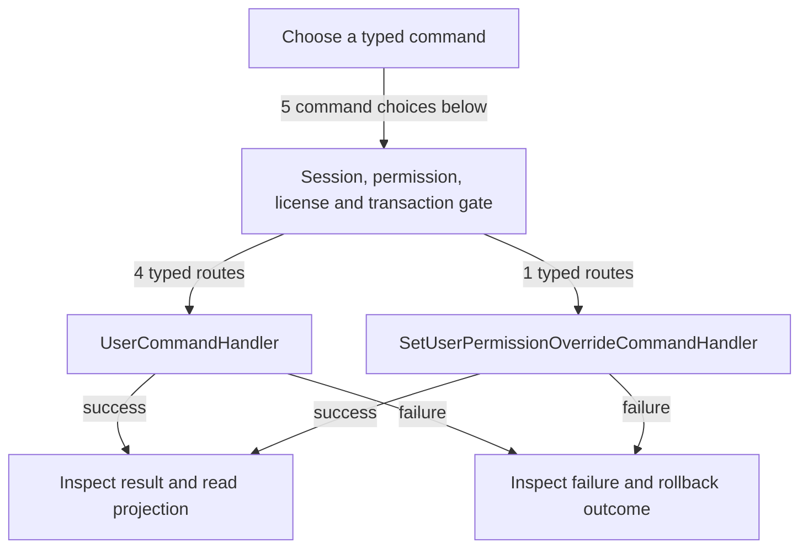

# Identity, access and first run

DRAFT · code snapshot 20 October 2026 · source review and targeted automated checks

Feature coverage: PP-F003. Source: [UserCommandHandler.cs:1](code-application.md#src-12dc7e3f2868), [SqliteSessionUnlockValidator.cs:1](code-infrastructure.md#src-a09def58afd6).

## Step-by-step review route

The numbered route is a business review checklist. Branches are separate actions; it does not imply that all actions occur in one transaction.

1. First run: provision the first administrator.
2. Otherwise select operator and authenticate PIN.
3. Apply lockout and session state.
4. Resolve live permissions for an action.
5. Run authorized command or deny.
6. Lock or expire session.

## Command routing map

This overview groups routes by handler to stay readable; each named command and its connections follow below. [Shared gate details](pipeline.md) apply when this handler is invoked through the pipeline. First-run provisioning is an explicit [separate path](access.md). Source construction sites show candidates, not proof of a connected or reachable UI path.

## Commands, options and implementation connections

### CreateUserCommand

Handler: [UserCommandHandler](code-application.md#src-12dc7e3f2868). Result type: <code>User</code>.

Declaration: [UserCommands.cs:26](code-application.md#src-2442f8313db3). <code>RequiredPermission = Permissions.ManageTeams</code>

Construction sites: **None found** among explicit `new Type(...)` expressions. Target-typed construction, factories and runtime dispatch are not resolved.

Handler method: [UserCommandHandler.HandleAsync(CreateUserCommand,CommandEnvelope&lt;CreateUserCommand&gt;,CancellationToken)](code-application.md#m-659137d5ea8e).

Same-owner helper candidates: [UserCommandHandler.IsValidRole(string,string)](code-application.md#m-4978232c8fe4), [UserCommandHandler.IsUserInRoleAsync(DbConnection,DbTransaction?,Guid,string,CancellationToken)](code-application.md#m-6dfb01dd06c6), [UserCommandHandler.IsValidPin(string)](code-application.md#m-8648b311bf10), [UserCommandHandler.AddParam(DbCommand,string,object?)](code-application.md#m-e25aed584719), [UserCommandHandler.EnsureDefaultRolesAndPermissionsAsync(DbConnection,DbTransaction?,CancellationToken)](code-application.md#m-508e00e19780), [UserCommandHandler.GetPermissionsForRole(string)](code-application.md#m-5ece0149cecb). These are unqualified/this-call name matches, including possible overloads; semantic binding was not performed.

| Direct method syntax | Extracted references |
| --- | --- |
| Reads | <code>users</code> |
| Writes / DDL | <code>user_roles</code>, <code>users</code> |
| Literal failure codes | <code>INVALID_DISPLAY_NAME</code>, <code>INVALID_QUICK_PIN</code>, <code>INVALID_ROLE</code>, <code>INVALID_USERNAME</code>, <code>PRIVILEGE_ESCALATION_DENIED</code>, <code>USERNAME_ALREADY_EXISTS</code> |

Helper calls, table references in helpers, and throw sites are listed in the method catalogue. This table is not a transitive effect analysis.

### CreateUserWithPersonCommand

Handler: [UserCommandHandler](code-application.md#src-12dc7e3f2868). Result type: <code>CreateUserWithPersonResult</code>.

Declaration: [CreateUserWithPersonCommand.cs:7](code-application.md#src-96eb7e988fa6). <code>RequiredPermission = Permissions.ManageTeams; AdditionalPermissions = [Permissions.SalaryManage]</code>

Construction sites: **None found** among explicit `new Type(...)` expressions. Target-typed construction, factories and runtime dispatch are not resolved.

Handler method: [UserCommandHandler.HandleAsync(CreateUserWithPersonCommand,CommandEnvelope&lt;CreateUserWithPersonCommand&gt;,CancellationToken)](code-application.md#m-227fa8a0bc5d).

Same-owner helper candidates: [UserCommandHandler.HasPermissionAsync(DbConnection,DbTransaction?,IPermissionResolver?,Guid,string,CancellationToken)](code-application.md#m-1c2e462024a0), [UserCommandHandler.IsValidRole(string,string)](code-application.md#m-4978232c8fe4), [UserCommandHandler.IsUserInRoleAsync(DbConnection,DbTransaction?,Guid,string,CancellationToken)](code-application.md#m-6dfb01dd06c6), [UserCommandHandler.IsValidPin(string)](code-application.md#m-8648b311bf10), [UserCommandHandler.AddParam(DbCommand,string,object?)](code-application.md#m-e25aed584719), [UserCommandHandler.GenerateUniquePersonCodeAsync(DbConnection,DbTransaction?,CancellationToken)](code-application.md#m-8769a42953c7), [UserCommandHandler.EnsureDefaultRolesAndPermissionsAsync(DbConnection,DbTransaction?,CancellationToken)](code-application.md#m-508e00e19780), [UserCommandHandler.GetPermissionsForRole(string)](code-application.md#m-5ece0149cecb). These are unqualified/this-call name matches, including possible overloads; semantic binding was not performed.

| Direct method syntax | Extracted references |
| --- | --- |
| Reads | <code>person_records</code>, <code>users</code> |
| Writes / DDL | <code>person_records</code>, <code>salary_agreements</code>, <code>user_roles</code>, <code>users</code> |
| Literal failure codes | <code>AUTH_UNAUTHORIZED</code>, <code>INVALID_DISPLAY_NAME</code>, <code>INVALID_EMPLOYMENT_DATES</code>, <code>INVALID_PAYROLL_MONTH</code>, <code>INVALID_PERSON_KIND</code>, <code>INVALID_QUICK_PIN</code>, <code>INVALID_ROLE</code>, <code>INVALID_SALARY_AMOUNT</code>, <code>INVALID_USERNAME</code>, <code>PERSON_CODE_ALREADY_EXISTS</code>, <code>PRIVILEGE_ESCALATION_DENIED</code>, <code>USERNAME_ALREADY_EXISTS</code> |

Helper calls, table references in helpers, and throw sites are listed in the method catalogue. This table is not a transitive effect analysis.

### ProvisionInitialAdminCommand

Handler: [UserCommandHandler](code-application.md#src-12dc7e3f2868). Result type: <code>User</code>.

Declaration: [UserCommands.cs:7](code-application.md#src-2442f8313db3). <code>RequiredPermission = string.Empty</code>

Construction sites: [RouteAsync:45](code-dataservice.md#src-46b520696446), [ProvisionInitialAdminAsync:8337](code-desktop.md#src-16497b924a99)

Handler method: [UserCommandHandler.HandleAsync(ProvisionInitialAdminCommand,CommandEnvelope&lt;ProvisionInitialAdminCommand&gt;,CancellationToken)](code-application.md#m-2ea4de08df45).

Same-owner helper candidates: [UserCommandHandler.IsValidPin(string)](code-application.md#m-8648b311bf10), [UserCommandHandler.EnsureDefaultRolesAndPermissionsAsync(DbConnection,DbTransaction?,CancellationToken)](code-application.md#m-508e00e19780), [UserCommandHandler.AddParam(DbCommand,string,object?)](code-application.md#m-e25aed584719), [UserCommandHandler.GetAllAdminPermissions()](code-application.md#m-e7ea0d1d59fd). These are unqualified/this-call name matches, including possible overloads; semantic binding was not performed.

| Direct method syntax | Extracted references |
| --- | --- |
| Reads | <code>users</code> |
| Writes / DDL | <code>user_roles</code>, <code>users</code> |
| Literal failure codes | <code>INVALID_DISPLAY_NAME</code>, <code>INVALID_QUICK_PIN</code>, <code>INVALID_USERNAME</code>, <code>SETUP_ALREADY_COMPLETED</code> |

Helper calls, table references in helpers, and throw sites are listed in the method catalogue. This table is not a transitive effect analysis.

### SetUserPermissionOverrideCommand

Handler: [SetUserPermissionOverrideCommandHandler](code-application.md#src-c7905080003f). Result type: <code>bool</code>.

Declaration: [SetUserPermissionOverrideCommands.cs:9](code-application.md#src-c7905080003f). <code>RequiredPermission = Permissions.ManagePermissions; RequiredModule = null</code>

Construction sites: [SetOverrideModeAsync:8611](code-desktop.md#src-16497b924a99)

Handler method: [SetUserPermissionOverrideCommandHandler.HandleAsync(SetUserPermissionOverrideCommand,CommandEnvelope&lt;SetUserPermissionOverrideCommand&gt;,CancellationToken)](code-application.md#m-9a1f02732077).

Same-owner helper candidates: [SetUserPermissionOverrideCommandHandler.AddParam(DbCommand,string,object)](code-application.md#m-4d4977103016). These are unqualified/this-call name matches, including possible overloads; semantic binding was not performed.

| Direct method syntax | Extracted references |
| --- | --- |
| Reads | <code>roles</code>, <code>user_permission_overrides</code>, <code>user_roles</code>, <code>users</code> |
| Writes / DDL | <code>user_permission_overrides</code>, <code>user_security_revisions</code> |
| Literal failure codes | <code>AUTH_UNAUTHORIZED</code>, <code>LAST_ADMIN_PROTECTION</code>, <code>PROTECTED_PERMISSION_DENIED</code>, <code>SELF_ESCALATION_DENIED</code> |

Helper calls, table references in helpers, and throw sites are listed in the method catalogue. This table is not a transitive effect analysis.

### UpdateUserQuickPinCommand

Handler: [UserCommandHandler](code-application.md#src-12dc7e3f2868). Result type: <code>bool</code>.

Declaration: [UserCommands.cs:51](code-application.md#src-2442f8313db3). <code>RequiredPermission = Permissions.ManageTeams</code>

Construction sites: [ConfirmChangePinAsync:8490](code-desktop.md#src-16497b924a99)

Handler method: [UserCommandHandler.HandleAsync(UpdateUserQuickPinCommand,CommandEnvelope&lt;UpdateUserQuickPinCommand&gt;,CancellationToken)](code-application.md#m-e4f8dbb4adb2).

Same-owner helper candidates: [UserCommandHandler.IsUserInRoleAsync(DbConnection,DbTransaction?,Guid,string,CancellationToken)](code-application.md#m-6dfb01dd06c6), [UserCommandHandler.AddParam(DbCommand,string,object?)](code-application.md#m-e25aed584719). These are unqualified/this-call name matches, including possible overloads; semantic binding was not performed.

| Direct method syntax | Extracted references |
| --- | --- |
| Reads | <code>users</code> |
| Writes / DDL | <code>sign_in_lockout_state</code>, <code>users</code> |
| Literal failure codes | <code>INVALID_QUICK_PIN</code>, <code>PRIVILEGE_ESCALATION_DENIED</code>, <code>USER_NOT_FOUND</code> |

Helper calls, table references in helpers, and throw sites are listed in the method catalogue. This table is not a transitive effect analysis.

## Verification still required

No application journey was executed for this map. Use a separate synthetic test environment to verify permission denial, valid success, invalid inputs, state conflicts, cancellation, transaction rollback, retry/idempotency and the resulting projection. Add physical-device checks only where the workflow dispatches output. Preserve original financial history when reviewing corrections or reversals.
