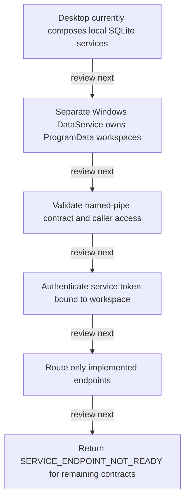

# Desktop and DataService boundaries

DRAFT · code snapshot 20 October 2026 · source review and targeted automated checks

Feature coverage: PP-F021. Source: [DataServiceComposition.cs:1](code-dataservice.md#src-a71687a05d71), [DataServiceRequestRouter.cs:1](code-dataservice.md#src-46b520696446).

## Step-by-step review route

The numbered route is a business review checklist. Branches are separate actions; it does not imply that all actions occur in one transaction.

1. Desktop currently composes local SQLite services.
2. Separate Windows DataService owns ProgramData workspaces.
3. Validate named-pipe contract and caller access.
4. Authenticate service token bound to workspace.
5. Route only implemented endpoints.
6. Return SERVICE_ENDPOINT_NOT_READY for remaining contracts.

## Lifecycle review map

This is a review route across the cited implementation, not a runtime trace captured from an executing application. [Runtime ownership](runtime.md) and the [source catalogues](index.md#source-catalogues) provide the actual composition evidence.

## Open review points

- [PP-REV-004: DataService contracts do not establish Desktop cutover](decisions.md#pp-rev-004) — implementation boundary / incomplete endpoints.
- [PP-REV-007: Recovery executable is a placeholder](decisions.md#pp-rev-007) — source-observed incomplete implementation.

## Verification still required

No application journey was executed for this map. Use a separate synthetic test environment to verify permission denial, valid success, invalid inputs, state conflicts, cancellation, transaction rollback, retry/idempotency and the resulting projection. Add physical-device checks only where the workflow dispatches output. Preserve original financial history when reviewing corrections or reversals.
