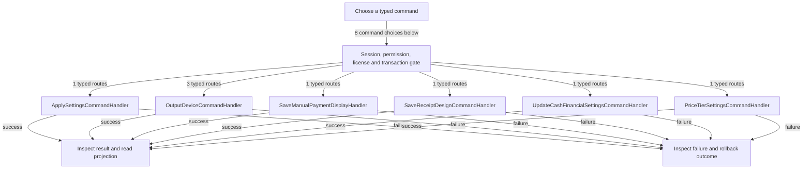

# Settings and output verification

DRAFT · code snapshot 20 October 2026 · source review and targeted automated checks

Feature coverage: PP-F018. Source: [ApplySettingsCommandHandler.cs:1](code-application.md#src-87133587a4b1), [OutputDeviceCommands.cs:1](code-application.md#src-bbf9d29f8bdc).

## Step-by-step review route

The numbered route is a business review checklist. Branches are separate actions; it does not imply that all actions occur in one transaction.

1. Choose store, financial, price-tier or output setting.
2. Validate permission and supported values.
3. Commit the specific configuration command.
4. Invalidate affected output capability when needed.
5. Spool a test and physically inspect thermal output.
6. Confirm physical output through the dedicated command.

## Command routing map

This overview groups routes by handler to stay readable; each named command and its connections follow below. [Shared gate details](pipeline.md) apply when this handler is invoked through the pipeline. First-run provisioning is an explicit [separate path](access.md). Source construction sites show candidates, not proof of a connected or reachable UI path.

## Commands, options and implementation connections

### ApplySettingsCommand

Handler: [ApplySettingsCommandHandler](code-application.md#src-87133587a4b1). Result type: <code>bool</code>.

Declaration: [ApplySettingsCommand.cs:5](code-application.md#src-a56b2ff06b35). <code>RequiredPermission = &quot;pos.system.settings&quot;</code>

Construction sites: [ApplySettingsAsync:7275](code-desktop.md#src-16497b924a99)

Handler method: [ApplySettingsCommandHandler.HandleAsync(ApplySettingsCommand,CommandEnvelope&lt;ApplySettingsCommand&gt;,CancellationToken)](code-application.md#m-0875a2f0acb6).

Same-owner helper candidates: [ApplySettingsCommandHandler.AddParam(System.Data.Common.DbCommand,string,object)](code-application.md#m-1f6cdbb379ee). These are unqualified/this-call name matches, including possible overloads; semantic binding was not performed.

| Direct method syntax | Extracted references |
| --- | --- |
| Reads | <code>business_profile_config</code>, <code>draft_carts</code>, <code>items</code>, <code>restaurant_orders</code>, <code>sales_invoices</code>, <code>shifts</code>, <code>stock_movements</code>, <code>store_config</code>, <code>user_roles</code>, <code>users</code> |
| Writes / DDL | <code>business_profile_config</code>, <code>store_config</code> |
| Literal failure codes | <code>AUTH_UNAUTHORIZED</code>, <code>INVALID_DECIMAL_PLACES</code>, <code>INVALID_PRICE_LEVEL_COUNT</code>, <code>INVALID_STORE_NAME</code>, <code>INVALID_TAX_RATE</code>, <code>MONETARY_IDENTITY_IN_USE</code>, <code>OPEN_WORK_EXISTS</code> |

Helper calls, table references in helpers, and throw sites are listed in the method catalogue. This table is not a transitive effect analysis.

### ConfirmThermalPhysicalOutputCommand

Handler: [OutputDeviceCommandHandler](code-application.md#src-bbf9d29f8bdc). Result type: <code>bool</code>.

Declaration: [OutputDeviceCommands.cs:27](code-application.md#src-bbf9d29f8bdc). <code>RequiredPermission = &quot;pos.system.settings&quot;</code>

Construction sites: [ConfirmThermalPrinterPhysicalOutputAsync:6857](code-desktop.md#src-16497b924a99)

Handler method: [OutputDeviceCommandHandler.HandleAsync(ConfirmThermalPhysicalOutputCommand,CommandEnvelope&lt;ConfirmThermalPhysicalOutputCommand&gt;,CancellationToken)](code-application.md#m-7dd40ed62d92).

Same-owner helper candidates: [OutputDeviceCommandHandler.ValidFingerprint(string)](code-application.md#m-87f72b5d6e9e), [OutputDeviceCommandHandler.Fail(string,string)](code-application.md#m-f074e9503d31), [OutputDeviceCommandHandler.IsActiveAdminAsync(Guid,CancellationToken)](code-application.md#m-36ab9b284c0d), [OutputDeviceCommandHandler.Add(System.Data.Common.DbCommand,string,object)](code-application.md#m-a7b11bf4e352). These are unqualified/this-call name matches, including possible overloads; semantic binding was not performed.

| Direct method syntax | Extracted references |
| --- | --- |
| Reads | None extracted directly; inspect helpers and dynamic paths. |
| Writes / DDL | <code>output_device_config</code> |
| Literal failure codes | None extracted directly; inspect helpers and dynamic paths. |

Helper calls, table references in helpers, and throw sites are listed in the method catalogue. This table is not a transitive effect analysis.

### RecordThermalTestSpoolAcceptedCommand

Handler: [OutputDeviceCommandHandler](code-application.md#src-bbf9d29f8bdc). Result type: <code>bool</code>.

Declaration: [OutputDeviceCommands.cs:22](code-application.md#src-bbf9d29f8bdc). <code>RequiredPermission = &quot;pos.system.settings&quot;</code>

Construction sites: [VerifyThermalPrinterAsync:6817](code-desktop.md#src-16497b924a99)

Handler method: [OutputDeviceCommandHandler.HandleAsync(RecordThermalTestSpoolAcceptedCommand,CommandEnvelope&lt;RecordThermalTestSpoolAcceptedCommand&gt;,CancellationToken)](code-application.md#m-9c80dc7d5eaf).

Same-owner helper candidates: [OutputDeviceCommandHandler.ValidFingerprint(string)](code-application.md#m-87f72b5d6e9e), [OutputDeviceCommandHandler.Fail(string,string)](code-application.md#m-f074e9503d31), [OutputDeviceCommandHandler.IsActiveAdminAsync(Guid,CancellationToken)](code-application.md#m-36ab9b284c0d), [OutputDeviceCommandHandler.Add(System.Data.Common.DbCommand,string,object)](code-application.md#m-a7b11bf4e352). These are unqualified/this-call name matches, including possible overloads; semantic binding was not performed.

| Direct method syntax | Extracted references |
| --- | --- |
| Reads | None extracted directly; inspect helpers and dynamic paths. |
| Writes / DDL | <code>output_device_config</code> |
| Literal failure codes | None extracted directly; inspect helpers and dynamic paths. |

Helper calls, table references in helpers, and throw sites are listed in the method catalogue. This table is not a transitive effect analysis.

### SaveManualPaymentDisplayCommand

Handler: [SaveManualPaymentDisplayHandler](code-infrastructure.md#src-9b4adc7a5d02). Result type: <code>bool</code>.

Declaration: [SaveManualPaymentDisplayCommand.cs:5](code-application.md#src-89b0251a9781). <code>RequiredPermission = &quot;pos.payments.configure&quot;</code>

Construction sites: [ApplyManualPaymentSettingsAsync:5619](code-desktop.md#src-16497b924a99)

Handler method: [SaveManualPaymentDisplayHandler.HandleAsync(SaveManualPaymentDisplayCommand,CommandEnvelope&lt;SaveManualPaymentDisplayCommand&gt;,CancellationToken)](code-infrastructure.md#m-711bf042b1db).

Same-owner helper candidates: [SaveManualPaymentDisplayHandler.Add(DbCommand,string,object)](code-infrastructure.md#m-99fb78c81996), [SaveManualPaymentDisplayHandler.ValidImage(byte[]?,string?)](code-infrastructure.md#m-82ec30f00b2c). These are unqualified/this-call name matches, including possible overloads; semantic binding was not performed.

| Direct method syntax | Extracted references |
| --- | --- |
| Reads | <code>user_roles</code>, <code>users</code> |
| Writes / DDL | <code>manual_payment_display</code> |
| Literal failure codes | <code>AUTH_UNAUTHORIZED</code>, <code>INVALID_PAYMENT_DETAILS</code>, <code>INVALID_PAYMENT_IMAGE</code> |

Helper calls, table references in helpers, and throw sites are listed in the method catalogue. This table is not a transitive effect analysis.

### SaveReceiptDesignCommand

Handler: [SaveReceiptDesignCommandHandler](code-application.md#src-c85e5e7f37c8). Result type: <code>long</code>.

Declaration: [ReceiptDesignCommands.cs:20](code-application.md#src-c85e5e7f37c8). <code>RequiredPermission = &quot;pos.system.settings&quot;</code>

Construction sites: [SaveReceiptDesignAsync:7004](code-desktop.md#src-16497b924a99)

Handler method: [SaveReceiptDesignCommandHandler.HandleAsync(SaveReceiptDesignCommand,CommandEnvelope&lt;SaveReceiptDesignCommand&gt;,CancellationToken)](code-application.md#m-9f50da09c2da).

Same-owner helper candidates: [SaveReceiptDesignCommandHandler.Add(System.Data.Common.DbCommand,string,object)](code-application.md#m-b77b924cf060). These are unqualified/this-call name matches, including possible overloads; semantic binding was not performed.

| Direct method syntax | Extracted references |
| --- | --- |
| Reads | <code>receipt_design_versions</code>, <code>receipt_designs</code>, <code>user_roles</code>, <code>users</code> |
| Writes / DDL | <code>receipt_design_versions</code>, <code>receipt_designs</code> |
| Literal failure codes | <code>ADMIN_REQUIRED</code>, <code>INVALID_RECEIPT_DESIGN</code>, <code>INVALID_RECEIPT_MEDIA_FAMILY</code>, <code>RECEIPT_DESIGN_REQUIRED</code> |

Helper calls, table references in helpers, and throw sites are listed in the method catalogue. This table is not a transitive effect analysis.

### UpdateCashFinancialSettingsCommand

Handler: [UpdateCashFinancialSettingsCommandHandler](code-application.md#src-dc0f9914df25). Result type: <code>CashFinancialSettings</code>.

Declaration: [CashFinancialSettingsCommands.cs:8](code-application.md#src-dc0f9914df25). <code>RequiredPermission = &quot;pos.system.settings&quot;</code>

Construction sites: [SaveCashFinancialSettingsAsync:6923](code-desktop.md#src-16497b924a99)

Handler method: [UpdateCashFinancialSettingsCommandHandler.HandleAsync(UpdateCashFinancialSettingsCommand,CommandEnvelope&lt;UpdateCashFinancialSettingsCommand&gt;,CancellationToken)](code-application.md#m-111036292e3c).

Same-owner helper candidates: [UpdateCashFinancialSettingsCommandHandler.Add(System.Data.Common.DbCommand,string,object)](code-application.md#m-faff6bce2618). These are unqualified/this-call name matches, including possible overloads; semantic binding was not performed.

| Direct method syntax | Extracted references |
| --- | --- |
| Reads | <code>draft_carts</code>, <code>restaurant_orders</code>, <code>store_config</code> |
| Writes / DDL | <code>store_config</code> |
| Literal failure codes | <code>CASH_DISPLAY_PRECISION_EXCEEDED</code>, <code>INVALID_CASH_DISPLAY_DECIMALS</code>, <code>INVALID_CASH_ROUNDING_INCREMENT</code>, <code>INVALID_CASH_ROUNDING_MODE</code>, <code>INVALID_CASH_ROUNDING_TIE_RULE</code>, <code>INVALID_SERVICE_CHARGE</code>, <code>INVALID_SERVICE_CHARGE_BASIS</code>, <code>INVALID_SERVICE_CHARGE_SCOPE</code>, <code>INVALID_SERVICE_CHARGE_TAX_MODE</code>, <code>OPEN_WORK_EXISTS</code> |

Helper calls, table references in helpers, and throw sites are listed in the method catalogue. This table is not a transitive effect analysis.

### UpdateOutputDeviceSettingsCommand

Handler: [OutputDeviceCommandHandler](code-application.md#src-bbf9d29f8bdc). Result type: <code>bool</code>.

Declaration: [OutputDeviceCommands.cs:7](code-application.md#src-bbf9d29f8bdc). <code>RequiredPermission = &quot;pos.system.settings&quot;</code>

Construction sites: [SaveOutputDevicesAsync:6742](code-desktop.md#src-16497b924a99), [VerifyThermalPrinterAsync:6804](code-desktop.md#src-16497b924a99)

Handler method: [OutputDeviceCommandHandler.HandleAsync(UpdateOutputDeviceSettingsCommand,CommandEnvelope&lt;UpdateOutputDeviceSettingsCommand&gt;,CancellationToken)](code-application.md#m-a04cc1af2dfe).

Same-owner helper candidates: [OutputDeviceCommandHandler.Fail(string,string)](code-application.md#m-f074e9503d31), [OutputDeviceCommandHandler.IsActiveAdminAsync(Guid,CancellationToken)](code-application.md#m-36ab9b284c0d), [OutputDeviceCommandHandler.Add(System.Data.Common.DbCommand,string,object)](code-application.md#m-a7b11bf4e352). These are unqualified/this-call name matches, including possible overloads; semantic binding was not performed.

| Direct method syntax | Extracted references |
| --- | --- |
| Reads | None extracted directly; inspect helpers and dynamic paths. |
| Writes / DDL | <code>output_device_config</code> |
| Literal failure codes | None extracted directly; inspect helpers and dynamic paths. |

Helper calls, table references in helpers, and throw sites are listed in the method catalogue. This table is not a transitive effect analysis.

### UpdatePriceTierSettingsCommand

Handler: [PriceTierSettingsCommandHandler](code-application.md#src-5251d2a718d0). Result type: <code>bool</code>.

Declaration: [PriceTierSettingsCommands.cs:24](code-application.md#src-96fee6b3d872). <code>RequiredPermission = &quot;pos.system.settings&quot;</code>

Construction sites: [SavePriceTierSettingsAsync:2094](code-desktop.md#src-974d69a1850f)

Handler method: [PriceTierSettingsCommandHandler.HandleAsync(UpdatePriceTierSettingsCommand,CommandEnvelope&lt;UpdatePriceTierSettingsCommand&gt;,CancellationToken)](code-application.md#m-2bbca65b6079).

Same-owner helper candidates: [PriceTierSettingsCommandHandler.AddParam(DbCommand,string,object)](code-application.md#m-31bfff363a35), [PriceTierSettingsCommandHandler.ReadTierStatesAsync(DbConnection,DbTransaction?,CancellationToken)](code-application.md#m-891875aacc7e), [PriceTierSettingsCommandHandler.RecordAffectedSystemTierItemsAsync(DbConnection,DbTransaction?,string,TierState,TierState,CommandEnvelope&lt;UpdatePriceTierSettingsCommand&gt;,CancellationToken)](code-application.md#m-855fbfc74b8b). These are unqualified/this-call name matches, including possible overloads; semantic binding was not performed.

| Direct method syntax | Extracted references |
| --- | --- |
| Reads | <code>user_roles</code>, <code>users</code> |
| Writes / DDL | <code>price_level_settings</code>, <code>store_config</code> |
| Literal failure codes | <code>AUTH_UNAUTHORIZED</code>, <code>INVALID_PRICE_LEVEL_COUNT</code>, <code>INVALID_TIER_WEIGHT</code> |

Helper calls, table references in helpers, and throw sites are listed in the method catalogue. This table is not a transitive effect analysis.

## Verification still required

No application journey was executed for this map. Use a separate synthetic test environment to verify permission denial, valid success, invalid inputs, state conflicts, cancellation, transaction rollback, retry/idempotency and the resulting projection. Add physical-device checks only where the workflow dispatches output. Preserve original financial history when reviewing corrections or reversals.
