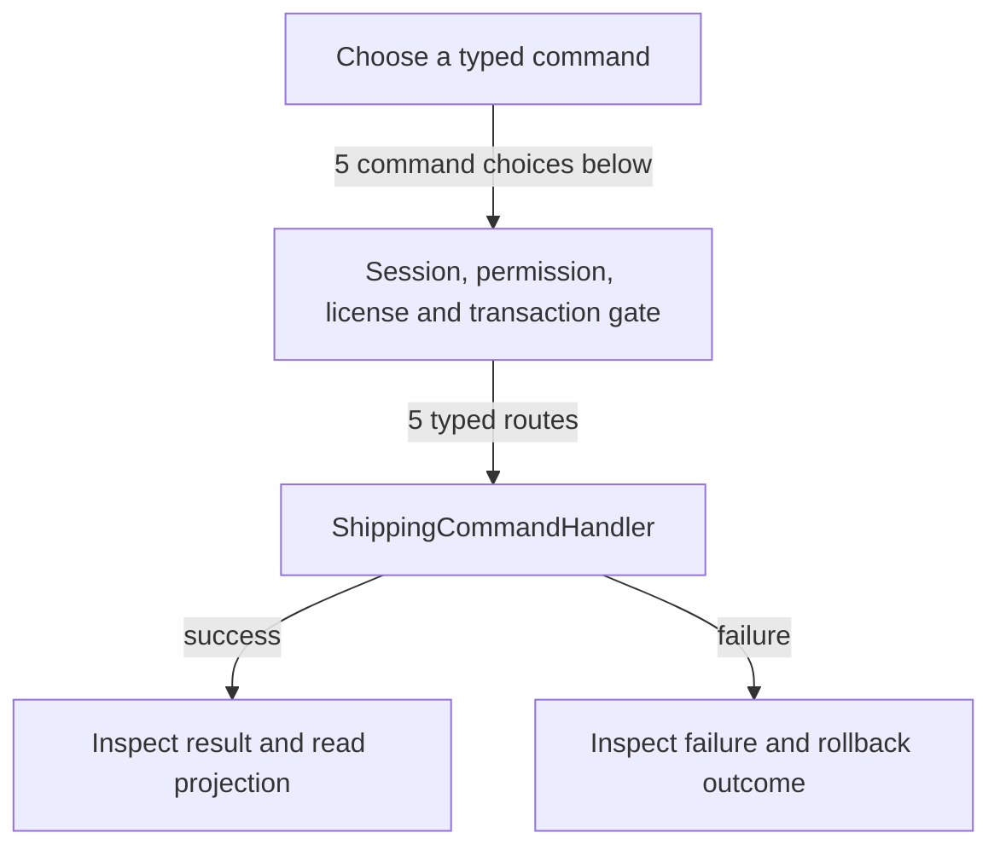

# Order drafts, reservations and shipping

DRAFT · code snapshot 20 October 2026 · source review and targeted automated checks

Feature coverage: PP-F024. Source: [ShippingCommands.cs:1](code-application.md#src-4772ecb3181e).

## Step-by-step review route

The numbered route is a business review checklist. Branches are separate actions; it does not imply that all actions occur in one transaction.

1. Save an order draft or replace reservation.
2. Validate available fulfillment and quantities.
3. Dispatch shipment.
4. Update tracking or confirm delivery.
5. Commit command-specific reservation and shipment state.
6. Read fulfillment history and outstanding quantity.

## Command routing map

This overview groups routes by handler to stay readable; each named command and its connections follow below. [Shared gate details](pipeline.md) apply when this handler is invoked through the pipeline. First-run provisioning is an explicit [separate path](access.md). Source construction sites show candidates, not proof of a connected or reachable UI path.

## Commands, options and implementation connections

### ConfirmShipmentDeliveryCommand

Handler: [ShippingCommandHandler](code-application.md#src-4772ecb3181e). Result type: <code>bool</code>.

Declaration: [ShippingCommands.cs:25](code-application.md#src-4772ecb3181e). <code>RequiredPermission = Permissions.UpdateShipping</code>

Construction sites: **None found** among explicit `new Type(...)` expressions. Target-typed construction, factories and runtime dispatch are not resolved.

Handler method: [ShippingCommandHandler.HandleAsync(ConfirmShipmentDeliveryCommand,CommandEnvelope&lt;ConfirmShipmentDeliveryCommand&gt;,CancellationToken)](code-application.md#m-ad068d3e8f16).

| Direct method syntax | Extracted references |
| --- | --- |
| Reads | None extracted directly; inspect helpers and dynamic paths. |
| Writes / DDL | <code>shipment_events</code>, <code>shipments</code> |
| Literal failure codes | <code>REASON_REQUIRED</code>, <code>SHIPMENT_STALE</code> |

Helper calls, table references in helpers, and throw sites are listed in the method catalogue. This table is not a transitive effect analysis.

### DispatchShipmentCommand

Handler: [ShippingCommandHandler](code-application.md#src-4772ecb3181e). Result type: <code>Guid</code>.

Declaration: [ShippingCommands.cs:20](code-application.md#src-4772ecb3181e). <code>RequiredPermission = Permissions.DispatchShipping</code>

Construction sites: **None found** among explicit `new Type(...)` expressions. Target-typed construction, factories and runtime dispatch are not resolved.

Handler method: [ShippingCommandHandler.HandleAsync(DispatchShipmentCommand,CommandEnvelope&lt;DispatchShipmentCommand&gt;,CancellationToken)](code-application.md#m-770a4dedaff2).

Same-owner helper candidates: [ShippingCommandHandler.Bad(string,string)](code-application.md#m-242c2be7fc9c). These are unqualified/this-call name matches, including possible overloads; semantic binding was not performed.

| Direct method syntax | Extracted references |
| --- | --- |
| Reads | <code>invoice_fulfillment</code>, <code>invoice_stock_reservations</code>, <code>items</code> |
| Writes / DDL | <code>invoice_fulfillment</code>, <code>invoice_stock_reservations</code>, <code>sales_line_kit_allocations</code>, <code>serials</code>, <code>shipment_allocations</code>, <code>shipments</code> |
| Literal failure codes | None extracted directly; inspect helpers and dynamic paths. |

Helper calls, table references in helpers, and throw sites are listed in the method catalogue. This table is not a transitive effect analysis.

### ReplaceInvoiceReservationCommand

Handler: [ShippingCommandHandler](code-application.md#src-4772ecb3181e). Result type: <code>bool</code>.

Declaration: [ShippingCommands.cs:33](code-application.md#src-4772ecb3181e). <code>RequiredPermission = Permissions.DispatchShipping</code>

Construction sites: **None found** among explicit `new Type(...)` expressions. Target-typed construction, factories and runtime dispatch are not resolved.

Handler method: [ShippingCommandHandler.HandleAsync(ReplaceInvoiceReservationCommand,CommandEnvelope&lt;ReplaceInvoiceReservationCommand&gt;,CancellationToken)](code-application.md#m-444be3598ac4).

| Direct method syntax | Extracted references |
| --- | --- |
| Reads | <code>invoice_fulfillment</code>, <code>invoice_stock_reservations</code>, <code>items</code>, <code>lots</code>, <code>pending_allocations</code>, <code>serials</code> |
| Writes / DDL | <code>invoice_fulfillment</code>, <code>invoice_stock_reservations</code> |
| Literal failure codes | <code>LOT_REQUIRED</code>, <code>LOT_UNAVAILABLE</code>, <code>NO_CHANGE</code>, <code>REASON_REQUIRED</code>, <code>RESERVATION_STALE</code>, <code>SERIAL_REQUIRED</code>, <code>SERIAL_UNAVAILABLE</code>, <code>SUBSTITUTION_NOT_NEEDED</code> |

Helper calls, table references in helpers, and throw sites are listed in the method catalogue. This table is not a transitive effect analysis.

### SaveOrderDraftCommand

Handler: [ShippingCommandHandler](code-application.md#src-4772ecb3181e). Result type: <code>Guid</code>.

Declaration: [ShippingCommands.cs:16](code-application.md#src-4772ecb3181e). <code>RequiredPermission = Permissions.IssueInvoice</code>

Construction sites: **None found** among explicit `new Type(...)` expressions. Target-typed construction, factories and runtime dispatch are not resolved.

Handler method: [ShippingCommandHandler.HandleAsync(SaveOrderDraftCommand,CommandEnvelope&lt;SaveOrderDraftCommand&gt;,CancellationToken)](code-application.md#m-5cc732b936bf).

Same-owner helper candidates: [ShippingCommandHandler.Bad(string,string)](code-application.md#m-242c2be7fc9c). These are unqualified/this-call name matches, including possible overloads; semantic binding was not performed.

| Direct method syntax | Extracted references |
| --- | --- |
| Reads | <code>draft_carts</code>, <code>items</code>, <code>lots</code>, <code>shifts</code>, <code>third_parties</code> |
| Writes / DDL | <code>draft_cart_lines</code>, <code>draft_carts</code>, <code>invoice_draft_options</code>, <code>pending_allocations</code> |
| Literal failure codes | None extracted directly; inspect helpers and dynamic paths. |

Helper calls, table references in helpers, and throw sites are listed in the method catalogue. This table is not a transitive effect analysis.

### UpdateShipmentTrackingCommand

Handler: [ShippingCommandHandler](code-application.md#src-4772ecb3181e). Result type: <code>bool</code>.

Declaration: [ShippingCommands.cs:30](code-application.md#src-4772ecb3181e). <code>RequiredPermission = Permissions.UpdateShipping</code>

Construction sites: **None found** among explicit `new Type(...)` expressions. Target-typed construction, factories and runtime dispatch are not resolved.

Handler method: [ShippingCommandHandler.HandleAsync(UpdateShipmentTrackingCommand,CommandEnvelope&lt;UpdateShipmentTrackingCommand&gt;,CancellationToken)](code-application.md#m-af9bb6bb7459).

| Direct method syntax | Extracted references |
| --- | --- |
| Reads | None extracted directly; inspect helpers and dynamic paths. |
| Writes / DDL | <code>commercial_shipping_events</code> |
| Literal failure codes | <code>REASON_REQUIRED</code>, <code>SHIPMENT_STALE</code> |

Helper calls, table references in helpers, and throw sites are listed in the method catalogue. This table is not a transitive effect analysis.

## Verification still required

No application journey was executed for this map. Use a separate synthetic test environment to verify permission denial, valid success, invalid inputs, state conflicts, cancellation, transaction rollback, retry/idempotency and the resulting projection. Add physical-device checks only where the workflow dispatches output. Preserve original financial history when reviewing corrections or reversals.
