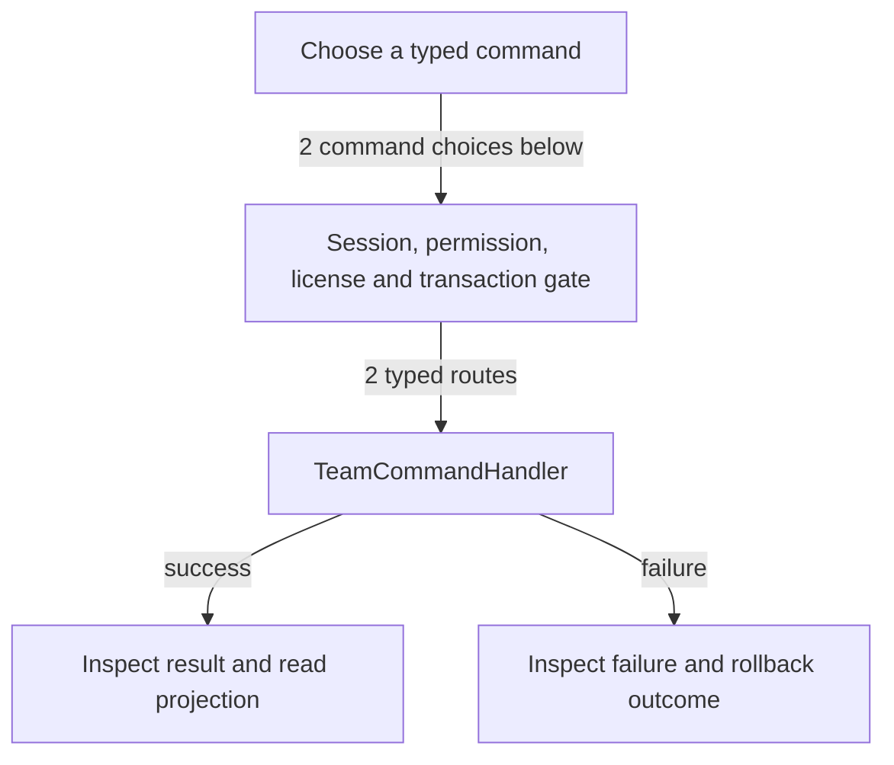

# Team membership and login access

DRAFT · code snapshot 18 October 2026 · source review, not runtime acceptance

Feature coverage: PP-F015. Source: [TeamCommandHandler.cs:1](code-application.md#src-691edb662577).

## Step-by-step review route

The numbered route is a business review checklist. Branches are separate actions; it does not imply that all actions occur in one transaction.

1. Choose person and team member.
2. Choose whether login is enabled.
3. Validate person, role and PIN rules.
4. Submit create or update command.
5. Commit related identity and membership records.
6. Reload staff and inspect effective access.

## Command routing map

This overview groups routes by handler to stay readable; each named command and its connections follow below. [Shared gate details](pipeline.md) apply when this handler is invoked through the pipeline. First-run provisioning is an explicit [separate path](access.md). Source construction sites show candidates, not proof of a connected or reachable UI path.

## Commands, options and implementation connections

### CreateTeamMemberCommand

Handler: [TeamCommandHandler](code-application.md#src-691edb662577). Result type: <code>CreateTeamMemberResult</code>.

Declaration: [TeamCommands.cs:7](code-application.md#src-c83e7d5dd8f2). <code>RequiredPermission = Permissions.ManageTeams; AdditionalPermissions = (Salary != null &amp;&amp; Salary.EnableSalary)             ? [Permissions.SalaryManage]             : []</code>

Construction sites: [SaveTeamMemberAsync:1794](code-desktop.md#src-45e93424b80f)

Handler method: [TeamCommandHandler.HandleAsync(CreateTeamMemberCommand,CommandEnvelope&lt;CreateTeamMemberCommand&gt;,CancellationToken)](code-application.md#m-2401aa2dbe1e).

Same-owner helper candidates: [TeamCommandHandler.HasPermissionAsync(DbConnection,DbTransaction?,Guid,string,CancellationToken)](code-application.md#m-389d98a83d85), [TeamCommandHandler.IsValidRole(string,string)](code-application.md#m-9dd3ab68c26f), [TeamCommandHandler.IsUserInRoleAsync(DbConnection,DbTransaction?,Guid,string,CancellationToken)](code-application.md#m-4e20a587e291), [TeamCommandHandler.IsValidPin(string)](code-application.md#m-e166b54b0176). These are unqualified/this-call name matches, including possible overloads; semantic binding was not performed.

| Direct method syntax | Extracted references |
| --- | --- |
| Reads | None extracted directly; inspect helpers and dynamic paths. |
| Writes / DDL | None extracted directly; inspect helpers and dynamic paths. |
| Literal failure codes | <code>AUTH_UNAUTHORIZED</code>, <code>INVALID_COMBINATION</code>, <code>INVALID_DECIMAL_PLACES</code>, <code>INVALID_DISPLAY_NAME</code>, <code>INVALID_EMPLOYMENT_DATES</code>, <code>INVALID_PAYROLL_MONTH</code>, <code>INVALID_PERSON_KIND</code>, <code>INVALID_QUICK_PIN</code>, <code>INVALID_ROLE</code>, <code>INVALID_SALARY_AMOUNT</code>, <code>INVALID_SALARY_DRAFT</code>, <code>INVALID_USERNAME</code>, <code>PERSON_CODE_ALREADY_EXISTS</code>, <code>PRIVILEGE_ESCALATION_DENIED</code>, <code>USERNAME_ALREADY_EXISTS</code>, <code>USER_ALREADY_LINKED</code>, <code>USER_NOT_FOUND</code> |

Helper calls, table references in helpers, and throw sites are listed in the method catalogue. This table is not a transitive effect analysis.

### UpdateTeamMemberCommand

Handler: [TeamCommandHandler](code-application.md#src-691edb662577). Result type: <code>UpdateTeamMemberResult</code>.

Declaration: [TeamCommands.cs:49](code-application.md#src-c83e7d5dd8f2). <code>RequiredPermission = (Person != null &#124;&#124; Login != null &#124;&#124; LinkExistingUserId.HasValue)             ? Permissions.ManageTeams             : Permissions.SalaryManage; AdditionalPermissions = ((Person != null &#124;&#124; Login != null &#124;&#124; LinkExistingUserId.HasValue) &amp;&amp; Salary != null)             ? [Permissions.SalaryManage]             : []</code>

Construction sites: [ToggleTeamMemberStatusAsync:984](code-desktop.md#src-45e93424b80f), [SaveTeamMemberAsync:1815](code-desktop.md#src-45e93424b80f)

Handler method: [TeamCommandHandler.HandleAsync(UpdateTeamMemberCommand,CommandEnvelope&lt;UpdateTeamMemberCommand&gt;,CancellationToken)](code-application.md#m-397002ae99a5).

Same-owner helper candidates: [TeamCommandHandler.HasPermissionAsync(DbConnection,DbTransaction?,Guid,string,CancellationToken)](code-application.md#m-389d98a83d85), [TeamCommandHandler.AddParam(DbCommand,string,object?)](code-application.md#m-65c47fa2f7ce), [TeamCommandHandler.GenerateUniquePersonCodeAsync(DbConnection,DbTransaction?,CancellationToken)](code-application.md#m-c6a8bd255da2), [TeamCommandHandler.IsValidRole(string,string)](code-application.md#m-9dd3ab68c26f), [TeamCommandHandler.IsUserInRoleAsync(DbConnection,DbTransaction?,Guid,string,CancellationToken)](code-application.md#m-4e20a587e291), [TeamCommandHandler.IsValidPin(string)](code-application.md#m-e166b54b0176). These are unqualified/this-call name matches, including possible overloads; semantic binding was not performed.

| Direct method syntax | Extracted references |
| --- | --- |
| Reads | <code>person_records</code>, <code>salary_agreements</code>, <code>salary_periods</code>, <code>users</code> |
| Writes / DDL | <code>person_records</code>, <code>users</code> |
| Literal failure codes | <code>AUTH_UNAUTHORIZED</code>, <code>CURRENCY_CHANGE_NOT_ALLOWED</code>, <code>INVALID_DECIMAL_PLACES</code>, <code>INVALID_DISPLAY_NAME</code>, <code>INVALID_EFFECTIVE_MONTH</code>, <code>INVALID_EMPLOYMENT_DATES</code>, <code>INVALID_PAYROLL_MONTH</code>, <code>INVALID_PERSON_KIND</code>, <code>INVALID_QUICK_PIN</code>, <code>INVALID_ROLE</code>, <code>INVALID_SALARY_AMOUNT</code>, <code>INVALID_SALARY_DRAFT</code>, <code>INVALID_USERNAME</code>, <code>LAST_ADMIN_PROTECTED</code>, <code>ON_SHIFT_CASHIER_PROTECTED</code>, <code>PERIOD_ALREADY_FINALIZED</code>, <code>PERSON_NOT_FOUND</code>, <code>PIN_REQUIRED</code>, <code>PRIVILEGE_ESCALATION_DENIED</code>, <code>STALE_REVISION</code>, <code>TRACKING_START_EXCLUDES_EXISTING_PAYROLL</code>, <code>USERNAME_ALREADY_EXISTS</code>, <code>USER_ALREADY_LINKED</code>, <code>USER_NOT_FOUND</code> |

Helper calls, table references in helpers, and throw sites are listed in the method catalogue. This table is not a transitive effect analysis.

## Verification still required

No application journey was executed for this map. Use a separate synthetic test environment to verify permission denial, valid success, invalid inputs, state conflicts, cancellation, transaction rollback, retry/idempotency and the resulting projection. Add physical-device checks only where the workflow dispatches output. Preserve original financial history when reviewing corrections or reversals.
