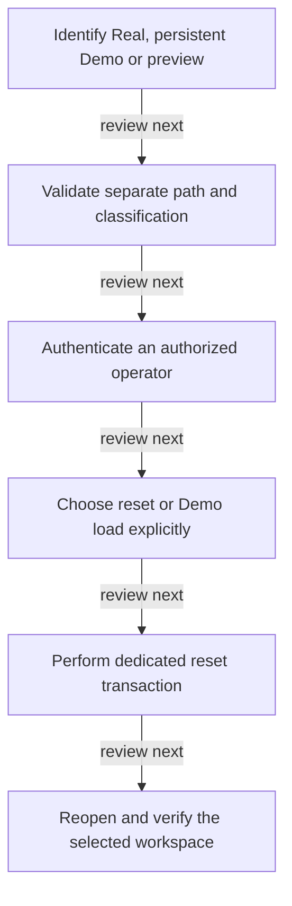

# Workspace isolation and reset

DRAFT · code snapshot 18 October 2026 · source review, not runtime acceptance

Feature coverage: PP-F002. Source: [PosBootstrapper.cs:1](code-desktop.md#src-d26211d90637), [SqliteRealWorkspaceResetService.cs:1](code-infrastructure.md#src-fd68b42fd4fb).

## Step-by-step review route

The numbered route is a business review checklist. Branches are separate actions; it does not imply that all actions occur in one transaction.

1. Identify Real, persistent Demo or preview.
2. Validate separate path and classification.
3. Authenticate an authorized operator.
4. Choose reset or Demo load explicitly.
5. Perform dedicated reset transaction.
6. Reopen and verify the selected workspace.

## Lifecycle review map

This is a review route across the cited implementation, not a runtime trace captured from an executing application. [Runtime ownership](runtime.md) and the [source catalogues](index.md#source-catalogues) provide the actual composition evidence.

## Open review points

- [PP-REV-001: Contradictory workspace flags select Demo implicitly](decisions.md#pp-rev-001) — source-observed behavior.

## Verification still required

No application journey was executed for this map. Use a separate synthetic test environment to verify permission denial, valid success, invalid inputs, state conflicts, cancellation, transaction rollback, retry/idempotency and the resulting projection. Add physical-device checks only where the workflow dispatches output. Preserve original financial history when reviewing corrections or reversals.
