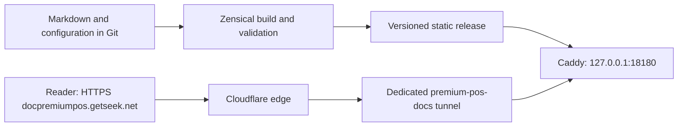

# Premium POS documentation site implementation plan

Date: **2026-10-18**, Asia/Bangkok.  
Public URL: **https://docpremiumpos.getseek.net/**.  
Requested stack: **Zensical + Markdown + Git + Caddy + Cloudflare Tunnel**.  
Status: **Discovery completed; implementation is planned below.**

## 1. Outcome and scope

Create a complete, searchable documentation site for the existing GetSeek / Premium POS application. Cover operators, shop administrators, developers, deployment, troubleshooting, and maintenance of the documentation itself. Base instructions on the current application and retain dated verification limits.

The existing working systems need separate ports. Give this documentation site its own Caddy process, named Cloudflare Tunnel, runtime directories, and startup tasks. Publish only the built documentation output.

Planning deliverables now live in the separate project at `F:\Premium_POS_docs`, including this plan and the project README. It did not initialize Git, install packages, edit application code, change the existing tunnel, register startup tasks, create DNS records, or publish the site.

## 2. Checked baseline

| Area | Finding | Effect on implementation |
| --- | --- | --- |
| Application | Windows desktop POS; .NET 10, Avalonia 11, SQLite. Eight application projects are listed in `Software/GetSeekPOS.sln`. | Document the desktop product and its separate DataService deployment accurately. |
| Source inventory | 431 `.cs`, `.axaml`, and `.sql` files under `Software/src`, excluding build outputs; 83 migration SQL files, ending at `083_ZReportSalaryExpensesAndWasteSettings.sql`. | Build documentation coverage from current source rather than historical feature promises. |
| Existing documentation | Root `README.md`, approximately 1.12 MB `GETSEEK_POS_COMPLETE_DOCUMENTATION.md`, 12 Markdown files across `docs` and `Software/docs`, and 27 files in `docs/screenshots`. | Reuse and reconcile existing material, then split it into task-oriented pages. |
| Documentation conflicts | The root document retains 1,203-test/open-audit wording; the Teams completeness audit claims repaired acceptance with 1,228 passing tests. Font-bundling statements also differ between documents. | Inspect referenced code, evidence, and dates before publishing a definitive status. No fresh application build or test suite was run in this planning pass. |
| Git | Neither `F:\Premium_POS` nor `Software` is currently a Git working tree. | Create a dedicated documentation repository without accidentally tracking the application's build outputs and operational files. |
| Site tooling | No existing Zensical configuration or Caddyfile was found in the project. Caddy is not in the current shell PATH and no Caddy process was observed. | Install/locate a separately versioned Caddy executable during implementation. |
| Existing ports | TCP ports 80, 8000, and 8001 are among the current listeners; 8000 and 8001 listen on loopback. | Use the new documentation ports below. |
| Existing tunnel | A `cloudflared.exe` process is running. `C:\Users\Jonas\.cloudflared\config.yml` contains `docrestaurant.getseek.net -> http://127.0.0.1:8001`, followed by an HTTP 404 catch-all. The process has no explicit `--config` argument. | Preserve the existing connector, configuration, hostname, and startup mechanism. Verify its effective startup configuration before deployment. |
| DNS | `docrestaurant.getseek.net` resolves. `docpremiumpos.getseek.net` returned “DNS name does not exist” from the host resolver. | Create the new hostname's tunnel DNS route during publication, after the local site passes verification. |

Host listener and Windows port-exclusion checks required host-level read access because sandboxed enumeration could not access CIM/service state. The successful host checks, rather than the empty sandboxed listener output, are the basis for this plan. Tunnel credential files were not opened or printed.

### Selected ports

| Purpose | Address | Verification on 2026-10-18 |
| --- | --- | --- |
| Caddy production origin | `127.0.0.1:18180` | No existing listener; outside IPv4/IPv6 TCP exclusion ranges; exclusive bind probe passed. |
| Local documentation preview | `127.0.0.1:18181` | Same checks passed. |
| Dedicated Caddy admin endpoint | `127.0.0.1:18182` | Same checks passed; avoids Caddy's normal admin-port collision. |
| Dedicated cloudflared metrics | `127.0.0.1:18183` | Same checks passed; keeps the connector metrics listener separate. |

All bind probes immediately released their listeners. Recheck these ports immediately before starting the new processes; a check does not reserve a port. Visitors use normal HTTPS at the public hostname without a port suffix.

## 3. Architecture



Zensical produces static files; its development server is for local preview. Caddy serves the generated release directory. Cloudflare provides public HTTPS and forwards through the outbound tunnel to the loopback HTTP origin. This follows the documented [Zensical build workflow](https://zensical.org/docs/usage/build/), [Caddy static-file serving](https://caddyserver.com/docs/quick-starts/static-files), and [Cloudflare hostname-to-origin ingress configuration](https://developers.cloudflare.com/tunnel/features/locally-managed-tunnels/configuration-file/).

Use an explicit HTTP Caddy listener on port 18180 with loopback binding. This design does not require Caddy to obtain a public certificate or bind ports 80/443. The tunnel and Caddy should run on the same Windows host for the loopback origin to work.

Prefer a new named tunnel, `premium-pos-docs`, with its own configuration and UUID credential file. Account authentication, if usable, can create this tunnel; runtime credentials belong to the new tunnel. Verify account/zone permissions rather than assuming an existing certificate grants them.

## 4. Source, Git, and runtime layout

Use `F:\Premium_POS_docs` as the standalone documentation project root, separate from `F:\Premium_POS`. All baseline references to the existing application's `Software`, `docs`, and root guides refer to `F:\Premium_POS`; they are review inputs, not build-time dependencies of the documentation site.

The documentation repository, Python environment, Markdown, assets, scripts, and deployment templates all belong in this separate root:

```text
Premium_POS_docs/
  README.md                    # maintainers' setup and publishing entry point
  .gitignore
  .gitattributes
  requirements.in             # selected direct build dependency
  requirements.lock           # pinned build environment and resolved dependencies
  plans/                       # implementation plan and later execution notes
  zensical.toml
  docs/
    index.md
    getting-started/
    operator/
    administration/
    reference/
    development/
    operations/
    contributing/
    release-notes/
    assets/                    # approved, sanitized images and local assets
  scripts/
    Check-Environment.ps1
    Preview-Docs.ps1
    Build-Docs.ps1
    Validate-Docs.ps1
    Publish-Docs.ps1
    Rollback-Docs.ps1
  deployment/
    Caddyfile.example
    cloudflared.example.yml
    startup/                   # uniquely named task templates and lifecycle scripts
  maintenance/
    content-inventory.md
    coverage-matrix.md
    evidence-register.md
    private-review/            # excluded from Git and publication when needed
```

Use a dedicated Python virtual environment and a tested, pinned Zensical version. Verify the actual Python interpreter; the `python` command currently resolves through `C:\Windows\system32\python`, which is not proof of a working package environment. The official [installation guidance](https://zensical.org/docs/get-started/) recommends a virtual environment.

Initialize Git only inside `F:\Premium_POS_docs`. This is a separate repository, not a child repository under the application folder. Track Markdown, approved assets, configuration, dependency locks, validation scripts, and deployment templates. Ignore `.venv`, build output, cache, logs, private review material, local configuration, credentials, and release directories. Configure UTF-8 and consistent line endings. Create local reviewable commits when implementation is ready; configure a remote only after a real destination is known.

Keep a source-document-to-page mapping in `maintenance/content-inventory.md`. Existing application guides remain preserved as source records during migration. Public pages must not depend on file links outside `F:\Premium_POS_docs\docs`. Copy approved content and assets into the documentation project; do not use symlinks or runtime imports from `F:\Premium_POS`. Once content migration is complete, building and serving the documentation must work without access to the application folder.

Use a host-local runtime directory such as `C:\ProgramData\GetSeekDocs\PremiumPos` for immutable releases, active configuration, deployment manifests, and logs. Store new tunnel credentials outside Git with access limited to the runtime identity and administrators. Confirm the Windows runtime identity and ACLs during setup. A boot-time server should not depend on an interactive user's mounted/synchronized `F:` drive; source can stay on `F:` while deployed files live on the system disk.

## 5. Documentation coverage

English is the initial authoring language. Document the product's English, Thai, and Myanmar Unicode behavior. A claim of translated website coverage requires actual translated pages and validation; product UI localization alone does not provide translated documentation.

| Section | Required content |
| --- | --- |
| Home and getting started | Product scope, audience routes, system requirements, first launch, first administrator, sign-in/lock, store setup, Real Shop versus persistent Demo, first safe demo sale, navigation and terminology. |
| Checkout and daily operation | Product search/scanning, cart and units, customers, pricing/discounts/tax, cash/QR/bank review, pay later, invoices and registers, partial/full payment, returns/refunds, shipping, order/table workflows where implemented, receipt access and reprints. |
| Cash and reporting | Drawer shifts, cash movements, bank/commercial accounts, opening and blind closing, discrepancies and required authority, X/Z reports, frozen report behavior, reporting dates/timezones, exports. |
| Inventory and pricing | Categories, item purposes, warehouses/bins, physical units and item package conversions, Standard/Lot/Serial policies, intake and adjustments, lots/expiry/serials, stock history, waste/loss, price tiers and history, virtual kits, import/export validation. |
| Recipes and production | Kit versus BOM distinctions, recipe versions, drafts, ingredient allocation, input/output lots, multi-day production where supported, completion/cancellation, valuation and pricing relationships, traceability limits. |
| Third parties, Teams, salary, expenses | Customers/suppliers, protected Walk-in records, import errors and duplicate handling, accounts/roles/permissions, people and agreements, employment/eligibility dates, salary forecasts/advances/finalization/reversals, record-only expenses, partial/full payments, categories, photos, waste links and Z-report lines. |
| Administration and hardware | Company/store settings, currency and decimal policy, timezone, tax/service charge/rounding, language/theme, permissions, receipt design/assets, printer queues and drivers, test printing, cutter/drawer settings, output queue recovery and limitations. |
| Data and support | Real/Demo paths and isolation, safe stopped-writer data transfer, computer migration, existing backup/recovery capabilities and limits, selective reset dependencies, diagnostics/error history, sanitized support evidence, troubleshooting by symptom. |
| Developer guide | Solution/project map, .NET SDK selection, restore/build/run/test commands, command/query boundaries, transaction/idempotency flow, financial and stock invariants, migrations 001–083 as verified, money/UOM policies, SQLite/WAL, shared Avalonia components, localization, imports/exports and output jobs. |
| Deployment and operations | Source versus self-contained app deployment, DataService versus desktop storage, documentation stack setup, ports/processes, Git workflow, Zensical builds, Caddy, tunnel/DNS, startup persistence, logs/health, updates, rollback, machine replacement, outage recovery. |
| Reference and status | Glossary, permissions matrix, supported configuration, stable error codes, command/query reference where useful, schema/module map, dated feature status, known limitations, release notes, verification evidence categories. |

For every operator task, explain purpose, prerequisites/permissions, numbered steps, expected result, errors/recovery, and applicable Real/Demo differences. Include sanitized screenshots where they materially clarify the task. Developer pages should link behavior to source paths and tested examples without implying a public code repository exists.

## 6. Content migration and verification rules

1. Inventory existing guides, archive blocks, screenshots, source modules, tests, and referenced evidence. Record each intended page and its source.
2. Establish current behavior from relevant startup code, view models, commands/queries, migration registration, and focused evidence. Separate implementation, automated verification, manual verification, and physical-device verification.
3. Resolve conflicting test totals, acceptance claims, font packaging, stale SDK blockers, old terminal provisioning, DataService integration, and backup/reset promises. Record unresolved items honestly rather than choosing the most optimistic document.
4. Rewrite into focused pages with stable slugs and relative Markdown links. Retain source dates; do not present archived plans as delivered features.
5. Inspect existing screenshots before reuse. Capture new images only from synthetic/disposable Demo data without touching real shop operations. Remove personal data, PINs, credentials, real receipts, and confidential salary/expense details.
6. Keep internal audits, raw TRX/log files, private review notes, and superseded specifications outside the publishable `docs` tree. Hiding a page from navigation does not prevent publication or search indexing; [Zensical explicitly distinguishes navigation omission from build exclusion](https://zensical.org/docs/setup/basics/#not_in_nav).
7. Maintain a coverage matrix: module/workflow, page, source evidence, verification date, remaining limitation. No unexplained empty topics or “coming soon” pages in the initial release.

No operational databases, active POS processes, live stock, payment records, or printer queues need to be changed to author this site. Application fixes discovered during documentation should be recorded separately from the site implementation.

## 7. Zensical site setup

- Set `site_name` to `Premium POS Documentation` and `site_url` to `https://docpremiumpos.getseek.net/`.
- Use `docs` as the only publishable content root and a separate generated output directory. Set the preview address to `127.0.0.1:18181`.
- Configure clear navigation, full-text search, page tables of contents, breadcrumbs where supported, light/dark appearance, readable tables, code blocks, callouts, and diagrams.
- Use the installed version's supported configuration for navigation, validation, Markdown extensions, and search. Confirm flags against its help output; run `zensical build --strict` as the build gate.
- Prefer local assets and fonts where practical. Check English, Thai, and Myanmar samples on the built site. Retain required font/image licenses.
- Add a useful 404 page, sitemap/canonical URL checks, and redirects for migrated public URLs if any are identified. Do not enable an offline cache/service worker by default.
- Show a real source/review date and status where useful. Add repository/edit links only when the actual Git remote and access model are known.

## 8. Deployment configuration

The initial Caddy template should express this structure; replace `RELEASE_ID` with the validated deployed release directory:

```caddyfile
{
    admin 127.0.0.1:18182
}

http://:18180 {
    bind 127.0.0.1
    root * "C:/ProgramData/GetSeekDocs/PremiumPos/releases/RELEASE_ID"
    encode zstd gzip
    header X-Content-Type-Options nosniff
    file_server
}
```

Configure bounded access-log retention, correct cache behavior for HTML/assets, and a tested 404 handler in the final configuration. Use Caddy's [loopback binding directive](https://caddyserver.com/docs/caddyfile/directives/bind) and [static-file handler](https://caddyserver.com/docs/caddyfile/directives/file_server). Restrict the serving root to generated files.

The dedicated tunnel template should contain:

```yaml
tunnel: NEW_DOCS_TUNNEL_UUID
credentials-file: C:/ProgramData/GetSeekDocs/PremiumPos/secrets/NEW_DOCS_TUNNEL_UUID.json
metrics: 127.0.0.1:18183
ingress:
  - hostname: docpremiumpos.getseek.net
    service: http://127.0.0.1:18180
  - service: http_status:404
```

Validate the ingress configuration and hostname match before launch. Create the `docpremiumpos.getseek.net` DNS route for the **new** tunnel UUID after checking for an intervening DNS change. Follow the official [named-tunnel creation workflow](https://developers.cloudflare.com/tunnel/features/locally-managed-tunnels/create-local-tunnel/) and [DNS routing guidance](https://developers.cloudflare.com/cloudflare-one/networks/connectors/cloudflare-tunnel/routing-to-tunnel/dns/).

Use explicit executable and configuration paths. For persistence, prepare two uniquely named Windows startup tasks, `GetSeekPremiumPosDocs-Caddy` and `GetSeekPremiumPosDocs-Tunnel`, with noninteractive launch, restart-on-failure behavior, and a verified runtime identity. Do not call an installer that replaces an existing generic cloudflared service or task. Confirm task start, stop, recovery, and reboot behavior before declaring hosting complete.

The initial publication assumption is a public documentation site. If any required material must be private, keep it out of the public output and settle its access mechanism before publication.

## 9. Ordered implementation work

| Phase | Work | Required result |
| --- | --- | --- |
| D00 — baseline | Snapshot current listener/process/startup configuration, existing tunnel routes, existing site's HTTP behavior, and relevant DNS. Confirm local runtime storage and executable versions. | Existing system's behavior recorded; documentation ports rechecked. |
| D01 — inventory | Build content inventory, coverage matrix, evidence register, and conflict list from current docs/source. | Agreed content map with sources and explicit unknowns. |
| D02 — scaffold | Create the documentation-only Git project at `F:\Premium_POS_docs`, Python environment/lock, Zensical config, navigation, assets, and build/preview scripts. | Minimal site builds and previews on 18181. |
| D03 — user manual | Write the getting-started, checkout, invoices, inventory, production, people/payroll/expenses, reports, administration, data, and support pages. | Every implemented workflow has usable instructions and limits. |
| D04 — technical manual | Write architecture, project map, transactions, schema, permissions, SDK/build/test, deployment, hardware, and troubleshooting reference. Reconcile the identified historical conflicts. | Technical claims trace to current source or clearly dated evidence. |
| D05 — site QA | Strict build, links/assets/anchors, navigation/search, privacy/output review, desktop/mobile layouts, Unicode, canonical URLs, and 404 behavior. | Candidate static release passes documented checks. |
| D06 — local hosting | Install/locate pinned Caddy, stage an immutable release, validate configuration, start dedicated Caddy on 18180 with admin on 18182, and verify loopback responses. | Production files served locally; existing sites and ports unchanged. |
| D07 — public routing | Create the dedicated named tunnel and protected local configuration, validate ingress, start metrics on 18183, create DNS routing, and verify public HTTPS. | New hostname serves the validated release through its tunnel. |
| D08 — persistence and handoff | Register the new startup tasks, test restart/reboot recovery and rollback, document exact paths/versions, and reconcile coverage. | Maintainable production site with a verified recovery procedure. |

Complete the local content, release, configuration, and verification work before the public DNS/startup changes. The request is to check and write the plan first; implementation begins after this planning deliverable is reviewed.

## 10. Update and rollback workflow

1. Edit Markdown in the documentation Git repository; preview on 18181.
2. Build with the locked environment; validate links, assets, generated output, and content changes. Create a Git commit for the accepted source.
3. Stage generated files into a new runtime release directory identified by commit plus build ID. Record the Git SHA, dependency versions, build time, and validation results in a deployment manifest.
4. Validate a candidate Caddy configuration pointing at that release. Activate it using the dedicated admin endpoint on 18182, then run local and public smoke checks.
5. Keep the previous known-good release and its configuration. If verification fails, reload the previous configuration and repeat smoke checks. Do not overwrite the live release in place or rebuild it during a request.
6. For site changes, leave the tunnel/DNS stable. Update Caddy/cloudflared binaries separately with their own validation and recovery record.

Initially provide explicit PowerShell commands for build, publish, status, and rollback. Automatic Git-based deployment can be added once a remote, hosting identity, and review policy exist; do not assume GitHub Actions or invent a remote repository.

## 11. Acceptance checklist

- [ ] Every source module/workflow in the coverage matrix is documented or explicitly marked unavailable/unverified with a reason.
- [ ] Root-document/audit contradictions are resolved against evidence or preserved as a clear limitation; historical test results are dated.
- [ ] All documentation source and tooling live in `F:\Premium_POS_docs`; the site builds and serves without reading `F:\Premium_POS`.
- [ ] A clean dependency installation can build the site reproducibly with the locked environment.
- [ ] The strict build passes; links, anchors, images, navigation, search, canonical URLs, and 404 behavior are verified.
- [ ] User guides contain actionable steps, permissions, expected results, and recovery guidance.
- [ ] Documentation renders acceptably on desktop and narrow/mobile layouts, in both themes, with English/Thai/Myanmar sample text.
- [ ] Only intended documentation files are present in the generated output; no credentials, database files, private logs, or real business screenshots are published or committed.
- [ ] Caddy listens only on 127.0.0.1:18180; its admin endpoint is 127.0.0.1:18182; preview uses 18181 only while authoring; tunnel metrics use 18183.
- [ ] `https://docpremiumpos.getseek.net/` serves the expected release, nested pages, assets, search, and correct missing-page responses.
- [ ] The existing `docrestaurant.getseek.net` route and working listeners retain their baseline behavior after each deployment step.
- [ ] Both new startup tasks recover after process failure and Windows restart without relying on interactive drive mounts.
- [ ] A rollback to the previous release has been exercised successfully.
- [ ] Maintainer documentation records the actual executable/configuration paths, runtime identity, Git workflow, update procedure, health checks, and recovery commands.

## 12. Items to establish during implementation

The active Cloudflare account must permit a new tunnel and DNS routing for `getseek.net`. Verify that before creating public resources. An existing certificate file alone does not prove this access.

A Git remote was not supplied; local Git history is sufficient to start. Caddy's installation path/version, the exact working Python interpreter, the new tasks' runtime identity, and runtime directory ACLs must be recorded after setup. No full product re-audit, clean-machine application deployment, or physical hardware certification is implied by a documentation build.
